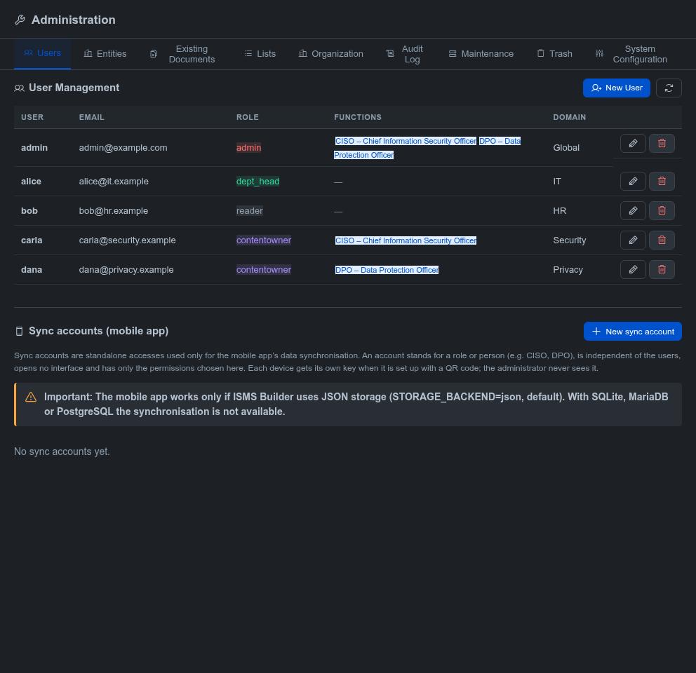
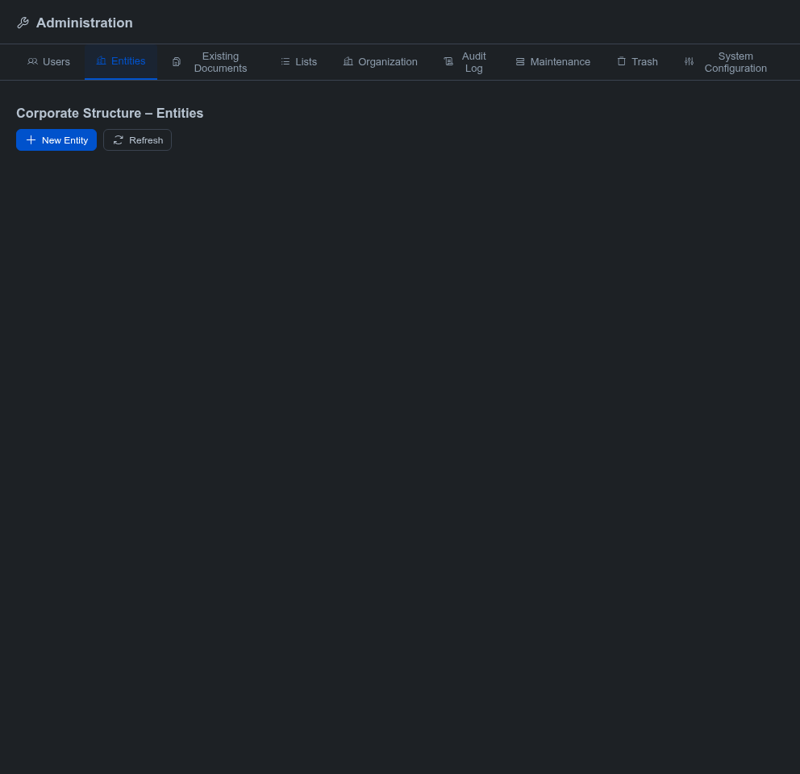
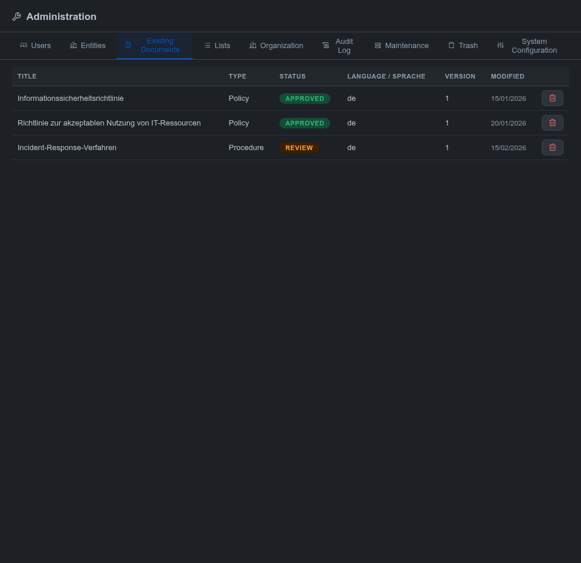
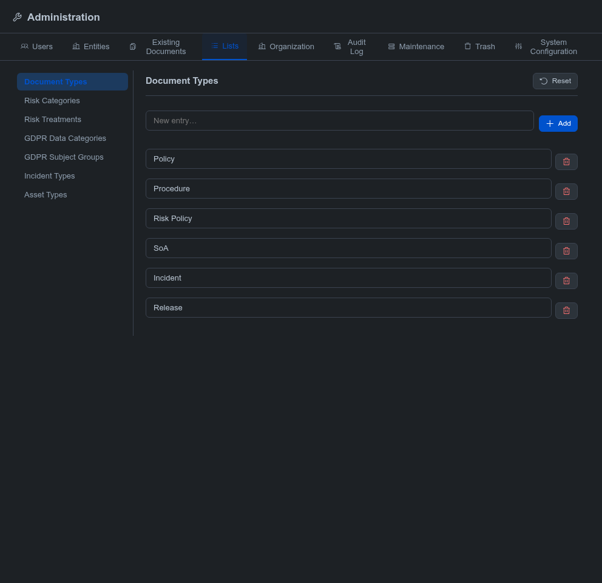
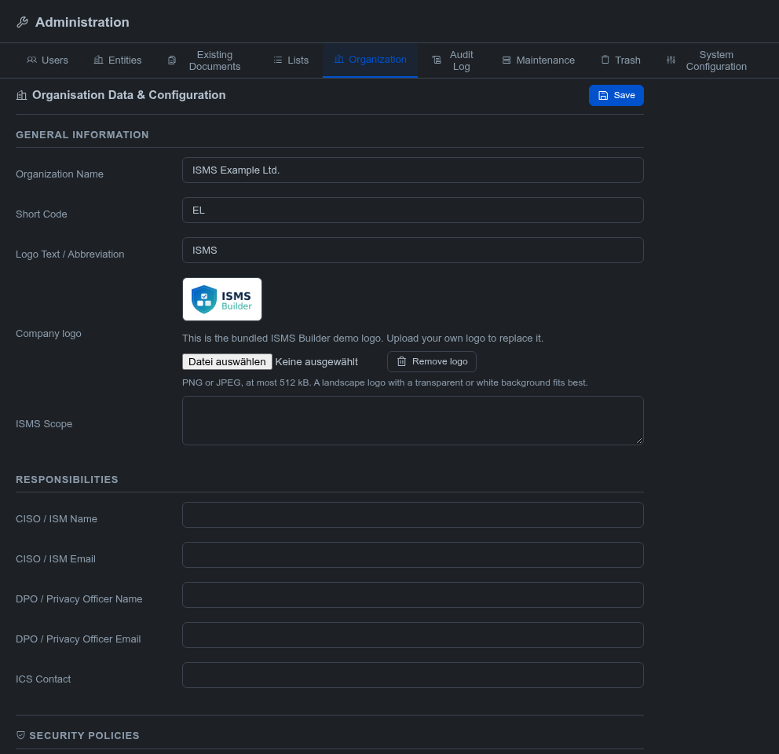
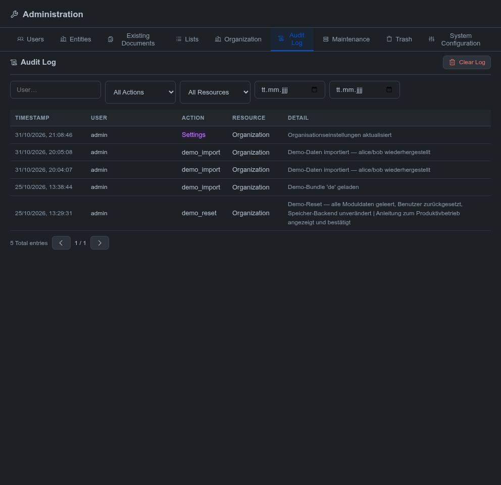
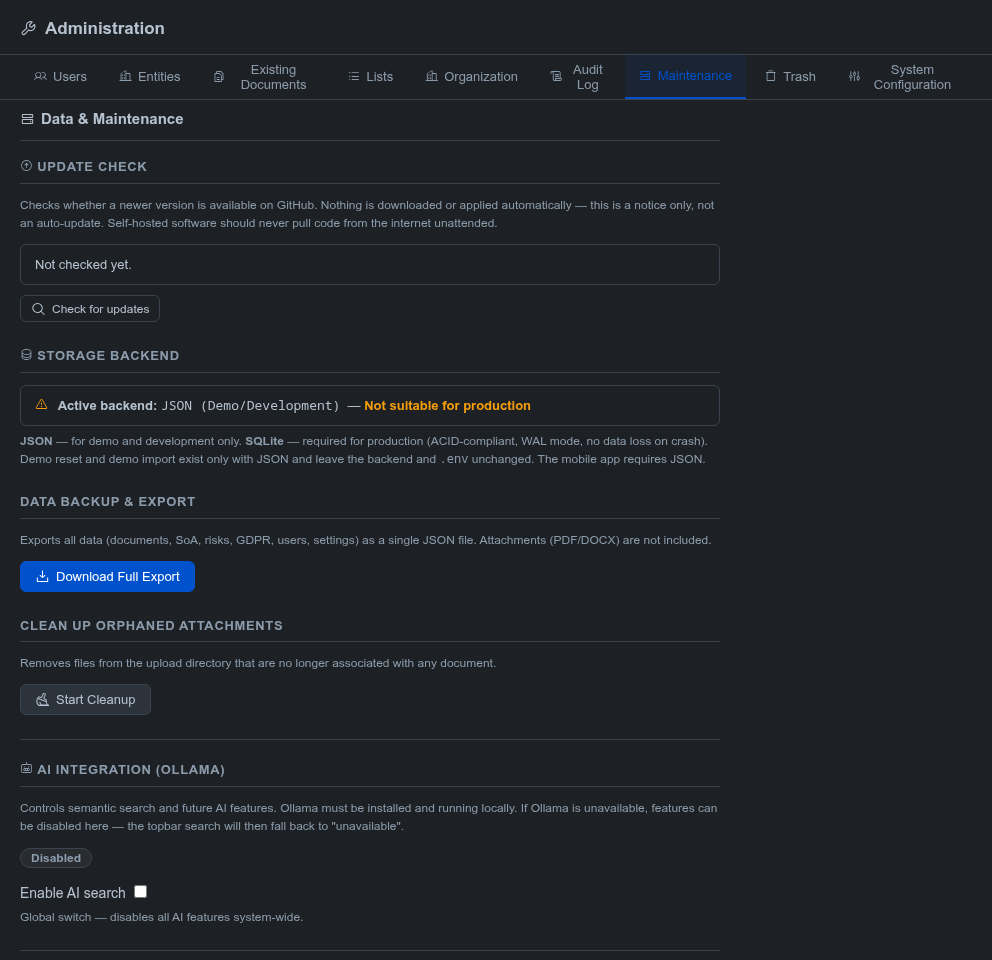
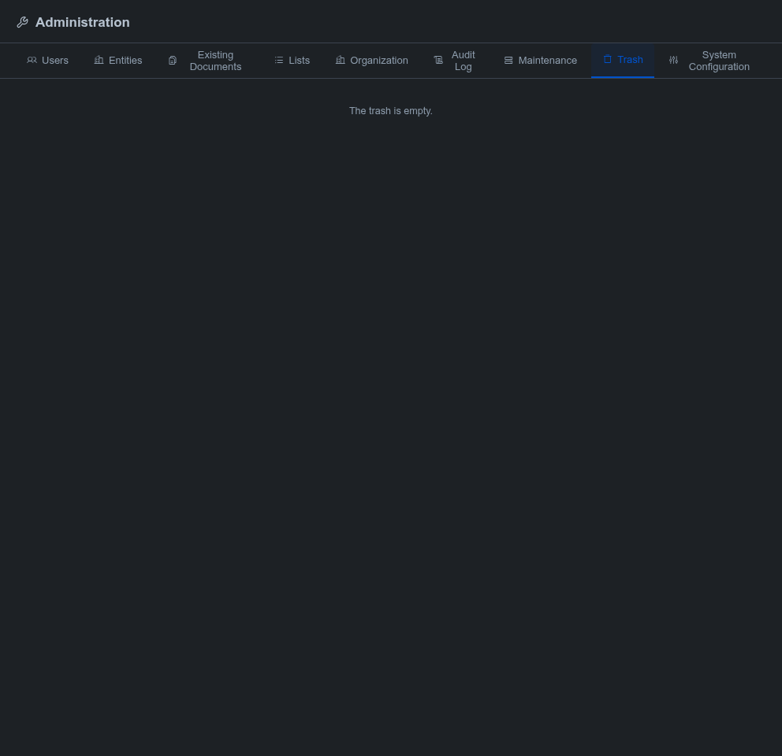
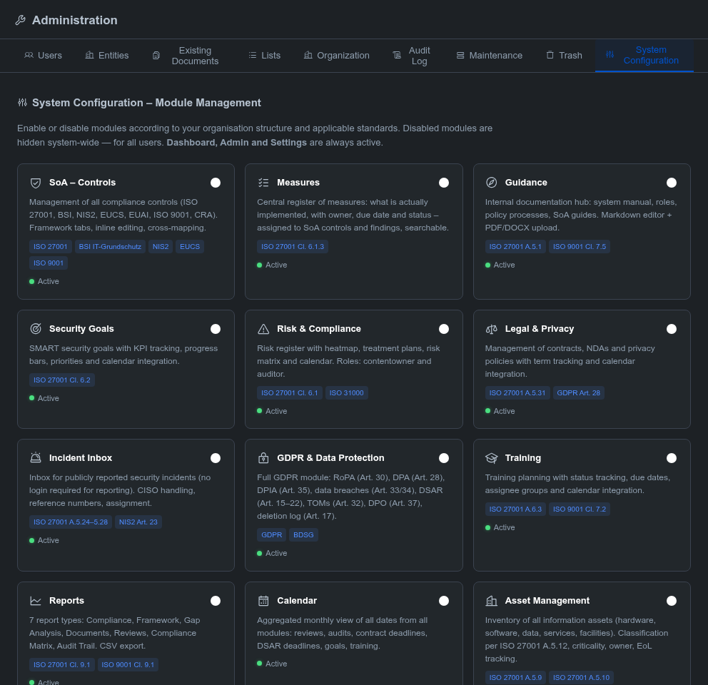

# Administration (Admin Console)

> Administration is the central place for users, roles, languages, services, data and maintenance. It is **visible only to users with the `admin` role**. This guide describes each of the nine tabs, the typical tasks and the pitfalls.

---

## Overview

Open **Admin** in the sidebar. The console has nine tabs:

| Tab | Purpose |
|---|---|
| **Users** | Accounts, roles, functions, passwords; sync accounts for the mobile app |
| **Entities** | Company structure (holding, subsidiaries) |
| **Existing Documents** | Overview of all documents with type, status, language, version |
| **Lists** | Selection lists (document types, risk categories, data categories …) |
| **Organization** | Name, logo, responsible persons, 2FA requirement, languages, e-mail, WebDAV, menu, organisational units |
| **Audit Log** | Log of all important actions |
| **Maintenance** | Update check, export, clean-up, AI switch, scan import, demo reset and demo import |
| **Trash** | Deleted entries of all modules, restore |
| **System Configuration** | Switch modules and compliance frameworks on and off |

**Ground rules**

- **Changes take effect immediately or after “Save”.** Each section has its own save button; unsaved input is lost when you switch tabs.
- **Much of it is recorded in the audit log** (creating users, changing roles, settings, demo reset/import). See “Audit Log”.
- **Secrets do not belong in a document or a chat.** SMTP passwords, keys and passwords are not shown again once saved (exception: see SMTP).
- Further guides under Guidance: **Login, sessions and production mode**, **Organisation & company logo**, **Mobile app & sync**, **AI drafts**.

---

## 1. Users

### Creating and editing users

**New User** opens the form:

| Field | Meaning |
|---|---|
| **Username** * | Unique, cannot be changed afterwards (read-only when editing) |
| **E-mail** * | Also used as login name and for notifications |
| **Role** * | Rights in the system (table below) |
| **Domain** | Area the user belongs to (e.g. IT, HR, Global); default “Global” |
| **Organisational functions** | Multiple selection, independent of the role |
| **Password / repeat** | At least 8 characters. Leave empty when editing to keep the password |

Only the administrator knows the password you assign: **the user must change it at first login.** A password you reset must also be changed at the next login (unless you change your own).

In **production mode**, known demo passwords are rejected. See the guide “Login, sessions and production mode”.

### Roles

| Role | Description |
|---|---|
| `reader` | Read access |
| `revision` | Internal audit, read-only |
| `editor` | Create and edit content |
| `dept_head` | Department head (editor with department-specific views) |
| `qmb` | Quality management officer |
| `contentowner` | CISO / ISB / DPO: approval, GDPR, risks |
| `auditor` | ICS/OT security, risk auditor |
| `admin` | System administrator, all rights |

Roles are ordered by rank; a higher role includes the rights of the lower ones. Details and the RACI matrix are in the system manual under “Roles & Responsibilities”.

### Functions

Functions are **independent of the role** and can be combined: **CISO**, **DPO**, **QMO**, **BCM Manager**, **Department Head**, **Internal Auditor** and **Admin Notification** (contracts, reviews). They control who receives which notifications and who may carry out specialist steps. Example: a DPIA is prepared by the CISO and the DPO enters the opinion; both can be separate people with the `contentowner` role.

### Deleting users

**Your own account cannot be deleted.** Other accounts are removed and noted in the audit log. When in doubt, block instead of delete (set the role to `reader`, assign a new password).

### Two-factor authentication

Each user sets up 2FA under **Settings**. You switch on the system-wide requirement in the **Organization** tab (see there). Only activate the requirement **once all accounts have set up 2FA**.

### Sync accounts (mobile app)

Sync accounts are **separate accesses used only for data synchronisation of the mobile app**. They are independent of users, open no interface and have only the rights chosen here.

1. **New sync account**: name (e.g. “Sales tablet”), per module **no access / read / read and write** (documents, SoA, risks, assets, findings; guidance read-only), optionally **Valid until** (empty = unlimited).
2. **Set up device (QR code)**: creates a setup code that is valid **only once and only briefly**. In the app choose “Set up device” and scan the QR code. Each device receives **its own key, which the administrator never sees**.
3. **Block device** takes effect immediately; other devices of the account remain usable. **Disable/Enable/Delete** apply to the whole account.
4. **Measures** have no right of their own: they are visible if at least one linked module is readable, and changeable only with write access to all linked modules.

**Prerequisite:** the app works only when ISMS Builder uses **JSON storage** (`STORAGE_BACKEND=json`, default). With SQLite, MariaDB or PostgreSQL synchronisation is not available. Details: guide “Mobile app & sync”.

---

## 2. Entities

Maintain the **company structure** here: **New entity** with **name**, **short name** and **type** (holding or subsidiary). **Refresh** reloads the list. Entities are assigned in other modules (e.g. affected entities in risks and audits).

---

## 3. Existing Documents

The tab shows **all existing documents** (policies, procedures etc.) as a table with **title, type, status, language, version** and **change date**. It serves as an overview and for checks (e.g. which language versions exist). Documents are edited in the document area; see “Documents: usage” in the system manual.

---

## 4. Lists

The selection lists that appear as dropdowns in the modules can be maintained:

**Document types, risk categories, risk treatment, GDPR data categories, GDPR data subject groups, incident types, asset types.**

- Choose a list, add an entry (**ID** and **label**) with **Add** or delete it with **Remove**; labels can be adjusted in the list (not verified which fields of existing entries are editable).
- **Reset** restores the delivered defaults.
- Before removing, check whether the value is still used in records (not verified how the interface shows existing records with removed values).

---

## 5. Organization

The tab collects the organisation's settings. For the company logo in detail: guide “Organisation & company logo”. Each section has its own save button.

### General information

**Organisation name**, **short name**, **logo text / abbreviation**, **company logo** (PNG or JPEG, at most 512 kB, saved immediately on upload; **Remove logo** restores the demo logo) and **ISMS scope**. Name and logo appear on the login page, in policy PDFs and print views.

### Responsibilities

**CISO/ISB** and **DPO/GDPO** (name and e-mail) and **ICS contact**. The e-mail addresses are the recipients of notifications and of the test mail. The actual rights are assigned through the user's role and function.

### Security policies: 2FA requirement

**Enforce two-factor authentication system-wide.** When active, users **without 2FA set up cannot log in**; the login is rejected with an explanation. **Warning:** only activate once **all** accounts have set up 2FA, otherwise you lock out the affected accounts immediately.

**Protection against lock-out:** The server only switches the requirement on if your own administrator account already has 2FA (otherwise a message is shown and nothing is changed); the interface shows the number of accounts without 2FA. If nobody can sign in anyway, only the command line helps (`node scripts/emergency-2fa.js disable-policy`) — see the guide “Sign-in, sessions and production use”, section “Emergency”.

### Language configuration

Here you choose **which languages are available in the system** (Deutsch, English, Français, Nederlands, Magyar, Eesti) and which **default language** the login page uses. The selection also applies to the language choice of **AI drafts** (“Create with AI”): exactly the languages selected here are offered, preselected with the interface language. If all are selected, all are offered.

### E-mail notifications and SMTP

- **Daily digest e-mail** to CISO, GDPO and admin e-mail; types can be switched individually: high/critical risks, BCM tests due, supplier audits due, DSAR deadlines, GDPR incidents open > 48 h, deletion log, expiring contracts, document reviews.
- **SMTP credentials:** environment variables in the `.env` (`SMTP_HOST` etc.) **always take precedence** and are safer. An **SMTP password entered here is stored in clear text in `org-settings.json`**; use it only if the `.env` is not an option.
- **Send test mail** goes to the CISO e-mail. Enter it first under “Responsibilities”.

### WebDAV publish (Nextcloud/ownCloud)

Approved policies are uploaded as PDF to a folder. **Enable automatic publish on approval**, **base URL**, **username**, **app password** (not the main account password; app passwords are individually revocable), **target folder**; **Test connection**. A failure of the remote system never prevents approval; the error becomes visible and can be repeated by re-sync in the document editor.

### Menu order

Adjust the sidebar order by dragging or ↑/↓; **Save order**, **Default** restores the default. Dashboard, Admin and Settings are always shown.

### Organisational units

Defines the IT organisation structure (e.g. CIO → GroupIT / GroupApp → Local IT) with **name, type, parent, lead, description**. It is used for assigning responsibilities in all modules (risks, assets, suppliers, BCM, goals, findings).

---

### PDF font

Under **Organization → PDF font** you decide in which font all PDFs and print views appear: document export, training confirmation, supplier form and the print windows of all modules. The font is embedded so that the special letters of **all 24 EU official languages** appear correctly (Latin, Greek, Cyrillic).

- **Bundled:** Liberation Sans (default, metrics like Arial/Helvetica), Noto Sans and DejaVu Sans, each with Regular, Bold and Italic and with its licence text (`server/fonts/`, see `THIRD-PARTY-LICENSES.md`).
- **Helvetica:** the standard PDF font, nothing is embedded (smallest files), but only Western European characters; everything else appears as ?.
- **Monospace font:** Code and references (e.g. `F-2026-001`) appear in **Nimbus Mono PS**, a Courier-like replacement from URW++ that covers Latin, Greek and Cyrillic (licence AGPL-3.0 with PDF font exception, `server/fonts/LICENSE-NimbusMonoPS.txt`). This applies to all embedded fonts; with "Helvetica" Courier is kept. With your own font you can optionally upload your own Mono file.
- **Own font:** upload TrueType or OpenType (up to 8 MB per file; "Regular" is required, "Bold" and "Italic" are optional, otherwise Regular is used). You confirm that your licence allows embedding in PDFs; fonts with an embedding restriction are rejected. The file is stored in the data directory (`pdf-fonts/`, mode 600), not in the program. "Remove own font" switches back to Liberation Sans.
- **Preview PDF:** shows the special letters of all EU languages in the chosen font — use it before switching to check that everything appears, especially with your own font.
- **Note:** The input fields in the fillable PDF form keep the standard PDF font; what suppliers type there is drawn by their PDF program. If the chosen font lacks a character, a placeholder appears.

---

## 6. Audit Log

The audit log records **time, user, action, resource and detail**, e.g. create/change/delete, logins, settings changes, demo reset and import.

- **Filters** by user, action (Created, Updated, Deleted, Login, Logout, Export, Settings) and resource; the total count and page number are shown at the bottom.
- The log keeps **at most the last 2000 entries**; older ones drop off as new ones are added.
- **Clear log** removes all entries (and records the clearing itself). Clear the log only if you do not need it as evidence; it is **not a tamper-proof record**.

---

## 7. Maintenance

### Update check

**Check for updates** asks GitHub whether a newer version exists. **Nothing is downloaded or applied automatically**; you only get a notice.

### Storage backend

Shows the active backend (JSON, SQLite, MariaDB, PostgreSQL). **JSON is the default and the current recommendation.** It is changed in the `.env` (`STORAGE_BACKEND`) with a restart. **Mobile app & sync** require JSON.

### Backup and export

**Download full export** creates a JSON file with all data (documents, SoA, risks, GDPR, users, settings). **Attachments (PDF/DOCX) are not included**; back those up and the data directory separately. Keep exports encrypted and separate; they contain user data.

### Back up and restore

The full export is a readable extract, **not a complete backup**: there is no import for it, and “Import demo data” is not a way to restore. The actual backup is the **data directory** (`DATA_DIR`, default `data/`) together with the `.env`; with MariaDB or PostgreSQL also the database.

**Back up** (stop the server briefly for a consistent state):

- **JSON and SQLite:** archive the data directory, e.g. `tar czf isms-data-$(date +%F).tar.gz data .env`. The SQLite database (`isms.db`) lives in the data directory and is included.
- **Docker:** on the host `tar czf ~/isms-data-$(date +%F).tar.gz ./data` (bind mount).
- **MariaDB/PostgreSQL:** back up the database with its own tools (e.g. `mariadb-dump`, `pg_dump`) and also the data directory (attachments, logo).

**Restore:**

1. Stop the server.
2. Rename the current data directory (do not delete it) so you can go back.
3. Put the saved data directory and, if needed, the `.env` back in place; with MariaDB/PostgreSQL load the database from the backup.
4. Start the server, sign in as administrator and spot-check (documents, users, attachments).

The backup contains user accounts, password hashes and 2FA secrets: keep it encrypted and separate. Restore a backup only into the same or a newer version, and rehearse the procedure on a test instance first.

### Clean up orphaned attachments

**Start clean-up** removes files from the upload directory that no longer belong to a document.

### AI integration (Ollama)

Global switch **Enable AI search**: controls semantic search and future AI functions. Ollama must run locally; if it is not reachable, search falls back to “not available”. The “Create with AI” function (prompt for external AI apps) sends nothing itself.

**API key (optional):** Sent as `Authorization: Bearer …` to the AI address — also for an Ollama on your own network, for example behind a reverse proxy or gateway. In the gateway’s log, every request from ISMS Builder can then be identified unambiguously (all requests also always send `User-Agent: ISMS-Builder/<version>`). The key is **never shown again, never logged and never exported**; an empty field keeps the stored key, **Remove key** deletes it. At most 512 visible ASCII characters are allowed. Alternatively the operator sets it as the environment variable `OLLAMA_API_KEY` (e.g. from a Docker secret); a key set in the interface takes precedence. With a key, **redirects are not followed**, and for an `http://` address to a foreign host the interface warns that the key would be sent unencrypted. Like the SMTP password, the key is stored in the server’s settings (not encrypted): protect access to the data directory. Address and models apply to all AI functions, including semantic search and the vector index.

### Greenbone scan import

Imports a Greenbone report (XML or PDF) as **risk drafts** (optionally with entity and scan reference). All imported risks have the status **needsReview** and must be reviewed by an auditor or CISO before they are active.

### Demo reset (switch to production)

First exports all demo data (automatic download), then deletes all module data and all users except `admin`, resets `admin` without 2FA to `adminpass` and ends your session. On click, **the production-mode guide opens first**; the switch starts only after you have read and confirmed it, and the action is noted in the audit log. **It cannot be undone** (except through demo import with the downloaded file). Details: guide “Login, sessions and production mode”. **Demo reset and demo import exist only with `STORAGE_BACKEND=json`** (otherwise error 409); the storage backend and the `.env` stay unchanged. With other backends use `scripts/prepare-production.js` or empty the database.

### Import demo data

Restores a previously exported demo data set. **All module data is overwritten.** `alice` and `bob` return with their original passwords, `admin` remains unchanged. Afterwards the system counts as a demo again (the demo passwords are valid again). **Do not use this on a production system.**

### Load a demo data set in a language

With “Load demo bundle” (also at the administrator's first login) a bundled demo data set is loaded in the chosen language (Deutsch, English, Français, Nederlands, Magyar, Eesti). Existing module data is replaced.

### Login splash screen

Shows a banner image for a few seconds after login. **Enable splash screen** and **Duration (seconds)**, then **Save**.

---

## 8. Trash

Deleted entries of **all modules** first land in the trash with **Deleted by**, **Deleted at** and **Expires**. **Entries are permanently deleted automatically after 30 days.** You can **restore** or **permanently delete** each entry (cannot be undone, with confirmation). Use the trash as a safety net against accidental deletion, not as an archive.

---

## 9. System Configuration (modules)

**Enable/disable modules** to match the organisation and the standards that apply: SoA, Measures, Guidance, Security goals, Risk & Compliance, Legal & Privacy, Incident Inbox, GDPR & Privacy, Training, Reports, Calendar, Asset Management, Governance, Business Continuity, Supply Chain, Audits. **Disabled modules are hidden for all users; the data is kept.** Dashboard, Admin and Settings are always active.

**Active compliance frameworks:** ISO 27001:2022, BSI IT-Grundschutz, EU NIS2, EU Cloud (EUCS), EU AI Act, ISO 9000, ISO 9001, EU Cyber Resilience Act. Disabled frameworks are hidden in SoA, dashboard and reports. **At least one framework must stay active.** Apply the selection with **Save & apply configuration**. The collective **Custom Controls** tab (individual own controls) is listed here too and can be switched off if your organisation does not use own controls — existing controls are kept.

**Own groups:** Own frameworks created in the SoA with **“＋ Own group”** (e.g. NEN 7510, TISAX or a customer requirement) appear below as cards showing their ID and number of controls. There you can switch them on and off (like the built-in frameworks; they also count towards “At least one framework must stay active”), **change name and colour** and — only once they contain no controls — **delete** them. The definitions are stored in `data/soa-frameworks.json`, are part of the full export and survive the demo reset. Creating and importing: see `template-type-soa.md` and the “SoA & Audit” guide.

---

## Typical tasks

**Add a new employee:** Users → New User → choose role and functions → communicate the initial password by a secure route → the user changes it at first login and sets up 2FA.

**Set up a mobile device:** Users → Sync accounts → create or choose an account → Set up device (QR code) → scan in the app. **Device lost:** Block device; it takes effect immediately.

**Define languages:** Organization → Language configuration → select the desired languages, set the default language, save language settings.

**Switch to production:** download full export → read the production-mode guide → demo reset → log in as `admin`, change password, set up 2FA → create your own users.

**Regularly:** check the audit log, look for updates, back up the full export and the data directory, block sync accounts and users that are no longer needed.

---

## Pitfalls

- **2FA requirement activated too early** → accounts without 2FA are locked out. Check first, then activate.
- **Demo import on a production system** → overwrites all data and makes the demo passwords valid again.
- **Demo reset without full export** → the file is downloaded automatically, but keep it safe before you continue.
- **SMTP password in the settings** is stored in clear text in `org-settings.json`; prefer `.env`.
- **Sync account with write rights on too many modules** → every connected device may change data there. Keep rights narrow and set an expiry date.
- **Modules or frameworks hidden** → records still exist but are invisible to everyone.
