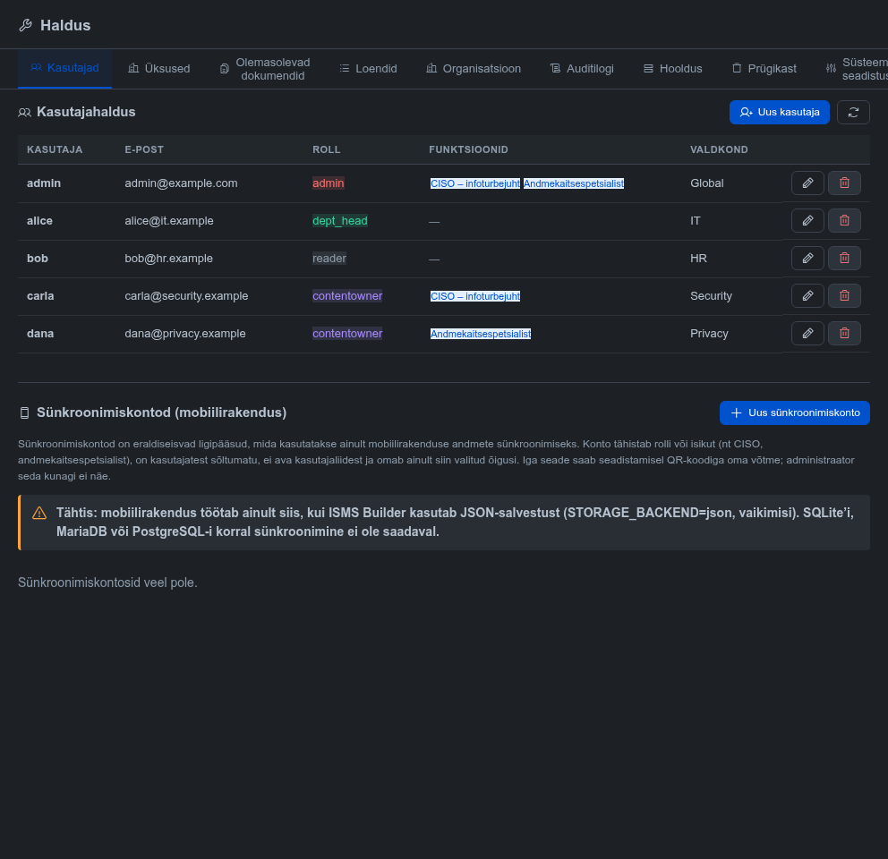
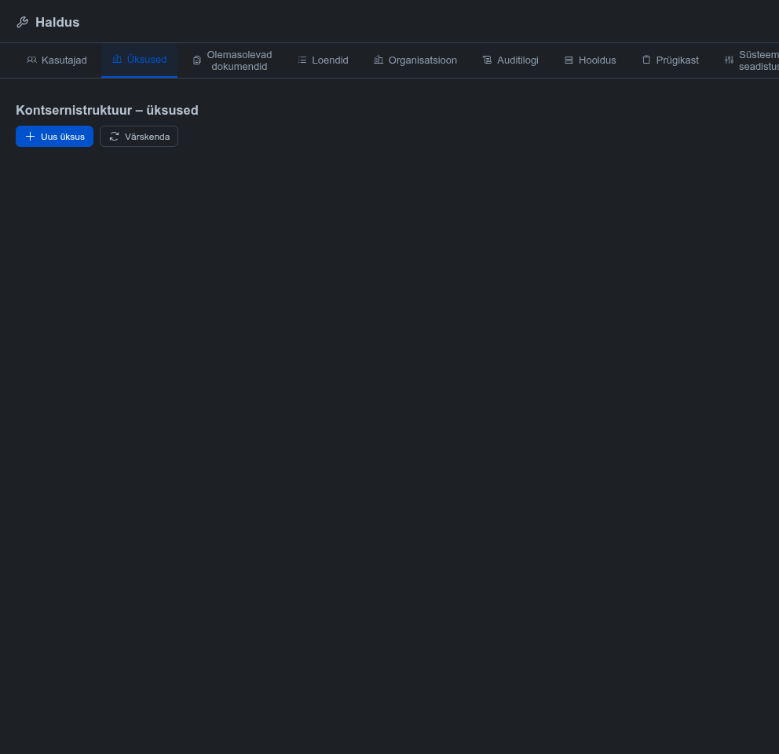
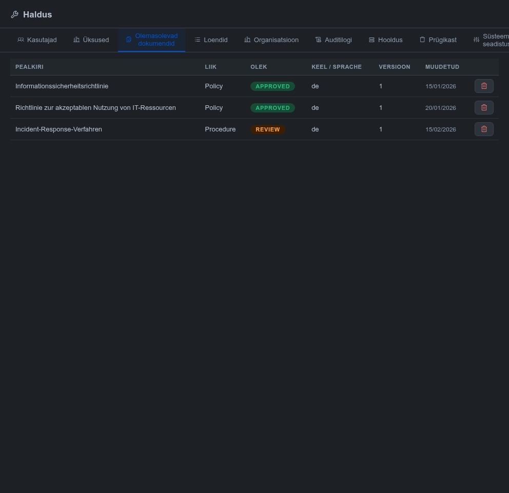
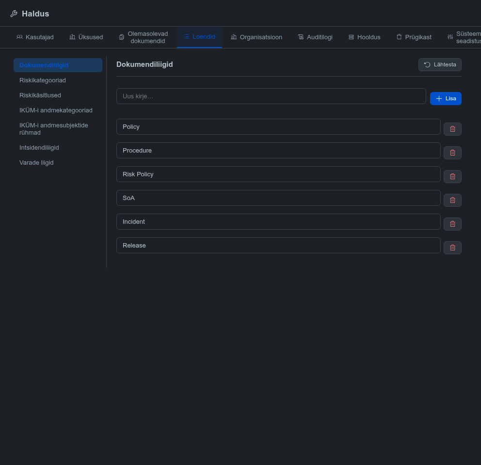
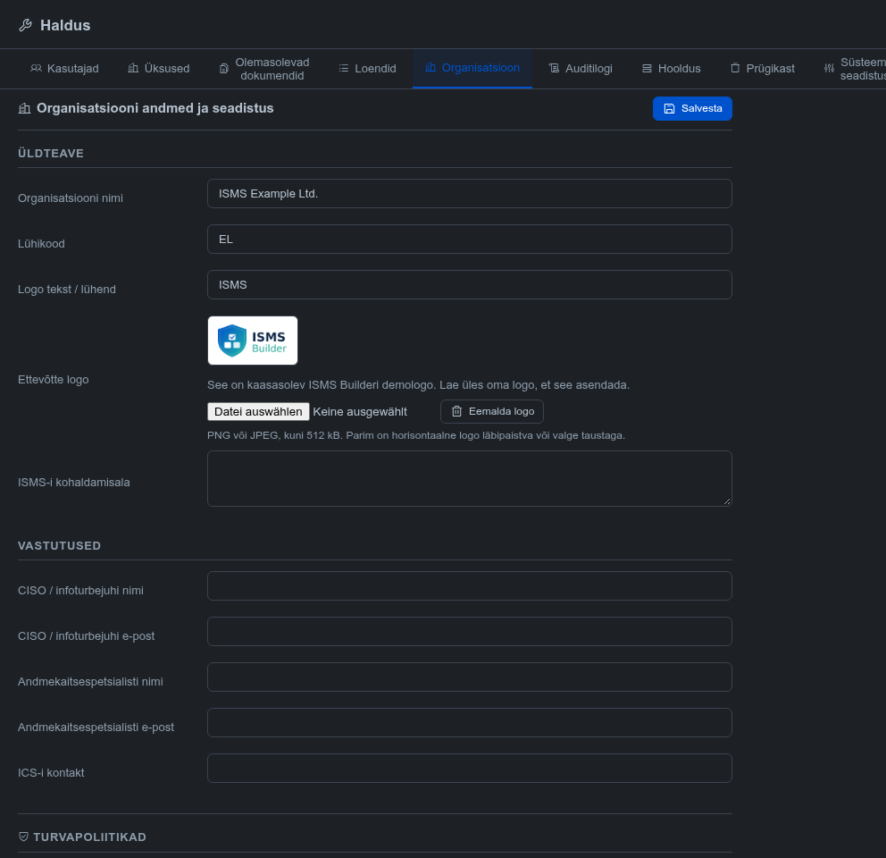
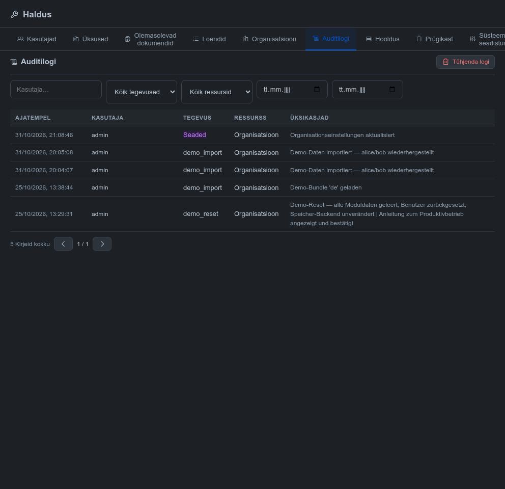
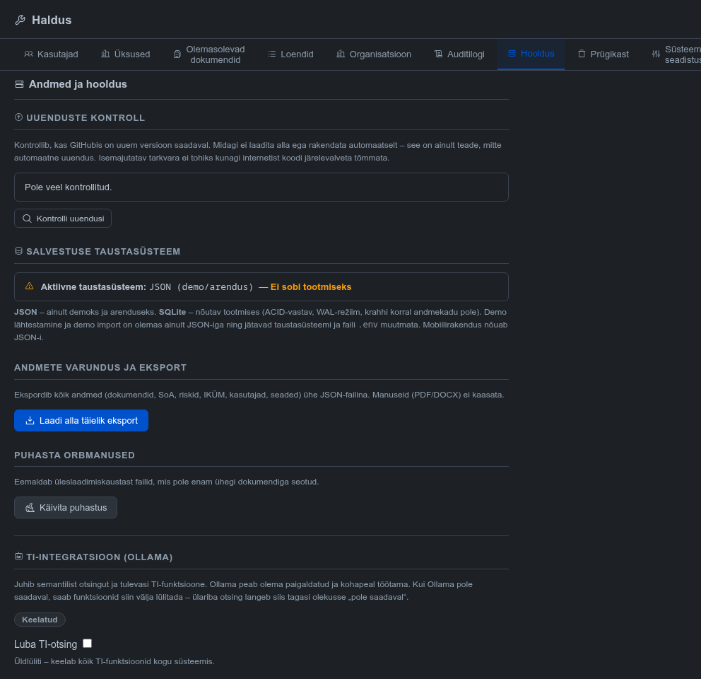
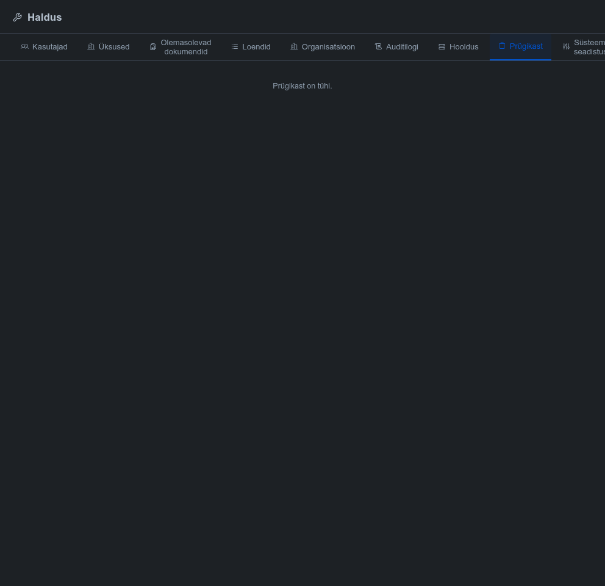
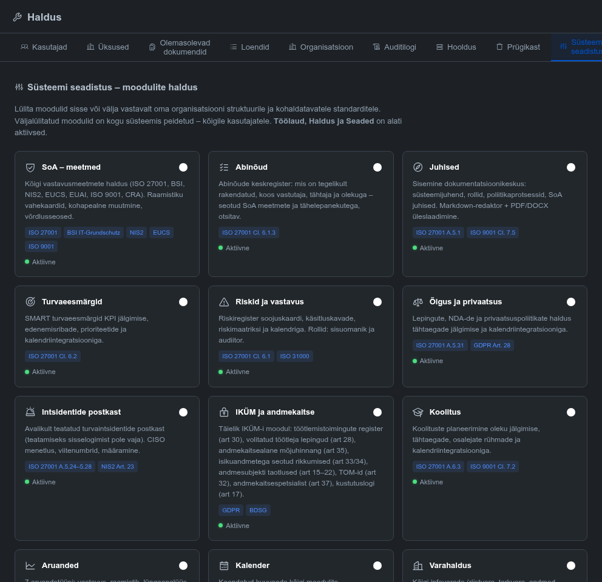

# Haldus (halduskonsool)

> Haldus on kasutajate, rollide, keelte, teenuste, andmete ja hoolduse keskne koht. See on **nähtav ainult rolliga `admin` kasutajatele**. See juhend kirjeldab kõiki üheksat vahekaarti, tüüpilisi ülesandeid ja lõkse.

---

## Ülevaade

Ava külgribal **Admin**. Konsoolil on üheksa vahekaarti:

| Vahekaart | Milleks |
|---|---|
| **Kasutajad** | Kontod, rollid, funktsioonid, paroolid; sünkroonimiskontod mobiilirakenduse jaoks |
| **Üksused** | Ettevõtte struktuur (holding, tütarettevõtted) |
| **Olemasolevad dokumendid** | Kõigi dokumentide ülevaade tüübi, oleku, keele ja versiooniga |
| **Loendid** | Valikuloendid (dokumenditüübid, riskikategooriad, andmekategooriad …) |
| **Organisatsioon** | Nimi, logo, vastutajad, 2FA kohustus, keeled, e-post, WebDAV, menüü, organisatsiooniüksused |
| **Auditilogi** | Kõigi oluliste toimingute logi |
| **Hooldus** | Uuenduste kontroll, eksport, koristus, TI-lüliti, skannimise import, demo lähtestamine ja demo import |
| **Prügikast** | Kõigi moodulite kustutatud kirjed, taastamine |
| **Süsteemi seadistus** | Moodulite ja vastavusraamistike sisse- ja väljalülitamine |

**Põhireeglid**

- **Muudatused jõustuvad kohe või pärast „Salvesta“.** Igal jaotisel on oma salvestusnupp; salvestamata sisestus läheb vahekaardi vahetamisel kaotsi.
- **Palju talletatakse auditilogisse** (kasutajate loomine, rollide muutmine, seaded, demo lähtestamine/import). Vt „Auditilogi“.
- **Saladused ei kuulu dokumenti ega vestlusesse.** SMTP-paroole, võtmeid ja paroole pärast salvestamist enam ei kuvata (erand: vt SMTP).
- Edasised juhendid jaotises Juhised: **Sisselogimine, seansid ja toodangurežiim**, **Organisatsioon ja ettevõtte logo**, **Mobiilirakendus ja sünkroonimine**, **TI-mustandid**.

---

## 1. Kasutajad

### Kasutajate loomine ja muutmine

**Uus kasutaja** avab vormi:

| Väli | Tähendus |
|---|---|
| **Kasutajanimi** * | Unikaalne, hiljem muutmatu (muutmisel kirjutuskaitstud) |
| **E-post** * | Toimib ka sisselogimisnimena ja teavituste jaoks |
| **Roll** * | Õigused süsteemis (tabel allpool) |
| **Domeen** | Valdkond, kuhu kasutaja kuulub (nt IT, HR, Global); vaikimisi „Global“ |
| **Organisatsioonilised funktsioonid** | Mitmikvalik, rollist sõltumatu |
| **Parool / kordus** | Vähemalt 8 märki. Muutmisel tühjaks jättes parool ei muutu |

Administraatori antud parooli teab ainult administraator: **kasutaja peab selle esimesel sisselogimisel muutma.** Sinu lähtestatud parool tuleb samuti järgmisel sisselogimisel muuta (v.a siis, kui muudad enda oma).

**Toodangurežiimis** lükatakse tuntud demoparoolid tagasi. Vt juhendit „Sisselogimine, seansid ja toodangurežiim“.

### Rollid

| Roll | Kirjeldus |
|---|---|
| `reader` | Lugemisõigus |
| `revision` | Siseaudit, ainult lugemine |
| `editor` | Sisu loomine ja muutmine |
| `dept_head` | Osakonnajuhataja (toimetaja osakonnapõhiste vaadetega) |
| `qmb` | Kvaliteedijuht |
| `contentowner` | CISO / ISB / DPO: kinnitamine, IKÜM, riskid |
| `auditor` | ICS/OT-turve, riskiaudiitor |
| `admin` | Süsteemiadministraator, kõik õigused |

Rollid on järjestatud astmeliselt; kõrgem roll hõlmab madalamate õigused. Üksikasjad ja RACI-maatriks on süsteemi käsiraamatus jaotises „Rollid ja vastutus“.

### Funktsioonid

Funktsioonid on **rollist sõltumatud** ja kombineeritavad: **CISO**, **DPO**, **QMO**, **BCM-juht**, **Osakonnajuhataja**, **Siseaudiitor** ja **Administraatori teavitus** (lepingud, ülevaatused). Need määravad, kes millised teavitused saab ja kes tohib teha erialaseid samme. Näide: DPIA valmistab ette CISO ja arvamuse kannab sisse DPO; nad võivad olla kaks eraldi inimest rolliga `contentowner`.

### Kasutajate kustutamine

**Oma kontot ei saa kustutada.** Teised kontod eemaldatakse ja märgitakse auditilogisse. Kahtluse korral pigem blokeeri kui kustuta (roll `reader`, uus parool).

### Kaheastmeline autentimine

Iga kasutaja seadistab 2FA ise jaotises **Seaded**. Süsteemiülese kohustuse lülitad sisse vahekaardil **Organisatsioon** (vt seal). Aktiveeri kohustus alles siis, **kui kõik kontod on 2FA seadistanud**.

### Sünkroonimiskontod (mobiilirakendus)

Sünkroonimiskontod on **eraldiseisvad juurdepääsud, mis on mõeldud ainult mobiilirakenduse andmete sünkroonimiseks**. Need on kasutajatest sõltumatud, ei ava kasutajaliidest ja neil on ainult siin valitud õigused.

1. **Uus sünkroonimiskonto**: nimi (nt „Müügitahvelarvuti“), mooduli kohta **juurdepääs puudub / lugemine / lugemine ja kirjutamine** (dokumendid, SoA, riskid, varad, tähelepanekud; juhised ainult lugemiseks), soovi korral **Kehtib kuni** (tühi = piiramatu).
2. **Seadme seadistamine (QR-kood)**: loob seadistuskoodi, mis kehtib **ainult üks kord ja ainult lühikest aega**. Vali rakenduses „Seadista seade“ ja skanni QR-kood. Iga seade saab **oma võtme, mida administraator kunagi ei näe**.
3. **Seadme blokeerimine** jõustub kohe; konto teised seadmed jäävad kasutatavaks. **Blokeeri/Luba/Kustuta** kehtivad kogu kontole.
4. **Abinõudel** pole oma õigust: need on nähtavad, kui vähemalt üks seotud moodul on loetav, ja muudetavad ainult siis, kui kõigis seotud moodulites on kirjutusõigus.

**Eeldus:** rakendus töötab ainult siis, kui ISMS Builder kasutab **JSON-salvestust** (`STORAGE_BACKEND=json`, vaikimisi). SQLite’i, MariaDB või PostgreSQL-i korral sünkroonimine pole saadaval. Üksikasjad: juhend „Mobiilirakendus ja sünkroonimine“.

---

## 2. Üksused

Siin hooldad **ettevõtte struktuuri**: **Uus üksus** koos **nime**, **lühinime** ja **tüübiga** (holding või tütarettevõte). **Värskenda** laadib loendi uuesti. Üksused määratakse teistes moodulites (nt mõjutatud üksused riskide ja auditite juures).

---

## 3. Olemasolevad dokumendid

Vahekaart näitab **kõiki olemasolevaid dokumente** (poliitikad, protseduurid jm) tabelina, kus on **pealkiri, tüüp, olek, keel, versioon** ja **muutmise kuupäev**. See on mõeldud ülevaateks ja kontrolliks (nt millised keeleversioonid on olemas). Dokumente muudetakse dokumentide alal; vt „Dokumendid: kasutamine“ süsteemi käsiraamatus.

---

## 4. Loendid

Valikuloendeid, mis moodulites rippmenüüna ilmuvad, saab hooldada:

**Dokumenditüübid, riskikategooriad, riskikäsitlus, IKÜM-i andmekategooriad, IKÜM-i andmesubjektide rühmad, intsidenditüübid, varatüübid.**

- Vali loend, lisa kirje (**ID** ja **silt**) nupuga **Lisa** või kustuta see nupuga **Eemalda**; silte saab loendis kohandada (ei ole kontrollitud, milliseid olemasolevate kirjete välju saab muuta).
- **Lähtesta** taastab kaasasolevad vaikeväärtused.
- Enne eemaldamist kontrolli, kas väärtust kasutatakse veel andmekirjetes (ei ole kontrollitud, kuidas kasutajaliides kuvab eemaldatud väärtusega kirjeid).

---

## 5. Organisatsioon

Vahekaart koondab organisatsiooni seaded. Ettevõtte logo kohta üksikasjalikult: juhend „Organisatsioon ja ettevõtte logo“. Igal jaotisel on oma salvestusnupp.

### Üldinfo

**Organisatsiooni nimi**, **lühinimi**, **logo tekst / lühend**, **ettevõtte logo** (PNG või JPEG, kuni 512 kB, salvestub üleslaadimisel kohe; **Eemalda logo** taastab demologo) ja **ISMS-i ulatus**. Nimi ja logo ilmuvad sisselogimislehel, poliitikate PDF-idel ja prindivaadetes.

### Vastutus

**CISO/ISB** ja **DPO/GDPO** (nimi ja e-post) ning **ICS-kontakt**. E-posti aadressid on teavituste ja testkirja saajad. Tegelikud õigused annad kasutaja rolli ja funktsiooni kaudu.

### Turvapoliitikad: 2FA kohustus

**Kaheastmelise autentimise nõudmine süsteemiüleselt.** Kui kohustus on aktiivne, **ei saa seadistamata 2FA-ga kasutajad sisse logida**; sisselogimine lükatakse selgitusega tagasi. **Hoiatus:** aktiveeri alles siis, kui **kõik** kontod on 2FA seadistanud, vastasel juhul lukustad mõjutatud kontod kohe välja.

**Kaitse lukustuse vastu:** Server lülitab kohustuse sisse ainult siis, kui teie enda administraatorikontol on juba 2FA (muidu kuvatakse teade ja midagi ei muudeta); liides näitab ilma 2FA-ta kontode arvu. Kui keegi ikkagi sisse ei saa, aitab ainult käsurida (`node scripts/emergency-2fa.js disable-policy`) — vt juhend „sisselogimine, seansid ja tootmiskasutus“, jaotis „Hädaabi“.

### Keelte seadistus

Siin valid, **millised keeled on süsteemis saadaval** (Deutsch, English, Français, Nederlands, Magyar, Eesti) ja millist **vaikekeelt** sisselogimisleht kasutab. Valik kehtib ka **TI-mustandite** („Koosta TI-ga mustand“) keelevalikule: pakutakse täpselt siin valitud keeli, eelvalitud on kasutajaliidese keel. Kui kõik on valitud, pakutakse kõiki.

### E-posti teavitused ja SMTP

- **Igapäevane kokkuvõtte e-kiri** CISO-le, GDPO-le ja administraatori e-postile; tüübid on eraldi lülitatavad: kõrged/kriitilised riskid, BCM-testid tähtajal, tarnijaauditid tähtajal, DSAR-tähtajad, üle 48 h avatud IKÜM-i intsidendid, kustutamislogi, lõppevad lepingud, dokumentide ülevaatused.
- **SMTP andmed:** `.env` keskkonnamuutujad (`SMTP_HOST` jne) **on alati ülimuslikud** ja turvalisemad. **Siia sisestatud SMTP parool salvestatakse failis `org-settings.json` lihttekstina**; kasuta seda ainult siis, kui `.env` pole võimalik.
- **Saada testkiri** läheb CISO e-posti aadressile. Sisesta see enne jaotises „Vastutus“.

### WebDAV-avaldamine (Nextcloud/ownCloud)

Kinnitatud poliitikad laaditakse PDF-ina kausta üles. **Luba automaatne avaldamine kinnitamisel**, **baas-URL**, **kasutajanimi**, **rakenduse parool** (mitte põhikonto parool; rakenduse paroole saab eraldi tühistada), **sihtkaust**; **Testi ühendust**. Kaugsüsteemi rike ei takista kunagi kinnitamist; viga muutub nähtavaks ja seda saab dokumendiredaktoris uuesti sünkroonides korrata.

### Menüü järjekord

Kohanda külgriba järjekorda lohistades või nuppudega ↑/↓; **Salvesta järjekord**, **Vaikimisi** taastab vaikeseisu. Töölaud, Admin ja Seaded kuvatakse alati.

### Organisatsiooniüksused

Määratleb IT-organisatsiooni struktuuri (nt CIO → GroupIT / GroupApp → Local IT) koos **nime, tüübi, ülemüksuse, juhi ja kirjeldusega**. Seda kasutatakse vastutuse määramiseks kõigis moodulites (riskid, varad, tarnijad, BCM, eesmärgid, tähelepanekud).

---

### PDF-kirjatüüp

Menüüs **Organisatsioon → PDF-kirjatüüp** määrate, millise kirjatüübiga kuvatakse kõik PDF-id ja prindivaated: dokumendi eksport, koolituse kinnitus, tarnija vorm ja kõigi moodulite prindiaknad. Kirjatüüp manustatakse, et **kõigi 24 ELi ametliku keele** erimärgid kuvataks õigesti (ladina, kreeka, kirillitsa).

- **Kaasas:** Liberation Sans (vaikimisi, Arial/Helvetica mõõtudega), Noto Sans ja DejaVu Sans, igaüks Regular, Bold ja Italic variandiga ning litsentsiteksiga (`server/fonts/`, vt `THIRD-PARTY-LICENSES.md`).
- **Helvetica:** PDF-i vaikekirjatüüp, midagi ei manustata (väikseimad failid), kuid ainult Lääne-Euroopa märgid; kõik muu kuvatakse kui ?.
- **Püsilaiusega kirjatüüp:** kood ja viited (nt `F-2026-001`) kuvatakse kirjatüübiga **Nimbus Mono PS** — URW++ Couriersarnane asendaja, mis katab ladina, kreeka ja kirillitsa (litsents AGPL-3.0 PDF-kirjatüübi erandiga, `server/fonts/LICENSE-NimbusMonoPS.txt`). See kehtib kõigile manustatud kirjatüüpidele; „Helvetica“ korral jääb Courier. Oma kirjatüübi puhul saate soovi korral üles laadida oma Mono faili.
- **Oma kirjatüüp:** laadige üles TrueType või OpenType (kuni 8 MB faili kohta; „Regular“ on kohustuslik, „Bold“ ja „Italic“ valikulised, muidu kasutatakse Regularit). Kinnitate, et teie litsents lubab PDF-i manustamist; manustamispiiranguga kirjatüübid lükatakse tagasi. Fail asub andmekataloogis (`pdf-fonts/`, õigused 600), mitte programmis. „Eemalda oma kirjatüüp“ taastab Liberation Sansi.
- **Eelvaate-PDF:** näitab kõigi ELi keelte erimärke valitud kirjatüübiga — kontrollige selle abil enne vahetamist, kas kõik kuvatakse, eriti oma kirjatüübi puhul.
- **Märkus:** täidetava PDF-vormi sisestusväljad säilitavad PDF-vormingu vaikekirjatüübi; mida tarnijad sinna kirjutavad, joonistab nende PDF-programm. Kui valitud kirjatüübil puudub märk, kuvatakse kohatäide.

---

## 6. Auditilogi

Auditilogi talletab **aja, kasutaja, toimingu, ressursi ja üksikasja**, nt loomine/muutmine/kustutamine, sisselogimised, seadete muutused, demo lähtestamine ja import.

- **Filtrid** kasutaja, toimingu (Loodud, Uuendatud, Kustutatud, Login, Logout, Eksport, Seaded) ja ressursi järgi; all on näha koguarv ja lehekülje number.
- Logi hoiab **kuni viimast 2000 kirjet**; vanemad kukuvad uute lisandudes välja.
- **Tühjenda logi** eemaldab kõik kirjed (ja talletab tühjendamise enda). Tühjenda logi ainult siis, kui sul pole seda tõendina vaja; see **ei ole võltsimiskindel tõend**.

---

## 7. Hooldus

### Uuenduste kontroll

**Otsi uuendusi** küsib GitHubist, kas on uuem versioon. **Midagi ei laadita alla ega rakendata automaatselt**; saad ainult teate.

### Salvestuse taustasüsteem

Näitab aktiivset taustasüsteemi (JSON, SQLite, MariaDB, PostgreSQL). **JSON on vaikeseade ja praegune soovitus.** Vahetatakse failis `.env` (`STORAGE_BACKEND`) koos taaskäivitusega. **Mobiilirakendus ja sünkroonimine** nõuavad JSON-i.

### Varundus ja eksport

**Laadi alla täielik eksport** loob JSON-faili kõigi andmetega (dokumendid, SoA, riskid, IKÜM, kasutajad, seaded). **Manuseid (PDF/DOCX) ei kaasata**; varunda need ja andmekataloog eraldi. Hoia eksporte krüpteeritult ja eraldi; need sisaldavad kasutajaandmeid.

### Varundamine ja taastamine

Täielik eksport on loetav väljavõte, **mitte täielik varukoopia**: selle jaoks pole importi ja „Demoandmete import“ ei ole taastamise viis. Tegelik varukoopia on **andmekataloog** (`DATA_DIR`, vaikimisi `data/`) koos failiga `.env`; MariaDB või PostgreSQL puhul lisaks andmebaas.

**Varundamine** (ühtse seisu jaoks peata server lühidalt):

- **JSON ja SQLite:** arhiveeri andmekataloog, nt `tar czf isms-data-$(date +%F).tar.gz data .env`. SQLite andmebaas (`isms.db`) asub andmekataloogis ja on seega kaasas.
- **Docker:** hostis `tar czf ~/isms-data-$(date +%F).tar.gz ./data` (bind mount).
- **MariaDB/PostgreSQL:** varunda andmebaas selle enda tööriistadega (nt `mariadb-dump`, `pg_dump`) ja lisaks andmekataloog (manused, logo).

**Taastamine:**

1. Peata server.
2. Nimeta praegune andmekataloog ümber (ära kustuta), et saaksid tagasi minna.
3. Taasta varundatud andmekataloog ja vajadusel `.env`; MariaDB/PostgreSQL puhul laadi andmebaas varukoopiast.
4. Käivita server, logi sisse administraatorina ja kontrolli pistelist (dokumendid, kasutajad, manused).

Varukoopia sisaldab kasutajakontosid, paroolide räsisid ja 2FA saladusi: hoia seda krüpteeritult ja eraldi. Taasta varukoopia ainult samasse või uuemasse versiooni ja harjuta toimingut enne testeksemplaril.

### Orbmanuste koristus

**Alusta koristust** eemaldab üleslaadimiskataloogist failid, mis ei kuulu enam ühelegi dokumendile.

### TI-integratsioon (Ollama)

Üldlüliti **Luba TI-otsing**: juhib semantilist otsingut ja tulevasi TI-funktsioone. Ollama peab töötama kohalikult; kui see pole kättesaadav, langeb otsing tagasi olekule „pole saadaval“. Funktsioon „Koosta TI-ga mustand“ (päring välistele TI-rakendustele) ise midagi ei saada.

**API-võti (valikuline):** Saadetakse TI aadressile kujul `Authorization: Bearer …` — ka oma võrgus töötava Ollama puhul, näiteks pöördproksi või lüüsi taga. Lüüsi logis on siis kõik ISMS Builderi päringud üheselt tuvastatavad (lisaks saadavad kõik päringud alati `User-Agent: ISMS-Builder/<versioon>`). Võtit **ei kuvata enam kunagi, seda ei logita ega eksporditud**; tühi väli jätab salvestatud võtme muutmata, **Eemalda võti** kustutab selle. Lubatud on kuni 512 nähtavat ASCII-märki. Teise võimalusena määrab haldaja selle keskkonnamuutujana `OLLAMA_API_KEY` (nt Dockeri saladusest); liideses määratud võti on eelistatud. Võtmega **ümbersuunamisi ei järgita** ja võõrale hostile osutava `http://` aadressi korral hoiatab liides, et võti edastataks krüpteerimata. Nagu SMTP parool, hoitakse võtit serveri seadetes (krüpteerimata): kaitske andmekataloogile juurdepääsu. Aadress ja mudelid kehtivad kõigile TI-funktsioonidele, ka semantilisele otsingule ja vektorindeksile.

### Greenbone’i skannimise import

Impordib Greenbone’i aruande (XML või PDF) **riskimustanditena** (soovi korral koos üksuse ja skannimise viitega). Kõigil imporditud riskidel on olek **needsReview** ja audiitor või CISO peab need üle vaatama, enne kui need aktiivseks muutuvad.

### Demo lähtestamine (üleminek toodangusse)

Ekspordib kõigepealt kõik demoandmed (automaatne allalaadimine), kustutab seejärel kõigi moodulite andmed ja kõik kasutajad peale `admin`, seab `admin`-i ilma 2FA-ta tagasi väärtusele `adminpass` ja lõpetab sinu seansi. Klõpsamisel avaneb **esmalt toodangurežiimi juhend**; üleminek algab alles pärast seda, kui oled selle läbi lugenud ja kinnitanud, ning toiming märgitakse auditilogisse. **Pöördumatu** (välja arvatud demo impordiga allalaaditud failist). Üksikasjad: juhend „Sisselogimine, seansid ja toodangurežiim“. **Demo lähtestamine ja demo import on olemas ainult väärtusega `STORAGE_BACKEND=json`** (muidu viga 409); salvestuse taustasüsteem ja `.env` jäävad muutmata. Muude taustasüsteemide korral kasuta `scripts/prepare-production.js` või tühjenda andmebaas.

### Demoandmete importimine

Taastab varem eksporditud demoandmekogu. **Kõik moodulite andmed kirjutatakse üle.** `alice` ja `bob` naasevad algsete paroolidega, `admin` jääb muutmata. Seejärel loetakse süsteem taas demoks (demoparoolid kehtivad uuesti). **Ära kasuta seda toodangusüsteemis.**

### Demoandmekogu laadimine keeles

Funktsiooniga „Laadi demopakett“ (ka administraatori esimesel sisselogimisel) laaditakse kaasasolev demoandmekogu valitud keeles (Deutsch, English, Français, Nederlands, Magyar, Eesti). Olemasolevad moodulite andmed asendatakse.

### Sisselogimise tervituskuva

Näitab pärast sisselogimist mõne sekundi bännerpilti. **Luba tervituskuva** ja **Kestus (sekundites)**, seejärel **Salvesta**.

---

## 8. Prügikast

**Kõigi moodulite** kustutatud kirjed satuvad esmalt prügikasti andmetega **Kustutaja**, **Kustutatud** ja **Aegub**. **Kirjed kustutatakse 30 päeva pärast automaatselt lõplikult.** Iga kirje saab **taastada** või **lõplikult kustutada** (pöördumatu, kinnitusega). Kasuta prügikasti turvavõrguna juhusliku kustutamise vastu, mitte arhiivina.

---

## 9. Süsteemi seadistus (moodulid)

**Moodulite sisse-/väljalülitamine** vastavalt organisatsioonile ja kohaldatavatele standarditele: SoA, Abinõud, Juhised, Turvaeesmärgid, Risk & Compliance, Legal & Privacy, Incident Inbox, IKÜM ja andmekaitse, Koolitus, Aruanded, Kalender, Varahaldus, Juhtimine, Talitluspidevus, Tarneahel, Auditid. **Väljalülitatud moodulid on kõigile kasutajatele peidetud; andmed säilivad.** Töölaud, Admin ja Seaded on alati aktiivsed.

**Aktiivsed vastavusraamistikud:** ISO 27001:2022, BSI IT-Grundschutz, EU NIS2, EU Cloud (EUCS), EU AI Act, ISO 9000, ISO 9001, EU Cyber Resilience Act. Väljalülitatud raamistikud on SoA-s, töölaual ja aruannetes peidetud. **Vähemalt üks raamistik peab jääma aktiivseks.** Rakenda valik nupuga **Salvesta ja rakenda seadistus**. Ka kogumisvahekaart **Custom Controls** (üksikud oma meetmed) on selles loendis ja selle saab välja lülitada, kui organisatsioon oma meetmeid ei kasuta — olemasolevad meetmed jäävad alles.

**Oma rühmad:** SoA-s nupuga **„＋ Oma rühm“** loodud oma raamistikud (nt NEN 7510, TISAX või kliendinõue) kuvatakse selle all kaartidena koos tunnuse ja meetmete arvuga. Seal saab neid sisse ja välja lülitada (nagu sisseehitatud raamistikke; nende suhtes kehtib ka reegel „Vähemalt üks raamistik peab jääma aktiivseks“), **muuta nime ja värvi** ning — ainult siis, kui neis pole enam meetmeid — **kustutada**. Definitsioonid asuvad failis `data/soa-frameworks.json`, kuuluvad täieliku ekspordi hulka ja jäävad demo lähtestamisel alles. Loomine ja import: vt `template-type-soa.md` ja juhend „SoA & Audit“.

---

## Tüüpilised ülesanded

**Uue töötaja lisamine:** Kasutajad → Uus kasutaja → vali roll ja funktsioonid → edasta algparool turvalist teed pidi → kasutaja muudab selle esimesel sisselogimisel ja seadistab 2FA.

**Mobiilseadme seadistamine:** Kasutajad → Sünkroonimiskontod → loo või vali konto → Seadista seade (QR-kood) → skanni rakenduses. **Seade kadunud:** Blokeeri seade; see jõustub kohe.

**Keelte määramine:** Organisatsioon → Keelte seadistus → vali soovitud keeled, määra vaikekeel, salvesta keeleseaded.

**Üleminek toodangusse:** laadi alla täielik eksport → loe toodangurežiimi juhend → demo lähtestamine → logi sisse `admin`-ina, muuda parool, seadista 2FA → loo oma kasutajad.

**Regulaarselt:** vaata auditilogi, otsi uuendusi, varunda täielik eksport ja andmekataloog, blokeeri mittevajalikud sünkroonimiskontod ja kasutajad.

---

## Lõksud

- **2FA kohustus aktiveeritud liiga vara** → ilma 2FA-ta kontod on välja lukustatud. Kontrolli enne, aktiveeri siis.
- **Demo import toodangusüsteemis** → kirjutab kõik andmed üle ja muudab demoparoolid uuesti kehtivaks.
- **Demo lähtestamine ilma täieliku ekspordita** → fail laaditakse automaatselt alla, kuid hoia see enne jätkamist alles.
- **SMTP parool seadetes** on failis `org-settings.json` lihttekstina; eelista `.env`-i.
- **Sünkroonimiskonto liiga paljude moodulite kirjutusõigusega** → iga ühendatud seade võib seal andmeid muuta. Hoia õigused kitsad ja määra aegumiskuupäev.
- **Peidetud moodulid või raamistikud** → kirjed on alles, kuid kõigile nähtamatud.
