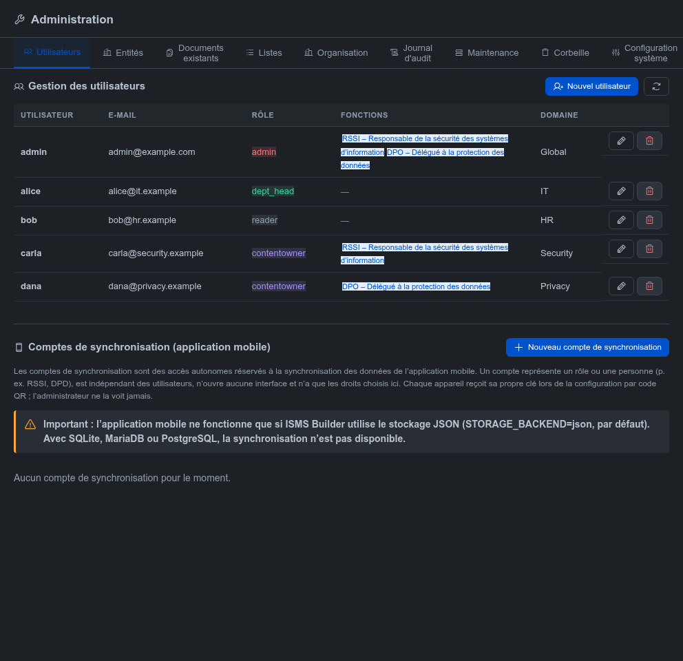
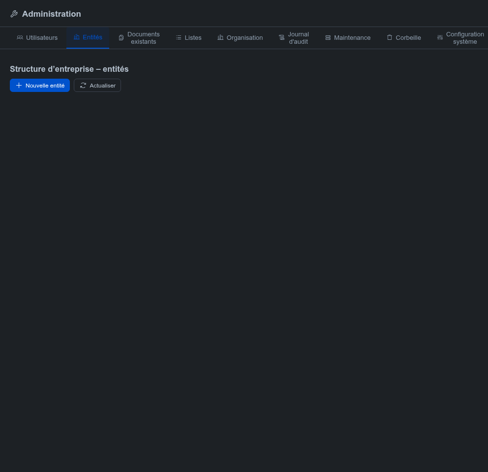
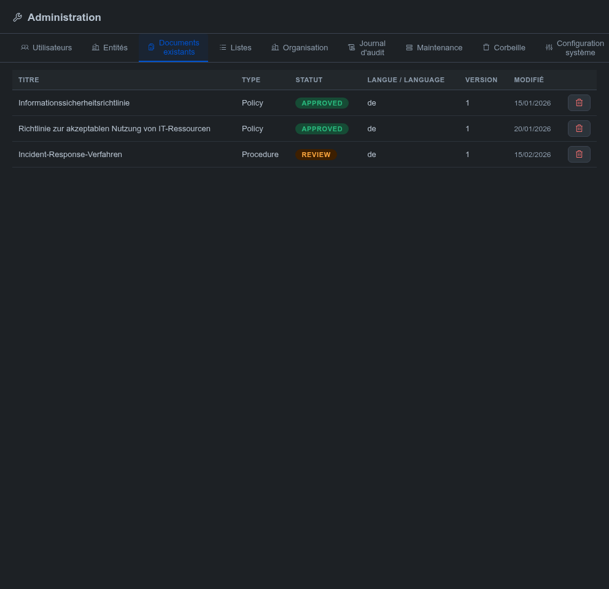
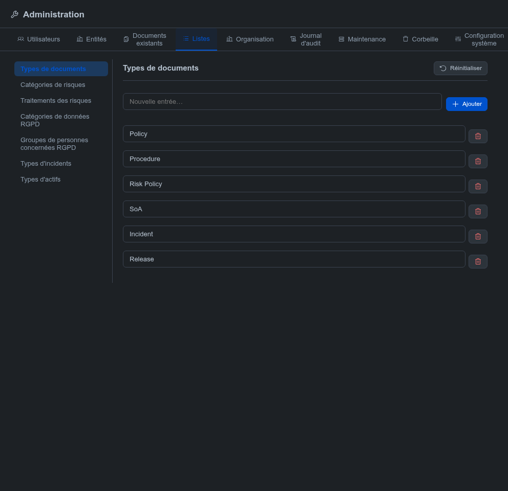
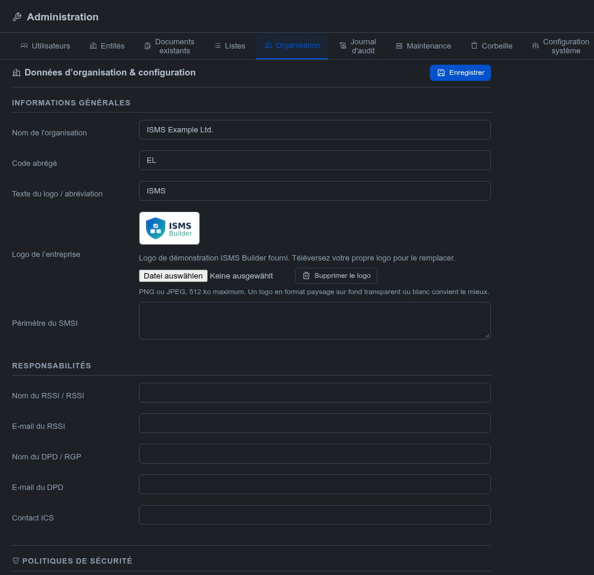
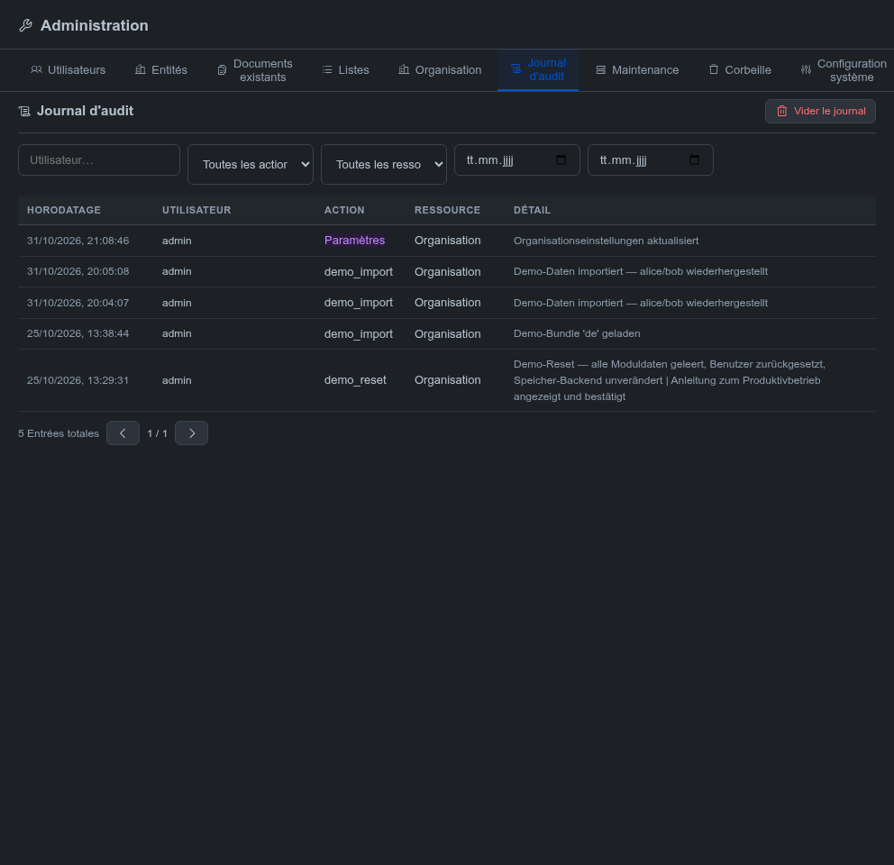
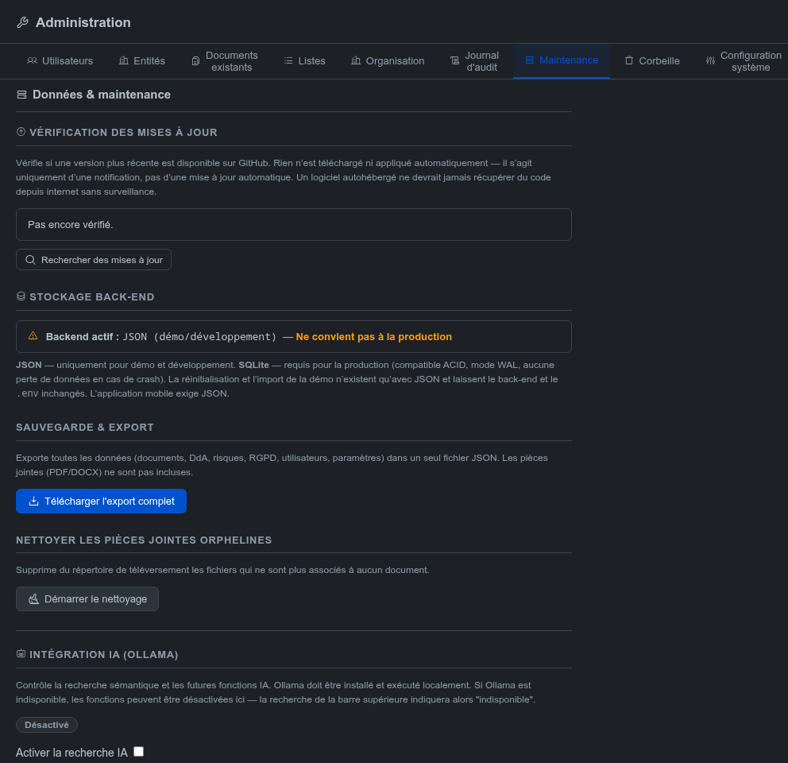
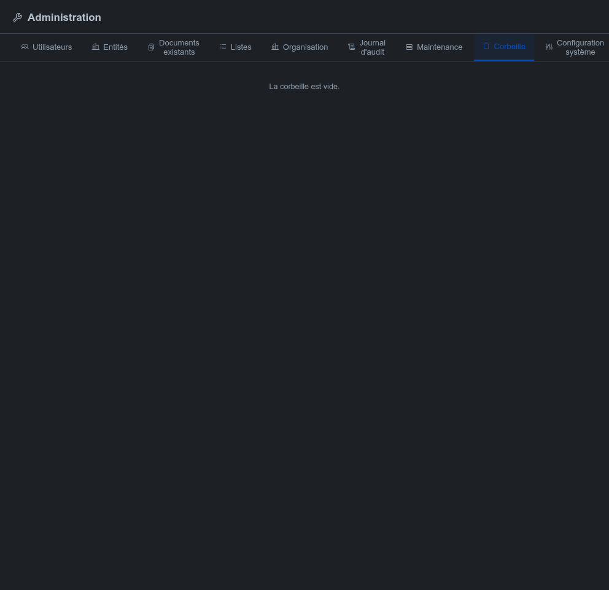
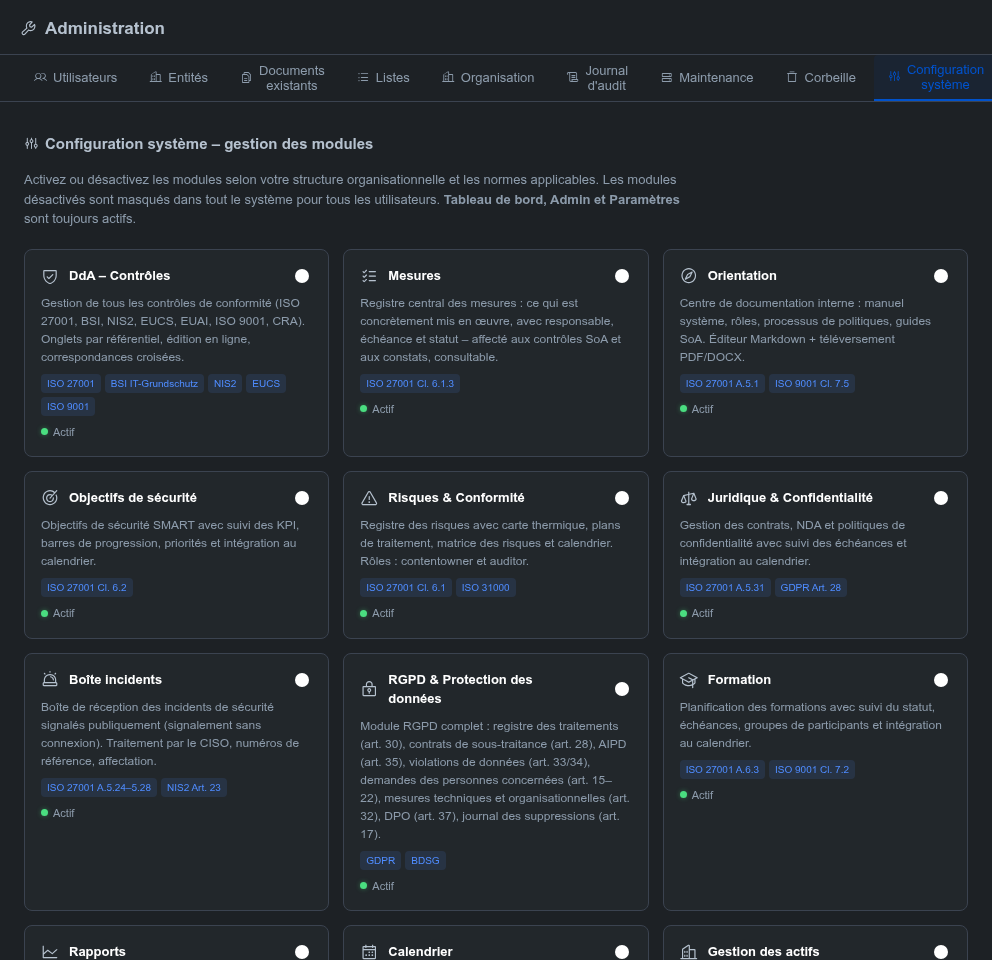

# Administration (console d’administration)

> L’administration est le point central pour les utilisateurs, les rôles, les langues, les services, les données et la maintenance. Elle n’est **visible que pour les utilisateurs ayant le rôle `admin`**. Ce guide décrit chacun des neuf onglets, les tâches courantes et les pièges.

---

## Vue d’ensemble

Ouvrez **Admin** dans la barre latérale. La console comporte neuf onglets :

| Onglet | Utilité |
|---|---|
| **Utilisateurs** | Comptes, rôles, fonctions, mots de passe ; comptes de synchronisation pour l’application mobile |
| **Entités** | Structure de l’entreprise (holding, filiales) |
| **Documents existants** | Aperçu de tous les documents avec type, statut, langue, version |
| **Listes** | Listes de sélection (types de documents, catégories de risques, catégories de données …) |
| **Organisation** | Nom, logo, responsables, obligation 2FA, langues, e-mail, WebDAV, menu, unités organisationnelles |
| **Journal d'audit** | Journal de toutes les actions importantes |
| **Maintenance** | Recherche de mises à jour, export, nettoyage, interrupteur IA, import de scan, réinitialisation et import de la démo |
| **Corbeille** | Entrées supprimées de tous les modules, restauration |
| **Configuration système** | Activer et désactiver les modules et les référentiels de conformité |

**Règles de base**

- **Les modifications prennent effet immédiatement ou après « Enregistrer ».** Chaque section a son propre bouton d’enregistrement ; les saisies non enregistrées sont perdues en changeant d’onglet.
- **Beaucoup d’actions sont consignées dans le journal d’audit** (création d’utilisateurs, changement de rôles, paramètres, réinitialisation/import de la démo). Voir « Journal d’audit ».
- **Les secrets n’ont leur place ni dans un document ni dans un chat.** Les mots de passe SMTP, clés et mots de passe ne sont plus affichés une fois enregistrés (exception : voir SMTP).
- Autres guides sous Guidance : **Connexion, sessions et mode production**, **Organisation et logo de l’entreprise**, **Application mobile et synchronisation**, **Brouillons IA**.

---

## 1. Utilisateurs

### Créer et modifier des utilisateurs

**Nouvel utilisateur** ouvre le formulaire :

| Champ | Signification |
|---|---|
| **Nom d’utilisateur** * | Unique, non modifiable ensuite (en lecture seule lors de la modification) |
| **E-mail** * | Sert aussi d’identifiant de connexion et pour les notifications |
| **Rôle** * | Droits dans le système (tableau ci-dessous) |
| **Domaine** | Domaine auquel l’utilisateur appartient (p. ex. IT, RH, Global) ; par défaut « Global » |
| **Fonctions organisationnelles** | Sélection multiple, indépendante du rôle |
| **Mot de passe / répétition** | Au moins 8 caractères. Laisser vide lors de la modification pour ne pas le changer |

Seul l’administrateur connaît le mot de passe attribué : **l’utilisateur doit le changer à la première connexion.** Un mot de passe que vous réinitialisez doit aussi être changé à la connexion suivante (sauf si vous changez le vôtre).

En **mode production**, les mots de passe de démonstration connus sont refusés. Voir le guide « Connexion, sessions et mode production ».

### Rôles

| Rôle | Description |
|---|---|
| `reader` | Accès en lecture |
| `revision` | Audit interne, lecture seule |
| `editor` | Créer et modifier du contenu |
| `dept_head` | Chef de département (éditeur avec vues propres au département) |
| `qmb` | Responsable qualité |
| `contentowner` | RSSI / ISB / DPO : approbation, RGPD, risques |
| `auditor` | Sécurité ICS/OT, auditeur des risques |
| `admin` | Administrateur système, tous les droits |

Les rôles sont classés par rang ; un rôle supérieur inclut les droits des rôles inférieurs. Les détails et la matrice RACI figurent dans le manuel du système sous « Rôles et responsabilités ».

### Fonctions

Les fonctions sont **indépendantes du rôle** et peuvent être combinées : **RSSI**, **DPO**, **RQ**, **Responsable PCA**, **Chef de département**, **Auditeur interne** et **Notification admin** (contrats, révisions). Elles déterminent qui reçoit quelles notifications et qui peut exécuter des étapes spécialisées. Exemple : une AIPD est préparée par le RSSI et l’avis est saisi par le DPO ; ce peuvent être deux personnes distinctes avec le rôle `contentowner`.

### Supprimer des utilisateurs

**Votre propre compte ne peut pas être supprimé.** Les autres comptes sont supprimés et consignés dans le journal d’audit. En cas de doute, bloquez plutôt que supprimer (rôle `reader`, nouveau mot de passe).

### Authentification à deux facteurs

Chaque utilisateur configure la 2FA lui-même sous **Paramètres**. L’obligation à l’échelle du système s’active dans l’onglet **Organisation** (voir plus bas). N’activez l’obligation **que lorsque tous les comptes ont configuré la 2FA**.

### Comptes de synchronisation (application mobile)

Les comptes de synchronisation sont des **accès autonomes, exclusivement destinés à la synchronisation des données de l’application mobile**. Ils sont indépendants des utilisateurs, n’ouvrent aucune interface et n’ont que les droits choisis ici.

1. **Nouveau compte de synchronisation** : nom (p. ex. « Tablette ventes »), par module **aucun accès / lecture / lecture et écriture** (documents, SoA, risques, actifs, constats ; guidance en lecture seule), éventuellement **Valable jusqu’au** (vide = illimité).
2. **Configurer l’appareil (code QR)** : génère un code de configuration valable **une seule fois et brièvement**. Dans l’application, choisissez « Configurer l’appareil » et scannez le code QR. Chaque appareil reçoit **sa propre clé, que l’administrateur ne voit jamais**.
3. **Bloquer l’appareil** prend effet immédiatement ; les autres appareils du compte restent utilisables. **Désactiver/Activer/Supprimer** concernent tout le compte.
4. Les **mesures** n’ont pas de droit propre : elles sont visibles si au moins un module lié est lisible, et modifiables seulement avec le droit d’écriture sur tous les modules liés.

**Condition :** l’application ne fonctionne que si ISMS Builder utilise le **stockage JSON** (`STORAGE_BACKEND=json`, par défaut). Avec SQLite, MariaDB ou PostgreSQL la synchronisation n’est pas disponible. Détails : guide « Application mobile et synchronisation ».

---

## 2. Entités

Gérez ici la **structure de l’entreprise** : **Nouvelle entité** avec **nom**, **nom court** et **type** (holding ou filiale). **Actualiser** recharge la liste. Les entités sont affectées dans d’autres modules (p. ex. entités concernées pour les risques et les audits).

---

## 3. Documents existants

L’onglet montre **tous les documents existants** (politiques, procédures, etc.) sous forme de tableau avec **titre, type, statut, langue, version** et **date de modification**. Il sert d’aperçu et de contrôle (p. ex. quelles versions linguistiques existent). Les documents se modifient dans la zone des documents ; voir « Documents : utilisation » dans le manuel du système.

---

## 4. Listes

Les listes de sélection qui apparaissent comme menus déroulants dans les modules sont modifiables :

**Types de documents, catégories de risques, traitement des risques, catégories de données RGPD, groupes de personnes concernées RGPD, types d’incidents, types d’actifs.**

- Choisissez une liste, ajoutez une entrée (**ID** et **libellé**) avec **Ajouter** ou supprimez-la avec **Supprimer** ; les libellés peuvent être adaptés dans la liste (non vérifié : quels champs des entrées existantes sont modifiables).
- **Réinitialiser** rétablit les valeurs par défaut fournies.
- Avant de supprimer, vérifiez si la valeur est encore utilisée dans des enregistrements (non vérifié : comment l’interface affiche les enregistrements dont la valeur a été supprimée).

---

## 5. Organisation

L’onglet regroupe les paramètres de l’organisation. Pour le logo de l’entreprise en détail : guide « Organisation et logo de l’entreprise ». Chaque section a son propre bouton d’enregistrement.

### Informations générales

**Nom de l’organisation**, **nom court**, **texte du logo / abréviation**, **logo de l’entreprise** (PNG ou JPEG, 512 ko au maximum, enregistré immédiatement au téléversement ; **Supprimer le logo** rétablit le logo de démonstration) et **périmètre de l’ISMS**. Le nom et le logo apparaissent sur la page de connexion, dans les PDF de politiques et les vues d’impression.

### Responsabilités

**RSSI/ISB** et **DPO/GDPO** (nom et e-mail) et **contact ICS**. Les adresses e-mail sont les destinataires des notifications et de l’e-mail de test. Les droits proprement dits s’attribuent par le rôle et la fonction de l’utilisateur.

### Politiques de sécurité : obligation 2FA

**Imposer l’authentification à deux facteurs à l’échelle du système.** Lorsqu’elle est active, les utilisateurs **sans 2FA configurée ne peuvent pas se connecter** ; la connexion est refusée avec une explication. **Avertissement :** n’activez l’obligation que lorsque **tous** les comptes ont configuré la 2FA, sinon vous bloquez immédiatement les comptes concernés.

**Protection contre le verrouillage :** Le serveur n'active l'obligation que si votre propre compte administrateur a déjà la 2FA (sinon un message s'affiche et rien n'est modifié) ; l'interface indique le nombre de comptes sans 2FA. Si plus personne ne peut se connecter malgré tout, seule la ligne de commande aide (`node scripts/emergency-2fa.js disable-policy`) — voir le guide « connexion, sessions et mise en production », section « Urgence ».

### Configuration des langues

Vous choisissez ici **quelles langues sont disponibles dans le système** (Deutsch, English, Français, Nederlands, Magyar, Eesti) et quelle **langue par défaut** la page de connexion utilise. La sélection vaut aussi pour le choix de langue des **brouillons IA** (« Créer avec l’IA ») : exactement les langues sélectionnées ici sont proposées, avec la langue de l’interface présélectionnée. Si toutes sont sélectionnées, toutes sont proposées.

### Notifications par e-mail et SMTP

- **E-mail de synthèse quotidien** au RSSI, au GDPO et à l’e-mail admin ; les types se règlent séparément : risques élevés/critiques, tests PCA à échéance, audits fournisseurs à échéance, délais DSAR, incidents RGPD ouverts > 48 h, journal des suppressions, contrats arrivant à échéance, revues de documents.
- **Identifiants SMTP :** les variables d’environnement du fichier `.env` (`SMTP_HOST` etc.) **ont toujours la priorité** et sont plus sûres. Un **mot de passe SMTP saisi ici est stocké en clair dans `org-settings.json`** ; ne l’utilisez que si le `.env` n’est pas possible.
- **Envoyer un e-mail de test** part vers l’e-mail du RSSI. Saisissez-le d’abord sous « Responsabilités ».

### Publication WebDAV (Nextcloud/ownCloud)

Les politiques approuvées sont téléversées en PDF dans un dossier. **Activer la publication automatique à l’approbation**, **URL de base**, **nom d’utilisateur**, **mot de passe d’application** (pas le mot de passe du compte principal ; les mots de passe d’application sont révocables individuellement), **dossier cible** ; **Tester la connexion**. Une panne du système distant n’empêche jamais l’approbation ; l’erreur devient visible et peut être répétée par resynchronisation dans l’éditeur de documents.

### Ordre du menu

Adaptez l’ordre de la barre latérale par glisser-déposer ou ↑/↓ ; **Enregistrer l’ordre**, **Par défaut** rétablit la valeur par défaut. Tableau de bord, Admin et Paramètres sont toujours affichés.

### Unités organisationnelles

Définit la structure de l’organisation IT (p. ex. CIO → GroupIT / GroupApp → Local IT) avec **nom, type, parent, responsable, description**. Elle sert à l’attribution des responsabilités dans tous les modules (risques, actifs, fournisseurs, PCA, objectifs, constats).

---

### Police PDF

Sous **Organisation → Police PDF**, vous choisissez la police de tous les PDF et vues d’impression : export de documents, attestation de formation, formulaire fournisseur et fenêtres d’impression de tous les modules. La police est incorporée afin que les lettres spéciales des **24 langues officielles de l’UE** s’affichent correctement (latin, grec, cyrillique).

- **Fournies :** Liberation Sans (par défaut, métriques d’Arial/Helvetica), Noto Sans et DejaVu Sans, chacune avec Regular, Bold et Italic et son texte de licence (`server/fonts/`, voir `THIRD-PARTY-LICENSES.md`).
- **Helvetica :** la police PDF standard, rien n’est incorporé (fichiers les plus petits), mais uniquement les caractères d’Europe occidentale ; le reste s’affiche comme ?.
- **Police à chasse fixe :** le code et les références (p. ex. `F-2026-001`) s’affichent en **Nimbus Mono PS**, un remplaçant proche de Courier signé URW++, couvrant le latin, le grec et le cyrillique (licence AGPL-3.0 avec exception pour les polices PDF, `server/fonts/LICENSE-NimbusMonoPS.txt`). Cela vaut pour toutes les polices incorporées ; avec « Helvetica », Courier est conservée. Avec une police personnalisée, vous pouvez téléverser en option votre propre fichier Mono.
- **Police personnalisée :** téléversez du TrueType ou de l’OpenType (8 Mo maximum par fichier ; « Regular » obligatoire, « Bold » et « Italic » facultatifs, sinon Regular est utilisée). Vous confirmez que votre licence autorise l’incorporation dans des PDF ; les polices avec restriction d’incorporation sont refusées. Le fichier est stocké dans le répertoire de données (`pdf-fonts/`, droits 600), pas dans le programme. « Supprimer la police personnalisée » rétablit Liberation Sans.
- **PDF d’aperçu :** affiche les lettres spéciales de toutes les langues de l’UE dans la police choisie — vérifiez avec lui avant de changer, surtout pour une police personnalisée.
- **Remarque :** les champs de saisie du formulaire PDF remplissable gardent la police standard du format PDF ; ce que les fournisseurs y saisissent est dessiné par leur logiciel PDF. Si un caractère manque à la police choisie, un symbole de remplacement apparaît.

---

## 6. Journal d’audit

Le journal d’audit consigne **l’heure, l’utilisateur, l’action, la ressource et le détail**, p. ex. création/modification/suppression, connexions, modifications de paramètres, réinitialisation et import de la démo.

- **Filtres** par utilisateur, action (Créé, Mis à jour, Supprimé, Connexion, Déconnexion, Export, Paramètres) et ressource ; le nombre total et le numéro de page figurent en bas.
- Le journal conserve **au maximum les 2000 dernières entrées** ; les plus anciennes disparaissent à chaque nouvelle entrée.
- **Vider le journal** supprime toutes les entrées (et consigne le vidage lui-même). Ne le videz que si vous n’en avez pas besoin comme preuve ; ce **n’est pas une preuve infalsifiable**.

---

## 7. Maintenance

### Recherche de mises à jour

**Rechercher des mises à jour** demande à GitHub si une version plus récente existe. **Rien n’est téléchargé ni appliqué automatiquement** ; vous recevez seulement une indication.

### Backend de stockage

Affiche le backend actif (JSON, SQLite, MariaDB, PostgreSQL). **JSON est la valeur par défaut et la recommandation actuelle.** On le change dans le `.env` (`STORAGE_BACKEND`) avec un redémarrage. **L’application mobile et la synchronisation** exigent JSON.

### Sauvegarde et export

**Télécharger l’export complet** crée un fichier JSON avec toutes les données (documents, SoA, risques, RGPD, utilisateurs, paramètres). **Les pièces jointes (PDF/DOCX) ne sont pas incluses** ; sauvegardez-les ainsi que le répertoire de données séparément. Conservez les exports chiffrés et séparés ; ils contiennent des données d’utilisateurs.

### Sauvegarder et restaurer

L’export complet est un extrait lisible, **pas une sauvegarde complète** : il n’existe pas d’import correspondant, et « Importer les données de démonstration » n’est pas une voie de restauration. La véritable sauvegarde est le **répertoire de données** (`DATA_DIR`, par défaut `data/`) avec le fichier `.env` ; avec MariaDB ou PostgreSQL, également la base de données.

**Sauvegarder** (arrêter brièvement le serveur pour un état cohérent) :

- **JSON et SQLite :** archiver le répertoire de données, p. ex. `tar czf isms-data-$(date +%F).tar.gz data .env`. La base SQLite (`isms.db`) se trouve dans le répertoire de données et est donc incluse.
- **Docker :** sur l’hôte `tar czf ~/isms-data-$(date +%F).tar.gz ./data` (bind mount).
- **MariaDB/PostgreSQL :** sauvegarder la base avec ses propres outils (p. ex. `mariadb-dump`, `pg_dump`) ainsi que le répertoire de données (pièces jointes, logo).

**Restaurer :**

1. Arrêter le serveur.
2. Renommer le répertoire de données actuel (ne pas le supprimer) pour pouvoir revenir en arrière.
3. Remettre en place le répertoire de données sauvegardé et, si nécessaire, le fichier `.env` ; avec MariaDB/PostgreSQL, importer la base depuis la sauvegarde.
4. Démarrer le serveur, se connecter en tant qu’administrateur et vérifier par sondage (documents, utilisateurs, pièces jointes).

La sauvegarde contient les comptes, les empreintes de mots de passe et les secrets 2FA : la conserver chiffrée et séparément. Ne restaurez une sauvegarde que dans la même version ou une version plus récente, et entraînez-vous d’abord sur une instance de test.

### Nettoyer les pièces jointes orphelines

**Lancer le nettoyage** supprime du répertoire de téléversement les fichiers qui n’appartiennent plus à aucun document.

### Intégration IA (Ollama)

Interrupteur global **Activer la recherche IA** : commande la recherche sémantique et les futures fonctions IA. Ollama doit fonctionner localement ; s’il est inaccessible, la recherche retombe sur « non disponible ». La fonction « Créer avec l’IA » (invite pour des applications IA externes) n’envoie rien elle-même.

**Clé d’API (facultative) :** Envoyée sous la forme `Authorization: Bearer …` à l’adresse de l’IA — y compris pour un Ollama sur votre propre réseau, par exemple derrière un proxy inverse ou une passerelle. Dans le journal de la passerelle, toutes les requêtes de l’ISMS Builder sont alors identifiables sans ambiguïté (toutes les requêtes envoient en outre toujours `User-Agent: ISMS-Builder/<version>`). La clé n’est **plus jamais affichée, ni journalisée ni exportée** ; un champ vide conserve la clé enregistrée, **Supprimer la clé** l’efface. 512 caractères ASCII visibles au maximum sont autorisés. L’exploitant peut aussi la définir via la variable d’environnement `OLLAMA_API_KEY` (p. ex. depuis un secret Docker) ; une clé définie dans l’interface est prioritaire. Avec une clé, **les redirections ne sont pas suivies**, et pour une adresse `http://` vers un hôte distant l’interface avertit que la clé serait transmise sans chiffrement. Comme le mot de passe SMTP, la clé est stockée dans les paramètres du serveur (non chiffrée) : protégez l’accès au répertoire de données. L’adresse et les modèles s’appliquent à toutes les fonctions IA, y compris la recherche sémantique et l’index vectoriel.

### Import de scan Greenbone

Importe un rapport Greenbone (XML ou PDF) sous forme de **brouillons de risques** (éventuellement avec entité et référence de scan). Tous les risques importés ont le statut **needsReview** et doivent être vérifiés par un auditeur ou le RSSI avant d’être actifs.

### Réinitialisation de la démo (passage en production)

Exporte d’abord toutes les données de démonstration (téléchargement automatique), supprime ensuite toutes les données des modules et tous les utilisateurs sauf `admin`, remet `admin` sans 2FA sur `adminpass` et termine votre session. Au clic, **le guide du mode production s’ouvre d’abord** ; le basculement ne commence qu’après que vous l’avez lu et confirmé, et l’action est consignée dans le journal d’audit. **Irréversible** (sauf par l’import de la démo avec le fichier téléchargé). Détails : guide « Connexion, sessions et mode production ». **La réinitialisation et l’import de la démo n’existent qu’avec `STORAGE_BACKEND=json`** (sinon erreur 409) ; le backend de stockage et le `.env` restent inchangés. Avec d’autres backends, utilisez `scripts/prepare-production.js` ou videz la base de données.

### Importer les données de démonstration

Restaure un jeu de données de démonstration exporté auparavant. **Toutes les données des modules sont écrasées.** `alice` et `bob` reviennent avec leurs mots de passe d’origine, `admin` reste inchangé. Ensuite, le système compte de nouveau comme une démo (les mots de passe de démonstration sont de nouveau valables). **Ne l’utilisez pas sur un système de production.**

### Charger un jeu de démonstration dans une langue

Avec « Charger le lot de démonstration » (aussi à la première connexion de l’administrateur), un jeu de données de démonstration fourni est chargé dans la langue choisie (Deutsch, English, Français, Nederlands, Magyar, Eesti). Les données de modules existantes sont remplacées.

### Écran d’accueil après la connexion

Affiche une image de bannière quelques secondes après la connexion. **Activer l’écran d’accueil** et **Durée (secondes)**, puis **Enregistrer**.

---

## 8. Corbeille

Les entrées supprimées de **tous les modules** arrivent d’abord dans la corbeille avec **Supprimé par**, **Supprimé le** et **Expire**. **Les entrées sont supprimées définitivement et automatiquement après 30 jours.** Vous pouvez **restaurer** ou **supprimer définitivement** chaque entrée (irréversible, avec confirmation). Utilisez la corbeille comme filet de sécurité contre les suppressions accidentelles, pas comme archive.

---

## 9. Configuration système (modules)

**Activer/désactiver les modules** selon l’organisation et les normes applicables : SoA, Mesures, Guidance, Objectifs de sécurité, Risk & Compliance, Legal & Privacy, Incident Inbox, RGPD et protection des données, Formation, Rapports, Calendrier, Gestion des actifs, Gouvernance, Continuité d’activité, Chaîne d’approvisionnement, Audits. **Les modules désactivés sont masqués pour tous les utilisateurs ; les données sont conservées.** Tableau de bord, Admin et Paramètres sont toujours actifs.

**Référentiels de conformité actifs :** ISO 27001:2022, BSI IT-Grundschutz, EU NIS2, EU Cloud (EUCS), EU AI Act, ISO 9000, ISO 9001, EU Cyber Resilience Act. Les référentiels désactivés sont masqués dans la SoA, le tableau de bord et les rapports. **Au moins un référentiel doit rester actif.** Appliquez la sélection avec **Enregistrer et appliquer la configuration**. L’onglet collectif **Custom Controls** (contrôles propres isolés) figure aussi dans cette liste et peut être désactivé si votre organisation n’utilise pas de contrôles propres — les contrôles existants sont conservés.

**Groupes personnalisés :** Les référentiels propres créés dans la SoA via **« ＋ Groupe personnalisé »** (p. ex. NEN 7510, TISAX ou une exigence client) apparaissent en dessous sous forme de cartes avec leur identifiant et le nombre de contrôles. Vous pouvez les activer ou les désactiver à cet endroit (comme les référentiels intégrés ; ils comptent aussi pour « Au moins un référentiel doit rester actif »), **modifier le nom et la couleur** et — seulement s’ils ne contiennent plus de contrôles — les **supprimer**. Les définitions sont stockées dans `data/soa-frameworks.json`, font partie de l’export complet et survivent à la réinitialisation de la démo. Création et import : voir `template-type-soa.md` et le guide « SoA & Audit ».

---

## Tâches courantes

**Ajouter un nouveau collaborateur :** Utilisateurs → Nouvel utilisateur → choisir le rôle et les fonctions → communiquer le mot de passe initial par un canal sûr → l’utilisateur le change à la première connexion et configure la 2FA.

**Configurer un appareil mobile :** Utilisateurs → Comptes de synchronisation → créer ou choisir un compte → Configurer l’appareil (code QR) → scanner dans l’application. **Appareil perdu :** Bloquer l’appareil ; l’effet est immédiat.

**Définir les langues :** Organisation → Configuration des langues → sélectionner les langues voulues, définir la langue par défaut, enregistrer les paramètres de langue.

**Passer en production :** télécharger l’export complet → lire le guide du mode production → réinitialisation de la démo → se connecter en tant qu’`admin`, changer le mot de passe, configurer la 2FA → créer ses propres utilisateurs.

**Régulièrement :** consulter le journal d’audit, rechercher des mises à jour, sauvegarder l’export complet et le répertoire de données, bloquer les comptes de synchronisation et utilisateurs inutiles.

---

## Pièges

- **Obligation 2FA activée trop tôt** → les comptes sans 2FA sont bloqués. Vérifier d’abord, activer ensuite.
- **Import de la démo sur un système de production** → écrase toutes les données et rend de nouveau valables les mots de passe de démonstration.
- **Réinitialisation de la démo sans export complet** → le fichier est téléchargé automatiquement, mais conservez-le avant de continuer.
- **Mot de passe SMTP dans les paramètres** : stocké en clair dans `org-settings.json` ; préférez le `.env`.
- **Compte de synchronisation avec droits d’écriture sur trop de modules** → chaque appareil connecté peut y modifier des données. Gardez les droits étroits et fixez une date d’expiration.
- **Modules ou référentiels masqués** → les enregistrements existent toujours mais sont invisibles pour tous.
