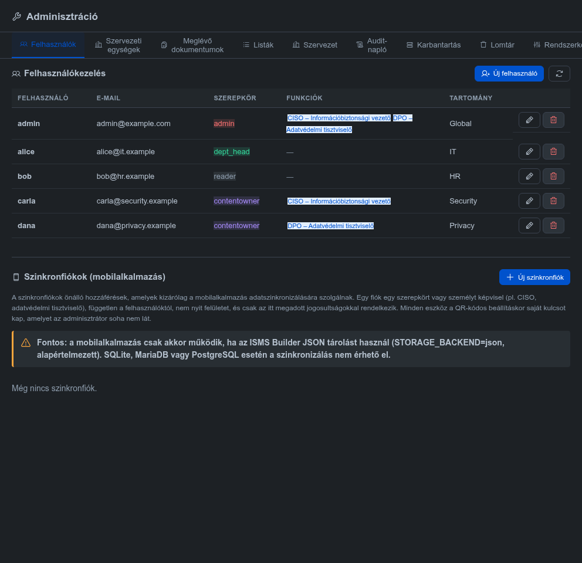
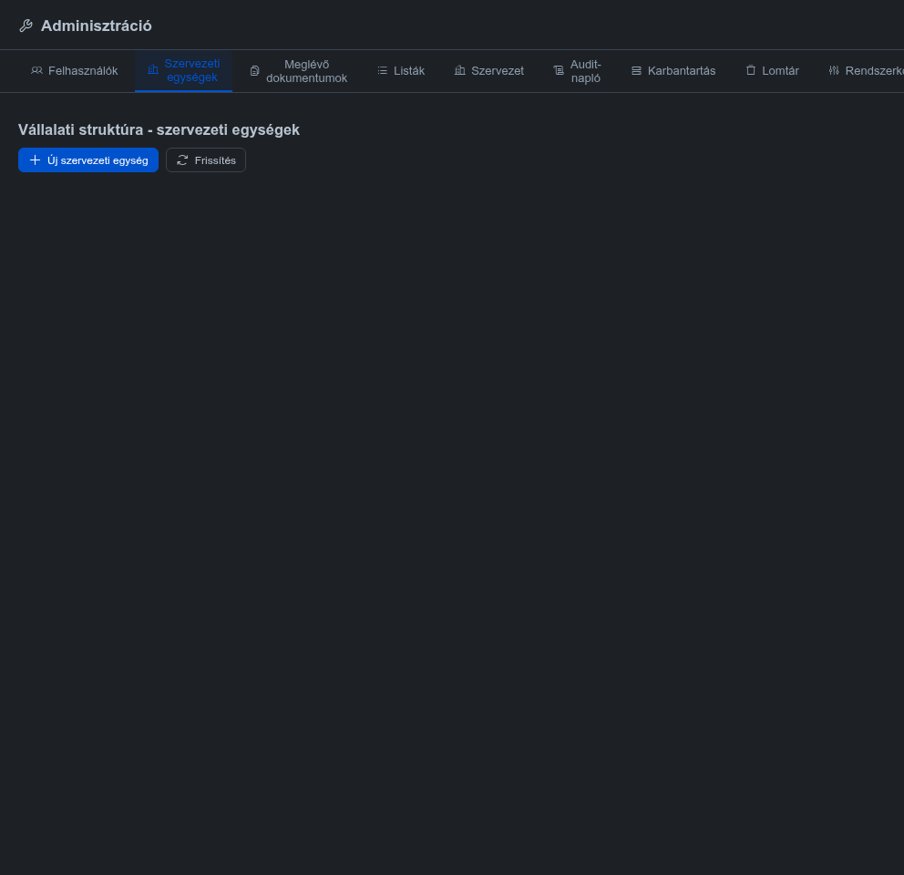
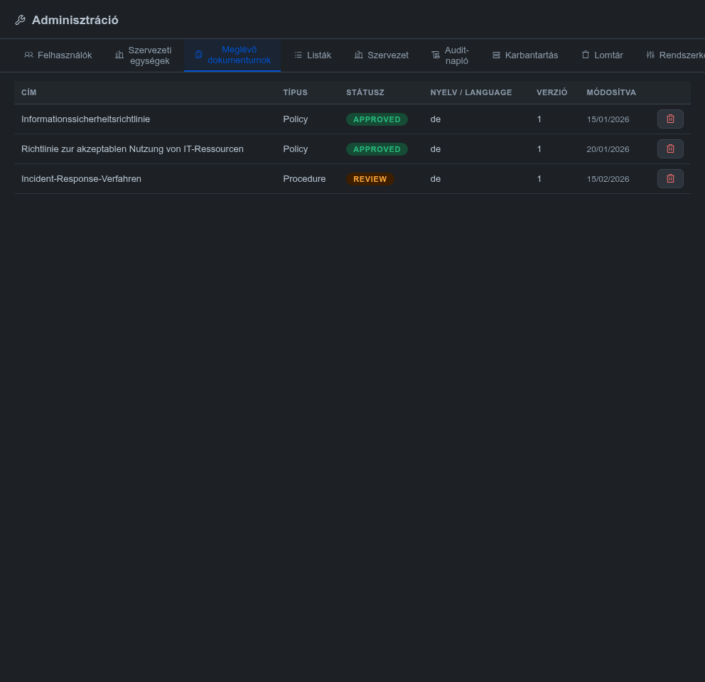
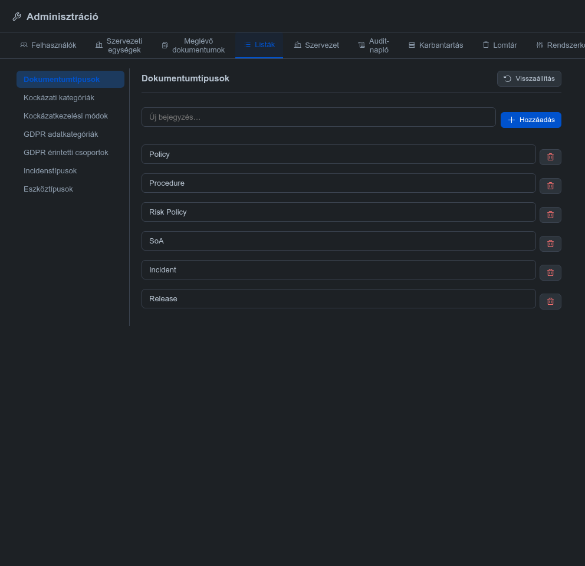
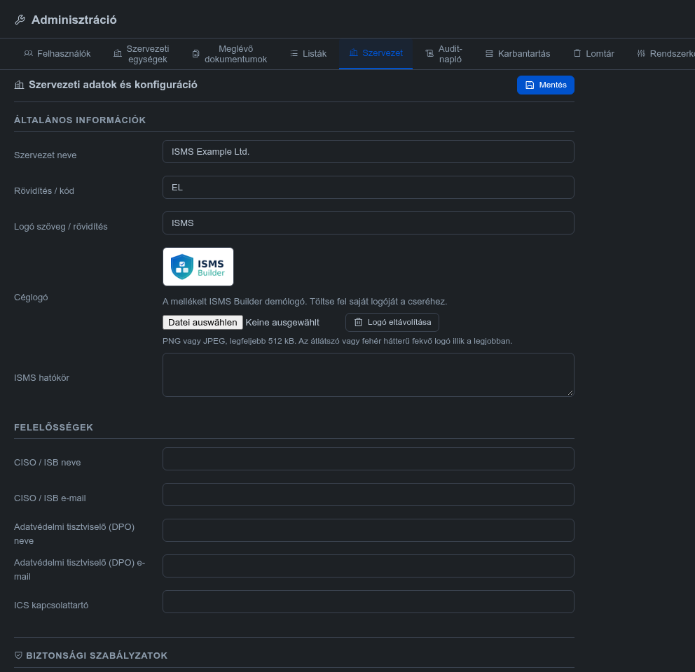
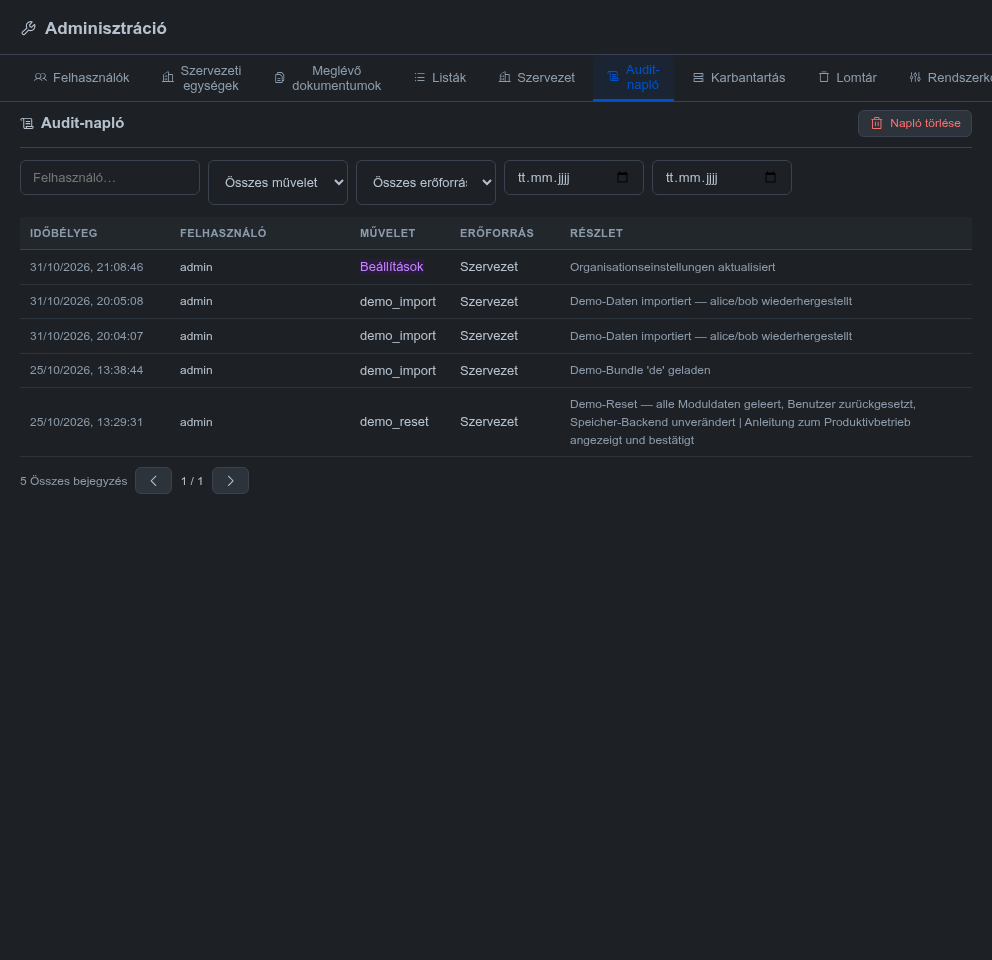
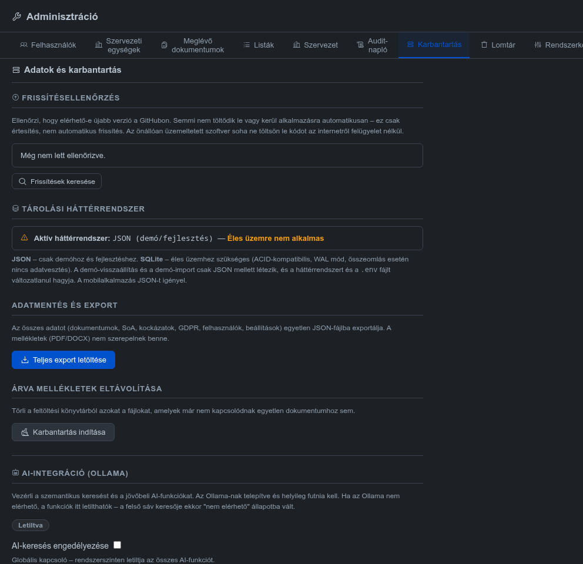
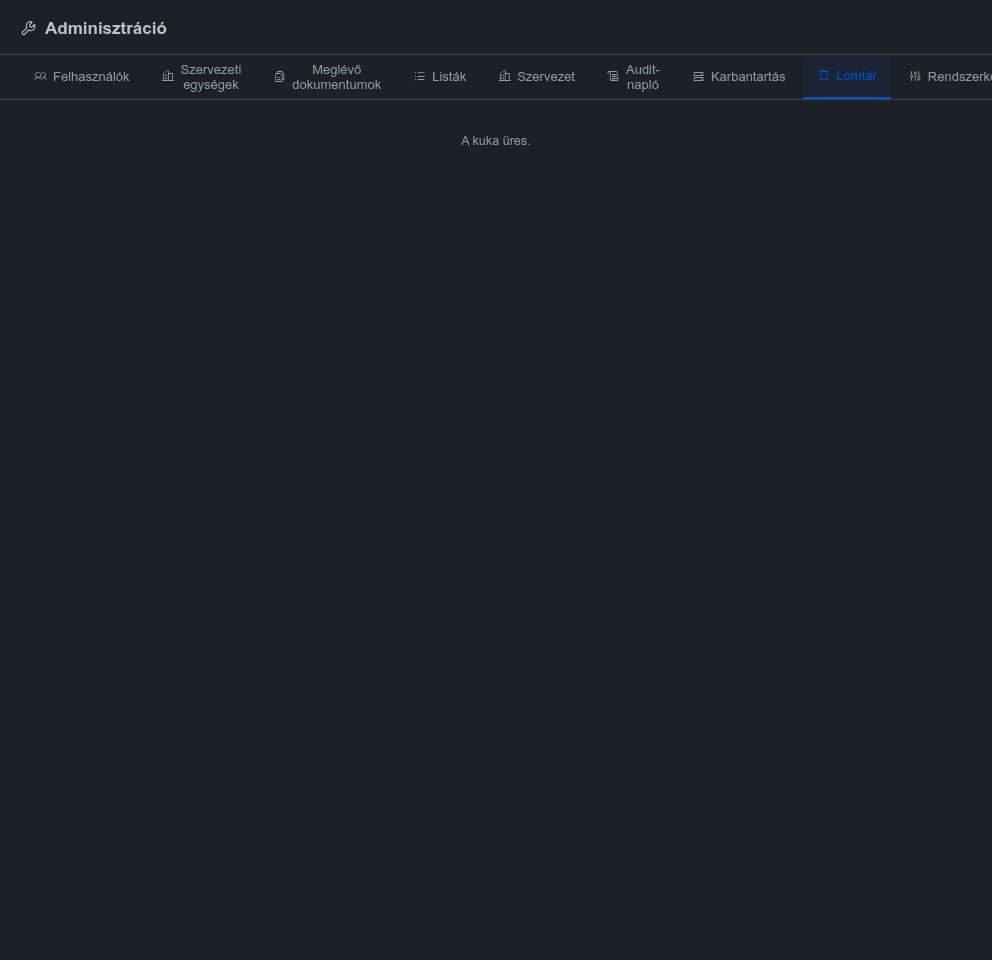
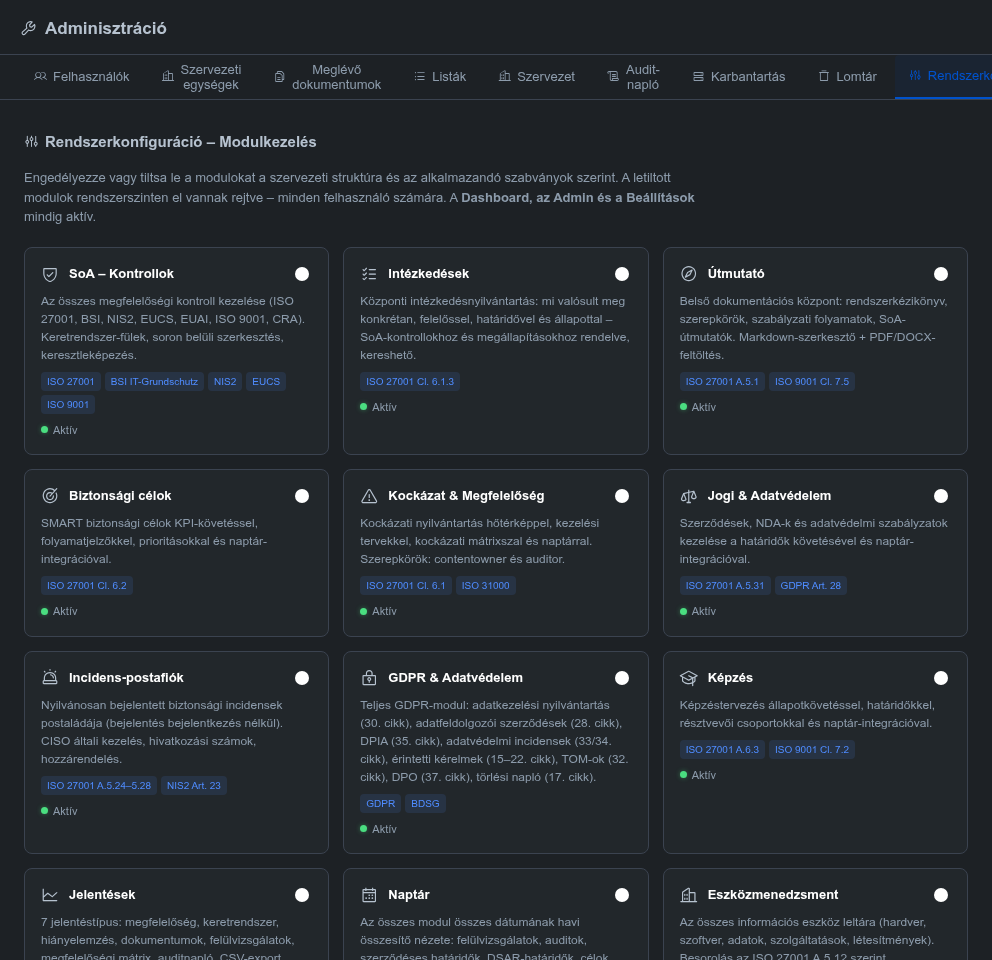

# Adminisztráció (adminisztrációs konzol)

> Az adminisztráció a felhasználók, szerepkörök, nyelvek, szolgáltatások, adatok és a karbantartás központi helye. **Csak az `admin` szerepkörű felhasználók számára látható.** Ez az útmutató a kilenc fület, a tipikus feladatokat és a buktatókat írja le.

---

## Áttekintés

Nyissa meg az **Admin** menüpontot az oldalsávban. A konzolnak kilenc füle van:

| Fül | Mire való |
|---|---|
| **Felhasználók** | Fiókok, szerepkörök, funkciók, jelszavak; szinkronfiókok a mobilalkalmazáshoz |
| **Szervezeti egységek** | A vállalat szerkezete (holding, leányvállalatok) |
| **Meglévő dokumentumok** | Az összes dokumentum áttekintése típussal, állapottal, nyelvvel, verzióval |
| **Listák** | Választólisták (dokumentumtípusok, kockázati kategóriák, adatkategóriák …) |
| **Szervezet** | Név, logó, felelősök, 2FA-kötelezettség, nyelvek, e-mail, WebDAV, menü, szervezeti egységek |
| **Audit-napló** | Az összes fontos művelet naplója |
| **Karbantartás** | Frissítésellenőrzés, export, takarítás, AI-kapcsoló, szkennelés-import, demó-visszaállítás és demó-import |
| **Lomtár** | Az összes modul törölt bejegyzései, visszaállítás |
| **Rendszerkonfiguráció** | Modulok és megfelelőségi keretrendszerek be- és kikapcsolása |

**Alapszabályok**

- **A módosítások azonnal vagy a „Mentés” után lépnek életbe.** Minden szakasznak saját mentés gombja van; a nem mentett bevitel fülváltáskor elvész.
- **Sok minden bekerül az audit-naplóba** (felhasználók létrehozása, szerepkörváltás, beállítások, demó-visszaállítás/-import). Lásd „Audit-napló”.
- **A titkok nem valók dokumentumba vagy csevegésbe.** Az SMTP-jelszavak, kulcsok és jelszavak mentés után nem jelennek meg újra (kivétel: lásd SMTP).
- További útmutatók az Útmutatók alatt: **Bejelentkezés, munkamenetek és éles üzem**, **Szervezet és céglogó**, **Mobilalkalmazás és szinkron**, **AI-vázlatok**.

---

## 1. Felhasználók

### Felhasználók létrehozása és szerkesztése

Az **Új felhasználó** megnyitja az űrlapot:

| Mező | Jelentés |
|---|---|
| **Felhasználónév** * | Egyedi, utólag nem módosítható (szerkesztéskor csak olvasható) |
| **E-mail** * | Bejelentkezési névként és értesítésekhez is szolgál |
| **Szerepkör** * | Jogosultságok a rendszerben (lásd az alábbi táblázatot) |
| **Domain** | Terület, amelyhez a felhasználó tartozik (pl. IT, HR, Global); alapértelmezés: „Global” |
| **Szervezeti funkciók** | Többszörös kiválasztás, a szerepkörtől függetlenül |
| **Jelszó / ismétlés** | Legalább 8 karakter. Szerkesztéskor üresen hagyva a jelszó nem változik |

Az adminisztrátor által megadott jelszót csak az adminisztrátor ismeri: **a felhasználónak az első bejelentkezéskor meg kell változtatnia.** Az Ön által visszaállított jelszót is meg kell változtatni a következő bejelentkezéskor (kivéve, ha a sajátját módosítja).

**Éles üzemben** az ismert demójelszavakat elutasítja a rendszer. Lásd a „Bejelentkezés, munkamenetek és éles üzem” útmutatót.

### Szerepkörök

| Szerepkör | Leírás |
|---|---|
| `reader` | Olvasási hozzáférés |
| `revision` | Belső audit, csak olvasás |
| `editor` | Tartalom létrehozása és szerkesztése |
| `dept_head` | Osztályvezető (szerkesztő osztályspecifikus nézetekkel) |
| `qmb` | Minőségügyi felelős |
| `contentowner` | CISO / ISB / DPO: jóváhagyás, GDPR, kockázatok |
| `auditor` | ICS/OT biztonság, kockázati auditor |
| `admin` | Rendszeradminisztrátor, minden jog |

A szerepkörök rangsorba vannak rendezve; a magasabb szerepkör tartalmazza az alacsonyabbak jogait. A részletek és a RACI-mátrix a rendszerkézikönyvben, a „Szerepkörök és felelősségek” alatt találhatók.

### Funkciók

A funkciók **függetlenek a szerepkörtől**, és kombinálhatók: **CISO**, **DPO**, **QMO**, **BCM-vezető**, **Osztályvezető**, **Belső auditor** és **Admin értesítés** (szerződések, felülvizsgálatok). Meghatározzák, ki milyen értesítést kap, és ki végezhet szakmai lépéseket. Példa: a DPIA-t a CISO készíti elő, a véleményt a DPO rögzíti; ők két külön személy lehetnek `contentowner` szerepkörrel.

### Felhasználók törlése

**A saját fiók nem törölhető.** A többi fiókot eltávolítja a rendszer, és az audit-napló rögzíti. Kétség esetén inkább tiltson, mint töröljön (szerepkör `reader`, új jelszó).

### Kétfaktoros hitelesítés

Minden felhasználó maga állítja be a 2FA-t a **Beállítások** alatt. A rendszerszintű kötelezettséget a **Szervezet** fülön kapcsolhatja be (lásd ott). A kötelezettséget csak akkor aktiválja, **ha minden fiók beállította a 2FA-t**.

### Szinkronfiókok (mobilalkalmazás)

A szinkronfiókok **önálló hozzáférések, kizárólag a mobilalkalmazás adatszinkronizálására**. Függetlenek a felhasználóktól, nem nyitnak felületet, és csak az itt kiválasztott jogosultságokkal rendelkeznek.

1. **Új szinkronfiók**: név (pl. „Értékesítési tablet”), modulonként **nincs hozzáférés / olvasás / olvasás és írás** (dokumentumok, SoA, kockázatok, eszközök, megállapítások; az útmutatók csak olvashatók), opcionálisan **Érvényes eddig** (üres = korlátlan).
2. **Eszköz beállítása (QR-kód)**: beállítási kódot hoz létre, amely **csak egyszer és csak rövid ideig** érvényes. Az alkalmazásban válassza az „Eszköz beállítása” lehetőséget, és olvassa be a QR-kódot. Minden eszköz **saját kulcsot** kap, **amelyet az adminisztrátor soha nem lát**.
3. Az **eszköz tiltása** azonnal hat; a fiók többi eszköze használható marad. A **Tiltás/Engedélyezés/Törlés** a teljes fiókra vonatkozik.
4. Az **intézkedéseknek** nincs saját jogosultságuk: láthatók, ha legalább egy kapcsolt modul olvasható, és csak akkor módosíthatók, ha az összes kapcsolt modulra van írási jog.

**Előfeltétel:** az alkalmazás csak akkor működik, ha az ISMS Builder **JSON-tárolást** használ (`STORAGE_BACKEND=json`, alapértelmezés). SQLite, MariaDB vagy PostgreSQL esetén a szinkron nem érhető el. Részletek: „Mobilalkalmazás és szinkron” útmutató.

---

## 2. Szervezeti egységek

Itt kezeli a **vállalati szerkezetet**: **Új szervezeti egység** **névvel**, **rövid névvel** és **típussal** (holding vagy leányvállalat). A **Frissítés** újratölti a listát. Az egységeket más modulokban rendelik hozzá (pl. érintett egységek a kockázatoknál és auditoknál).

---

## 3. Meglévő dokumentumok

A fül **az összes meglévő dokumentumot** (szabályzatok, eljárások stb.) táblázatban mutatja **cím, típus, állapot, nyelv, verzió** és **módosítás dátuma** oszlopokkal. Áttekintésre és ellenőrzésre szolgál (pl. milyen nyelvi változatok léteznek). A dokumentumokat a dokumentumok területén szerkesztik; lásd „Dokumentumok: használat” a rendszerkézikönyvben.

---

## 4. Listák

A modulokban legördülő listaként megjelenő választólisták karbantarthatók:

**Dokumentumtípusok, kockázati kategóriák, kockázatkezelés, GDPR-adatkategóriák, GDPR-érintetti csoportok, incidenstípusok, eszköztípusok.**

- Válasszon listát, adjon hozzá bejegyzést (**azonosító** és **címke**) a **Hozzáadás** gombbal, vagy törölje az **Eltávolítás** gombbal; a címkék a listában módosíthatók (nem ellenőrzött, hogy a meglévő bejegyzések mely mezői szerkeszthetők).
- A **Visszaállítás** helyreállítja a mellékelt alapértékeket.
- Eltávolítás előtt ellenőrizze, hogy az érték szerepel-e még rekordokban (nem ellenőrzött, hogyan jeleníti meg a felület az eltávolított értékű rekordokat).

---

## 5. Szervezet

A fül a szervezet beállításait foglalja össze. A céglogóról részletesen: „Szervezet és céglogó” útmutató. Minden szakasznak saját mentés gombja van.

### Általános információk

**Szervezet neve**, **rövid név**, **logószöveg / rövidítés**, **céglogó** (PNG vagy JPEG, legfeljebb 512 kB, feltöltéskor azonnal mentődik; a **Logó eltávolítása** visszaállítja a demólogót) és **az ISMS hatálya**. A név és a logó megjelenik a bejelentkezési oldalon, a szabályzat-PDF-ekben és a nyomtatási nézetekben.

### Felelősségek

**CISO/ISB** és **DPO/GDPO** (név és e-mail) és **ICS-kapcsolattartó**. Az e-mail-címek az értesítések és a tesztlevél címzettjei. A tényleges jogosultságokat a felhasználó szerepkörével és funkciójával adja ki.

### Biztonsági szabályzatok: 2FA-kötelezettség

**A kétfaktoros hitelesítés kikényszerítése rendszerszinten.** Ha aktív, a **2FA nélküli felhasználók nem tudnak bejelentkezni**; a bejelentkezést magyarázattal utasítja el a rendszer. **Figyelmeztetés:** csak akkor aktiválja, ha **minden** fiók beállította a 2FA-t, különben azonnal kizárja az érintett fiókokat.

**Védelem a kizárás ellen:** A szerver csak akkor kapcsolja be a kötelezettséget, ha a saját rendszergazdai fiókjának már van 2FA-ja (különben üzenet jelenik meg, és semmi sem változik); a felület megmutatja a 2FA nélküli fiókok számát. Ha mégsem tud senki bejelentkezni, csak a parancssor segít (`node scripts/emergency-2fa.js disable-policy`) — lásd a „Bejelentkezés, munkamenetek és éles üzem” útmutató „Vészhelyzet” szakaszát.

### Nyelvkonfiguráció

Itt választja ki, **mely nyelvek érhetők el a rendszerben** (Deutsch, English, Français, Nederlands, Magyar, Eesti), és melyik az **alapértelmezett nyelv** a bejelentkezési oldalon. A választás az **AI-vázlatok** („Vázlat készítése AI-val”) nyelvválasztására is vonatkozik: pontosan az itt kiválasztott nyelvek kínálódnak fel, előre kiválasztva a felület nyelvével. Ha mind ki van választva, mind felkínálásra kerül.

### E-mail-értesítések és SMTP

- **Napi összefoglaló e-mail** a CISO-nak, a GDPO-nak és az admin e-mail-címére; a típusok külön kapcsolhatók: magas/kritikus kockázatok, esedékes BCM-tesztek, esedékes szállítói auditok, DSAR-határidők, 48 óránál régebben nyitott GDPR-incidensek, törlési napló, lejáró szerződések, dokumentum-felülvizsgálatok.
- **SMTP-hozzáférés:** a `.env` környezeti változói (`SMTP_HOST` stb.) **mindig elsőbbséget élveznek**, és biztonságosabbak. Az **itt megadott SMTP-jelszó egyszerű szövegként tárolódik az `org-settings.json` fájlban**; csak akkor használja, ha a `.env` nem járható út.
- A **Tesztlevél küldése** a CISO e-mail-címére megy. Előbb adja meg a „Felelősségek” alatt.

### WebDAV-publikálás (Nextcloud/ownCloud)

A jóváhagyott szabályzatok PDF-ként feltöltődnek egy mappába. **Automatikus publikálás jóváhagyáskor**, **alap-URL**, **felhasználónév**, **alkalmazásjelszó** (nem a fő fiók jelszava; az alkalmazásjelszavak egyenként visszavonhatók), **célmappa**; **Kapcsolat tesztelése**. A távoli rendszer kiesése soha nem akadályozza meg a jóváhagyást; a hiba láthatóvá válik, és a dokumentumszerkesztőben újraszinkronizálással megismételhető.

### Menüsorrend

Az oldalsáv sorrendjét húzással vagy ↑/↓ gombokkal igazíthatja; **Sorrend mentése**, az **Alapértelmezett** visszaállítja az alapot. Az Irányítópult, az Admin és a Beállítások mindig megjelenik.

### Szervezeti egységek

Meghatározza az IT-szervezeti szerkezetet (pl. CIO → GroupIT / GroupApp → Local IT) **névvel, típussal, felettessel, vezetővel, leírással**. A felelősségek kiosztására szolgál minden modulban (kockázatok, eszközök, szállítók, BCM, célok, megállapítások).

---

### PDF-betűtípus

A **Szervezet → PDF-betűtípus** résznél adja meg, milyen betűtípussal jelenjen meg minden PDF és nyomtatási nézet: dokumentumexport, képzési igazolás, szállítói űrlap és minden modul nyomtatási ablaka. A betűtípus beágyazásra kerül, hogy az **EU mind a 24 hivatalos nyelvének** különleges betűi helyesen jelenjenek meg (latin, görög, cirill).

- **Mellékelt:** Liberation Sans (alapértelmezett, az Arial/Helvetica méreteivel), Noto Sans és DejaVu Sans, mindegyik Regular, Bold és Italic változattal és licencszöveggel (`server/fonts/`, lásd `THIRD-PARTY-LICENSES.md`).
- **Helvetica:** a PDF alapbetűtípusa, semmi sem kerül beágyazásra (legkisebb fájlok), de csak nyugat-európai karakterekkel; minden más ?-ként jelenik meg.
- **Egyenközű betűtípus:** a kód és a hivatkozások (pl. `F-2026-001`) a **Nimbus Mono PS** betűtípussal jelennek meg, ez az URW++ Courier-szerű pótlása, amely a latin, görög és cirill írást is lefedi (licenc: AGPL-3.0 PDF-betűtípus-kivétellel, `server/fonts/LICENSE-NimbusMonoPS.txt`). Ez minden beágyazott betűtípusra érvényes; „Helvetica” esetén a Courier marad. Saját betűtípusnál opcionálisan saját Mono fájlt is feltölthet.
- **Saját betűtípus:** TrueType vagy OpenType feltöltése (fájlonként legfeljebb 8 MB; a „Regular” kötelező, a „Bold” és az „Italic” nem kötelező, különben a Regular lesz használva). Megerősíti, hogy a licence engedi a PDF-be ágyazást; a beágyazási tiltással rendelkező betűtípusokat elutasítjuk. A fájl az adatkönyvtárban van (`pdf-fonts/`, 600-as jogosultság), nem a programban. A „Saját betűtípus eltávolítása” visszaállítja a Liberation Sans-t.
- **Előnézeti PDF:** az EU összes nyelvének különleges betűit mutatja a választott betűtípussal — váltás előtt ezzel ellenőrizze, hogy minden megjelenik-e, különösen saját betűtípusnál.
- **Megjegyzés:** a kitölthető PDF-űrlap beviteli mezői a PDF-formátum alapbetűtípusát használják; amit a szállítók ide írnak, azt a PDF-programjuk rajzolja. Ha a választott betűtípusból hiányzik egy karakter, helyőrző jelenik meg.

---

## 6. Audit-napló

Az audit-napló rögzíti az **időpontot, felhasználót, műveletet, erőforrást és részletet**, pl. létrehozás/módosítás/törlés, bejelentkezések, beállításváltozások, demó-visszaállítás és -import.

- **Szűrők** felhasználó, művelet (Létrehozva, Frissítve, Törölve, Login, Logout, Export, Beállítások) és erőforrás szerint; alul az összesítés és az oldalszám látható.
- A napló **legfeljebb az utolsó 2000 bejegyzést** őrzi; a régebbiek új bejegyzésekkel kiesnek.
- A **Napló ürítése** minden bejegyzést eltávolít (és rögzíti magát az ürítést). Csak akkor ürítse, ha nincs szüksége bizonyítékként; **nem manipulációbiztos bizonyíték**.

---

## 7. Karbantartás

### Frissítésellenőrzés

A **Frissítések keresése** megkérdezi a GitHubot, van-e újabb verzió. **Semmi nem töltődik le és nem települ automatikusan**; csak tájékoztatást kap.

### Tárolási háttérrendszer

Mutatja az aktív háttérrendszert (JSON, SQLite, MariaDB, PostgreSQL). **A JSON az alapértelmezés és a jelenlegi ajánlás.** Váltani a `.env` fájlban (`STORAGE_BACKEND`) lehet, újraindítással. A **mobilalkalmazás és a szinkron** JSON-t igényel.

### Biztonsági mentés és export

A **Teljes export letöltése** JSON-fájlt hoz létre az összes adattal (dokumentumok, SoA, kockázatok, GDPR, felhasználók, beállítások). **A mellékletek (PDF/DOCX) nincsenek benne**; ezeket és az adatkönyvtárat külön mentse. Az exportokat titkosítva és elkülönítve őrizze; felhasználói adatokat tartalmaznak.

### Mentés és visszaállítás

A teljes export olvasható kivonat, **nem teljes biztonsági mentés**: nincs hozzá importálás, és a „Demóadatok importálása” nem visszaállítási mód. A tényleges mentés az **adatkönyvtár** (`DATA_DIR`, alapértelmezés `data/`) a `.env` fájllal együtt; MariaDB vagy PostgreSQL esetén ezenfelül az adatbázis.

**Mentés** (egységes állapothoz rövid időre állítsa le a szervert):

- **JSON és SQLite:** archiválja az adatkönyvtárat, pl. `tar czf isms-data-$(date +%F).tar.gz data .env`. Az SQLite-adatbázis (`isms.db`) az adatkönyvtárban van, így benne van a mentésben.
- **Docker:** a gazdagépen `tar czf ~/isms-data-$(date +%F).tar.gz ./data` (bind mount).
- **MariaDB/PostgreSQL:** az adatbázist a saját eszközeivel mentse (pl. `mariadb-dump`, `pg_dump`), és ezenfelül az adatkönyvtárat (mellékletek, logó).

**Visszaállítás:**

1. Állítsa le a szervert.
2. Nevezze át (ne törölje) a jelenlegi adatkönyvtárat, hogy vissza tudjon térni.
3. Másolja vissza a mentett adatkönyvtárat és szükség esetén a `.env` fájlt; MariaDB/PostgreSQL esetén töltse vissza az adatbázist a mentésből.
4. Indítsa el a szervert, jelentkezzen be rendszergazdaként, és szúrópróbaszerűen ellenőrizze (dokumentumok, felhasználók, mellékletek).

A mentés felhasználói fiókokat, jelszókivonatokat és 2FA-titkokat tartalmaz: titkosítva és elkülönítve őrizze. Mentést csak ugyanarra vagy újabb verzióra állítson vissza, és előbb próbálja ki a folyamatot egy tesztpéldányon.

### Árva mellékletek takarítása

A **Takarítás indítása** eltávolítja a feltöltési könyvtárból azokat a fájlokat, amelyek már egyetlen dokumentumhoz sem tartoznak.

### AI-integráció (Ollama)

Globális kapcsoló: **AI-keresés engedélyezése**: a szemantikus keresést és a jövőbeli AI-funkciókat vezérli. Az Ollamának helyben kell futnia; ha nem érhető el, a keresés „nem elérhető” állapotra áll. A „Vázlat készítése AI-val” funkció (prompt külső AI-alkalmazásokhoz) maga nem küld semmit.

**API-kulcs (opcionális):** `Authorization: Bearer …` formában kerül elküldésre az MI címére — a saját hálózaton futó Ollama esetén is, például fordított proxy vagy átjáró mögött. Az átjáró naplójában így az ISMS Builder minden kérése egyértelműen felismerhető (minden kérés ezenkívül mindig elküldi a `User-Agent: ISMS-Builder/<verzió>` fejlécet). A kulcs **soha többé nem jelenik meg, nem naplózódik és nem exportálódik**; üres mező esetén a mentett kulcs változatlan marad, a **Kulcs eltávolítása** törli. Legfeljebb 512 látható ASCII-karakter engedélyezett. Alternatívaként az üzemeltető az `OLLAMA_API_KEY` környezeti változóban adhatja meg (pl. Docker-titokból); a felületen megadott kulcs elsőbbséget élvez. Kulccsal az **átirányítások nem követettek**, és idegen gazdagépre mutató `http://` cím esetén a felület figyelmeztet, hogy a kulcs titkosítatlanul kerülne továbbításra. Az SMTP-jelszóhoz hasonlóan a kulcs a szerver beállításai között tárolódik (titkosítatlanul): védje az adatkönyvtárhoz való hozzáférést. A cím és a modellek minden AI-funkcióra érvényesek, a szemantikus keresésre és a vektorindexre is.

### Greenbone-szkennelés importja

Greenbone-jelentést (XML vagy PDF) importál **kockázati vázlatként** (opcionálisan egységgel és szkennelési hivatkozással). Minden importált kockázat **needsReview** állapotú, és auditornak vagy a CISO-nak át kell néznie, mielőtt aktívvá válik.

### Demó-visszaállítás (átállás éles üzemre)

Először exportálja az összes demóadatot (automatikus letöltés), majd törli az összes modul adatait és az `admin` kivételével az összes felhasználót, az `admin` jelszavát 2FA nélkül `adminpass`-ra állítja, és befejezi az Ön munkamenetét. Kattintáskor **először az éles üzemre vonatkozó útmutató nyílik meg**; az átállás csak azután kezdődik, hogy elolvasta és megerősítette, és a műveletet az audit-napló rögzíti. **Nem vonható vissza** (kivéve a demó-importtal a letöltött fájllal). Részletek: „Bejelentkezés, munkamenetek és éles üzem” útmutató. **A demó-visszaállítás és a demó-import csak `STORAGE_BACKEND=json` mellett létezik** (különben 409-es hiba); a tárolási háttérrendszer és a `.env` változatlan marad. Más háttérrendszernél használja a `scripts/prepare-production.js` szkriptet, vagy ürítse az adatbázist.

### Demóadatok importálása

Egy korábban exportált demóadatkészletet állít vissza. **Az összes modul adata felülíródik.** Az `alice` és a `bob` eredeti jelszavukkal tér vissza, az `admin` változatlan marad. Ezután a rendszer újra demónak számít (a demójelszavak újra érvényesek). **Éles rendszeren ne használja.**

### Demóadatkészlet betöltése egy nyelven

A „Demócsomag betöltése” funkcióval (az adminisztrátor első bejelentkezésekor is) a mellékelt demóadatkészlet töltődik be a kiválasztott nyelven (Deutsch, English, Français, Nederlands, Magyar, Eesti). A meglévő modulok adatait lecseréli.

### Bejelentkezési nyitókép

Bejelentkezés után néhány másodpercig bannerképet mutat. **Nyitókép engedélyezése** és **Időtartam (másodperc)**, majd **Mentés**.

---

## 8. Lomtár

Az **összes modul** törölt bejegyzései először a lomtárba kerülnek **Törölte**, **Törlés ideje** és **Lejár** adatokkal. **A bejegyzések 30 nap után automatikusan véglegesen törlődnek.** Minden bejegyzést **visszaállíthat** vagy **véglegesen törölhet** (nem vonható vissza, megerősítéssel). A lomtárat a véletlen törlés elleni védőhálóként használja, ne archívumként.

---

## 9. Rendszerkonfiguráció (modulok)

**Modulok be- és kikapcsolása** a szervezethez és az alkalmazandó szabványokhoz igazítva: SoA, Intézkedések, Útmutatók, Biztonsági célok, Risk & Compliance, Legal & Privacy, Incident Inbox, GDPR és adatvédelem, Oktatás, Jelentések, Naptár, Eszközkezelés, Irányítás, Üzletmenet-folytonosság, Ellátási lánc, Auditok. **A kikapcsolt modulok minden felhasználó számára rejtettek; az adatok megmaradnak.** Az Irányítópult, az Admin és a Beállítások mindig aktív.

**Aktív megfelelőségi keretrendszerek:** ISO 27001:2022, BSI IT-Grundschutz, EU NIS2, EU Cloud (EUCS), EU AI Act, ISO 9000, ISO 9001, EU Cyber Resilience Act. A kikapcsolt keretrendszerek rejtettek a SoA-ban, az irányítópulton és a jelentésekben. **Legalább egy keretrendszernek aktívnak kell maradnia.** A választást a **Konfiguráció mentése és alkalmazása** gombbal érvényesítheti. A gyűjtő **Custom Controls** fül (különálló saját kontrollok) szintén szerepel ebben a listában, és kikapcsolható, ha a szervezet nem használ saját kontrollokat — a meglévő kontrollok megmaradnak.

**Saját csoportok:** A SoA-ban a **„＋ Saját csoport”** gombbal létrehozott saját keretrendszerek (pl. NEN 7510, TISAX vagy ügyfélkövetelmény) alatta kártyákként jelennek meg az azonosítójukkal és a kontrollok számával. Itt be- és kikapcsolhatók (mint a beépített keretrendszerek; a „Legalább egy keretrendszernek aktívnak kell maradnia” szabály rájuk is vonatkozik), módosítható a **név és a szín**, és — csak ha már nem tartalmaznak kontrollokat — **törölhetők**. A definíciók a `data/soa-frameworks.json` fájlban vannak, a teljes export részét képezik, és a demó visszaállítása nem érinti őket. Létrehozás és importálás: lásd `template-type-soa.md` és a „SoA & Audit” útmutatót.

---

## Tipikus feladatok

**Új munkatárs felvétele:** Felhasználók → Új felhasználó → szerepkör és funkciók kiválasztása → a kezdőjelszó biztonságos úton történő megadása → a felhasználó az első bejelentkezéskor megváltoztatja, és beállítja a 2FA-t.

**Mobil eszköz beállítása:** Felhasználók → Szinkronfiókok → fiók létrehozása vagy kiválasztása → Eszköz beállítása (QR-kód) → beolvasás az alkalmazásban. **Elveszett eszköz:** Eszköz tiltása; azonnal hat.

**Nyelvek meghatározása:** Szervezet → Nyelvkonfiguráció → a kívánt nyelvek kiválasztása, az alapértelmezett nyelv beállítása, nyelvi beállítások mentése.

**Átállás éles üzemre:** teljes export letöltése → az éles üzemre vonatkozó útmutató elolvasása → demó-visszaállítás → bejelentkezés `admin`-ként, jelszó módosítása, 2FA beállítása → saját felhasználók létrehozása.

**Rendszeresen:** az audit-napló ellenőrzése, frissítések keresése, a teljes export és az adatkönyvtár mentése, a már nem szükséges szinkronfiókok és felhasználók tiltása.

---

## Buktatók

- **Túl korán aktivált 2FA-kötelezettség** → a 2FA nélküli fiókok ki vannak zárva. Előbb ellenőrizze, aztán aktiválja.
- **Demó-import éles rendszeren** → felülírja az összes adatot, és újra érvényessé teszi a demójelszavakat.
- **Demó-visszaállítás teljes export nélkül** → a fájl automatikusan letöltődik, de a folytatás előtt őrizze meg.
- **SMTP-jelszó a beállításokban** egyszerű szövegként van az `org-settings.json` fájlban; inkább a `.env`-et használja.
- **Túl sok modulra írási joggal rendelkező szinkronfiók** → minden csatlakoztatott eszköz módosíthat ott adatot. Tartsa szűken a jogokat, és adjon meg lejárati dátumot.
- **Elrejtett modulok vagy keretrendszerek** → a rekordok megvannak, de mindenki számára láthatatlanok.
