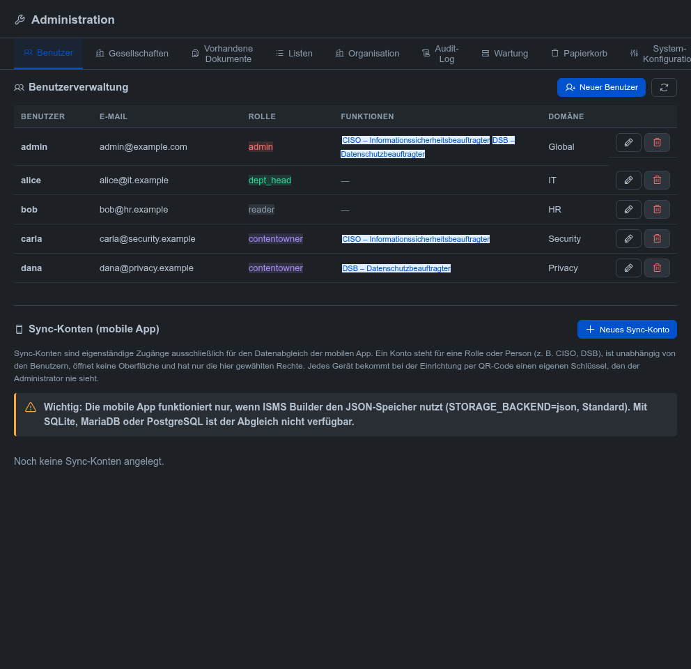
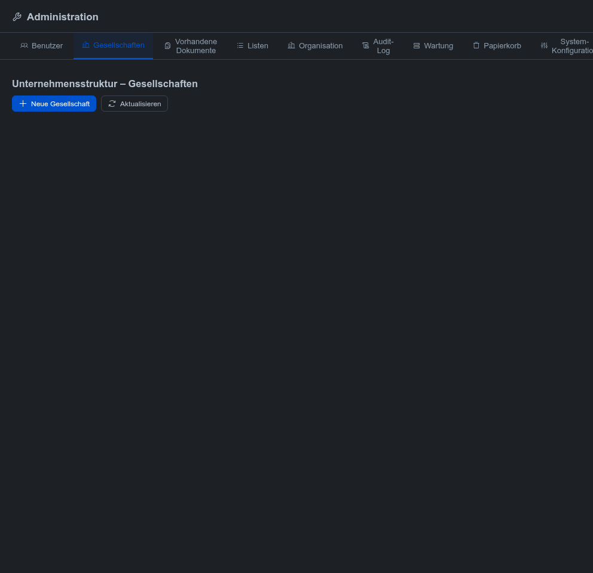
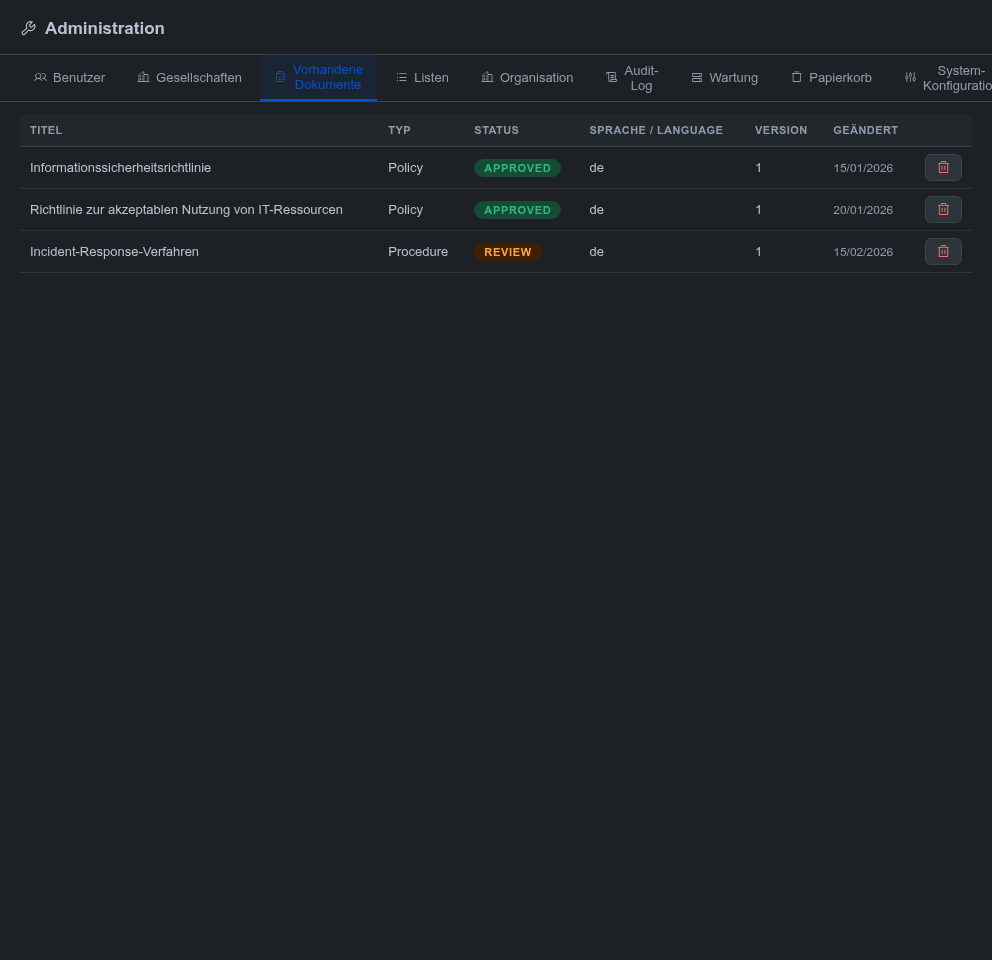
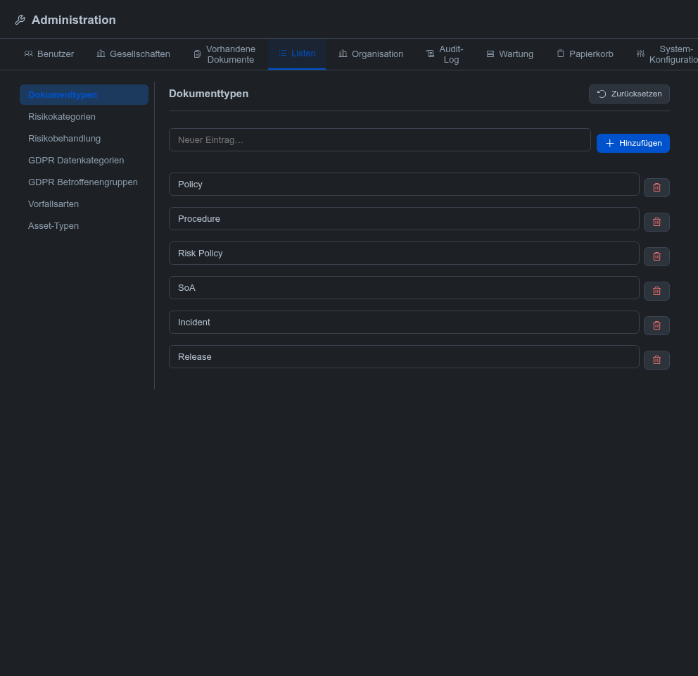
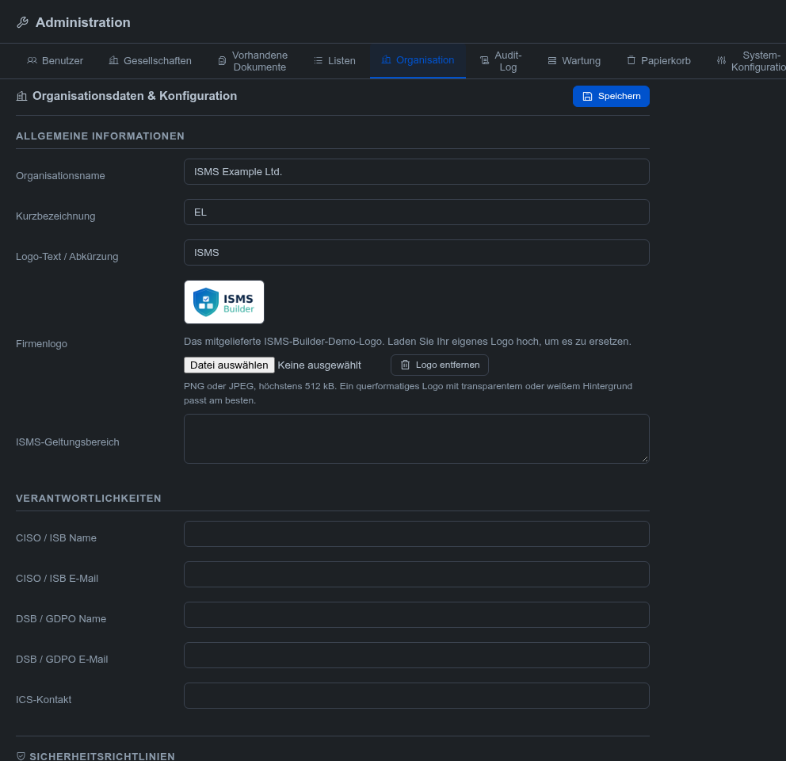
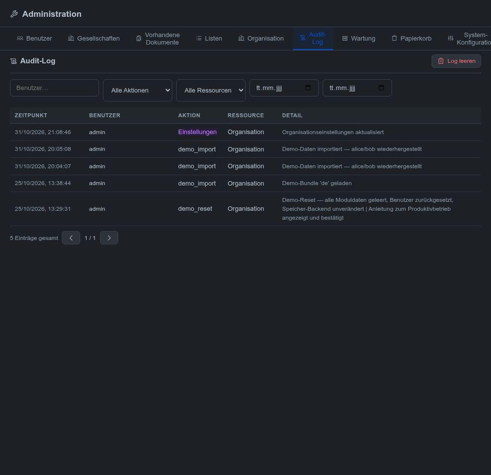
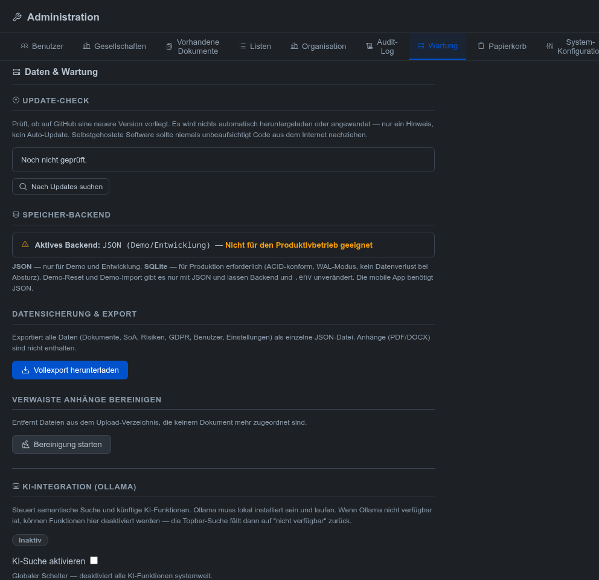
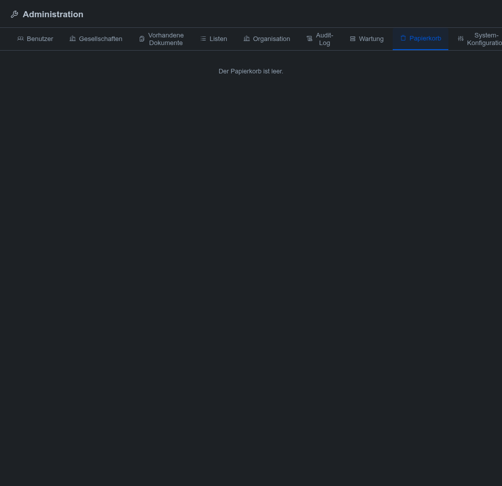
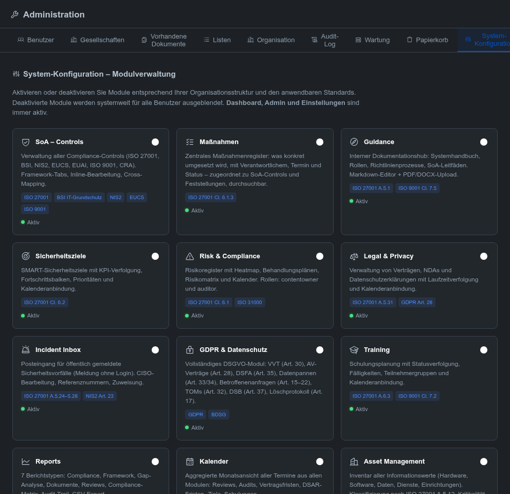

# Administration (Admin-Konsole)

> Die Administration ist die zentrale Stelle für Benutzer, Rollen, Sprachen, Dienste, Daten und Wartung. Sie ist **nur für Benutzer mit der Rolle `admin`** sichtbar. Dieser Leitfaden beschreibt jeden der neun Reiter, die typischen Aufgaben und die Stolperfallen.

---

## Überblick

Öffnen Sie **Admin** in der Seitenleiste. Die Konsole hat neun Reiter:

| Reiter | Wofür |
|---|---|
| **Benutzer** | Konten, Rollen, Funktionen, Passwörter; Sync-Konten für die mobile App |
| **Gesellschaften** | Unternehmensstruktur (Holding, Tochtergesellschaften) |
| **Vorhandene Dokumente** | Übersicht aller vorhandenen Dokumente mit Typ, Status, Sprache, Version |
| **Listen** | Auswahllisten (Dokumenttypen, Risikokategorien, Datenkategorien …) |
| **Organisation** | Name, Logo, Verantwortliche, 2FA-Pflicht, Sprachen, E-Mail, WebDAV, Menü, Organisationseinheiten |
| **Audit-Log** | Protokoll aller wichtigen Aktionen |
| **Wartung** | Update-Prüfung, Export, Aufräumen, KI-Schalter, Scan-Import, Demo-Reset und Demo-Import |
| **Papierkorb** | Gelöschte Einträge aller Module, Wiederherstellen |
| **System-Konfiguration** | Module und Compliance-Frameworks ein- und ausschalten |

**Grundregeln**

- **Änderungen wirken sofort oder nach „Speichern“.** Jeder Abschnitt hat einen eigenen Speichern-Knopf; ungespeicherte Eingaben gehen beim Wechsel des Reiters verloren.
- **Vieles wird im Audit-Log festgehalten** (Benutzer anlegen, Rollen ändern, Einstellungen, Demo-Reset/-Import). Siehe Abschnitt „Audit-Log“.
- **Geheimnisse gehören nicht ins Dokument oder in den Chat.** SMTP-Passwörter, Schlüssel und Passwörter werden nie angezeigt, nachdem sie gespeichert wurden (Ausnahme siehe SMTP).
- Weiterführende Leitfäden stehen unter Guidance: **Anmeldung, Sitzungen und Produktivbetrieb**, **Organisation & Firmenlogo**, **Mobile App & Sync**, **KI-Entwürfe**.

---

## 1. Benutzer

### Benutzer anlegen und bearbeiten

**Neuer Benutzer** öffnet die Eingabemaske:

| Feld | Bedeutung |
|---|---|
| **Benutzername** * | Eindeutig, nachträglich nicht änderbar (beim Bearbeiten schreibgeschützt) |
| **E-Mail** * | Dient auch als Anmeldename und für Benachrichtigungen |
| **Rolle** * | Rechte im System (Tabelle unten) |
| **Domäne** | Bereich, dem der Benutzer zugeordnet ist (z. B. IT, HR, Global); Standard „Global“ |
| **Organisatorische Funktionen** | Mehrfachauswahl, unabhängig von der Rolle |
| **Passwort / Wiederholung** | Mindestens 8 Zeichen. Beim Bearbeiten leer lassen, um das Passwort nicht zu ändern |

Das vom Administrator vergebene Passwort kennt danach nur der Administrator: **Der Benutzer muss es bei der ersten Anmeldung ändern.** Ebenso muss ein von Ihnen zurückgesetztes Passwort beim nächsten Login geändert werden (außer Sie ändern Ihr eigenes).

Im **Produktivbetrieb** werden bekannte Demo-Passwörter abgelehnt. Siehe den Leitfaden „Anmeldung, Sitzungen und Produktivbetrieb“.

### Rollen

| Rolle | Beschreibung |
|---|---|
| `reader` | Lesezugriff |
| `revision` | Interne Prüfung, nur Lesezugriff |
| `editor` | Inhalte erstellen und bearbeiten |
| `dept_head` | Abteilungsleiter (Editor mit abteilungsbezogenen Ansichten) |
| `qmb` | Qualitätsmanagementbeauftragter |
| `contentowner` | CISO / ISB / DSB: Freigabe, DSGVO, Risiken |
| `auditor` | ICS/OT-Sicherheit, Risikoprüfer |
| `admin` | Systemadministrator, alle Rechte |

Die Rollen sind in Rängen geordnet; eine höhere Rolle umfasst die Rechte der niedrigeren. Details und die RACI-Matrix stehen im Systemhandbuch unter „Rollen & Verantwortlichkeiten“.

### Funktionen

Funktionen sind **unabhängig von der Rolle** und können kombiniert werden: **CISO**, **DSB**, **QMB**, **BCM-Manager**, **Abteilungsleiter**, **Interner Auditor** und **Admin-Benachrichtigung** (Verträge, Reviews). Sie steuern, wer welche Benachrichtigungen bekommt und wer fachliche Schritte ausführen darf. Beispiel: Eine DSFA wird vom CISO vorbereitet, die Stellungnahme trägt der DSB ein; beide können getrennte Personen mit der Rolle `contentowner` sein.

### Benutzer löschen

Das **eigene Konto kann nicht gelöscht werden**. Andere Konten werden entfernt und im Audit-Log vermerkt. Im Zweifel besser sperren statt löschen (Rolle auf `reader` setzen, Passwort neu vergeben).

### Zwei-Faktor-Authentifizierung

Jeder Benutzer richtet 2FA selbst unter **Einstellungen** ein. Die systemweite Pflicht schalten Sie im Reiter **Organisation** ein (siehe dort). Aktivieren Sie die Pflicht erst, **wenn alle Konten 2FA eingerichtet haben**.

### Sync-Konten (mobile App)

Sync-Konten sind **eigenständige Zugänge ausschließlich für den Datenabgleich der mobilen App**. Sie sind unabhängig von den Benutzern, öffnen keine Oberfläche und haben nur die hier gewählten Rechte.

1. **Neues Sync-Konto**: Name (z. B. „Tablet Vertrieb“), je Modul **kein Zugriff / lesen / lesen und schreiben** (Dokumente, SoA, Risiken, Assets, Feststellungen; Guidance nur lesbar), optional **Gültig bis** (leer = unbegrenzt).
2. **Gerät einrichten (QR-Code)**: erzeugt einen Einrichtungscode, der **nur einmal und nur kurz** gültig ist. In der App „Gerät einrichten“ wählen und den QR-Code scannen. Jedes Gerät erhält einen **eigenen Schlüssel, den der Administrator nie sieht**.
3. **Gerät sperren** wirkt sofort; andere Geräte des Kontos bleiben nutzbar. **Sperren/Freigeben/Löschen** gelten für das ganze Konto.
4. **Maßnahmen** haben kein eigenes Recht: Sie sind sichtbar, wenn mindestens ein verknüpftes Modul lesbar ist, und änderbar nur mit Schreibrecht auf alle verknüpften Module.

**Voraussetzung:** Die App funktioniert nur, wenn ISMS Builder den **JSON-Speicher** nutzt (`STORAGE_BACKEND=json`, Standard). Mit SQLite, MariaDB oder PostgreSQL ist der Abgleich nicht verfügbar. Details: Leitfaden „Mobile App & Sync“.

---

## 2. Gesellschaften

Hier pflegen Sie die **Unternehmensstruktur**: **Neue Gesellschaft** mit **Name**, **Kurzbezeichnung** und **Typ** (Holding oder Tochtergesellschaft). **Aktualisieren** lädt die Liste neu. Gesellschaften werden in anderen Modulen zugeordnet (z. B. betroffene Gesellschaften bei Risiken und Audits).

---

## 3. Vorhandene Dokumente

Der Reiter zeigt **alle vorhandenen Dokumente** (Richtlinien, Verfahren u. a.) als Tabelle mit **Titel, Typ, Status, Sprache, Version** und **Änderungsdatum**. Er dient der Übersicht und der Kontrolle (z. B. welche Sprachfassungen es gibt). Bearbeitet werden Dokumente im Dokumentenbereich; siehe „Dokumente: Nutzung“ im Systemhandbuch.

---

## 4. Listen

Die Auswahllisten, die in den Modulen als Dropdown erscheinen, sind pflegbar:

**Dokumenttypen, Risikokategorien, Risikobehandlung, GDPR-Datenkategorien, GDPR-Betroffenengruppen, Vorfallsarten, Asset-Typen.**

- Liste wählen, Eintrag (**ID** und **Bezeichnung**) mit **Hinzufügen** ergänzen oder mit **Entfernen** löschen; Bezeichnungen lassen sich in der Liste anpassen (nicht geprüft, welche Felder bestehender Einträge editierbar sind).
- **Zurücksetzen** stellt die mitgelieferten Standardwerte wieder her.
- Prüfen Sie vor dem Entfernen, ob der Wert noch in Datensätzen verwendet wird (nicht geprüft, wie die Oberfläche bestehende Datensätze mit entfernten Werten anzeigt).

---

## 5. Organisation

Der Reiter bündelt die Einstellungen der Organisation. Ausführlich zum Firmenlogo: Leitfaden „Organisation & Firmenlogo“. Jeder Abschnitt hat einen eigenen Speichern-Knopf.

### Allgemeine Informationen

**Organisationsname**, **Kurzbezeichnung**, **Logo-Text / Abkürzung**, **Firmenlogo** (PNG oder JPEG, höchstens 512 kB, wird beim Hochladen sofort gespeichert; **Logo entfernen** stellt das Demo-Logo wieder her) und **ISMS-Geltungsbereich**. Name und Logo erscheinen auf der Anmeldeseite, in Richtlinien-PDFs und Druckansichten.

### Verantwortlichkeiten

**CISO/ISB** und **DSB/GDPO** (Name und E-Mail) und **ICS-Kontakt**. Die E-Mail-Adressen sind die Empfänger der Benachrichtigungen und der Testmail. Die eigentlichen Rechte vergeben Sie über Rolle und Funktion des Benutzers.

### Sicherheitsrichtlinien: 2FA-Pflicht

**Zwei-Faktor-Authentifizierung systemweit erzwingen.** Ist die Pflicht aktiv, können sich Benutzer **ohne eingerichtete 2FA nicht anmelden**; die Anmeldung wird mit einer Erklärung abgelehnt. **Warnung:** Erst aktivieren, wenn **alle** Konten 2FA eingerichtet haben, sonst sperren Sie betroffene Konten sofort aus.

**Schutz vor Aussperrung:** Der Server schaltet die Pflicht nur ein, wenn Ihr eigenes Administrator-Konto bereits 2FA hat (sonst Meldung, nichts wird geändert); die Oberfläche nennt die Zahl der Konten ohne 2FA. Ist trotzdem niemand mehr angemeldet, hilft nur die Kommandozeile (`node scripts/emergency-2fa.js disable-policy`) — siehe die Anleitung „Anmeldung, Sitzungen und Produktivbetrieb“, Abschnitt „Notfall“.

### Sprachkonfiguration

Hier wählen Sie, **welche Sprachen im System zur Verfügung stehen** (Deutsch, English, Français, Nederlands, Magyar, Eesti) und welche **Standardsprache** die Anmeldeseite verwendet. Die Auswahl gilt auch für die Sprachwahl der **KI-Entwürfe** („Mit KI erstellen“): Dort stehen genau die hier ausgewählten Sprachen zur Wahl, vorbelegt mit der Sprache der Oberfläche. Sind alle ausgewählt, stehen alle zur Wahl.

### E-Mail-Benachrichtigungen und SMTP

- **Tägliche Digest-E-Mail** an CISO, GDPO und Admin-E-Mail; Typen einzeln schaltbar: hohe/kritische Risiken, BCM-Tests fällig, Lieferantenaudits fällig, DSAR-Fristen, GDPR-Vorfälle > 48 h offen, Löschprotokoll, auslaufende Verträge, Dokumenten-Reviews.
- **SMTP-Zugangsdaten:** Umgebungsvariablen in der `.env` (`SMTP_HOST` usw.) haben **immer Vorrang** und sind sicherer. Ein hier eingegebenes **SMTP-Passwort wird in `org-settings.json` im Klartext gespeichert**; verwenden Sie es nur, wenn die `.env` keine Option ist.
- **Testmail senden** geht an die CISO-E-Mail. Tragen Sie sie vorher unter „Verantwortlichkeiten“ ein.

### WebDAV-Publish (Nextcloud/ownCloud)

Freigegebene Richtlinien werden als PDF in einen Ordner hochgeladen. **Automatischen Publish bei Freigabe aktivieren**, **Basis-URL**, **Benutzername**, **App-Passwort** (kein Hauptkonto-Passwort; App-Passwörter sind einzeln widerrufbar), **Zielordner**; **Verbindung testen**. Ein Ausfall des Remote-Systems verhindert die Freigabe nie; der Fehler wird sichtbar und lässt sich per Re-Sync im Dokumenten-Editor wiederholen.

### Menüreihenfolge

Die Reihenfolge der Seitenleiste per Ziehen oder ↑/↓ anpassen; **Reihenfolge speichern**, **Standard** stellt die Vorgabe wieder her. Dashboard, Admin und Einstellungen werden immer angezeigt.

### Organisationseinheiten

Definiert die IT-Organisationsstruktur (z. B. CIO → GroupIT / GroupApp → Local IT) mit **Name, Typ, Übergeordnet, Leitung, Beschreibung**. Sie wird für Verantwortungszuweisungen in allen Modulen verwendet (Risiken, Assets, Lieferanten, BCM, Ziele, Feststellungen).

---

### PDF-Schrift

Unter **Organisation → PDF-Schrift** legen Sie fest, in welcher Schrift alle PDFs und Druckansichten erscheinen: Dokument-Export, Teilnahmebestätigung, Lieferantenformular und die Druckfenster aller Module. Die Schrift wird eingebettet, damit die Sonderbuchstaben **aller 24 EU-Amtssprachen** richtig erscheinen (Latein, Griechisch, Kyrillisch).

- **Mitgeliefert:** Liberation Sans (Standard, Maße wie Arial/Helvetica), Noto Sans und DejaVu Sans, jeweils mit Regular, Bold und Italic und mit Lizenztext (`server/fonts/`, siehe `THIRD-PARTY-LICENSES.md`).
- **Helvetica:** die PDF-Standardschrift, nichts wird eingebettet (kleinste Dateien), aber nur westeuropäische Zeichen; alles andere erscheint als ?.
- **Festbreitenschrift:** Code und Referenzen (z. B. `F-2026-001`) erscheinen in **Nimbus Mono PS**, einem Courier-ähnlichen Courier-Ersatz von URW++, der Latein, Griechisch und Kyrillisch abdeckt (Lizenz AGPL-3.0 mit PDF-Schriftenausnahme, `server/fonts/LICENSE-NimbusMonoPS.txt`). Das gilt für alle eingebetteten Schriften; bei „Helvetica“ bleibt es bei Courier. Bei einer eigenen Schrift können Sie optional eine eigene Mono-Datei hochladen.
- **Eigene Schrift:** TrueType oder OpenType hochladen (je Datei bis 8 MB; „Regular“ ist Pflicht, „Bold“ und „Italic“ optional, sonst wird Regular verwendet). Sie bestätigen, dass Ihre Lizenz das Einbetten in PDFs erlaubt; Schriften mit Einbettungssperre werden abgelehnt. Die Datei liegt im Datenverzeichnis (`pdf-fonts/`, Rechte 600), nicht im Programm. „Eigene Schrift entfernen“ stellt Liberation Sans wieder ein.
- **Vorschau-PDF:** zeigt die Sonderbuchstaben aller EU-Sprachen in der gewählten Schrift — prüfen Sie damit vor dem Wechsel, ob alles erscheint, insbesondere bei einer eigenen Schrift.
- **Hinweis:** Die Eingabefelder im ausfüllbaren PDF-Formular behalten die Standardschrift des PDF-Formats; was Lieferanten dort tippen, zeichnet deren PDF-Programm. Fehlt der gewählten Schrift ein Zeichen, erscheint ein Platzhalter.

---

## 6. Audit-Log

Das Audit-Log protokolliert **Zeitpunkt, Benutzer, Aktion, Ressource und Detail**, z. B. Anlegen/Ändern/Löschen, Anmeldungen, Einstellungsänderungen, Demo-Reset und -Import.

- **Filter** nach Benutzer, Aktion (Erstellt, Aktualisiert, Gelöscht, Login, Logout, Export, Einstellungen) und Ressource; unten stehen die Gesamtzahl und die Seitenzahl.
- Das Protokoll hält **höchstens die letzten 2000 Einträge**; ältere fallen bei neuen Einträgen weg.
- **Log leeren** entfernt alle Einträge (und vermerkt das Leeren selbst). Leeren Sie das Protokoll nur, wenn Sie es nicht als Nachweis benötigen; es ist **kein manipulationssicherer Nachweis**.

---

## 7. Wartung

### Update-Check

**Nach Updates suchen** fragt GitHub, ob eine neuere Version vorliegt. Es wird **nichts automatisch heruntergeladen oder angewendet**; es gibt nur einen Hinweis.

### Speicher-Backend

Zeigt das aktive Backend (JSON, SQLite, MariaDB, PostgreSQL). **JSON ist der Standard und die aktuelle Empfehlung.** Gewechselt wird in der `.env` (`STORAGE_BACKEND`) mit Neustart. **Mobile App & Sync** erfordern JSON.

### Datensicherung und Export

**Vollexport herunterladen** erzeugt eine JSON-Datei mit allen Daten (Dokumente, SoA, Risiken, GDPR, Benutzer, Einstellungen). **Anhänge (PDF/DOCX) sind nicht enthalten**; sichern Sie diese und das Datenverzeichnis zusätzlich. Bewahren Sie Exporte verschlüsselt und getrennt auf, sie enthalten Benutzerdaten.

### Sichern und Wiederherstellen

Der Vollexport ist ein lesbarer Auszug, **keine vollständige Sicherung**: Es gibt keinen Import dafür, und „Demo-Daten importieren“ ist kein Wiederherstellungsweg. Die eigentliche Sicherung ist das **Datenverzeichnis** (`DATA_DIR`, Standard `data/`) zusammen mit der `.env`; bei MariaDB oder PostgreSQL zusätzlich die Datenbank.

**Sichern** (für einen einheitlichen Stand den Server kurz stoppen):

- **JSON und SQLite:** das Datenverzeichnis archivieren, z. B. `tar czf isms-data-$(date +%F).tar.gz data .env`. Die SQLite-Datenbank (`isms.db`) liegt im Datenverzeichnis und ist damit enthalten.
- **Docker:** auf dem Host `tar czf ~/isms-data-$(date +%F).tar.gz ./data` (Bind-Mount).
- **MariaDB/PostgreSQL:** die Datenbank mit ihren eigenen Werkzeugen sichern (z. B. `mariadb-dump`, `pg_dump`) und zusätzlich das Datenverzeichnis (Anhänge, Logo).

**Wiederherstellen:**

1. Server stoppen.
2. Das aktuelle Datenverzeichnis umbenennen (nicht löschen), damit Sie zurückkönnen.
3. Das gesicherte Datenverzeichnis und, falls nötig, die `.env` zurückspielen; bei MariaDB/PostgreSQL die Datenbank aus der Sicherung einspielen.
4. Server starten, als Administrator anmelden und stichprobenartig prüfen (Dokumente, Benutzer, Anhänge).

Die Sicherung enthält Benutzerkonten, Passwort-Hashes und 2FA-Geheimnisse: verschlüsselt und getrennt aufbewahren. Spielen Sie eine Sicherung nur in dieselbe oder eine neuere Version zurück und üben Sie den Ablauf vorher auf einer Testinstanz.

### Verwaiste Anhänge bereinigen

**Bereinigung starten** entfernt Dateien aus dem Upload-Verzeichnis, die keinem Dokument mehr zugeordnet sind.

### KI-Integration (Ollama)

Globaler Schalter **KI-Suche aktivieren**: steuert semantische Suche und künftige KI-Funktionen. Ollama muss lokal laufen; ist es nicht erreichbar, fällt die Suche auf „nicht verfügbar“ zurück. Die Funktion „Mit KI erstellen“ (Prompt für externe KI-Apps) sendet selbst nichts.

**API-Schlüssel (optional):** Wird als `Authorization: Bearer …` an die KI-Adresse gesendet — auch bei einem Ollama im eigenen Netz, etwa hinter einem Reverse-Proxy oder Gateway. Im Protokoll des Gateways lassen sich so alle Anfragen des ISMS Builders eindeutig erkennen (zusätzlich senden die Anfragen immer `User-Agent: ISMS-Builder/<Version>`). Der Schlüssel wird **nie wieder angezeigt, nicht protokolliert und nicht exportiert**; ein leeres Feld lässt den gespeicherten Schlüssel unverändert, **Schlüssel entfernen** löscht ihn. Erlaubt sind höchstens 512 sichtbare ASCII-Zeichen. Alternativ setzt der Betreiber ihn als Umgebungsvariable `OLLAMA_API_KEY` (z. B. aus einem Docker-Secret); ein in der Oberfläche gesetzter Schlüssel hat Vorrang. Mit Schlüssel werden **Weiterleitungen nicht verfolgt**, und bei einer `http://`-Adresse zu einem fremden Host warnt die Oberfläche, dass der Schlüssel unverschlüsselt übertragen würde. Der Schlüssel liegt wie das SMTP-Passwort in den Einstellungen des Servers (nicht verschlüsselt): Zugriff auf das Datenverzeichnis schützen. Adresse und Modelle gelten für alle KI-Funktionen, auch für die semantische Suche und den Vektorindex.

### Greenbone-Scan-Import

Importiert einen Greenbone-Bericht (XML oder PDF) als **Risiko-Entwürfe** (optional mit Gesellschaft und Scan-Referenz). Alle importierten Risiken haben den Status **needsReview** und müssen von einem Auditor oder CISO geprüft werden, bevor sie aktiv sind.

### Demo-Reset (Wechsel in den Produktivbetrieb)

Exportiert zuerst alle Demodaten (automatischer Download), löscht dann alle Moduldaten und alle Benutzer außer `admin`, setzt `admin` ohne 2FA auf `adminpass` zurück und beendet Ihre Sitzung. Beim Klick öffnet sich **zuerst die Anleitung zum Produktivbetrieb**; die Umstellung beginnt erst, nachdem Sie sie gelesen und bestätigt haben, und der Vorgang wird im Audit-Log vermerkt. **Nicht rückgängig zu machen** (außer über den Demo-Import mit der heruntergeladenen Datei). Details: Leitfaden „Anmeldung, Sitzungen und Produktivbetrieb“. **Demo-Reset und Demo-Import gibt es nur mit `STORAGE_BACKEND=json`** (sonst Fehler 409); das Speicher-Backend und die `.env` bleiben unverändert. Bei anderen Backends nutzen Sie `scripts/prepare-production.js` oder leeren die Datenbank.

### Demo-Daten importieren

Stellt einen zuvor exportierten Demodatensatz wieder her. **Alle Moduldaten werden überschrieben.** `alice` und `bob` kehren mit ihren ursprünglichen Passwörtern zurück, `admin` bleibt unverändert. Danach gilt das System wieder als Demo (die Demo-Passwörter sind wieder gültig). **Setzen Sie das nicht auf einem Produktivsystem ein.**

### Demo-Datensatz in einer Sprache laden

Mit „Demo-Bündel laden“ (auch beim ersten Anmelden des Administrators) wird ein mitgelieferter Demodatensatz in der gewählten Sprache geladen (Deutsch, English, Français, Nederlands, Magyar, Eesti). Bestehende Moduldaten werden ersetzt.

### Login-Splash-Screen

Zeigt nach der Anmeldung einige Sekunden ein Bannerbild. **Splash-Screen aktivieren** und **Dauer (Sekunden)**, dann **Speichern**.

---

## 8. Papierkorb

Gelöschte Einträge **aller Module** landen zuerst im Papierkorb mit **Gelöscht von**, **Gelöscht am** und **Läuft ab**. **Einträge werden nach 30 Tagen automatisch endgültig gelöscht.** Sie können jeden Eintrag **wiederherstellen** oder **endgültig löschen** (nicht rückgängig zu machen, mit Rückfrage). Nutzen Sie den Papierkorb als Sicherheitsnetz gegen versehentliches Löschen, nicht als Archiv.

---

## 9. System-Konfiguration (Module)

**Module aktivieren/deaktivieren** passend zur Organisation und zu den anwendbaren Standards: SoA, Maßnahmen, Guidance, Sicherheitsziele, Risk & Compliance, Legal & Privacy, Incident Inbox, GDPR & Datenschutz, Training, Reports, Kalender, Asset Management, Governance, Business Continuity, Lieferkette, Audits. **Deaktivierte Module sind für alle Benutzer ausgeblendet; die Daten bleiben erhalten.** Dashboard, Admin und Einstellungen sind immer aktiv.

**Aktive Compliance-Frameworks:** ISO 27001:2022, BSI IT-Grundschutz, EU NIS2, EU Cloud (EUCS), EU AI Act, ISO 9000, ISO 9001, EU Cyber Resilience Act. Deaktivierte Frameworks werden in SoA, Dashboard und Reports ausgeblendet. **Mindestens ein Framework muss aktiv bleiben.** Mit **Konfiguration speichern & anwenden** übernehmen Sie die Auswahl. Auch der Sammel-Tab **Custom Controls** (eigene Einzel-Controls) steht in dieser Liste und lässt sich ausschalten, wenn Ihre Organisation keine eigenen Controls nutzt — vorhandene Controls bleiben erhalten.

**Eigene Gruppen:** Eigene Frameworks, die in der SoA über **„＋ Eigene Gruppe“** angelegt wurden (z. B. NEN 7510, TISAX oder eine Kundenanforderung), erscheinen darunter als Karten mit Kennung und Anzahl der Controls. Dort lassen sie sich ein- und ausschalten (wie die eingebauten Frameworks; sie zählen auch bei „Mindestens ein Framework muss aktiv bleiben“), **Bezeichnung und Farbe ändern** und — nur wenn sie keine Controls mehr enthalten — **löschen**. Die Definitionen liegen in `data/soa-frameworks.json`, gehören zum Vollexport und bleiben beim Demo-Reset erhalten. Anlegen und Importieren: siehe `template-type-soa.md` und den Leitfaden „SoA & Audit“.

---

## Typische Aufgaben

**Neuen Mitarbeiter anlegen:** Benutzer → Neuer Benutzer → Rolle und Funktionen wählen → Anfangspasswort mitteilen (auf einem sicheren Weg) → der Benutzer ändert es beim ersten Login und richtet 2FA ein.

**Mobilgerät einrichten:** Benutzer → Sync-Konten → Konto anlegen oder wählen → Gerät einrichten (QR-Code) → in der App scannen. **Gerät verloren:** Gerät sperren; es wirkt sofort.

**Sprachen festlegen:** Organisation → Sprachkonfiguration → gewünschte Sprachen auswählen, Standardsprache setzen, Spracheinstellungen speichern.

**In den Produktivbetrieb wechseln:** Vollexport laden → Anleitung zum Produktivbetrieb lesen → Demo-Reset → als `admin` anmelden, Passwort ändern, 2FA einrichten → eigene Benutzer anlegen.

**Regelmäßig:** Audit-Log prüfen, Updates suchen, Vollexport und Datenverzeichnis sichern, nicht benötigte Sync-Konten und Benutzer sperren.

---

## Stolperfallen

- **2FA-Pflicht zu früh aktiviert** → Konten ohne 2FA sind ausgesperrt. Erst prüfen, dann aktivieren.
- **Demo-Import auf einem Produktivsystem** → überschreibt alle Daten und macht die Demo-Passwörter wieder gültig.
- **Demo-Reset ohne Vollexport** → die Datei wird zwar automatisch geladen; bewahren Sie sie auf, bevor Sie fortfahren.
- **SMTP-Passwort in den Einstellungen** liegt im Klartext in `org-settings.json`; besser `.env`.
- **Sync-Konto mit Schreibrechten auf zu viele Module** → jedes verbundene Gerät darf dort ändern. Rechte knapp halten und Ablaufdatum setzen.
- **Module oder Frameworks ausgeblendet** → Datensätze sind weiter vorhanden, aber für alle unsichtbar.
