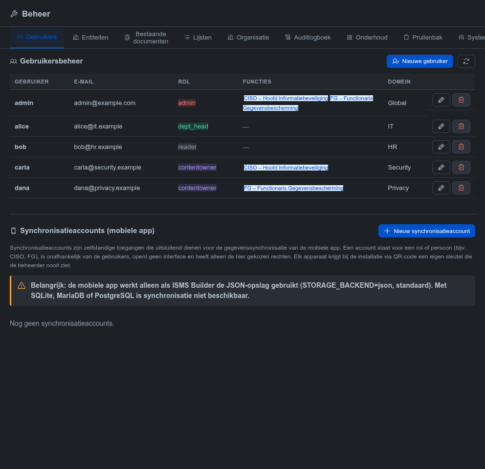
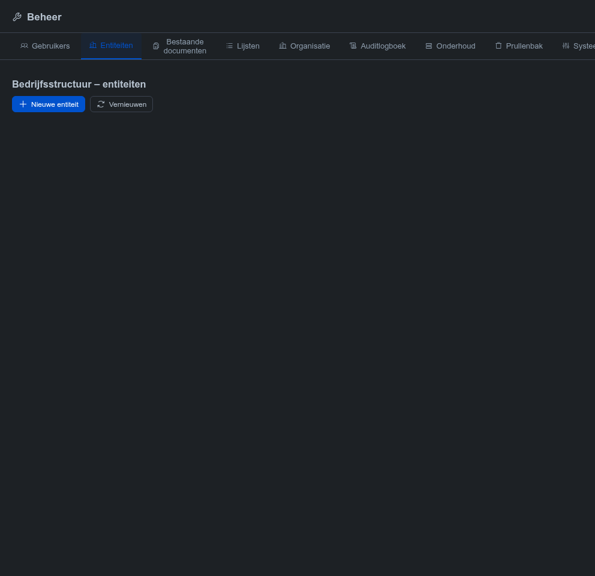
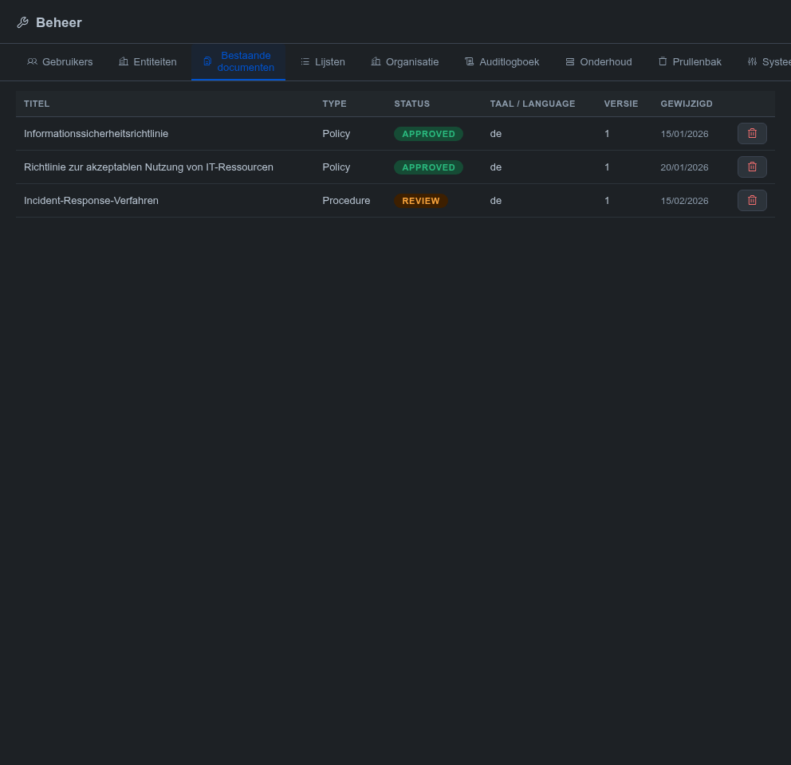
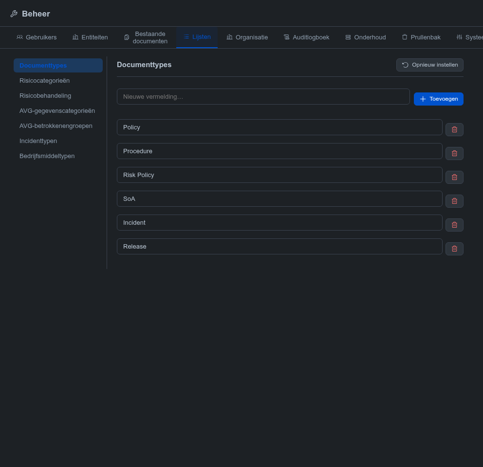
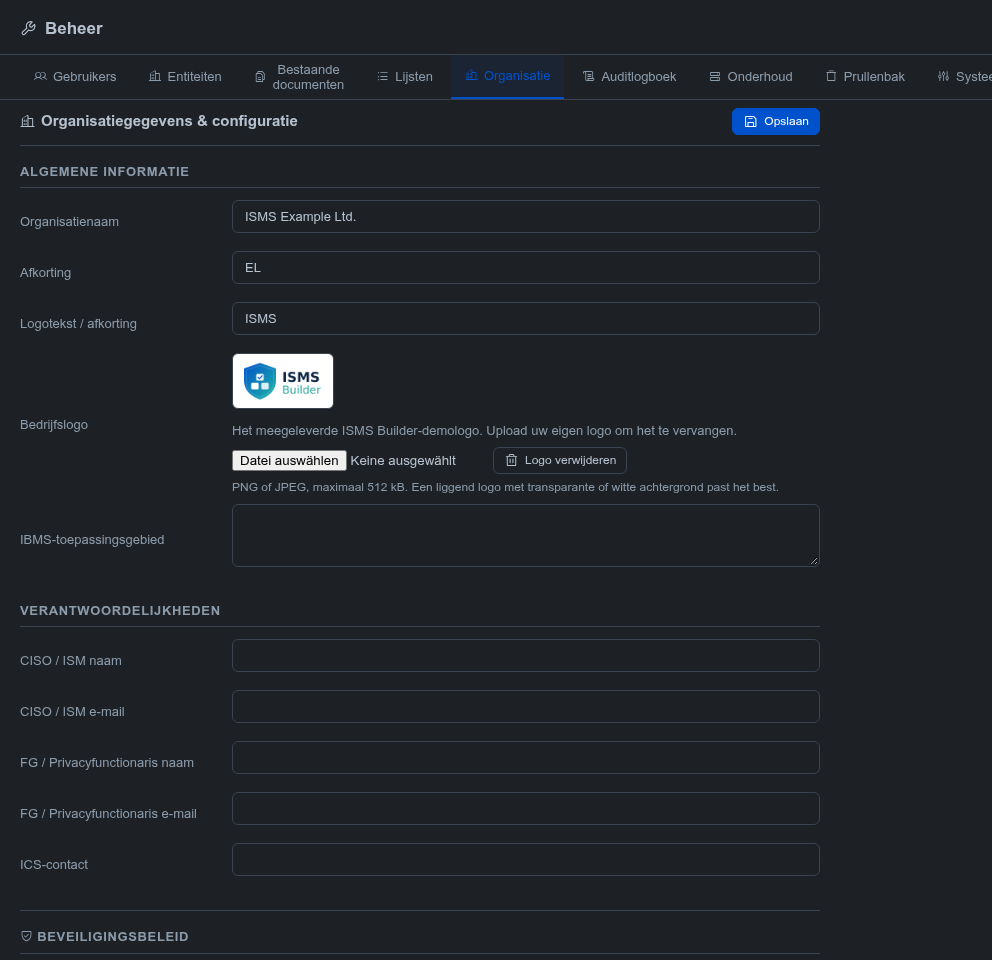
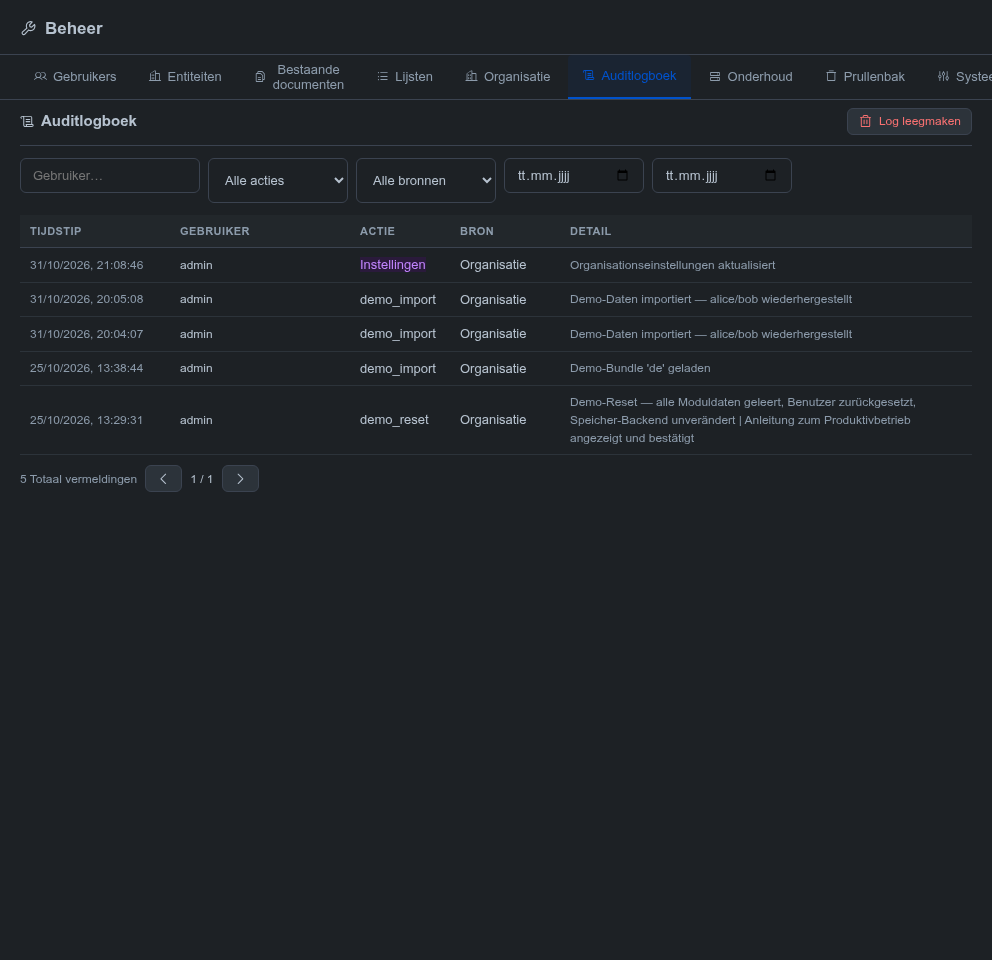
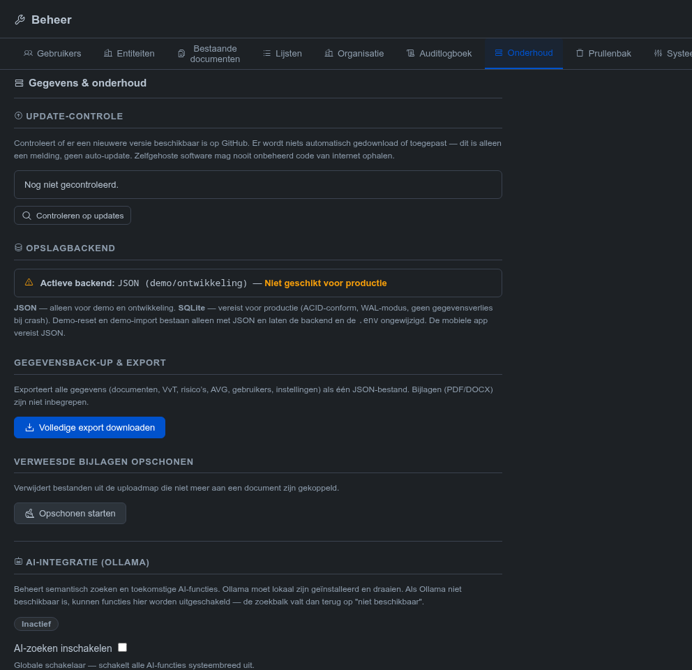
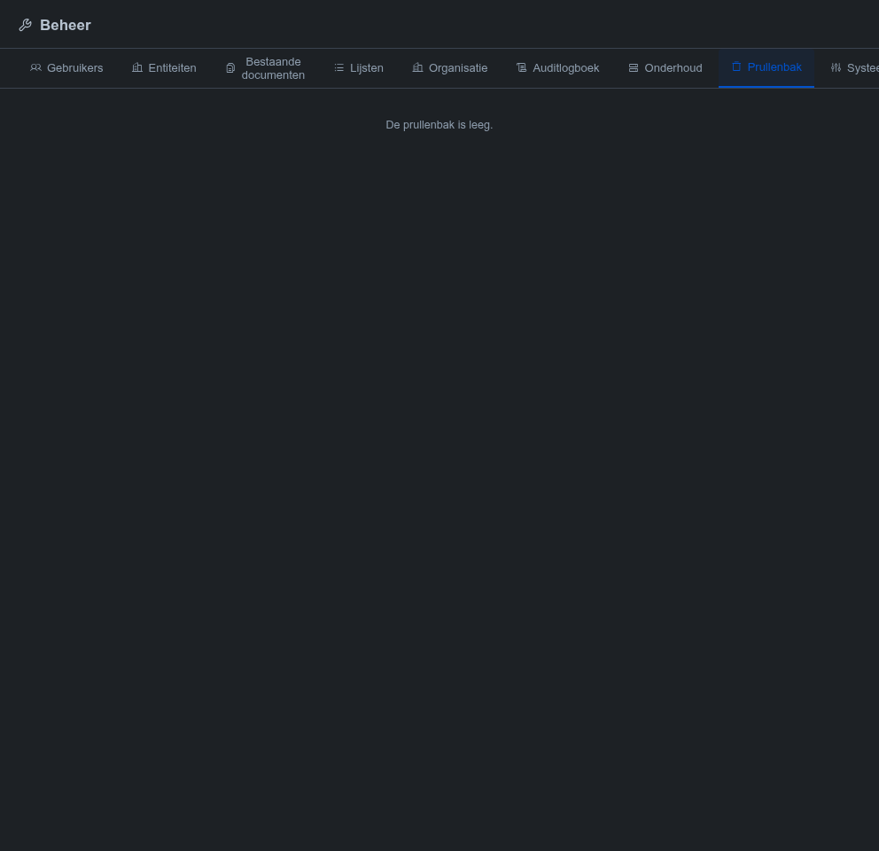
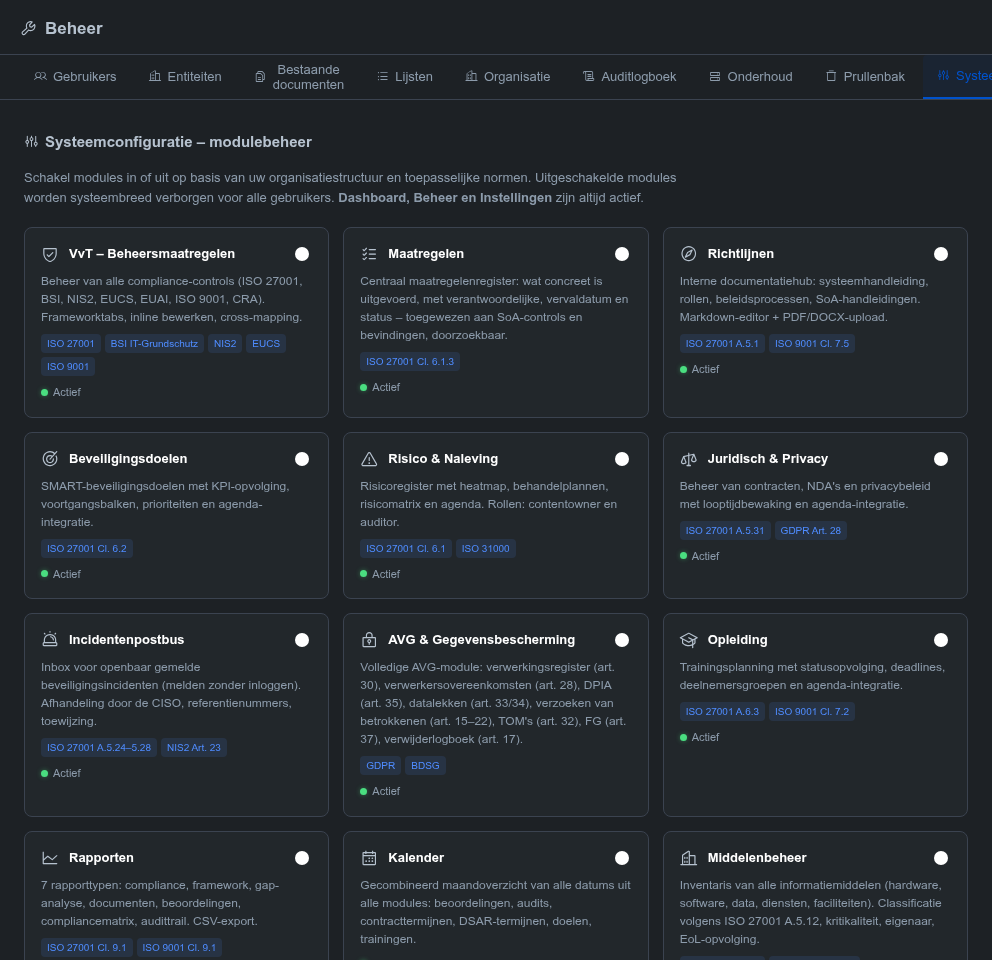

# Beheer (beheerconsole)

> Beheer is de centrale plek voor gebruikers, rollen, talen, diensten, gegevens en onderhoud. Het is **alleen zichtbaar voor gebruikers met de rol `admin`**. Deze handleiding beschrijft elk van de negen tabbladen, de typische taken en de valkuilen.

---

## Overzicht

Open **Admin** in de zijbalk. De console heeft negen tabbladen:

| Tabblad | Doel |
|---|---|
| **Gebruikers** | Accounts, rollen, functies, wachtwoorden; synchronisatieaccounts voor de mobiele app |
| **Entiteiten** | Bedrijfsstructuur (holding, dochterondernemingen) |
| **Bestaande documenten** | Overzicht van alle documenten met type, status, taal, versie |
| **Lijsten** | Keuzelijsten (documenttypen, risicocategorieën, gegevenscategorieën …) |
| **Organisatie** | Naam, logo, verantwoordelijken, 2FA-plicht, talen, e-mail, WebDAV, menu, organisatie-eenheden |
| **Auditlogboek** | Logboek van alle belangrijke acties |
| **Onderhoud** | Updatecontrole, export, opruimen, AI-schakelaar, scanimport, demo-reset en demo-import |
| **Prullenbak** | Verwijderde items van alle modules, herstellen |
| **Systeemconfiguratie** | Modules en compliance-kaders in- en uitschakelen |

**Basisregels**

- **Wijzigingen werken direct of na “Opslaan”.** Elke sectie heeft een eigen opslaanknop; niet-opgeslagen invoer gaat verloren bij het wisselen van tabblad.
- **Veel wordt vastgelegd in het auditlogboek** (gebruikers aanmaken, rollen wijzigen, instellingen, demo-reset/-import). Zie “Auditlogboek”.
- **Geheimen horen niet in een document of chat.** SMTP-wachtwoorden, sleutels en wachtwoorden worden na het opslaan niet meer getoond (uitzondering: zie SMTP).
- Verdere handleidingen onder Guidance: **Aanmelden, sessies en productiemodus**, **Organisatie & bedrijfslogo**, **Mobiele app & synchronisatie**, **AI-concepten**.

---

## 1. Gebruikers

### Gebruikers aanmaken en bewerken

**Nieuwe gebruiker** opent het formulier:

| Veld | Betekenis |
|---|---|
| **Gebruikersnaam** * | Uniek, achteraf niet te wijzigen (bij bewerken alleen-lezen) |
| **E-mail** * | Dient ook als inlognaam en voor meldingen |
| **Rol** * | Rechten in het systeem (tabel hieronder) |
| **Domein** | Gebied waartoe de gebruiker behoort (bijv. IT, HR, Global); standaard “Global” |
| **Organisatorische functies** | Meervoudige keuze, onafhankelijk van de rol |
| **Wachtwoord / herhaling** | Minimaal 8 tekens. Bij bewerken leeg laten om het wachtwoord te behouden |

Het door de beheerder toegekende wachtwoord kent alleen de beheerder: **de gebruiker moet het bij de eerste aanmelding wijzigen.** Ook een door u gereset wachtwoord moet bij de volgende aanmelding worden gewijzigd (behalve als u uw eigen wijzigt).

In de **productiemodus** worden bekende demowachtwoorden geweigerd. Zie de handleiding “Aanmelden, sessies en productiemodus”.

### Rollen

| Rol | Beschrijving |
|---|---|
| `reader` | Leestoegang |
| `revision` | Interne audit, alleen lezen |
| `editor` | Inhoud aanmaken en bewerken |
| `dept_head` | Afdelingshoofd (editor met afdelingsspecifieke weergaven) |
| `qmb` | Kwaliteitsmanager |
| `contentowner` | CISO / ISB / FG: goedkeuring, AVG, risico’s |
| `auditor` | ICS/OT-beveiliging, risicoauditor |
| `admin` | Systeembeheerder, alle rechten |

De rollen zijn naar rang geordend; een hogere rol omvat de rechten van de lagere. Details en de RACI-matrix staan in het systeemhandboek onder “Rollen & verantwoordelijkheden”.

### Functies

Functies zijn **onafhankelijk van de rol** en te combineren: **CISO**, **FG**, **QMO**, **BCM-manager**, **Afdelingshoofd**, **Interne auditor** en **Adminmelding** (contracten, reviews). Ze bepalen wie welke meldingen krijgt en wie inhoudelijke stappen mag uitvoeren. Voorbeeld: een DPIA wordt door de CISO voorbereid en de FG voert het advies in; beide kunnen aparte personen met de rol `contentowner` zijn.

### Gebruikers verwijderen

**Uw eigen account kan niet worden verwijderd.** Andere accounts worden verwijderd en in het auditlogboek vermeld. Blokkeer bij twijfel liever dan te verwijderen (rol `reader`, nieuw wachtwoord).

### Tweefactorauthenticatie

Elke gebruiker stelt 2FA zelf in onder **Instellingen**. De systeembrede plicht schakelt u in op het tabblad **Organisatie** (zie daar). Activeer de plicht pas **wanneer alle accounts 2FA hebben ingesteld**.

### Synchronisatieaccounts (mobiele app)

Synchronisatieaccounts zijn **zelfstandige toegangen uitsluitend voor de gegevenssynchronisatie van de mobiele app**. Ze zijn onafhankelijk van gebruikers, openen geen interface en hebben alleen de hier gekozen rechten.

1. **Nieuw synchronisatieaccount**: naam (bijv. “Tablet verkoop”), per module **geen toegang / lezen / lezen en schrijven** (documenten, SoA, risico’s, assets, bevindingen; guidance alleen-lezen), eventueel **Geldig tot** (leeg = onbeperkt).
2. **Apparaat instellen (QR-code)**: maakt een instelcode die **slechts eenmaal en kort** geldig is. Kies in de app “Apparaat instellen” en scan de QR-code. Elk apparaat krijgt **een eigen sleutel die de beheerder nooit ziet**.
3. **Apparaat blokkeren** werkt direct; andere apparaten van het account blijven bruikbaar. **Blokkeren/Vrijgeven/Verwijderen** gelden voor het hele account.
4. **Maatregelen** hebben geen eigen recht: ze zijn zichtbaar als minstens één gekoppelde module leesbaar is, en alleen te wijzigen met schrijfrecht op alle gekoppelde modules.

**Voorwaarde:** de app werkt alleen als ISMS Builder **JSON-opslag** gebruikt (`STORAGE_BACKEND=json`, standaard). Met SQLite, MariaDB of PostgreSQL is synchronisatie niet beschikbaar. Details: handleiding “Mobiele app & synchronisatie”.

---

## 2. Entiteiten

Beheer hier de **bedrijfsstructuur**: **Nieuwe entiteit** met **naam**, **korte naam** en **type** (holding of dochteronderneming). **Vernieuwen** laadt de lijst opnieuw. Entiteiten worden in andere modules toegewezen (bijv. betrokken entiteiten bij risico’s en audits).

---

## 3. Bestaande documenten

Het tabblad toont **alle bestaande documenten** (beleid, procedures enz.) als tabel met **titel, type, status, taal, versie** en **wijzigingsdatum**. Het dient als overzicht en voor controle (bijv. welke taalversies er zijn). Documenten bewerkt u in het documentengedeelte; zie “Documenten: gebruik” in het systeemhandboek.

---

## 4. Lijsten

De keuzelijsten die in de modules als dropdown verschijnen, zijn te beheren:

**Documenttypen, risicocategorieën, risicobehandeling, AVG-gegevenscategorieën, AVG-groepen betrokkenen, incidenttypen, assettypen.**

- Kies een lijst, voeg een item (**ID** en **label**) toe met **Toevoegen** of verwijder het met **Verwijderen**; labels zijn in de lijst aan te passen (niet gecontroleerd welke velden van bestaande items bewerkbaar zijn).
- **Herstellen** zet de meegeleverde standaardwaarden terug.
- Controleer vóór het verwijderen of de waarde nog in gegevens wordt gebruikt (niet gecontroleerd hoe de interface bestaande gegevens met verwijderde waarden toont).

---

## 5. Organisatie

Het tabblad bundelt de instellingen van de organisatie. Voor het bedrijfslogo in detail: handleiding “Organisatie & bedrijfslogo”. Elke sectie heeft een eigen opslaanknop.

### Algemene informatie

**Organisatienaam**, **korte naam**, **logotekst / afkorting**, **bedrijfslogo** (PNG of JPEG, hoogstens 512 kB, direct opgeslagen bij uploaden; **Logo verwijderen** herstelt het demologo) en **ISMS-reikwijdte**. Naam en logo verschijnen op de aanmeldpagina, in beleids-pdf’s en afdrukweergaven.

### Verantwoordelijkheden

**CISO/ISB** en **FG/GDPO** (naam en e-mail) en **ICS-contact**. De e-mailadressen zijn de ontvangers van meldingen en van de testmail. De eigenlijke rechten kent u toe via rol en functie van de gebruiker.

### Beveiligingsbeleid: 2FA-plicht

**Tweefactorauthenticatie systeembreed afdwingen.** Is de plicht actief, dan kunnen gebruikers **zonder ingestelde 2FA zich niet aanmelden**; de aanmelding wordt met een toelichting geweigerd. **Waarschuwing:** activeer pas wanneer **alle** accounts 2FA hebben ingesteld, anders sluit u de betrokken accounts direct buiten.

**Bescherming tegen buitensluiting:** De server schakelt de verplichting alleen in als uw eigen beheerdersaccount al 2FA heeft (anders verschijnt een melding en wordt niets gewijzigd); de interface toont het aantal accounts zonder 2FA. Kan niemand toch nog inloggen, dan helpt alleen de opdrachtregel (`node scripts/emergency-2fa.js disable-policy`) — zie de handleiding “inloggen, sessies en productiegebruik”, sectie “Nood”.

### Taalconfiguratie

Hier kiest u **welke talen in het systeem beschikbaar zijn** (Deutsch, English, Français, Nederlands, Magyar, Eesti) en welke **standaardtaal** de aanmeldpagina gebruikt. De keuze geldt ook voor de taalkeuze van **AI-concepten** (“Met AI maken”): precies de hier gekozen talen worden aangeboden, voorgeselecteerd met de interfacetaal. Zijn alle gekozen, dan worden alle aangeboden.

### E-mailmeldingen en SMTP

- **Dagelijkse digest-e-mail** aan CISO, GDPO en admin-e-mail; typen apart schakelbaar: hoge/kritieke risico’s, BCM-tests verschuldigd, leveranciersaudits verschuldigd, DSAR-termijnen, AVG-incidenten > 48 u open, verwijderlogboek, aflopende contracten, documentreviews.
- **SMTP-gegevens:** omgevingsvariabelen in de `.env` (`SMTP_HOST` enz.) **hebben altijd voorrang** en zijn veiliger. Een **hier ingevoerd SMTP-wachtwoord wordt in leesbare tekst in `org-settings.json` opgeslagen**; gebruik het alleen als de `.env` geen optie is.
- **Testmail verzenden** gaat naar het CISO-e-mailadres. Vul dat eerst in onder “Verantwoordelijkheden”.

### WebDAV-publicatie (Nextcloud/ownCloud)

Goedgekeurd beleid wordt als pdf naar een map geüpload. **Automatische publicatie bij goedkeuring inschakelen**, **basis-URL**, **gebruikersnaam**, **app-wachtwoord** (niet het hoofdaccountwachtwoord; app-wachtwoorden zijn afzonderlijk in te trekken), **doelmap**; **Verbinding testen**. Een storing van het externe systeem verhindert goedkeuring nooit; de fout wordt zichtbaar en is te herhalen met opnieuw synchroniseren in de documenteditor.

### Menuvolgorde

Pas de volgorde van de zijbalk aan door slepen of ↑/↓; **Volgorde opslaan**, **Standaard** herstelt de standaard. Dashboard, Admin en Instellingen worden altijd getoond.

### Organisatie-eenheden

Definieert de IT-organisatiestructuur (bijv. CIO → GroupIT / GroupApp → Local IT) met **naam, type, bovenliggend, leiding, beschrijving**. Ze wordt gebruikt voor het toewijzen van verantwoordelijkheden in alle modules (risico’s, assets, leveranciers, BCM, doelen, bevindingen).

---

### Pdf-lettertype

Onder **Organisatie → Pdf-lettertype** bepaalt u in welk lettertype alle pdf’s en afdrukweergaven verschijnen: documentexport, deelnamebevestiging, leveranciersformulier en de afdrukvensters van alle modules. Het lettertype wordt ingesloten zodat de speciale letters van **alle 24 officiële EU-talen** goed worden weergegeven (Latijn, Grieks, Cyrillisch).

- **Meegeleverd:** Liberation Sans (standaard, maten als Arial/Helvetica), Noto Sans en DejaVu Sans, elk met Regular, Bold en Italic en met licentietekst (`server/fonts/`, zie `THIRD-PARTY-LICENSES.md`).
- **Helvetica:** het standaard pdf-lettertype, niets wordt ingesloten (kleinste bestanden), maar alleen West-Europese tekens; al het andere verschijnt als ?.
- **Dikte-vast lettertype:** code en referenties (bijv. `F-2026-001`) verschijnen in **Nimbus Mono PS**, een Courier-achtige vervanger van URW++ die Latijn, Grieks en Cyrillisch dekt (licentie AGPL-3.0 met pdf-lettertype-uitzondering, `server/fonts/LICENSE-NimbusMonoPS.txt`). Dit geldt voor alle ingesloten lettertypen; bij “Helvetica” blijft Courier. Bij een eigen lettertype kunt u optioneel een eigen Mono-bestand uploaden.
- **Eigen lettertype:** upload TrueType of OpenType (maximaal 8 MB per bestand; “Regular” is verplicht, “Bold” en “Italic” zijn optioneel, anders wordt Regular gebruikt). U bevestigt dat uw licentie insluiten in pdf’s toestaat; lettertypen met een insluitbeperking worden geweigerd. Het bestand staat in de gegevensmap (`pdf-fonts/`, rechten 600), niet in het programma. “Eigen lettertype verwijderen” zet Liberation Sans terug.
- **Voorbeeld-pdf:** toont de speciale letters van alle EU-talen in het gekozen lettertype — controleer daarmee vóór het wisselen of alles verschijnt, zeker bij een eigen lettertype.
- **Let op:** de invoervelden in het invulbare pdf-formulier behouden het standaard pdf-lettertype; wat leveranciers daar typen, tekent hun pdf-programma. Ontbreekt een teken in het gekozen lettertype, dan verschijnt een tijdelijke aanduiding.

---

## 6. Auditlogboek

Het auditlogboek legt **tijdstip, gebruiker, actie, resource en detail** vast, bijv. aanmaken/wijzigen/verwijderen, aanmeldingen, instellingswijzigingen, demo-reset en -import.

- **Filters** op gebruiker, actie (Aangemaakt, Bijgewerkt, Verwijderd, Login, Logout, Export, Instellingen) en resource; onderaan staan het totaal en het paginanummer.
- Het logboek bewaart **hoogstens de laatste 2000 items**; oudere vallen weg bij nieuwe items.
- **Logboek wissen** verwijdert alle items (en legt het wissen zelf vast). Wis het logboek alleen als u het niet als bewijs nodig hebt; het is **geen fraudebestendig bewijs**.

---

## 7. Onderhoud

### Updatecontrole

**Naar updates zoeken** vraagt aan GitHub of er een nieuwere versie is. **Er wordt niets automatisch gedownload of toegepast**; u krijgt alleen een melding.

### Opslagbackend

Toont de actieve backend (JSON, SQLite, MariaDB, PostgreSQL). **JSON is de standaard en de huidige aanbeveling.** Wisselen gebeurt in de `.env` (`STORAGE_BACKEND`) met een herstart. **Mobiele app & synchronisatie** vereisen JSON.

### Back-up en export

**Volledige export downloaden** maakt een JSON-bestand met alle gegevens (documenten, SoA, risico’s, AVG, gebruikers, instellingen). **Bijlagen (PDF/DOCX) zijn niet inbegrepen**; maak daarvan en van de gegevensmap apart een back-up. Bewaar exports versleuteld en gescheiden; ze bevatten gebruikersgegevens.

### Back-up maken en terugzetten

De volledige export is een leesbaar uittreksel, **geen volledige back-up**: er bestaat geen import voor, en „Demogegevens importeren” is geen manier om terug te zetten. De eigenlijke back-up is de **gegevensmap** (`DATA_DIR`, standaard `data/`) samen met de `.env`; bij MariaDB of PostgreSQL ook de database.

**Back-up maken** (de server kort stoppen voor een consistente stand):

- **JSON en SQLite:** de gegevensmap archiveren, bijv. `tar czf isms-data-$(date +%F).tar.gz data .env`. De SQLite-database (`isms.db`) staat in de gegevensmap en is dus inbegrepen.
- **Docker:** op de host `tar czf ~/isms-data-$(date +%F).tar.gz ./data` (bind-mount).
- **MariaDB/PostgreSQL:** de database met de eigen hulpmiddelen back-uppen (bijv. `mariadb-dump`, `pg_dump`) en daarnaast de gegevensmap (bijlagen, logo).

**Terugzetten:**

1. De server stoppen.
2. De huidige gegevensmap hernoemen (niet verwijderen), zodat u terug kunt.
3. De opgeslagen gegevensmap en zo nodig de `.env` terugzetten; bij MariaDB/PostgreSQL de database uit de back-up laden.
4. De server starten, als beheerder aanmelden en steekproefsgewijs controleren (documenten, gebruikers, bijlagen).

De back-up bevat gebruikersaccounts, wachtwoord-hashes en 2FA-geheimen: versleuteld en gescheiden bewaren. Zet een back-up alleen terug in dezelfde of een nieuwere versie en oefen de procedure eerst op een testinstantie.

### Verweesde bijlagen opruimen

**Opruimen starten** verwijdert bestanden uit de uploadmap die bij geen enkel document meer horen.

### AI-integratie (Ollama)

Globale schakelaar **AI-zoeken inschakelen**: stuurt semantisch zoeken en toekomstige AI-functies aan. Ollama moet lokaal draaien; is het niet bereikbaar, dan valt zoeken terug op “niet beschikbaar”. De functie “Met AI maken” (prompt voor externe AI-apps) verstuurt zelf niets.

**API-sleutel (optioneel):** Wordt als `Authorization: Bearer …` naar het AI-adres gestuurd — ook bij een Ollama in uw eigen netwerk, bijvoorbeeld achter een reverse proxy of gateway. In het logboek van de gateway zijn alle verzoeken van de ISMS Builder dan eenduidig te herkennen (alle verzoeken sturen bovendien altijd `User-Agent: ISMS-Builder/<versie>`). De sleutel wordt **nooit meer getoond, niet gelogd en niet geëxporteerd**; een leeg veld laat de opgeslagen sleutel ongewijzigd, **Sleutel verwijderen** wist hem. Maximaal 512 zichtbare ASCII-tekens zijn toegestaan. Als alternatief stelt de beheerder hem in als omgevingsvariabele `OLLAMA_API_KEY` (bijv. uit een Docker-secret); een in de interface ingestelde sleutel gaat voor. Met sleutel worden **omleidingen niet gevolgd**, en bij een `http://`-adres naar een vreemde host waarschuwt de interface dat de sleutel onversleuteld zou worden verzonden. Net als het SMTP-wachtwoord staat de sleutel in de instellingen van de server (niet versleuteld): bescherm de toegang tot de gegevensmap. Adres en modellen gelden voor alle AI-functies, ook voor semantisch zoeken en de vectorindex.

### Greenbone-scanimport

Importeert een Greenbone-rapport (XML of PDF) als **risicoconcepten** (eventueel met entiteit en scanreferentie). Alle geïmporteerde risico’s hebben de status **needsReview** en moeten door een auditor of CISO worden gecontroleerd voordat ze actief zijn.

### Demo-reset (overstap naar productie)

Exporteert eerst alle demogegevens (automatische download), verwijdert daarna alle modulegegevens en alle gebruikers behalve `admin`, zet `admin` zonder 2FA terug op `adminpass` en beëindigt uw sessie. Bij het klikken opent **eerst de handleiding voor de productiemodus**; de overstap begint pas nadat u die hebt gelezen en bevestigd, en de actie wordt in het auditlogboek vermeld. **Niet ongedaan te maken** (behalve via demo-import met het gedownloade bestand). Details: handleiding “Aanmelden, sessies en productiemodus”. **Demo-reset en demo-import bestaan alleen met `STORAGE_BACKEND=json`** (anders fout 409); de opslagbackend en de `.env` blijven ongewijzigd. Gebruik bij andere backends `scripts/prepare-production.js` of maak de database leeg.

### Demogegevens importeren

Herstelt een eerder geëxporteerde demogegevensset. **Alle modulegegevens worden overschreven.** `alice` en `bob` keren terug met hun oorspronkelijke wachtwoorden, `admin` blijft ongewijzigd. Daarna geldt het systeem weer als demo (de demowachtwoorden zijn weer geldig). **Gebruik dit niet op een productiesysteem.**

### Demogegevensset in een taal laden

Met “Demopakket laden” (ook bij de eerste aanmelding van de beheerder) wordt een meegeleverde demogegevensset in de gekozen taal geladen (Deutsch, English, Français, Nederlands, Magyar, Eesti). Bestaande modulegegevens worden vervangen.

### Splashscherm bij aanmelden

Toont enkele seconden een bannerafbeelding na het aanmelden. **Splashscherm inschakelen** en **Duur (seconden)**, daarna **Opslaan**.

---

## 8. Prullenbak

Verwijderde items van **alle modules** komen eerst in de prullenbak met **Verwijderd door**, **Verwijderd op** en **Verloopt**. **Items worden na 30 dagen automatisch definitief verwijderd.** U kunt elk item **herstellen** of **definitief verwijderen** (niet ongedaan te maken, met bevestiging). Gebruik de prullenbak als vangnet tegen onbedoeld verwijderen, niet als archief.

---

## 9. Systeemconfiguratie (modules)

**Modules in-/uitschakelen** passend bij de organisatie en de toepasselijke normen: SoA, Maatregelen, Guidance, Beveiligingsdoelen, Risk & Compliance, Legal & Privacy, Incident Inbox, AVG & privacy, Training, Rapporten, Kalender, Assetbeheer, Governance, Bedrijfscontinuïteit, Toeleveringsketen, Audits. **Uitgeschakelde modules zijn voor alle gebruikers verborgen; de gegevens blijven behouden.** Dashboard, Admin en Instellingen zijn altijd actief.

**Actieve compliance-kaders:** ISO 27001:2022, BSI IT-Grundschutz, EU NIS2, EU Cloud (EUCS), EU AI Act, ISO 9000, ISO 9001, EU Cyber Resilience Act. Uitgeschakelde kaders worden verborgen in SoA, dashboard en rapporten. **Minstens één kader moet actief blijven.** Pas de keuze toe met **Configuratie opslaan en toepassen**. Ook het verzameltabblad **Custom Controls** (losse eigen controls) staat in deze lijst en kan worden uitgeschakeld als uw organisatie geen eigen controls gebruikt — bestaande controls blijven behouden.

**Eigen groepen:** Eigen kaders die in de SoA met **‘＋ Eigen groep’** zijn aangemaakt (bijv. NEN 7510, TISAX of een klanteis) verschijnen daaronder als kaarten met hun ID en het aantal controls. Daar kunt u ze in- en uitschakelen (zoals de ingebouwde kaders; ze tellen ook mee voor ‘Minstens één kader moet actief blijven’), **naam en kleur wijzigen** en — alleen als ze geen controls meer bevatten — **verwijderen**. De definities staan in `data/soa-frameworks.json`, maken deel uit van de volledige export en blijven bij de demoreset behouden. Aanmaken en importeren: zie `template-type-soa.md` en de gids ‘SoA & Audit’.

---

## Typische taken

**Nieuwe medewerker toevoegen:** Gebruikers → Nieuwe gebruiker → rol en functies kiezen → beginwachtwoord via een veilige weg doorgeven → de gebruiker wijzigt het bij de eerste aanmelding en stelt 2FA in.

**Mobiel apparaat instellen:** Gebruikers → Synchronisatieaccounts → account aanmaken of kiezen → Apparaat instellen (QR-code) → scannen in de app. **Apparaat kwijt:** Apparaat blokkeren; dat werkt direct.

**Talen vastleggen:** Organisatie → Taalconfiguratie → gewenste talen kiezen, standaardtaal instellen, taalinstellingen opslaan.

**Overstappen naar productie:** volledige export downloaden → handleiding voor de productiemodus lezen → demo-reset → als `admin` aanmelden, wachtwoord wijzigen, 2FA instellen → eigen gebruikers aanmaken.

**Regelmatig:** auditlogboek controleren, naar updates zoeken, volledige export en gegevensmap back-uppen, niet meer benodigde synchronisatieaccounts en gebruikers blokkeren.

---

## Valkuilen

- **2FA-plicht te vroeg geactiveerd** → accounts zonder 2FA zijn buitengesloten. Eerst controleren, dan activeren.
- **Demo-import op een productiesysteem** → overschrijft alle gegevens en maakt de demowachtwoorden weer geldig.
- **Demo-reset zonder volledige export** → het bestand wordt automatisch gedownload, maar bewaar het veilig voordat u doorgaat.
- **SMTP-wachtwoord in de instellingen** staat in leesbare tekst in `org-settings.json`; geef de voorkeur aan `.env`.
- **Synchronisatieaccount met schrijfrechten op te veel modules** → elk verbonden apparaat mag daar gegevens wijzigen. Houd rechten beperkt en stel een vervaldatum in.
- **Modules of kaders verborgen** → gegevens bestaan nog, maar zijn voor iedereen onzichtbaar.
