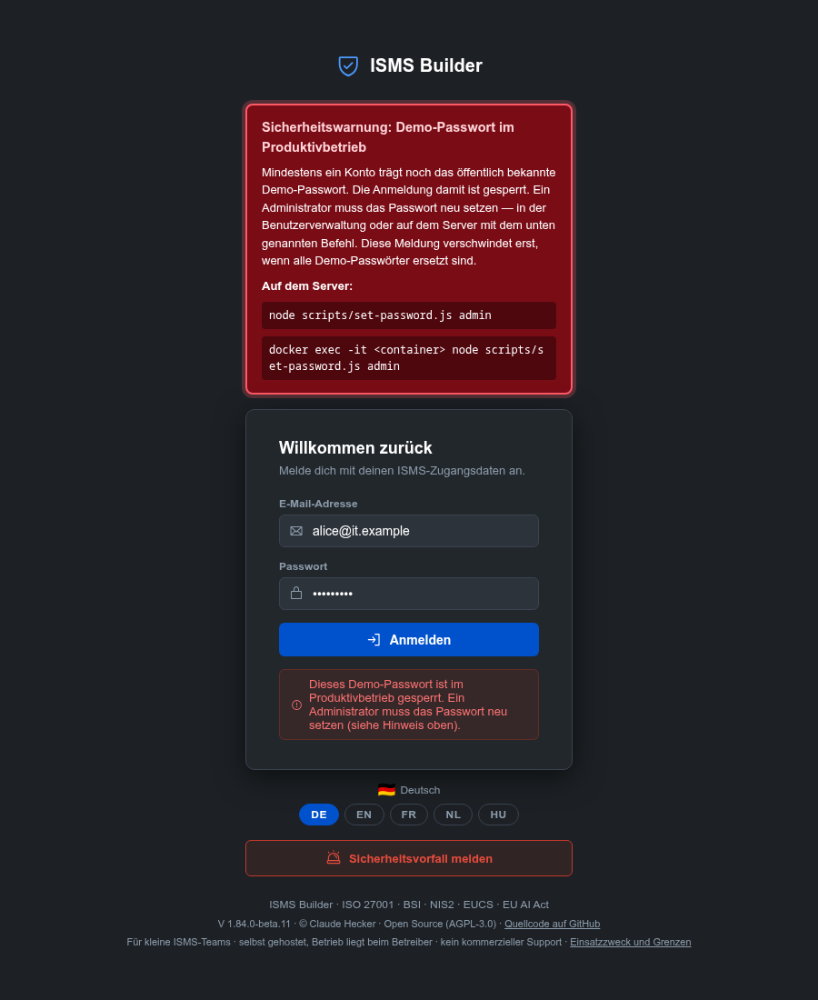

# Module: Sign-in, sessions and production use

> How sign-in is protected: **one session per account**, demo passwords **only in the demo**, cookie only over **HTTPS**. This guide is for administrators and operators.

---

## One concurrent session per account

Each account may have **only one session at a time**. When someone signs in with an account, the previous session of that account ends; at the next click it returns to the sign-in page.

**If you need two sessions at the same time** (two people, two devices or browsers), create a **separate account** for it. Accounts are not shared.

A session also ends: on **sign-out** (immediately, a copied token is worthless afterwards), on a **password change** (your own session stays), when an administrator **changes role, area or functions**, **resets a password** or **deletes the account**, and after **8 hours** (`JWT_EXPIRES_IN`).

Passwords need **at least 8 characters**. The access keys of the mobile app (sync) are separate and not affected by this rule.

## Demo and production

A new instance is a **demo** with the demo accounts (`admin`, `alice`, `bob`, `carla`, `dana`) and publicly known passwords (e.g. `adminpass`). The switch to **production** is done under **Administration → Demo reset** (or `scripts/prepare-production.js`); the system is then permanently marked as production.

Clicking **Administration → Maintenance → Demo reset** (and the command-line route `node scripts/prepare-production.js`) **first opens this guide** in a separate window. The confirm button only becomes available once you have scrolled to the end and at least 15 seconds have passed. **The switch only starts after you have confirmed and closed the window**; if the window is closed any other way or a pop-up is blocked, nothing is changed. The audit log entry “Demo reset” records that the guide was shown and confirmed. The guide does not appear during normal demo use.

**Backup:** Before anything is deleted, all demo data (modules, user list without passwords, settings, log, privacy and legal data) is exported as the file `isms-demo-export-<date>.json` and **downloaded automatically**. Please keep this file — the server stores no copy. Uploaded files (attachments, logo) are not included. On the command-line route, `prepare-production.js` instead creates a backup of the `data/` directory and shows its path.


In production the **demo passwords are blocked**: signing in with them is rejected and they cannot be assigned again. The only exception is the **handover** right after the reset: `admin` signs in with the initial password and must **set its own password immediately**; all other functions stay blocked until then.


## Warning about demo passwords in production

If an account in production still has its demo password, the system warns clearly — **the warning cannot be dismissed** and stays until all passwords are replaced:

- **Server log:** at start-up and every 30 minutes a conspicuous “SICHERHEITSWARNUNG” box with the affected accounts and the command to fix it.
- **Sign-in page:** a red notice (without account names). Anyone typing the demo password gets a “blocked” message.
- **Signed-in administrators:** a fixed red bar at the very top naming the affected accounts.




### How to fix it

1. **As another administrator:** Administration → Users → open the account → set a new password (the user must change it at the next sign-in).
2. **On the server** (also when the only administrator is affected): `node scripts/set-password.js admin` — in the Docker container: `docker exec -it <container> node scripts/set-password.js admin`. The password is asked for without echo; the account's existing sessions end.

## HTTPS

The session cookie gets the **Secure** flag and the server sends **HSTS** as soon as the request arrives over HTTPS: with your own certificate (`SSL_CERT_FILE`/`SSL_KEY_FILE`) or behind a proxy with **`TRUST_PROXY`** set (without it the app does not recognise HTTPS behind the proxy).

Over HTTP the system keeps working for now but **warns at start-up**: cookie and passwords can be read on the network. In a later release HTTP in production will only be allowed with `ALLOW_INSECURE_HTTP=true`. Run the system in production over HTTPS only.

## Notes for updating

- After the update **everyone signs in once more** (old sign-in tokens are no longer valid).
- Anyone using a **demo password** in production is locked out — see “How to fix it”.
- Behind a proxy set `TRUST_PROXY` so HTTPS is recognised.

_The screenshots show the German interface._

## Emergency: locked out by the 2FA requirement

If the **2FA requirement** is switched on under *Administration → Organization → Security policies* and **no administrator** has 2FA set up, nobody can sign in any more: sign-in answers `ENFORCE_2FA`, and 2FA can only be set up after signing in.

**Prevention.** The server only switches the requirement on if the acting administrator **has 2FA set up themselves** (otherwise error `ENFORCE_2FA_SELF`, nothing is changed). Before switching on, the interface shows how many accounts still have no 2FA. Set up 2FA for at least two administrators first. At startup the server writes a warning to the log if the requirement is on and no administrator has 2FA.

**Emergency path on the command line** (`scripts/emergency-2fa.js`, all storage backends; **stop the server first**, otherwise it overwrites the change):

```
node scripts/emergency-2fa.js status                      # show the state, changes nothing
node scripts/emergency-2fa.js disable-policy              # switch the 2FA requirement off
node scripts/emergency-2fa.js reset-user <username>       # reset the 2FA of one account
```

Docker: `docker exec -it <container> node scripts/emergency-2fa.js status`. The tool asks before every change (type JA; `--yes` skips the question), makes a backup copy with JSON storage (`*.notfall-<time>.bak`), records the change in the audit log (user `notfall-cli`) and never shows secrets. If a server is still running it aborts (`--force` overrides). Afterwards: start the server, sign in as administrator, **set up 2FA**, and only then switch the requirement on again.

Whoever can run the tool has access to the server's data; it is not a way around the server's access protection but the operator's way in.
