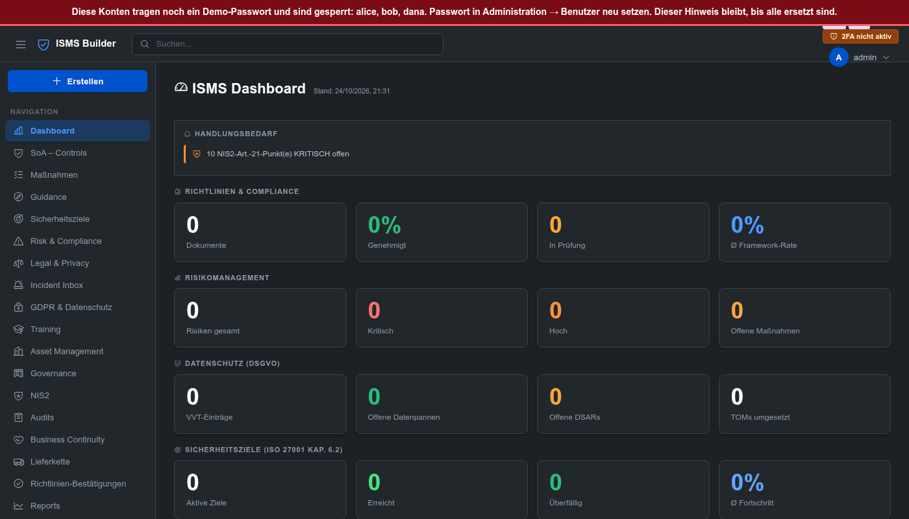

# Moodul: sisselogimine, seansid ja tootmiskasutus

> Kuidas sisselogimist kaitstakse: **üks seanss konto kohta**, demoparoolid **ainult demos**, küpsis ainult **HTTPS-i** kaudu. See juhend on mõeldud administraatoritele ja käitajatele.

---

## Üks samaaegne seanss konto kohta

Igal kontol võib olla **korraga ainult üks seanss**. Kui keegi logib kontoga sisse, lõpeb selle konto eelmine seanss; järgmisel klõpsul naaseb see sisselogimislehele.

**Kui vajate kahte samaaegset seanssi** (kaks inimest, kaks seadet või brauserit), looge selle jaoks **eraldi konto**. Kontosid ei jagata.

Seanss lõpeb ka: **väljalogimisel** (kohe, kopeeritud token on pärast väärtusetu), **parooli muutmisel** (teie enda seanss jääb), kui administraator **muudab rolli, valdkonda või funktsioone**, **lähtestab parooli** või **kustutab konto**, ning pärast **8 tundi** (`JWT_EXPIRES_IN`).

Paroolid vajavad **vähemalt 8 märki**. Mobiilirakenduse (sünkroonimise) juurdepääsuvõtmed on eraldi ja seda reeglit need ei puuduta.

## Demo ja tootmine

Uus paigaldus on **demo** demokontodega (`admin`, `alice`, `bob`, `carla`, `dana`) ja avalikult teadaolevate paroolidega (nt `adminpass`). Üleminek **tootmisse** tehakse jaotises **Haldus → Demo lähtestamine** (või `scripts/prepare-production.js`); süsteem märgitakse seejärel püsivalt tootmiseks.

Klõpsamine **Haldus → Hooldus → Demo lähtestamine** (ja käsurea tee `node scripts/prepare-production.js`) **avab esmalt selle juhendi** eraldi aknas. Kinnitusnupp muutub kättesaadavaks alles pärast lõpuni kerimist ja vähemalt 15 sekundi möödumist. **Üleminek algab alles pärast kinnitamist ja akna sulgemist**; kui aken suletakse muul viisil või hüpikaken blokeeritakse, ei muudeta midagi. Auditilogi kirje „Demo lähtestamine“ registreerib, et juhend kuvati ja kinnitati. Tavalise demokasutuse ajal juhendit ei kuvata.

**Varukoopia:** Enne mis tahes kustutamist eksporditakse kõik demoandmed (moodulid, paroolideta kasutajate loend, seaded, logi, andmekaitse- ja õigusandmed) failina `isms-demo-export-<kuupäev>.json` ja **laaditakse automaatselt alla**. Palun hoidke see fail alles — server ei salvesta koopiat. Üleslaaditud faile (manuseid, logo) ei kaasata. Käsurea teel loob `prepare-production.js` selle asemel kataloogi `data/` varukoopia ja näitab selle asukohta.


Tootmises on **demoparoolid blokeeritud**: nendega sisselogimine lükatakse tagasi ja neid ei saa uuesti määrata. Ainus erand on **üleandmine** vahetult pärast lähtestamist: `admin` logib sisse algse parooliga ja peab **kohe määrama oma parooli**; kõik muud funktsioonid jäävad seni blokeerituks.


## Hoiatus demoparoolide kohta tootmises

Kui tootmises on kontol veel demoparool, hoiatab süsteem selgelt — **hoiatust ei saa sulgeda** ja see jääb, kuni kõik paroolid on välja vahetatud:

- **Serverilogi:** käivitamisel ja iga 30 minuti järel silmatorkav kast „SICHERHEITSWARNUNG“ mõjutatud kontode ja parandamise käsuga.
- **Sisselogimisleht:** punane teade (ilma kontonimedeta). Kes sisestab demoparooli, saab teate „blokeeritud“.
- **Sisselogitud administraatorid:** fikseeritud punane riba kõige ülaosas, mis nimetab mõjutatud kontosid.




### Kuidas parandada

1. **Teise administraatorina:** Haldus → Kasutajad → ava konto → määra uus parool (kasutaja peab selle järgmisel sisselogimisel muutma).
2. **Serveris** (ka siis, kui mõjutatud on ainus administraator): `node scripts/set-password.js admin` — Dockeri konteineris: `docker exec -it <container> node scripts/set-password.js admin`. Parooli küsitakse kajata; konto olemasolevad seansid lõpevad.

## HTTPS

Seansiküpsis saab lipu **Secure** ja server saadab **HSTS**-i niipea, kui päring saabub HTTPS-i kaudu: oma sertifikaadiga (`SSL_CERT_FILE`/`SSL_KEY_FILE`) või puhverserveri taga, kus on seatud **`TRUST_PROXY`** (ilma selleta ei tunne rakendus puhverserveri taga HTTPS-i ära).

HTTP-ga süsteem esialgu töötab, kuid **hoiatab käivitamisel**: küpsist ja paroole saab võrgus lugeda. Hilisemas väljalaskes lubatakse HTTP tootmises ainult koos `ALLOW_INSECURE_HTTP=true`. Käitage süsteemi tootmises ainult HTTPS-iga.

## Märkused uuendamiseks

- Pärast uuendust **logivad kõik uuesti sisse** (vanad sisselogimistokenid ei kehti enam).
- Igaüks, kes kasutab tootmises **demoparooli**, jääb välja — vt „Kuidas parandada“.
- Puhverserveri taga seadke `TRUST_PROXY`, et HTTPS ära tunda.

_Ekraanipildid näitavad saksakeelset kasutajaliidest._

## Hädaabi: 2FA-kohustus lukustas välja

Kui **2FA-kohustus** on sisse lülitatud (*Administreerimine → Organisatsioon → Turvapoliitikad*) ja **ühelgi administraatoril** pole 2FA seadistatud, ei saa keegi enam sisse logida: sisselogimine vastab `ENFORCE_2FA`, ja 2FA-d saab seadistada alles pärast sisselogimist.

**Ennetamine.** Server lülitab kohustuse sisse ainult siis, kui tegutsev administraator **ise** on 2FA seadistanud (muidu viga `ENFORCE_2FA_SELF`, midagi ei muudeta). Enne sisselülitamist näitab liides, mitmel kontol pole veel 2FA-d. Seadistage 2FA esmalt vähemalt kahele administraatorile. Käivitamisel kirjutab server logisse hoiatuse, kui kohustus on sees ja ühelgi administraatoril pole 2FA-d.

**Hädaabi käsureal** (`scripts/emergency-2fa.js`, kõik salvestustaustad; **peatage server enne**, muidu kirjutab ta muudatuse üle):

```
node scripts/emergency-2fa.js status                      # näitab seisu, ei muuda midagi
node scripts/emergency-2fa.js disable-policy              # lülitab 2FA-kohustuse välja
node scripts/emergency-2fa.js reset-user <kasutajanimi>   # lähtestab ühe konto 2FA
```

Docker: `docker exec -it <konteiner> node scripts/emergency-2fa.js status`. Tööriist küsib enne iga muudatust (tippige JA; `--yes` jätab küsimuse vahele), teeb JSON-salvestuse puhul varukoopia (`*.notfall-<aeg>.bak`), kannab muudatuse auditilogisse (kasutaja `notfall-cli`) ega näita kunagi saladusi. Kui server veel töötab, katkestab ta (`--force` sunnib). Seejärel: käivitage server, logige administraatorina sisse, **seadistage 2FA** ja alles siis lülitage kohustus uuesti sisse.

Kes tööriista käivitada saab, pääseb ligi serveri andmetele; see pole möödapääs serveri juurdepääsukaitsest, vaid operaatori tee.
