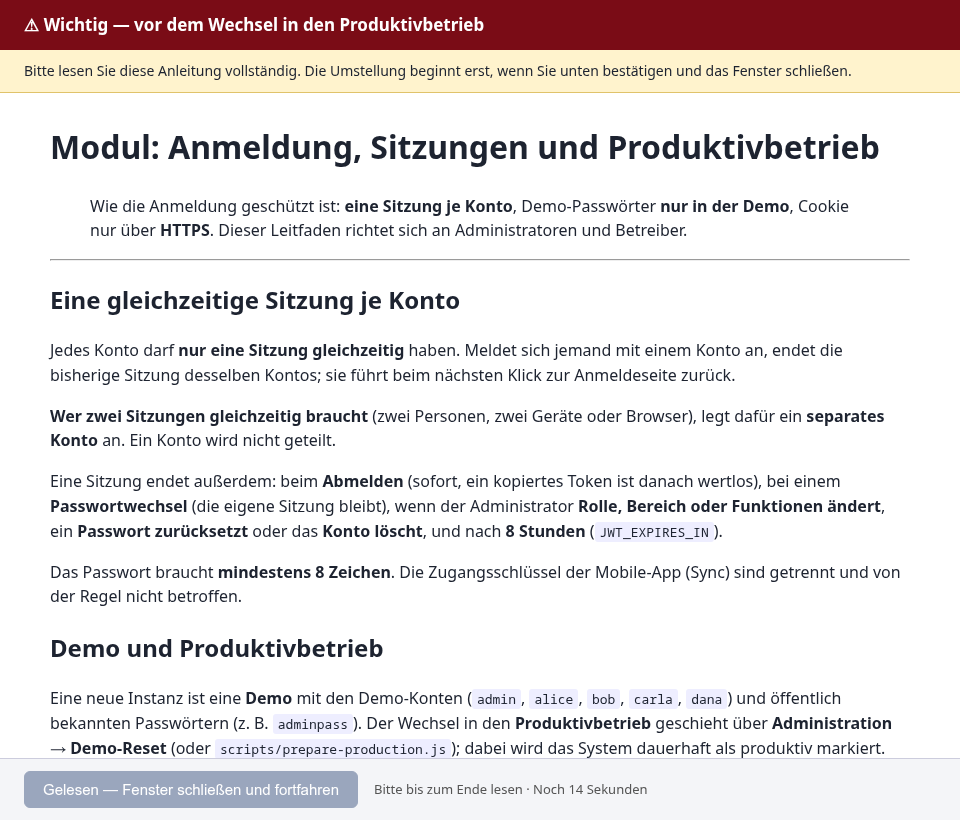

# Modul: Bejelentkezés, munkamenetek és éles üzem

> Hogyan védett a bejelentkezés: **fiókonként egy munkamenet**, demójelszavak **csak a demóban**, süti csak **HTTPS** felett. Ez az útmutató rendszergazdáknak és üzemeltetőknek szól.

---

## Fiókonként egy egyidejű munkamenet

Minden fióknak **egyszerre csak egy munkamenete** lehet. Ha valaki bejelentkezik egy fiókkal, az adott fiók korábbi munkamenete véget ér; a következő kattintásnál a bejelentkezési oldalra tér vissza.

**Aki egyszerre két munkamenetet szeretne** (két személy, két eszköz vagy böngésző), hozzon létre erre **külön fiókot**. Fiókot nem osztunk meg.

A munkamenet véget ér továbbá: **kijelentkezéskor** (azonnal, a lemásolt token utána értéktelen), **jelszóváltoztatáskor** (a saját munkamenet marad), ha a rendszergazda **szerepet, területet vagy funkciókat módosít**, **jelszót állít vissza** vagy **törli a fiókot**, valamint **8 óra** után (`JWT_EXPIRES_IN`).

A jelszó legalább **8 karakter** legyen. A mobilalkalmazás hozzáférési kulcsai (szinkron) külön állnak, a szabály nem vonatkozik rájuk.

## Demó és éles üzem

Az új példány **demó** a demófiókokkal (`admin`, `alice`, `bob`, `carla`, `dana`) és nyilvánosan ismert jelszavakkal (pl. `adminpass`). Az **éles üzemre** váltás az **Adminisztráció → Demó visszaállítás** menüben (vagy a `scripts/prepare-production.js` szkripttel) történik; a rendszer ezután tartósan élesként van megjelölve.

A **Adminisztráció → Karbantartás → Demó visszaállítás** gombra (és a parancssoros `node scripts/prepare-production.js` útvonalra) kattintva **először ez az útmutató** nyílik meg külön ablakban. A megerősítő gomb csak akkor válik elérhetővé, ha az ablak végéig legörgetett, és legalább 15 másodperc eltelt. **Az átállás csak azután kezdődik, hogy megerősítette és bezárta az ablakot**; ha az ablakot másképp zárják be, vagy a felugró ablakot blokkolják, semmi sem változik. A „Demó visszaállítás” audit-naplóbejegyzés rögzíti, hogy az útmutatót megjelenítették és megerősítették. A rendes demóhasználat során az útmutató nem jelenik meg.

**Biztonsági mentés:** a törlés előtt az összes demóadat (modulok, jelszavak nélküli felhasználólista, beállítások, napló, adatvédelmi és jogi adatok) exportálásra kerül az `isms-demo-export-<dátum>.json` fájlba, és **automatikusan letöltődik**. Kérjük, őrizze meg ezt a fájlt — a szerver nem tárol másolatot. A feltöltött fájlok (mellékletek, logó) nem szerepelnek benne. A parancssoros útvonalon a `prepare-production.js` ehelyett biztonsági másolatot készít a `data/` könyvtárról, és megjeleníti az útvonalat.



Éles üzemben a **demójelszavak le vannak tiltva**: az ezekkel való bejelentkezés elutasításra kerül, és újra sem adhatók meg. Az egyetlen kivétel az **átadás** közvetlenül a visszaállítás után: az `admin` a kezdőjelszóval jelentkezik be, és **azonnal saját jelszót kell megadnia**; addig minden más funkció le van zárva.


## Figyelmeztetés demójelszavakra éles üzemben

Ha éles üzemben egy fiók még a demójelszavát használja, a rendszer egyértelműen figyelmeztet — **a figyelmeztetés nem zárható be**, és addig marad, amíg minden jelszó ki nem cserélődik:

- **Szervernapló:** induláskor, majd 30 percenként feltűnő „SICHERHEITSWARNUNG” keret az érintett fiókokkal és a javító paranccsal.
- **Bejelentkezési oldal:** piros figyelmeztető mező (fióknevek nélkül). Aki a demójelszót beírja, „letiltva” üzenetet kap.
- **Bejelentkezett rendszergazdák:** fix piros sáv legfelül az érintett fiókokkal.


### Így javíthatja ki

1. **Másik rendszergazdaként:** Adminisztráció → Felhasználók → fiók megnyitása → új jelszó beállítása (a felhasználónak a következő bejelentkezéskor meg kell változtatnia).
2. **A szerveren** (akkor is, ha az egyetlen rendszergazda érintett): `node scripts/set-password.js admin` — Docker-tárolóban: `docker exec -it <container> node scripts/set-password.js admin`. A jelszót visszhang nélkül kéri; a fiók meglévő munkamenetei véget érnek.

## HTTPS

A munkamenet-süti **Secure** jelzőt kap, a szerver pedig **HSTS**-t küld, amint a kérés HTTPS-en érkezik: saját tanúsítvánnyal (`SSL_CERT_FILE`/`SSL_KEY_FILE`) vagy olyan proxy mögött, amelynél be van állítva a **`TRUST_PROXY`** (e változó nélkül az alkalmazás nem ismeri fel a HTTPS-t a proxy mögött).

HTTP-n a rendszer egyelőre tovább működik, de **induláskor figyelmeztet**: a süti és a jelszavak a hálózaton olvashatók. Egy későbbi kiadásban a HTTP éles üzemben csak `ALLOW_INSECURE_HTTP=true` esetén lesz engedélyezett. Éles üzemben csak HTTPS-en üzemeltesse a rendszert.

## Megjegyzések a frissítéshez

- A frissítés után **mindenki egyszer újra bejelentkezik** (a régi bejelentkezési tokenek érvénytelenek).
- Aki éles üzemben még **demójelszót** használ, ki lesz zárva — lásd „Így javíthatja ki”.
- Proxy mögött állítsa be a `TRUST_PROXY`-t, hogy a HTTPS felismerhető legyen.

_A képernyőképek a német felületet mutatják._

## Vészhelyzet: kizárás a 2FA-kötelezettség miatt

Ha a **2FA-kötelezettség** be van kapcsolva (*Adminisztráció → Szervezet → Biztonsági szabályzatok*), és **egyetlen rendszergazdának** sincs beállított 2FA-ja, senki sem tud bejelentkezni: a bejelentkezés `ENFORCE_2FA` választ ad, a 2FA-t pedig csak bejelentkezés után lehet beállítani.

**Megelőzés.** A szerver csak akkor kapcsolja be a kötelezettséget, ha a művelet végrehajtó rendszergazdának **saját** beállított 2FA-ja van (különben `ENFORCE_2FA_SELF` hiba, semmi sem változik). Bekapcsolás előtt a felület megmutatja, hány fióknak nincs még 2FA-ja. Először állítson be 2FA-t legalább két rendszergazdának. Indításkor a szerver figyelmeztetést ír a naplóba, ha a kötelezettség be van kapcsolva és egyetlen rendszergazdának sincs 2FA-ja.

**Vészút a parancssorban** (`scripts/emergency-2fa.js`, minden tárolási háttér; **előbb állítsa le a szervert**, különben felülírja a módosítást):

```
node scripts/emergency-2fa.js status                      # az állapotot mutatja, nem módosít
node scripts/emergency-2fa.js disable-policy              # kikapcsolja a 2FA-kötelezettséget
node scripts/emergency-2fa.js reset-user <felhasználónév> # egy fiók 2FA-ját visszaállítja
```

Docker: `docker exec -it <konténer> node scripts/emergency-2fa.js status`. Az eszköz minden módosítás előtt rákérdez (JA beírása; a `--yes` kihagyja a kérdést), JSON tárolásnál biztonsági másolatot készít (`*.notfall-<idő>.bak`), a módosítást bejegyzi az audit naplóba (`notfall-cli` felhasználó), és soha nem ír ki titkokat. Ha még fut a szerver, megszakad (`--force` kikényszeríti). Utána: indítsa el a szervert, jelentkezzen be rendszergazdaként, **állítsa be a 2FA-t**, és csak ezután kapcsolja vissza a kötelezettséget.

Aki az eszközt futtatni tudja, hozzáfér a szerver adataihoz; ez nem kerülőút a hozzáférés-védelem mellett, hanem az üzemeltető útja.
