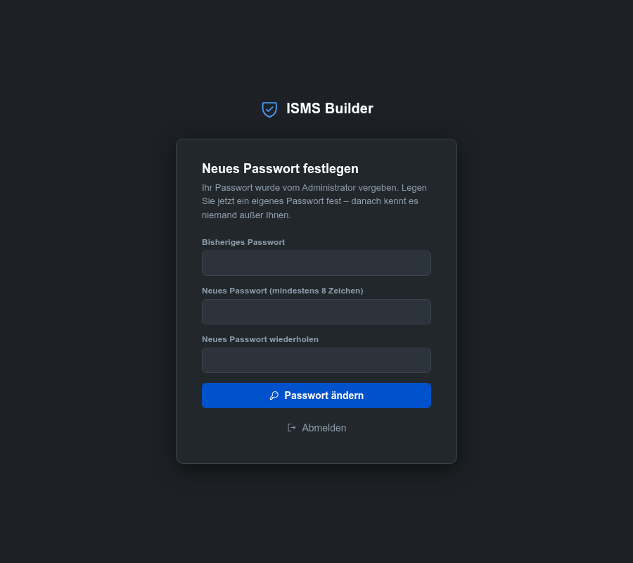

# Modul: Anmeldung, Sitzungen und Produktivbetrieb

> Wie die Anmeldung geschützt ist: **eine Sitzung je Konto**, Demo-Passwörter **nur in der Demo**, Cookie nur über **HTTPS**. Dieser Leitfaden richtet sich an Administratoren und Betreiber.

---

## Eine gleichzeitige Sitzung je Konto

Jedes Konto darf **nur eine Sitzung gleichzeitig** haben. Meldet sich jemand mit einem Konto an, endet die bisherige Sitzung desselben Kontos; sie führt beim nächsten Klick zur Anmeldeseite zurück.

**Wer zwei Sitzungen gleichzeitig braucht** (zwei Personen, zwei Geräte oder Browser), legt dafür ein **separates Konto** an. Ein Konto wird nicht geteilt.

Eine Sitzung endet außerdem: beim **Abmelden** (sofort, ein kopiertes Token ist danach wertlos), bei einem **Passwortwechsel** (die eigene Sitzung bleibt), wenn der Administrator **Rolle, Bereich oder Funktionen ändert**, ein **Passwort zurücksetzt** oder das **Konto löscht**, und nach **8 Stunden** (`JWT_EXPIRES_IN`).

Das Passwort braucht **mindestens 8 Zeichen**. Die Zugangsschlüssel der Mobile-App (Sync) sind getrennt und von der Regel nicht betroffen.

## Demo und Produktivbetrieb

Eine neue Instanz ist eine **Demo** mit den Demo-Konten (`admin`, `alice`, `bob`, `carla`, `dana`) und öffentlich bekannten Passwörtern (z. B. `adminpass`). Der Wechsel in den **Produktivbetrieb** geschieht über **Administration → Demo-Reset** (oder `scripts/prepare-production.js`); dabei wird das System dauerhaft als produktiv markiert.

Beim Klick auf **Administration → Wartung → Demo-Reset** (und beim Kommandozeilenweg `node scripts/prepare-production.js`) öffnet sich **zuerst diese Anleitung** in einem eigenen Fenster. Der Bestätigungsknopf wird erst frei, wenn Sie bis zum Ende gescrollt haben und mindestens 15 Sekunden vergangen sind. **Die Umstellung beginnt erst, nachdem Sie bestätigt und das Fenster geschlossen haben**; wird das Fenster anders geschlossen oder ein Pop-up blockiert, wird nichts geändert. Im Audit-Log steht beim Eintrag „Demo-Reset“, dass die Anleitung angezeigt und bestätigt wurde. In der Demo selbst erscheint die Anleitung nicht.

**Datensicherung:** Vor dem Löschen werden alle Demodaten (Module, Benutzerliste ohne Passwörter, Einstellungen, Protokoll, Datenschutz- und Rechtsdaten) als Datei `isms-demo-export-<Datum>.json` exportiert und **automatisch heruntergeladen**. Bitte bewahren Sie diese Datei auf — der Server speichert keine Kopie. Hochgeladene Dateien (Anhänge, Logo) sind nicht enthalten. Beim Kommandozeilenweg legt `prepare-production.js` stattdessen ein Backup des Datenverzeichnisses `data/` an und zeigt den Pfad.


Im Produktivbetrieb sind die **Demo-Passwörter gesperrt**: Die Anmeldung damit wird abgelehnt und sie lassen sich nicht neu vergeben. Einzige Ausnahme ist die **Übergabe** direkt nach dem Reset: `admin` meldet sich mit dem Anfangspasswort an und muss **sofort ein eigenes Passwort festlegen**; bis dahin sind alle anderen Funktionen gesperrt.



## Warnung bei Demo-Passwörtern im Produktivbetrieb

Trägt im Produktivbetrieb noch ein Konto sein Demo-Passwort, warnt das System deutlich — **die Warnung lässt sich nicht wegklicken** und bleibt, bis alle Passwörter ersetzt sind:

- **Serverlog:** beim Start und danach alle 30 Minuten ein auffälliger Kasten „SICHERHEITSWARNUNG“ mit den betroffenen Konten und dem Befehl zum Beheben.
- **Anmeldeseite:** ein rotes Hinweisfeld (ohne Kontonamen). Wer das Demo-Passwort eintippt, erhält die Meldung „gesperrt“.
- **Angemeldete Administratoren:** eine feste rote Leiste ganz oben mit den betroffenen Konten.


### So beheben Sie es

1. **Als anderer Administrator:** Administration → Benutzer → Konto öffnen → neues Passwort setzen (der Benutzer muss es beim nächsten Login ändern).
2. **Auf dem Server** (auch wenn der einzige Administrator betroffen ist): `node scripts/set-password.js admin` — im Docker-Container: `docker exec -it <container> node scripts/set-password.js admin`. Das Passwort wird verdeckt abgefragt, bestehende Sitzungen des Kontos enden.

## HTTPS

Das Sitzungs-Cookie bekommt das Flag **Secure** und der Server sendet **HSTS**, sobald die Anfrage über HTTPS kommt: mit eigenem Zertifikat (`SSL_CERT_FILE`/`SSL_KEY_FILE`) oder hinter einem Proxy mit gesetztem **`TRUST_PROXY`** (ohne diese Variable erkennt die App HTTPS hinter dem Proxy nicht).

Über HTTP läuft das System vorerst weiter, **warnt aber beim Start**: Cookie und Passwörter sind dort im Netz mitlesbar. In einem späteren Release wird HTTP in Produktion nur noch mit `ALLOW_INSECURE_HTTP=true` erlaubt. Betreiben Sie das System produktiv nur über HTTPS.

## Hinweise zum Update

- Nach dem Update **melden sich alle einmal neu an** (alte Anmelde-Token gelten nicht mehr).
- Wer produktiv noch ein **Demo-Passwort** nutzt, wird ausgesperrt — siehe „So beheben Sie es“.
- Hinter einem Proxy `TRUST_PROXY` setzen, damit HTTPS erkannt wird.

_Die Screenshots zeigen die deutsche Oberfläche._

## Notfall: Aussperrung durch die 2FA-Pflicht

Ist unter *Administration → Organisation → Sicherheitsrichtlinien* die **2FA-Pflicht** eingeschaltet und hat **kein Administrator** eine eingerichtete 2FA, kann sich niemand mehr anmelden: Die Anmeldung antwortet mit `ENFORCE_2FA`, und die 2FA lässt sich nur nach einer Anmeldung einrichten.

**Vorbeugung.** Der Server schaltet die Pflicht nur ein, wenn der handelnde Administrator **selbst** eine eingerichtete 2FA hat (sonst Fehler `ENFORCE_2FA_SELF`, nichts wird geändert). Die Oberfläche nennt vor dem Einschalten, wie viele Konten noch keine 2FA haben. Richten Sie vorher 2FA für mindestens zwei Administratoren ein. Beim Start schreibt der Server eine Warnung ins Log, wenn die Pflicht an ist und kein Administrator 2FA hat.

**Notweg auf der Kommandozeile** (`scripts/emergency-2fa.js`, alle Speicher-Backends; **den Server vorher beenden**, sonst überschreibt er die Änderung):

```
node scripts/emergency-2fa.js status                      # Zustand anzeigen, ändert nichts
node scripts/emergency-2fa.js disable-policy              # 2FA-Pflicht ausschalten
node scripts/emergency-2fa.js reset-user <benutzername>   # 2FA eines Kontos zurücksetzen
```

Docker: `docker exec -it <container> node scripts/emergency-2fa.js status`. Das Werkzeug fragt vor jeder Änderung (JA tippen; `--yes` überspringt die Frage), legt bei JSON-Speicher eine Sicherungskopie an (`*.notfall-<Zeit>.bak`), trägt die Änderung im Audit-Log ein (Benutzer `notfall-cli`) und zeigt nie Geheimnisse. Läuft noch ein Server, bricht es ab (`--force` erzwingt). Danach: Server starten, als Administrator anmelden, **2FA einrichten**, erst dann die Pflicht wieder einschalten.

Wer das Werkzeug ausführen kann, hat Zugriff auf die Daten des Servers; es ist kein Weg am Zugriffsschutz des Servers vorbei, sondern der Weg für den Betreiber.
