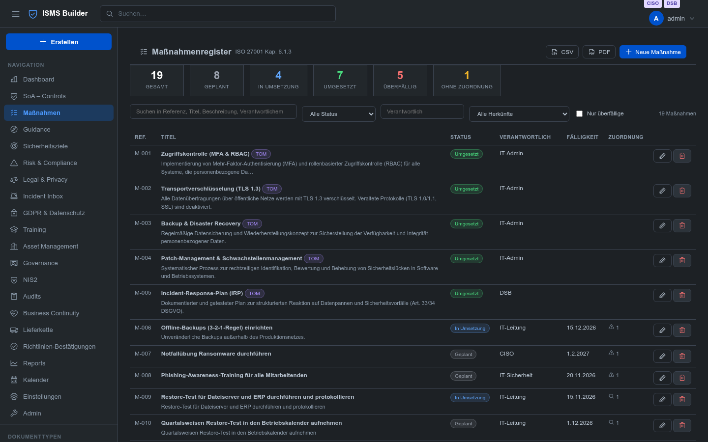
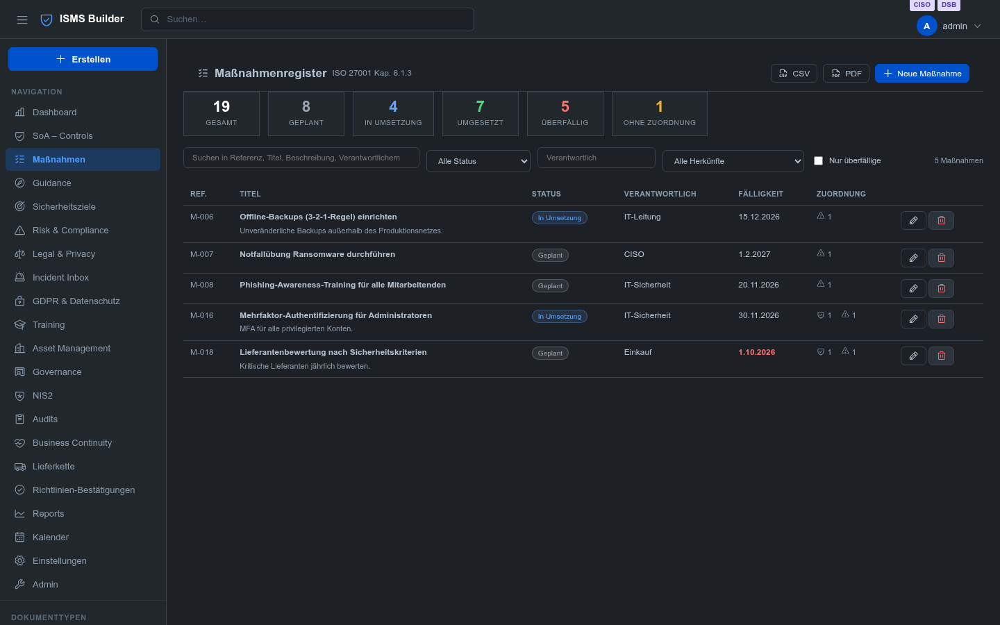
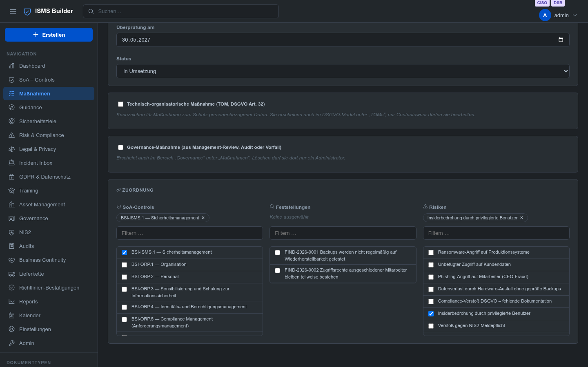
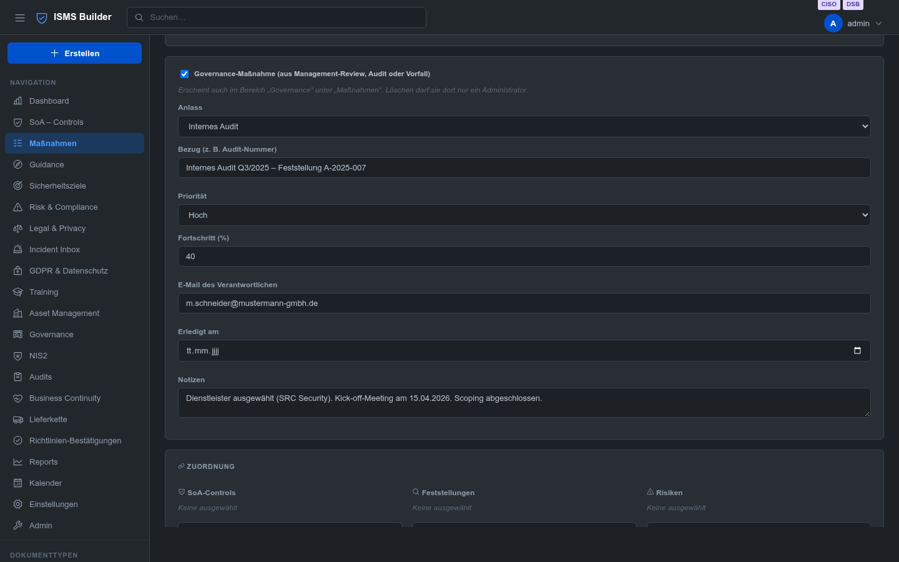
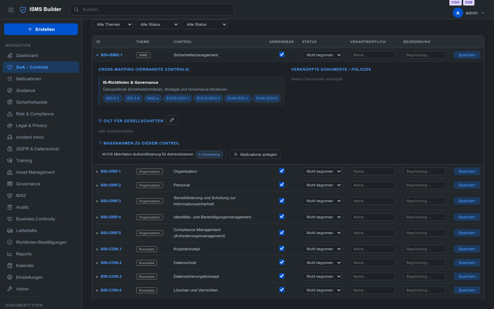
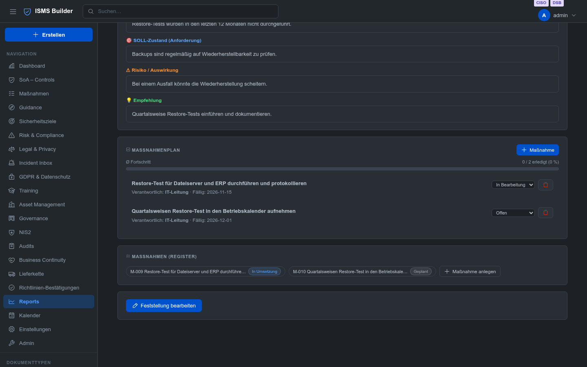
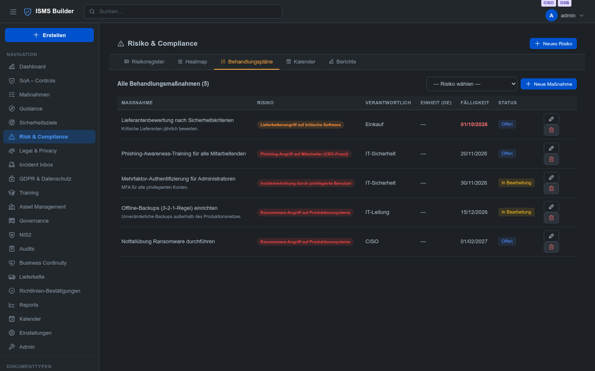
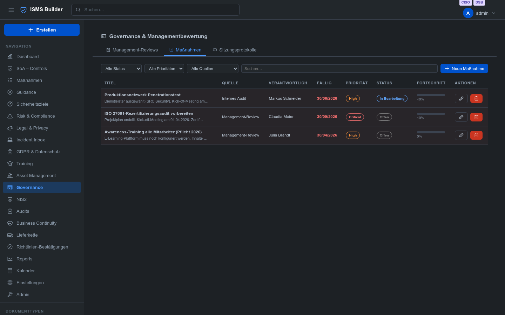
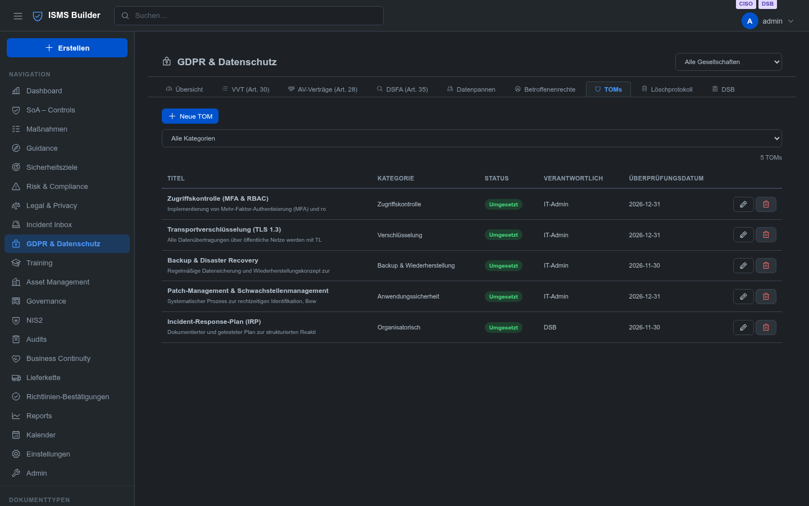

# Moodul: abinõude register

> Üks keskne register kõigi ISMS-i abinõude jaoks — ISO 27001 punkt 6.1.3 nõuab, et riskikäsitlused
> määratletaks, rakendataks ja nende täitmist jälgitaks; IKÜM art 32 nõuab sama tehniliste ja korralduslike
> meetmete (TOM-ide) kohta.

---

## Üks abinõu, üks koht

Abinõud tekivad paljudes kohtades: riski käsitlusena, auditi tähelepaneku tulemusena, juhtkonna ülevaatuse
otsusena või TOM-ina IKÜM art 32 alusel. Varem pidas iga moodul oma loendit. Alates
versioonist 1.80 on **üks andmekogum**: abinõude register. Moodulid näitavad oma abinõusid endiselt
tuttavas kohas, kuid loevad ja kirjutavad neid registris. Muudatus ühes kohas kehtib seetõttu
kõikjal ja ükski abinõu ei ilmu kaks korda.

| Päritolu | Kus seda muudetakse | Märge registris |
|---|---|---|
| Riski käsitlus | Riskid ja vastavus → käsitluskavad | Seotud **riskiga** |
| Tähelepaneku tegevus | Aruanded → auditi tähelepanekud | Seotud **tähelepanekuga** |
| Juhtimisabinõu | Juhtimine → tegevused | Märge **Juhtimine** |
| TOM IKÜM art 32 alusel | IKÜM → TOM-id | Märge **TOM** |
| Oma abinõu | Abinõud | Seotud **SoA meetmetega** või seostamata |

Abinõu võib olla mitu asja korraga: abinõu „MFA administraatoritele“ võib rakendada meedet ja
käsitleda riski samal ajal.

---

## Rollid ja õigused

| Tegevus | Minimaalne roll |
|---|---|
| Abinõude vaatamine | `reader` |
| Abinõu loomine ja muutmine | `editor` |
| Abinõu seostamine **riski** või **tähelepanekuga**; riskiga seotud abinõude muutmine | `auditor` või `contentowner` |
| TOM-i loomine või muutmine (märge TOM) | `contentowner` |
| Abinõu kustutamine | `contentowner` |
| Juhtimisabinõu kustutamine | `admin` |
| Kustutatud abinõu taastamine või jäädav kustutamine | `admin` |

Register ei anna kellelegi rohkem õigusi kui moodulid varem: kes võis riskikäsitlusi muuta ainult
audiitorina, võib neid registris muuta samuti ainult audiitorina.

---

## Register

**Abinõud** (navigeerimises, pärast „SoA – meetmed“)

*Ekraanipildid näitavad saksakeelset kasutajaliidest saksakeelse demoandmestikuga; kasutajaliides on saadaval
viies keeles.*

**Põhinäitajad** üleval: Kokku, Planeeritud, Töös, Rakendatud (sh „Tõhusus kontrollitud“),
Üle tähtaja ja Seostamata. Abinõu on *üle tähtaja*, kui selle tähtaeg on möödunud ja see on endiselt planeeritud või
töös. *Seostamata* on abinõud, mis pole seotud meetme, tähelepaneku ega riskiga ning pole ei
TOM ega juhtimisabinõu — need torkavad auditil esimesena silma, sest pole selge, milleks need on.

**Otsing ja filter:** täistekst (viide, pealkiri, kirjeldus, rakendamine, vastutaja), olek,
vastutaja, „Ainult üle tähtaja“ ja **päritolu**.

Päritolu filtrid: *Kõik allikad*, *Ainult TOM-id*, *Ainult juhtimisabinõud*, *Ainult riskikäsitlused*,
*Ainult tähelepanekute tegevused*.

**Veerg „Seotud“:** ikoonid näitavad, millega abinõu on seotud (meede, tähelepanek, risk), koos arvuga.

**Eksport:** **CSV** (kaitstud valemisüsti eest tabelarvutustes) ja **PDF** (prindivaade) sisaldavad
praegu filtreeritud loendit.

---

## Abinõu loomine ja muutmine

**Abinõud → „+ Uus abinõu“**. Abinõu saab automaatselt viite `M-001`, `M-002`, …

| Väli | Tähendus |
|---|---|
| Pealkiri, kirjeldus | Mida tuleb saavutada |
| Rakendamine (konkreetselt) | Mis on tehtud: mida, kuidas, kus, kui tihti — tõend audiitoritele |
| Vastutaja | Kes selle rakendab |
| Tähtaeg / Ülevaatus | Rakendamise tähtaeg ja järelkontrolli kuupäev tõhususe kontrolliks |
| Olek | `Planeeritud` · `Töös` · `Rakendatud` · `Tõhusus kontrollitud` · `Tühistatud` |

Kui abinõu seatakse olekusse *Rakendatud* või *Tõhusus kontrollitud*, sisestab süsteem kuupäeva väljale „Lõpetatud“,
kui seda pole antud. Tühistatud abinõud jäävad registrisse (jälgitavuse jaoks), kuid ei loeta enam
riski praeguseks käsitluseks.

### Seosed

Jaotis **Seosed** seob abinõu **SoA meetmete**, **tähelepanekute** ja **riskidega**. Igal loendil on
filtriväli.

Iga riskiga seotud abinõu loetakse **selle riski käsitluseks** ja see ilmub jaotises Riskid ja vastavus →
käsitluskavad. Iga tähelepanekuga seotud abinõu ilmub tähelepaneku tegevuskavas. Toimetajad näevad neid
kahte loendit ainult lugemiseks (vt rollid); meetmeid saavad nad vabalt siduda.

### Juhtimisabinõu

Märkega **Juhtimisabinõu** hallatakse abinõu ka juhtimise valdkonnas. See lisab täiendavaid
välju: **Päritolu** (juhtkonna ülevaatus, sise- või välisaudit, intsident, muu), **Viide** (nt
auditi number), **Prioriteet**, **Edenemine (%)**, vastutaja e-post, **Lõpetatud** ja märkused.

Juhtimisabinõu võib kustutada ainult administraator, ka registris.

### TOM (IKÜM art 32)

Märkega **TOM** ilmub abinõu ka IKÜM-i moodulis jaotises „TOM-id“. Täiendavad väljad: **Kategooria**
(juurdepääsukontroll, krüpteerimine, logimine, võrguturve, rakenduste turve, varundus ja taaste,
korralduslik, koolitus, andmete säilitamine), **Riskitase**, **Säilitusreegel** ja **Tõend**. TOM-e võivad
luua ja muuta ainult sisuomanikud, nagu IKÜM-i moodulis.

---

## Kus abinõud ilmuvad

**SoA – meetmed:** Laiendatud meetmes näitab plokk **„Selle meetme abinõud“** seotud
abinõusid nende olekuga. Klõps avab abinõu; **„Lisa abinõu“** loob uue ja seob selle
meetmega kohe.

**Tähelepanekud:** Tähelepaneku **tegevuskava** näitab selle abinõusid nagu varem ja töötab samade kirjetega nagu
register. Selle all loetleb plokk **„Abinõud (register)“** neid viite ja olekuga.

**Riskid:** Vahekaart **Käsitluskavad** näitab kõigi riskide kõiki käsitlusi; riski üksikasjad näitavad
üksiku riski käsitlusi.

**Juhtimine:** Vahekaart **Tegevused** näitab juhtimisabinõusid päritolu, prioriteedi ja edenemisega.
Manused (protokollid, tõendid) jäävad seal abinõu külge.

**IKÜM:** Vahekaart **TOM-id** näitab abinõusid, millel on märge TOM.

**Kalender:** Tähtajalised abinõud ilmuvad oma kuupäevaga. Riskikäsitlustel, tähelepanekute tegevustel ja juhtimisabinõudel
on igaühel oma sündmuse liik; kõik teised ilmuvad abinõu tähtajana. Sama abinõu ei
loetleta lisaks üldise abinõu tähtajana. Kui see kuulub korraga riskile ja tähelepanekule, ilmub see
mõlema konteksti jaoks.

**TI-otsing:** Register on otsingu osa; abinõusid saab leida märksõna või küsimuse abil.

---

## Olemasolevad andmed (uuendus versioonile 1.80)

Esimesel käivitamisel versiooniga 1.80 võtab süsteem automaatselt registrisse varem moodulitesse
manustatud abinõud: TOM-id, riskikäsitlused, tähelepanekute tegevused ja juhtimisabinõud.

- **Identifikaatorid, ajatemplid ja kustutamise olek säilivad**; viited `M-…` määratakse loomise kuupäeva järgi.
- **Protsess on korratav:** juba üle võetud kirjeid ei looda uuesti.
- **Vanad andmed jäävad puutumata** (`risks.json`, `findings.json`, `governance.json`, `gdpr/toms.json` või
  andmebaasitabelid). Neid ei loeta enam, kuid need toimivad varukoopiana.
- **Olekud** teisendatakse: moodulite *avatud / töös / valmis* vastavad olekutele *Planeeritud / Töös / Rakendatud*.
- **Uued ID-d:** uued juhtimisabinõud saavad vormi `meas_…` ID-d (varem `gact_…`); olemasolevad
  identifikaatorid ei muutu.

JSON-ilt SQL-andmebaasile üleminekul tööriistaga `tools/migrate-json-to-knex.js` kantakse register üle
kõigi väljade ja manustega.

**Demoandmed:** Demopaketid (saksa, inglise, prantsuse, hollandi, ungari) sisaldavad registrit kõigi
viie päritoluga. Paketi uuesti laadimine asendab registri.

---

## Prügikast

Kustutatud abinõud on prügikastis (**Haldus → Prügikast**, välja arvatud TOM-id: need ilmuvad IKÜM-i
kirjete hulgas) ning administraatorid saavad need taastada või jäädavalt kustutada. Kui riski käsitlus või
tähelepaneku tegevus „kustutatakse“, kuigi see on veel seotud meetme või täiendavate riskide või tähelepanekutega,
eemaldatakse ainult seos selle riski või tähelepanekuga; abinõu ise jääb registrisse.

---

## API

| Meetod | Tee | Eesmärk |
|---|---|---|
| GET | `/measures` | Loend; filtrid `q`, `status`, `responsible`, `control`, `finding`, `risk`, `overdue`, `tom`, `governance`, `source`, `priority`, `category` |
| GET | `/measures/summary` | Põhinäitajad |
| GET | `/measures/{id}` | Üksik abinõu |
| POST | `/measures` | Loomine |
| PUT | `/measures/{id}` | Muutmine (ainult edastatud väljad) |
| DELETE | `/measures/{id}` | Kustutamine (prügikast) |
| POST | `/measures/{id}/restore` | Taastamine (admin) |
| DELETE | `/measures/{id}/permanent` | Jäädav kustutamine (admin) |

Moodulite olemasolevad liidesed (`/risks/{id}/treatments`, `/findings/{id}/actions`,
`/governance/actions`, `/gdpr/toms`) jäävad muutmata ja töötavad sama andmekogumiga.

---

## Märkus auditiks

ISO 27001 jaoks on register ja selle kirjed tõendiks punktide 6.1.3 (riskikäsitlus), 8.3
(käsitluse rakendamine) ja 10.2 (korrigeerivad tegevused) kohta. Audiitorid küsivad tavaliselt:

1. Kas iga aktsepteerimata riski jaoks on abinõu vastutaja ja kuupäevaga?
2. Kas tähtaja ületanud abinõud on teada ja põhjendatud?
3. Kas rakendatud abinõude kohta on tõend registreeritud (rakendamine, tõhususe kontroll)?
4. Kas auditi tähelepanekud viivad abinõudeni ja kas neid saab jälgida?

IKÜM art 32 jaoks tõendavad TOM-id kategooria, riskitaseme ja tõendiga, et abinõud on asjakohased.
