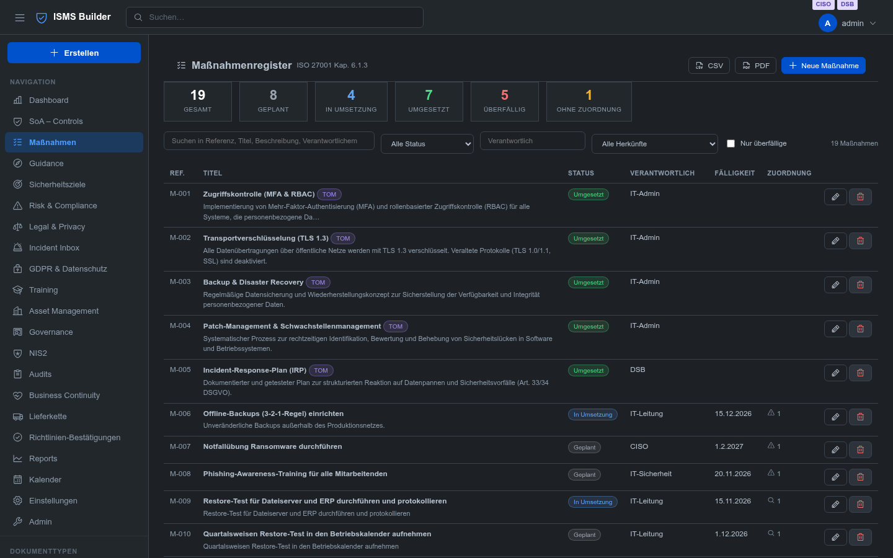
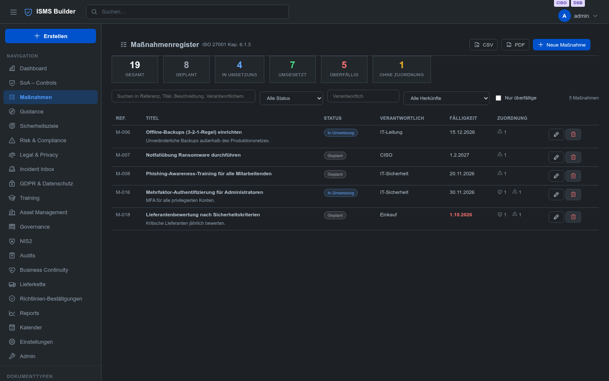
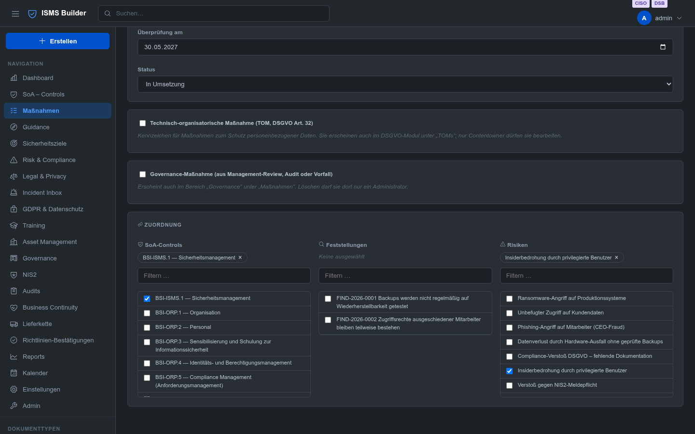
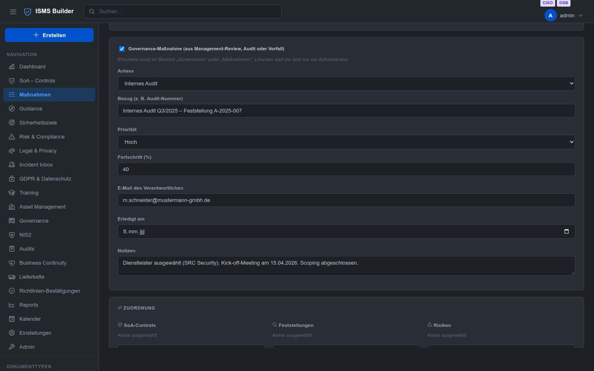
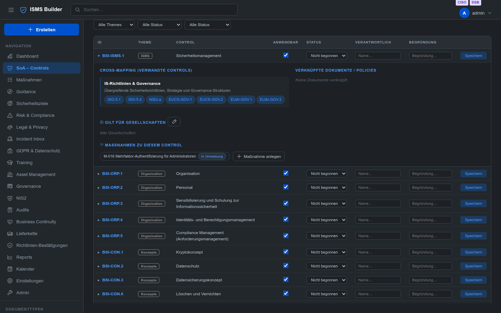
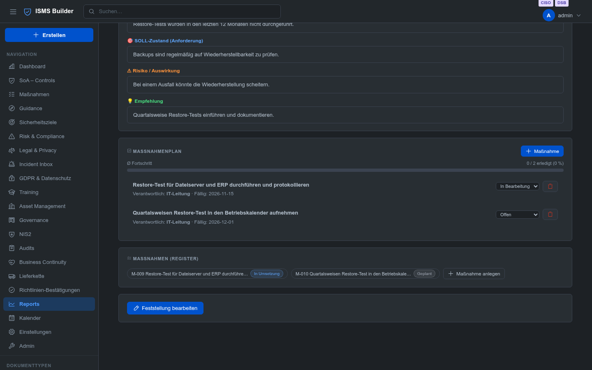
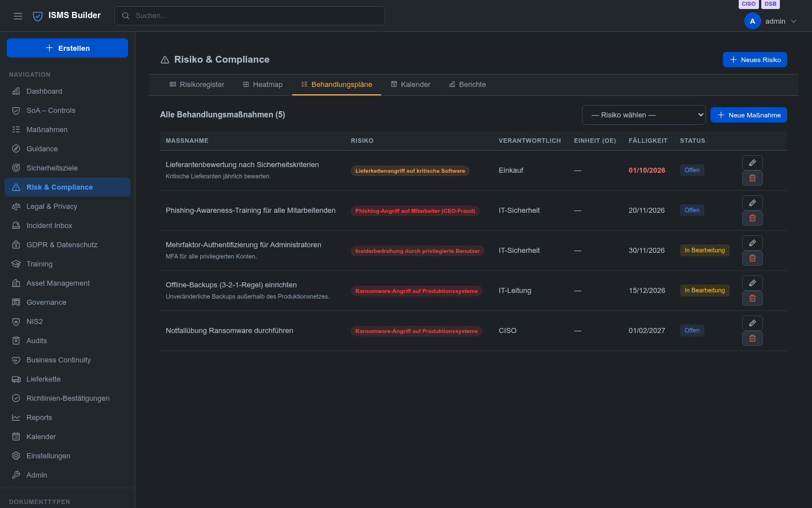
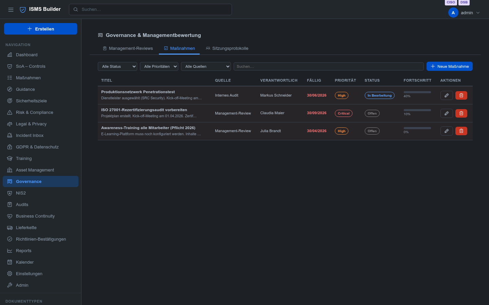
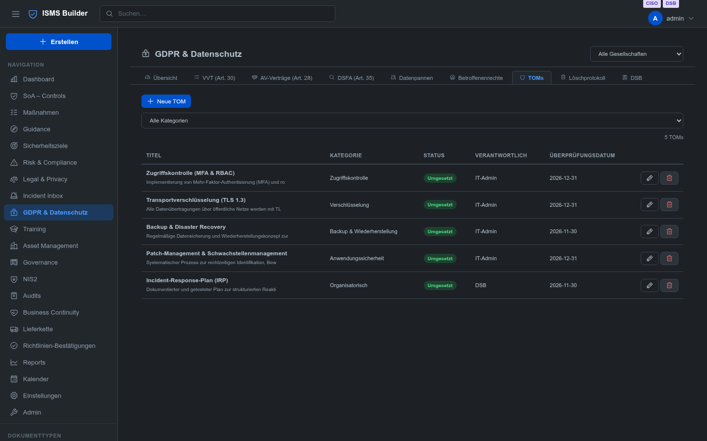

# Modul: Intézkedésnyilvántartás

> Egyetlen központi nyilvántartás az ISMS összes intézkedéséhez — az ISO 27001 6.1.3. pontja előírja, hogy a
> kockázatkezelést meg kell határozni, végre kell hajtani és nyomon kell követni; a GDPR 32. cikke ugyanezt
> várja el a technikai és szervezési intézkedésektől (TOM).

---

## Egy intézkedés, egy hely

Az intézkedések sok helyen keletkeznek: egy kockázat kezeléseként, auditmegállapítás következményeként,
vezetőségi átvizsgálás döntéseként vagy a GDPR 32. cikke szerinti TOM-ként. Korábban minden modul saját listát
vezetett. Az 1.80-as verzió óta **egyetlen adatállomány** van: az intézkedésnyilvántartás. A modulok
továbbra is a megszokott helyen mutatják az intézkedéseiket, de a nyilvántartásból olvassák és abba írják
azokat. Egy helyen végzett módosítás ezért mindenhol érvényes, és egy intézkedés sem jelenik meg kétszer.

| Eredet | Hol szerkeszthető | Jelölés a nyilvántartásban |
|---|---|---|
| Kockázatkezelés | Risk & Compliance → Kezelési tervek | **Kockázathoz** rendelve |
| Megállapításhoz tartozó intézkedés | Reports → Audit megállapítások | **Megállapításhoz** rendelve |
| Irányítási intézkedés | Irányítás → Intézkedések | **Irányítás** jelölés |
| TOM a GDPR 32. cikke szerint | GDPR → TOM-ok | **TOM** jelölés |
| Saját intézkedés | Intézkedések | **SoA-kontrollokhoz** rendelve, vagy hozzárendelés nélkül |

Egy intézkedés egyszerre több is lehet: az „MFA a rendszergazdáknak” intézkedés megvalósíthat egy kontrollt, és
egyúttal kezelhet egy kockázatot.

---

## Szerepkörök és jogosultságok

| Művelet | Minimális szerepkör |
|---|---|
| Intézkedések megtekintése | `reader` |
| Intézkedés létrehozása és szerkesztése | `editor` |
| Intézkedés **kockázathoz** vagy **megállapításhoz** rendelése; kockázathoz rendelt intézkedések módosítása | `auditor` vagy `contentowner` |
| TOM létrehozása, módosítása (TOM jelölés) | `contentowner` |
| Intézkedés törlése | `contentowner` |
| Irányítási intézkedés törlése | `admin` |
| Törölt intézkedés visszaállítása vagy végleges törlése | `admin` |

A nyilvántartás senkinek nem ad több jogot, mint korábban a modulok: aki a kockázatkezeléseket korábban csak
auditorként módosíthatta, a nyilvántartásban is csak auditorként módosíthatja.

---

## A nyilvántartás

**Intézkedések** (a navigációban az „SoA – Controls” után)

*A képernyőképek a német felületet mutatják a német demóadatokkal; a felület öt nyelven érhető el.*

**Mutatók** felül: Összesen, Tervezett, Megvalósítás alatt, Megvalósítva („Hatékonyság ellenőrizve”
állapotot is beleértve), Lejárt és Hozzárendelés nélkül. Egy intézkedés *lejárt*, ha a határideje elmúlt, és
még tervezett vagy megvalósítás alatt áll. *Hozzárendelés nélküli* az az intézkedés, amely nincs
kontrollhoz, megállapításhoz vagy kockázathoz rendelve, és nem TOM, sem irányítási intézkedés — ezek
tűnnek fel először egy auditon, mert nem világos, mire szolgálnak.

**Keresés és szűrés:** teljes szöveg (hivatkozás, cím, leírás, megvalósítás, felelős), állapot, felelős,
„Csak lejártak” és **eredet**.

Az eredet szerinti szűrők: *Minden eredet*, *Csak TOM-ok*, *Csak irányítási intézkedések*, *Csak
kockázatkezelések*, *Csak megállapításokhoz tartozó intézkedések*.

**„Hozzárendelés” oszlop:** ikonok mutatják, mihez kapcsolódik az intézkedés (kontroll, megállapítás,
kockázat), darabszámmal.

**Exportálás:** a **CSV** (képletinjekció elleni védelemmel a táblázatkezelőkben) és a **PDF** (nyomtatási
nézet) az éppen szűrt listát tartalmazza.

---

## Intézkedés létrehozása és szerkesztése

**Intézkedések → „+ Új intézkedés”**. Az intézkedés automatikusan `M-001`, `M-002`, … hivatkozást kap.

| Mező | Jelentés |
|---|---|
| Cím, leírás | Mit kell elérni |
| Megvalósítás (konkrétan) | Mi valósult meg: mit, hogyan, hol, milyen gyakran — az auditorok bizonyítéka |
| Felelős | Ki hajtja végre |
| Határidő / Felülvizsgálat ideje | Megvalósítási határidő és utókövetés a hatékonyság ellenőrzéséhez |
| Állapot | `Tervezett` · `Megvalósítás alatt` · `Megvalósítva` · `Hatékonyság ellenőrizve` · `Megszakítva` |

Ha egy intézkedést *Megvalósítva* vagy *Hatékonyság ellenőrizve* állapotra állítanak, a rendszer a dátumot
automatikusan „Teljesítve” értékként rögzíti, ha nincs megadva. A megszakított intézkedések a
nyomon követhetőség miatt a nyilvántartásban maradnak, de már nem számítanak egy kockázat folyamatban lévő
kezelésének.

### Hozzárendelések

A **Hozzárendelés** szakasz **SoA-kontrollokhoz**, **megállapításokhoz** és **kockázatokhoz** kapcsolja az
intézkedést. Minden listához tartozik szűrőmező.

Minden kockázathoz rendelt intézkedés **az adott kockázat kezelésének** számít, és a Risk & Compliance →
Kezelési tervek alatt jelenik meg. Minden megállapításhoz rendelt intézkedés megjelenik a megállapítás
intézkedési tervében. A szerkesztők ezt a két listát csak olvashatják (lásd szerepkörök); kontrollokat
szabadon rendelhetnek hozzá.

### Irányítási intézkedés

Az **Irányítási intézkedés** jelöléssel az intézkedést az Irányítás területen is vezetik. Ehhez további mezők
tartoznak: **Eredet** (vezetőségi átvizsgálás, belső vagy külső audit, incidens, egyéb), **Hivatkozás** (pl.
audit száma), **Prioritás**, **Előrehaladás (%)**, a felelős e-mail-címe, **Teljesítve** és jegyzetek.

Irányítási intézkedést csak rendszergazda törölhet, a nyilvántartásban is.

### TOM (GDPR 32. cikk)

A **TOM** jelöléssel az intézkedés a GDPR modulban is megjelenik a „TOM-ok” alatt. További mezők:
**Kategória** (hozzáférés-szabályozás, titkosítás, naplózás, hálózatbiztonság, alkalmazásbiztonság, mentés és
helyreállítás, szervezési, képzés, adatmegőrzés), **Kockázati szint**, **Megőrzési szabály** és
**Bizonyíték**. TOM-ot csak tartalomgazda (contentowner) hozhat létre és módosíthat, mint a GDPR modulban.

---

## Hol jelennek meg az intézkedések

**SoA – Controls:** egy kinyitott kontrollban az **„Intézkedések ehhez a kontrollhoz”** blokk mutatja a
hozzárendelt intézkedéseket állapotukkal. Kattintásra megnyílik az intézkedés; az **„Intézkedés felvétele”**
újat hoz létre, és rögtön a kontrollhoz rendeli.

**Megállapítások:** a megállapítás **intézkedési terve** a korábbiak szerint mutatja az intézkedéseit, és
ugyanazokkal a rekordokkal dolgozik, mint a nyilvántartás. Alatta az **„Intézkedések (nyilvántartás)”** blokk
hivatkozással és állapottal sorolja fel őket.

**Kockázatok:** a **Kezelési tervek** fül az összes kockázat összes kezelését mutatja; a kockázat részletei
az adott kockázat kezeléseit.

**Irányítás:** az **Intézkedések** fül az irányítási intézkedéseket mutatja eredettel, prioritással és
előrehaladással. A mellékletek (jegyzőkönyvek, bizonyítékok) ott maradnak az intézkedéshez csatolva.

**GDPR:** a **TOM-ok** fül a TOM jelölésű intézkedéseket mutatja.

**Naptár:** a határidős intézkedések a dátumukkal jelennek meg. A kockázatkezelések, a megállapításokhoz
tartozó intézkedések és az irányítási intézkedések külön eseménytípust kapnak; az összes többi
intézkedési határidőként jelenik meg. Ugyanaz az intézkedés nem szerepel emellett általános intézkedési
határidőként. Ha egyszerre tartozik kockázathoz és megállapításhoz, mindkét összefüggésben megjelenik.

**AI-keresés:** a nyilvántartás része a keresésnek; az intézkedések kulcsszóval vagy kérdéssel megtalálhatók.

---

## Meglévő adatok (frissítés az 1.80-as verzióra)

Az 1.80-as verzióval történő első indításkor a rendszer automatikusan átveszi a nyilvántartásba a korábban a
modulokba ágyazott intézkedéseket: a TOM-okat, a kockázatkezeléseket, a megállapításokhoz tartozó
intézkedéseket és az irányítási intézkedéseket.

- **Az azonosítók, az időbélyegek és a törlési állapot megmaradnak**; az `M-…` hivatkozásokat a létrehozás dátuma szerint osztja ki a rendszer.
- **A folyamat megismételhető:** a már átvett rekordokat nem hozza létre újra.
- **A régi adatok változatlanul megmaradnak** (`risks.json`, `findings.json`, `governance.json`,
  `gdpr/toms.json` vagy az adatbázis táblái). Már nem olvassa őket a rendszer, de mentésként szolgálnak.
- **Az állapotok** megfeleltetése: a modulok *nyitott / folyamatban / kész* állapota a *Tervezett /
  Megvalósítás alatt / Megvalósítva* állapotnak felel meg.
- **Új azonosítók:** az új irányítási intézkedések `meas_…` alakú azonosítót kapnak (korábban `gact_…`); a
  meglévők nem változnak.

A JSON-ról SQL-adatbázisra való áttéréskor a `tools/migrate-json-to-knex.js` eszközzel a nyilvántartás minden
mezőjével és mellékletével együtt átkerül.

**Demóadatok:** a demócsomagok (német, angol, francia, holland, magyar) tartalmazzák a nyilvántartást mind az
öt eredettel. Egy csomag újbóli betöltése lecseréli a nyilvántartást.

---

## Lomtár

A törölt intézkedések a lomtárban vannak (**Admin → Lomtár**, kivéve a TOM-okat: azok a GDPR-bejegyzések között
találhatók), és az adminisztrátorok visszaállíthatják vagy véglegesen törölhetik őket. Ha egy kockázatban egy
kezelést vagy egy megállapításban egy intézkedést „törölnek”, miközben az még kontrollhoz vagy további
kockázatokhoz, illetve megállapításokhoz van rendelve, csak az adott kockázathoz vagy megállapításhoz
tartozó hozzárendelés szűnik meg; maga az intézkedés a nyilvántartásban marad.

---

## Programozási felület

| Metódus | Útvonal | Cél |
|---|---|---|
| GET | `/measures` | Lista; szűrők: `q`, `status`, `responsible`, `control`, `finding`, `risk`, `overdue`, `tom`, `governance`, `source`, `priority`, `category` |
| GET | `/measures/summary` | Mutatók |
| GET | `/measures/{id}` | Egy intézkedés |
| POST | `/measures` | Létrehozás |
| PUT | `/measures/{id}` | Módosítás (csak a megadott mezők) |
| DELETE | `/measures/{id}` | Törlés (lomtár) |
| POST | `/measures/{id}/restore` | Visszaállítás (admin) |
| DELETE | `/measures/{id}/permanent` | Végleges törlés (admin) |

A modulok korábbi felületei (`/risks/{id}/treatments`, `/findings/{id}/actions`,
`/governance/actions`, `/gdpr/toms`) változatlanok maradnak, és ugyanazon az adatállományon dolgoznak.

---

## Auditmegjegyzés

Az ISO 27001 szempontjából a nyilvántartás és bejegyzései a 6.1.3. (kockázatkezelés), a 8.3. (a kezelés
végrehajtása) és a 10.2. (helyesbítő intézkedések) pont bizonyítékai. Az auditorok jellemzően ezt kérdezik:

1. Van-e minden el nem fogadott kockázathoz felelőssel és határidővel rendelkező intézkedés?
2. Ismertek és indokoltak-e a lejárt intézkedések?
3. Rögzítve van-e a megvalósított intézkedések bizonyítéka (megvalósítás, hatékonyság-ellenőrzés)?
4. Vezetnek-e az auditmegállapítások intézkedésekhez, és nyomon követhetők-e ezek?

A GDPR 32. cikkéhez a TOM-ok kategóriával, kockázati szinttel és bizonyítékkal igazolják az intézkedések
megfelelőségét.
