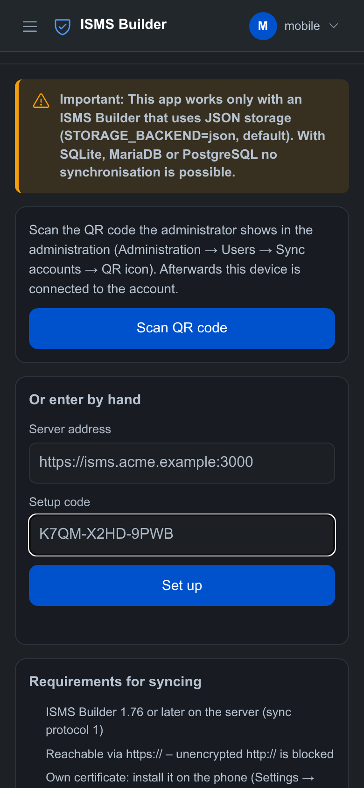
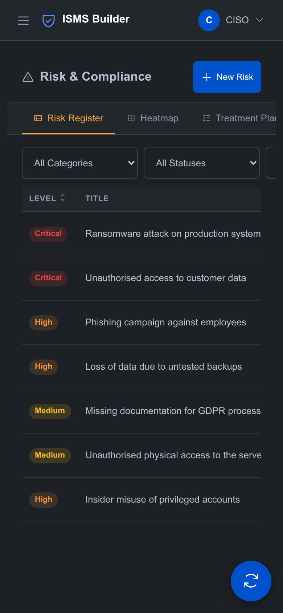
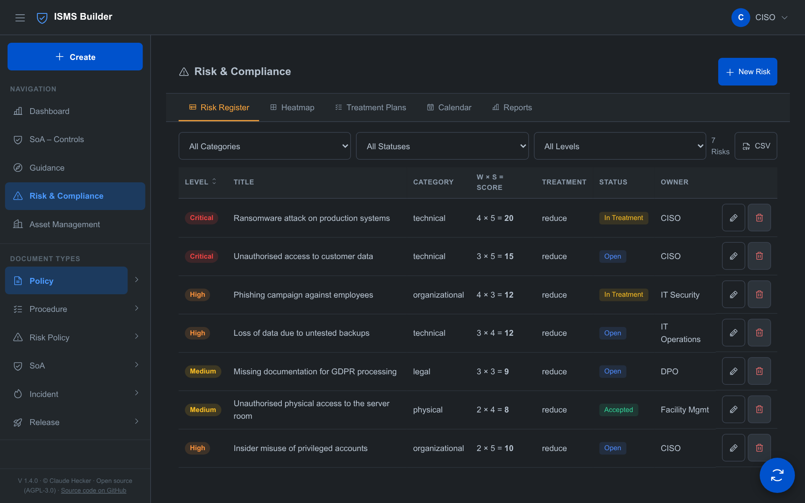
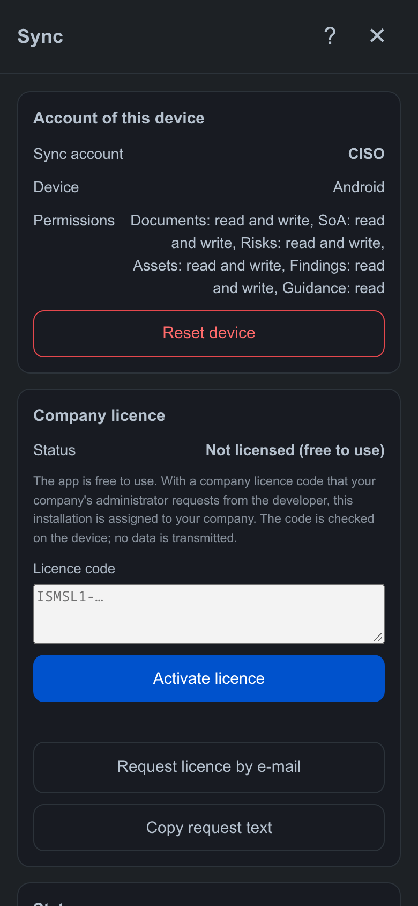
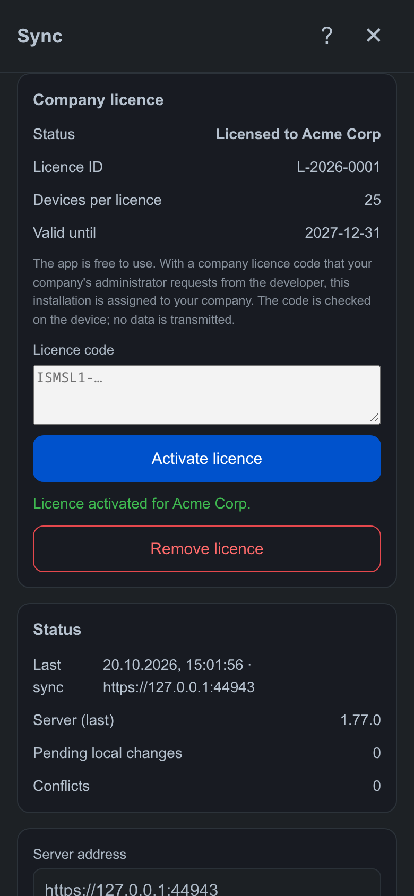
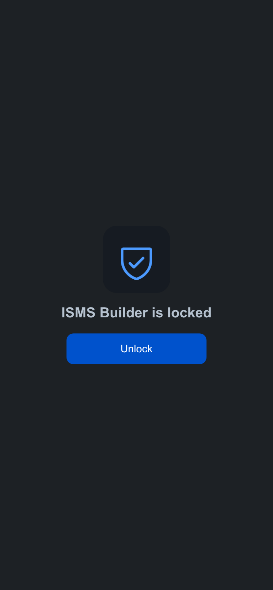

# Module: Mobile App (Android) & Sync

> The Android app is a standalone, offline-capable variant of ISMS Builder. It keeps its own data set on the
> phone or tablet and synchronises it with the main system on demand — over Wi-Fi or via a file.

> **⚠ Important — JSON storage only:** The mobile app and the synchronisation work **exclusively** when ISMS Builder uses **JSON storage** (`STORAGE_BACKEND=json`, the default). With **SQLite, MariaDB/MySQL or PostgreSQL the synchronisation is not available** (the server answers `501`). The active storage is set in the server's `.env` (`STORAGE_BACKEND`). Please check before using the app.

---

<!-- mobile-screenshots:start -->
## Screenshots

> The pictures are taken in a desktop browser with fictitious sample data (company “Acme Corp”), because the Android app blocks screenshots for security reasons. The app's interface matches them.



*Set-up: scan the QR code or enter address and code*



*Risks on the phone*



*Tablet in landscape: menu and content side by side*



*The sync panel: status, server, sync*



*Company licence activated*



*Locked app: unlock with the device lock*

<!-- mobile-screenshots:end -->

## What the app does

- **Works offline:** the app ships the user interface and the server logic (risk scoring, asset types, versioning, status transitions). No server is needed.
- **Modules:** documents/templates, SoA (Statement of Applicability), risks, assets, audit findings and guidance. All other modules (e.g. GDPR, BCM, suppliers, administration) are not part of the app.
- **One account per app:** after set-up the app belongs to exactly one sync account. Name, menu and editing rights in the app follow this account's permissions.
- **Phone and tablet:** the interface adapts (portrait and landscape; in landscape the sidebar stays visible). There are no settings for password, 2FA and roles locally; the language is chosen in the sync panel under *Interface language*.
- **Help in the app:** The “?” button in the sync panel and on the set-up screen opens built-in user help (set-up, sync, conflicts, file exchange, security, error messages). It is readable offline and available in all five languages.
- **Permissions per area:** New, edit, delete and file upload appear only in areas where the sync account may write; the guidance is always read-only in the app. Print and PDF functions are available on the server only.
- **Company licence (optional):** The app stays free to use. With a licence code that a company's administrator requests from the developer, the installation is assigned to the company (“licensed to …”). The code is checked offline on the device and no data is transmitted; without a code only a notice band appears.
- **Open-source licences:** Under *Info* in the app, all included third-party components are listed with copyright notice and licence text (readable offline).
- **Not available:** file uploads/attachments (PDF/Word files of the guidance exist on the server only; the app shows a note), WebDAV publishing, AI features, PDF download from the server.

## Requirements on the main system

- ISMS Builder **version 1.76 or later** (sync protocol 1, shown as `syncProtocol` by `GET /api/version`).
- `STORAGE_BACKEND=json` (default). With sqlite, mariadb or postgres the sync endpoints answer `501`.
- **HTTPS:** the server must be reachable via `https://` (set-up: `scripts/setup-ssl.sh`, section *SSL/TLS set-up*). The address entered in the app must be listed in the certificate.
- **Versions:** the app has its **own version number** and is independent of the main system. They are compatible when the sync protocol matches (currently 1) and the server is at least version 1.76. The app shows version and compatibility under *Check server* and *Info & requirements*.
- A **sync account** (see below). A normal user account is not used for synchronisation.

## Creating a sync account

Administrators create sync accounts under *Administration → Users* in the section *Sync accounts (mobile app)* (*New sync account*). A sync account stands for a **role or person** (e.g. “CISO”, “DPO”, “Audit”) and is **independent of the users**: no login to the interface, no role, no password, no 2FA. It exists only for the app's data synchronisation.

- **Name**, e.g. “CISO”. The name appears in the app as the account, on newly created records and in the audit log (`sync:CISO`).
- **Permissions per module:** *no access*, *read* or *read and write* (documents/templates, SoA, risks, assets, findings). Guidance is read-only. Example: the auditor's account may read and write risks and findings and nothing else.
- **Valid until** (optional).
- **Devices:** an account can have several devices (e.g. the CISO's phone and tablet). Each device has its **own key**. The list shows device name and “last used”; a lost device can be blocked individually (✕) without affecting the others.

### Setting up a device (QR code)

After creating the account, and later at any time via the QR icon, the administration shows a **QR code and a setup code** (format `XXXX-XXXX-XXXX`). Both are **valid for 15 minutes and usable only once**; a new code invalidates the previous one. The address the app uses to reach the server can be edited (pre-filled with the one currently used). The QR code contains only this address and the one-time code — **not the key**. The key is created only when the app redeems the code, is never visible to the administrator and is stored on the server only as a hash.

For **scripts** (e.g. `scripts/sync-import.js`) the key icon creates a device key `ISMS-XXXX-XXXX-XXXX-XXXX-XXXX-XXXX-XXXX-XXXX`, shown **once**.

Disabling, enabling, changing permissions and deleting take effect immediately. The administration is logged in the audit log (never keys or codes); changes coming from the synchronisation appear there under the name of the sync account.

## Setting up the device in the app

1. Install and open the app (with an active device lock, unlock first, see *Security*). On first start the app shows only the setup screen.
2. **Scan QR code** and capture the administration's QR code with the camera. Alternatively enter server address and setup code by hand. The app reads the QR code itself, without Google services.
3. The app exchanges the code for the device key (stored in the Android keystore), fetches the base data set (first sync) and restarts.

Afterwards the app belongs to **this one account**: the account name is shown at the top, and menu and editing rights follow the account's permissions. Modules without access are missing from the menu; read-only modules are write-protected (changes are rejected with “Access denied”). The sync panel shows account, device and permissions under *Account of this device*.

- **Permissions change:** every sync fetches the current permissions. If a read permission is withdrawn, the app deletes the local data of that module (including unsent changes); if a module is newly granted, it is loaded completely. Display and menu adapt after the interface reloads.
- **Switching accounts or handing over the device:** *Reset device* in the sync panel deletes, after confirmation, all local data, the account and the key; a new setup is then required. Unsent changes are lost.

## Certificate on the phone

With a publicly trusted certificate (e.g. Let's Encrypt) nothing needs to be done. With an **own or self-signed certificate** the phone has to trust it:

1. When creating it with `scripts/setup-ssl.sh`, enter the name or IP used in the app under *additional names/IP addresses* (e.g. `192.168.1.20`). If the address is not in the certificate, the app refuses the connection.
2. Copy `ssl/cert.pem` to the phone (USB, Nextcloud, e-mail).
3. On the phone: *Settings → Security → Encryption & credentials → Install a certificate → CA certificate* (the path differs by manufacturer). Android warns about third-party certificates; here it is your own certificate.
4. In the app choose *Check server*: if the server version appears, the phone trusts the certificate.

Error messages: *Server not reachable* → check address, port, Wi-Fi/VPN and the server firewall. *Certificate … not trusted* → steps 1–3.

## Synchronising over Wi-Fi

After set-up (see above) address and key are stored: *Sync now* is enough. The following steps apply if the key was removed or another device key is used.

1. Tap the sync button at the bottom right of the app.
2. Enter the server address (e.g. `https://isms.example.org:3000`) and the **access key**. *Check server* shows server version and compatibility; after the first sync the app also shows the name and permissions of the sync account. The key is stored in the protected Android keystore; *Remove key* deletes it from the device.
3. **Sync now.** The app first sends local changes (push) and then fetches everything that is new on the server (pull). The first sync downloads the complete base data set.

Rules:

- **Changes only:** only what changed since the last sync is transferred.
- **Server time:** the server assigns `updatedAt` when it accepts a record. A wrong phone clock does not disturb the sync.
- **Conflicts:** if a record was changed on the server after the phone fetched it, it is **not overwritten**. It appears in the app under *Resolve conflicts*, showing the differing fields. Per record you choose *Keep my version* (sent on the next sync) or *Take server version*.
- **Deleting:** deleting on the phone puts the record in the main system's trash. *Delete permanently* on the phone is transferred there as a deleted record as well; it does not remove the record from the main system.
- **Permissions:** modules without read permission are not fetched. If write permission is missing for a module, the app reports it as *rejected*; local changes are not lost. *Access key invalid, disabled or expired* means: check the account in the administration.

## Synchronising via file

For devices without a network connection to the main system:

- **Export everything** — a complete backup of the app data (app to app, or archive).
- **Export changes only** — a file with the locally changed records. Import it on the main system with a sync account:

  ```bash
  ISMS_SYNC_KEY=ISMS-XXXX-… node scripts/sync-import.js https://isms.example.org:3000 isms-mobile-changes-2026-10-18.json
  ```

  Without `ISMS_SYNC_KEY` the script asks for the key without echo. The same permissions and conflict rule apply as for the Wi-Fi sync; exit code `3` means conflicts or rejected records.
- **Import file** — accepts an app bundle or an export of the main system (*Admin → Export*). The app first shows a **preview** (new / updated / unchanged / conflicts). Locally changed records are never silently overwritten. The main system's export contains only the modules it provides itself (e.g. templates, SoA, risks, guidance); assets and findings arrive through the Wi-Fi sync.

## Measures

Measures have **no permission of their own** in the sync account. Access follows the modules a measure is linked to:

| Link | Module |
|---|---|
| Risk | Risks |
| Finding | Findings |
| SoA control | SoA |
| Policy | Documents/templates |

- **Read:** at least one linked module is readable.
- **Change, create, delete:** write access to **all** modules of the measure (previous and new state). A new measure needs at least one link; measures without a link are not synchronised.
- **Never changeable via the app:** TOMs, governance measures and measures linked to processing activities. Attachments stay on the server.
- If a read permission is withdrawn, the affected measures disappear from the device at the next sync. A measure linked to a risk **and** a finding needs write access to both.
- Treatments of risks and actions of findings are measures of the register and follow the same rules.
- The reference (M-001 …) is assigned by the server; if the reference of a measure created on the device collides, it gets the next free one.

Note: web roles (e.g. auditor, content owner) do not apply to sync accounts; only the per-module permissions count.

## API

All calls except `/sync/enroll` carry the header `Authorization: Bearer <device key>`.

| Method | Path | Purpose |
|---|---|---|
| POST | `/sync/enroll` | Set up a device: exchanges the setup code (from the QR code) for a device key. No login; code is single-use and valid for 15 minutes; failed attempts are slowed down. |
| GET | `/sync/me` | Name, permissions and validity of the sync account. |
| GET | `/sync/pull?since=<ISO>&modules=a,b` | Changes since `since`, including deleted records, for readable modules only (explicitly requested but not permitted ones are listed under `denied`). The response carries `serverTime` for the next pull. |
| POST | `/sync/push` | `{ protocolVersion, changes: { <module>: [records with baseUpdatedAt] } }` — response: `accepted`, `conflicts`, `rejected`. |

The administration of sync accounts (`/admin/sync-accounts`) is for administrators only. Modules: `templates`, `soa`, `risks`, `assets`, `findings`, `guidance`. Described in `docs/architecture/openapi.yaml`.

## Security

- The transfer is **encrypted only (HTTPS)**. The app rejects unencrypted `http://`. Outside your own Wi-Fi the server should additionally be reachable over a VPN or reverse proxy.
- The access key entitles **only to synchronise** the permitted modules, not to the interface or the administration. The server stores only its hash; on the device it sits in the Android keystore. If a device is lost, disable or delete the sync account — it takes effect immediately.
- Wrong keys are slowed down (like wrong passwords at login).
- **App lock:** the app asks for fingerprint, face or the device's PIN/pattern/password at start and after about two minutes in the background. If the device has no screen lock, the app does not start and explains why.
- Android backup of the app is disabled; screenshots, screen recording and the preview in the app overview are blocked. A signed release version is delivered (not “debuggable”, WebView debugging off).
- Setup codes are single-use and valid for 15 minutes; wrong codes are slowed down.
- The data sits in the app's protected storage on the device but is **not additionally encrypted**. A device lock and Android device encryption are mandatory.

## Limits

- JSON backend only; attachments are not synchronised.
- Conflicts are resolved per record, not per field.
- Records permanently deleted on the main system do not reach the phone.
- The interface has no permissions per module: it only distinguishes “may write somewhere” from “read-only”. The exact check per module happens when saving.
- Audit findings are synchronised but have no view of their own in the app yet.
- The app contains the server logic of the version it was built from. After a server update, rebuild the app too (`npm run build:android` in the `isms-builder-mobile` project).
