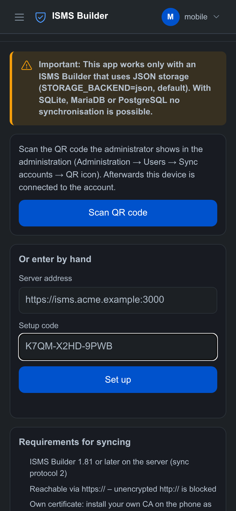
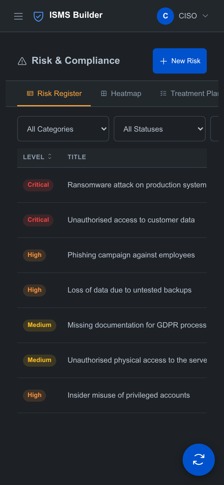
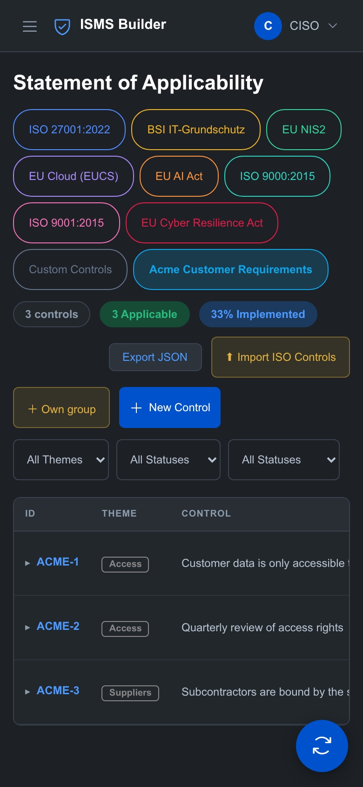
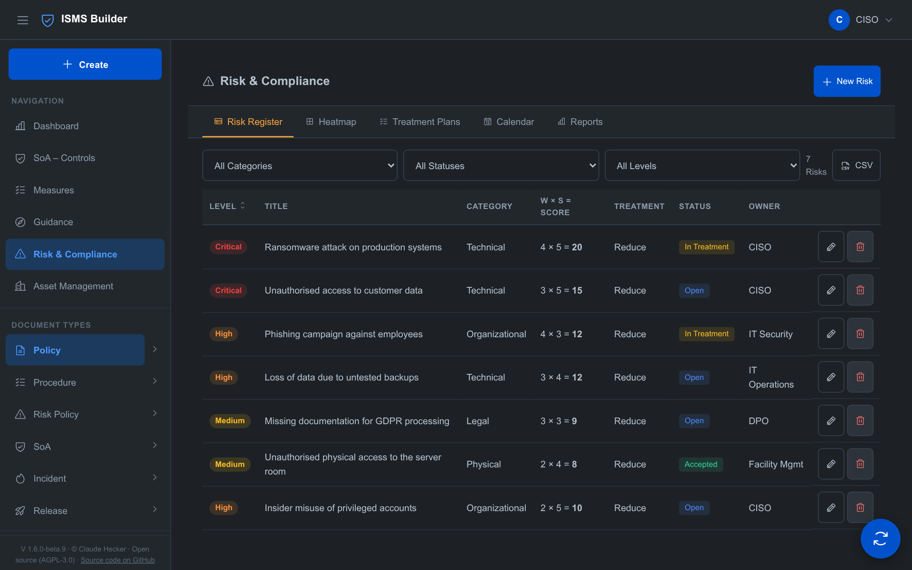
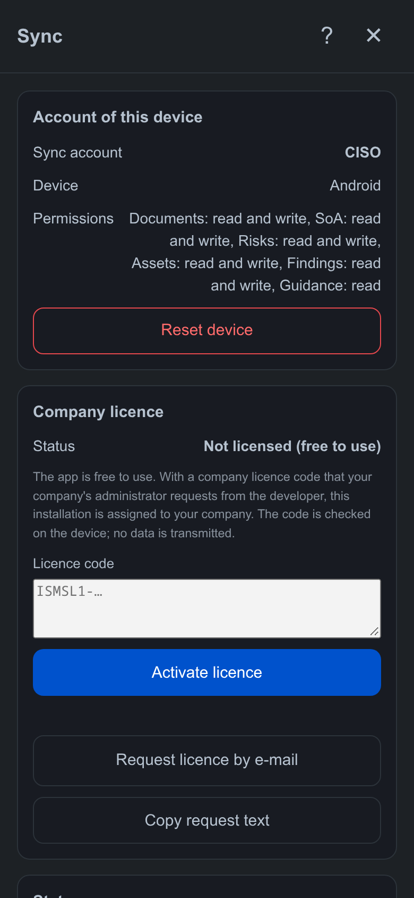
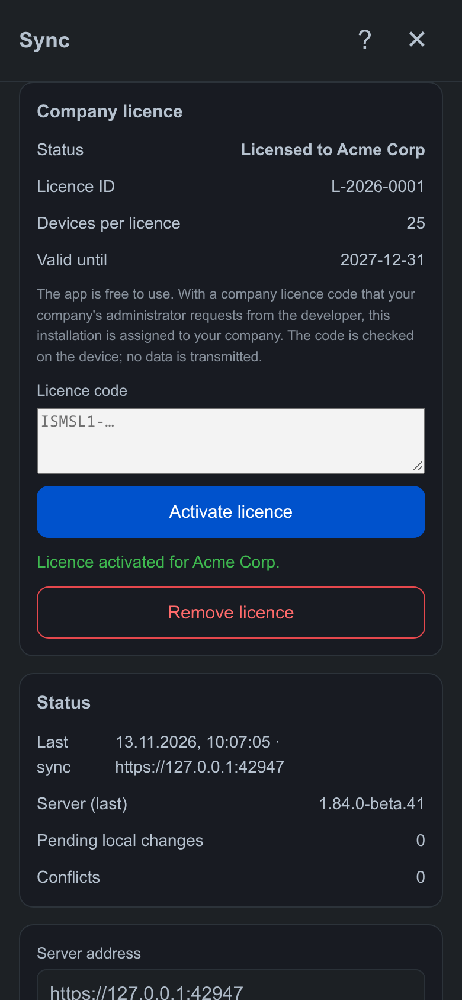
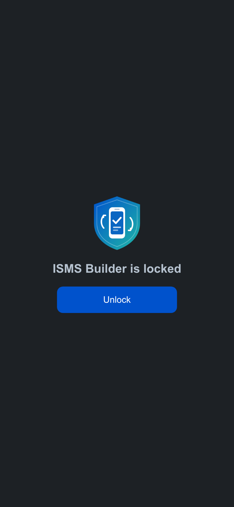

# Moodul: mobiilirakendus (Android) ja sünkroonimine

> Androidi rakendus on ISMS Builderi eraldiseisev, võrguühenduseta töötav variant. See hoiab oma andmekogumit
> telefonis või tahvelarvutis ja sünkroonib seda nõudmisel põhisüsteemiga — WLAN-i kaudu või faili abil.

> **⚠ Tähtis — ainult JSON-salvestus:** Mobiilirakendus ja sünkroonimine töötavad **ainult** siis, kui ISMS Builder kasutab **JSON-salvestust** (`STORAGE_BACKEND=json`, vaikimisi). **SQLite’i, MariaDB/MySQL-i või PostgreSQL-i korral ei ole sünkroonimine saadaval** (server vastab `501`). Aktiivne salvestus määratakse serveri failis `.env` (`STORAGE_BACKEND`). Palun kontrollige enne rakenduse kasutamist.

---

<!-- mobile-screenshots:start -->
## Ekraanipildid

> Pildid on tehtud lauaarvuti brauseris väljamõeldud näidisandmetega (ettevõte „Acme Corp“), sest Androidi rakendus blokeerib turvakaalutlustel ekraanipildid. Rakenduse kasutajaliides vastab neile.



*Seadistus: skanni QR-kood või sisesta aadress ja kood*



*Riskid telefonis*



*Kohandatud SoA-rühm eraldi sakina (väljamõeldud näide)*



*Tahvelarvuti horisontaalselt: menüü ja sisu kõrvuti*



*Sünkroonimispaneel: olek, server, sünkroonimine*



*Ettevõtte litsents aktiveeritud*



*Lukustatud rakendus: ava seadme lukuga*

<!-- mobile-screenshots:end -->

## Mida rakendus teeb

- **Töötab võrguühenduseta:** rakendus sisaldab kasutajaliidest ja serveriloogikat (riskihindamine, varaliigid, versioonimine, olekuüleminekud). Serverit pole vaja.
- **Moodulid:** dokumendid/mallid, SoA (kohaldatavuse deklaratsioon), riskid, varad, auditi tähelepanekud ja juhised. Kõik muud moodulid (nt IKÜM, BCM, tarnijad, haldus) ei kuulu rakenduse juurde.
- **Üks konto rakenduse kohta:** pärast seadistamist kuulub rakendus täpselt ühele sünkroonimiskontole. Nimi, menüü ja muutmisõigused rakenduses järgivad selle konto õigusi.
- **Telefon ja tahvelarvuti:** kasutajaliides kohandub (püst- ja rõhtpaigutus; rõhtpaigutuses jääb külgriba nähtavaks). Kohalikke parooli, 2FA ja rollide seadeid pole; keel valitakse sünkroonimispaneelis jaotises *Kasutajaliidese keel*.
- **Abi rakenduses:** Nupp „?“ sünkroonimispaneelis ja seadistuskuval avab sisseehitatud kasutajaabi (seadistus, sünkroonimine, konfliktid, failivahetus, turvalisus, veateated). See on loetav võrguühenduseta ja saadaval kõigis kuues keeles.
- **Õigused valdkonna kaupa:** Uus, muuda, kustuta ja failide üleslaadimine ilmuvad ainult valdkondades, kus sünkroonimiskontol on kirjutusõigus; juhised on rakenduses alati ainult lugemiseks. Printimis- ja PDF-funktsioonid on saadaval ainult serveris.
- **Ettevõtte litsents (valikuline):** Rakendus jääb vabalt kasutatavaks. Litsentsikoodiga, mille ettevõtte administraator arendajalt taotleb, määratakse paigaldus ettevõttele („litsentsitud …“). Koodi kontrollitakse seadmes võrguühenduseta ja andmeid ei edastata; ilma koodita ilmub ainult teateriba.
- **Avatud lähtekoodiga litsentsid:** Rakenduses jaotises *Teave* on loetletud kõik kaasatud kolmandate osapoolte komponendid autoriõiguse teate ja litsentsiteksti (loetav võrguühenduseta) kaupa.
- **Pole saadaval:** failide üleslaadimised/manused (juhiste PDF/Wordi failid on ainult serveris; rakendus näitab märkust), WebDAV-i avaldamine, TI-funktsioonid, PDF-i allalaadimine serverist.

## Nõuded põhisüsteemile

- ISMS Builder **versioon 1.76 või uuem** (sünkroonimisprotokoll 1, näidatud kui `syncProtocol` päringuga `GET /api/version`).
- `STORAGE_BACKEND=json` (vaikimisi). SQLite’i, MariaDB või postgresi korral vastavad sünkroonimise lõpp-punktid `501`.
- **HTTPS:** server peab olema ligipääsetav kaudu `https://` (seadistus: `scripts/setup-ssl.sh`, jaotis *SSL/TLS seadistus*). Rakenduses sisestatud aadress peab olema sertifikaadis loetletud.
- **Versioonid:** rakendusel on **oma versiooninumber** ja see on põhisüsteemist sõltumatu. Need on ühilduvad, kui sünkroonimisprotokoll ühtib (praegu 1) ja server on vähemalt versioon 1.76. Rakendus näitab versiooni ja ühilduvust jaotistes *Kontrolli serverit* ja *Teave ja nõuded*.
- **Sünkroonimiskonto** (vt allpool). Tavalist kasutajakontot sünkroonimiseks ei kasutata.

## Sünkroonimiskonto loomine

Administraatorid loovad sünkroonimiskontod jaotises *Haldus → Kasutajad* sektsioonis *Sünkroonimiskontod (mobiilirakendus)* (*Uus sünkroonimiskonto*). Sünkroonimiskonto tähistab **rolli või isikut** (nt „CISO“, „Andmekaitsespetsialist“, „Audit“) ja on **kasutajatest sõltumatu**: ei sisselogimist kasutajaliidesesse, ei rolli, ei parooli, ei 2FA-d. See on olemas ainult rakenduse andmete sünkroonimiseks.

- **Nimi**, nt „CISO“. Nimi ilmub rakenduses kontona, äsja loodud kirjetel ja auditilogis (`sync:CISO`).
- **Õigused mooduli kaupa:** *puudub juurdepääs*, *lugemine* või *lugemine ja kirjutamine* (dokumendid/mallid, SoA, riskid, varad, tähelepanekud). Juhised on ainult lugemiseks. Näide: audiitori konto võib lugeda ja kirjutada riske ja tähelepanekuid ning mitte midagi muud.
- **Kehtib kuni** (valikuline).
- **Seadmed:** kontol võib olla mitu seadet (nt CISO telefon ja tahvelarvuti). Igal seadmel on **oma võti**. Loend näitab seadme nime ja „viimati kasutatud“; kaotatud seadme saab eraldi blokeerida (✕), teisi mõjutamata.

### Kohandatud SoA-rühmad

Kohandatud SoA-rühmad (raamistikud, mille administraator serveris lõi) sünkroonitakse SoA-ga. **Vaadata** saavad kontod, mis võivad lugeda SoA-d või *Kohandatud SoA-rühmi*; ilma rühma definitsioonita poleks kohandatud rühma kontrollidel rakenduses nime ega värvi. **Rühmade loomine, ümbernimetamine, värvimuutmine ja tühjade rühmade kustutamine** nõuab õigust *Kohandatud SoA-rühmad (haldus)* = *lugemine ja kirjutamine* — sünkroonimiskontod ei ole administraatorid, serveri administraator annab selle juurdepääsu siin. Pelgalt SoA kirjutusõigusest ei piisa. Serveri kontrollid jäävad samaks (ID, sisseehitatud raamistike reserveeritud ID-d, värv `#RRGGBB`, nimi kuni 120 märki); kontrolle sisaldavat rühma ei saa kustutada. Rühma import failist loob ka kontrolle ja vajab seetõttu lisaks SoA kirjutusõigust (eelvaateks piisab rühmaõigusest). **Serveri minimaalne versioon selle funktsiooni jaoks: 1.84.0.**

### Seadme seadistamine (QR-kood)

Pärast konto loomist ja hiljem igal ajal QR-ikooni kaudu näitab haldus **QR-koodi ja seadistuskoodi** (vorming `XXXX-XXXX-XXXX`). Mõlemad kehtivad **15 minutit ja neid saab kasutada ainult üks kord**; uus kood tühistab eelmise. Aadressi, mille kaudu rakendus serveriga ühendub, saab muuta (eeltäidetud praegu kasutatavaga). QR-kood sisaldab ainult seda aadressi ja ühekordset koodi — **mitte võtit**. Võti luuakse alles siis, kui rakendus koodi lunastab, administraator ei näe seda kunagi ja serveris salvestatakse see ainult räsina.

**Skriptide** (nt `scripts/sync-import.js`) jaoks loob võtmeikoon seadmevõtme `ISMS-XXXX-XXXX-XXXX-XXXX-XXXX-XXXX-XXXX-XXXX`, mida näidatakse **ainult üks kord**.

Keelamine, lubamine, õiguste muutmine ja kustutamine jõustuvad kohe. Haldus logitakse auditilogisse (kunagi mitte võtmeid ega koode); sünkroonimisest tulevad muudatused ilmuvad seal sünkroonimiskonto nime all.

## Seadme seadistamine rakenduses

1. Paigaldage ja avage rakendus (aktiivse seadmelukuga esmalt avage lukk, vt *Turvalisus*). Esimesel käivitamisel näitab rakendus ainult seadistuskuva.
2. **Skanni QR-kood** ja jäädvusta halduse QR-kood kaameraga. Teise võimalusena sisestage serveri aadress ja seadistuskood käsitsi. Rakendus loeb QR-koodi ise, ilma Google’i teenusteta.
3. Rakendus vahetab koodi seadmevõtme vastu (salvestatud Androidi võtmehoidlas), laadib alusandmestiku (esimene sünkroonimine) ja taaskäivitub.

Seejärel kuulub rakendus **sellele ühele kontole**: konto nimi on üleval näidatud ning menüü ja muutmisõigused järgivad konto õigusi. Moodulid ilma juurdepääsuta puuduvad menüüst; ainult lugemiseks moodulid on kirjutuskaitstud (muudatused lükatakse tagasi teatega „Juurdepääs keelatud“). Sünkroonimispaneel näitab kontot, seadet ja õigusi jaotises *Selle seadme konto*.

- **Õiguste muutumine:** iga sünkroonimine toob praegused õigused. Kui lugemisõigus võetakse ära, kustutab rakendus selle mooduli kohalikud andmed (sh saatmata muudatused); kui moodul antakse uuesti, laaditakse see täielikult. Kuva ja menüü kohanduvad pärast kasutajaliidese uuesti laadimist.
- **Kontode vahetamine või seadme üleandmine:** *Lähtesta seade* sünkroonimispaneelis kustutab pärast kinnitust kõik kohalikud andmed, konto ja võtme; seejärel on vaja uut seadistust. Saatmata muudatused lähevad kaduma.

## Sertifikaat telefonis

Avalikult usaldatud sertifikaadiga (nt Let’s Encrypt) pole midagi vaja teha. **Oma või ise allkirjastatud sertifikaadiga** peab telefon seda usaldama:

1. Selle loomisel skriptiga `scripts/setup-ssl.sh` sisestage rakenduses kasutatav nimi või IP jaotises *täiendavad nimed/IP-aadressid* (nt `192.168.1.20`). Kui aadressi sertifikaadis pole, keeldub rakendus ühendusest.
2. Kopeerige `ssl/cert.pem` telefoni (USB, Nextcloud, e-post).
3. Telefonis: *Seaded → Turvalisus → Krüpteerimine ja volitused → Paigalda sertifikaat → CA sertifikaat* (tee erineb tootja järgi). Android hoiatab kolmandate osapoolte sertifikaatide eest; siin on see teie enda sertifikaat.
4. Valige rakenduses *Kontrolli serverit*: kui serveri versioon ilmub, usaldab telefon sertifikaati.

Veateated: *Server pole kättesaadav* → kontrollige aadressi, porti, WLAN-i/VPN-i ja serveri tulemüüri. *Sertifikaat … ei ole usaldatud* → sammud 1–3.

## Sünkroonimine WLAN-i kaudu

Pärast seadistamist (vt ülal) on aadress ja võti salvestatud: piisab *Sünkrooni nüüd*. Järgmised sammud kehtivad, kui võti eemaldati või kasutatakse teist seadmevõtit.

1. Puudutage rakenduse paremas allnurgas sünkroonimisnuppu.
2. Sisestage serveri aadress (nt `https://isms.example.org:3000`) ja **juurdepääsuvõti**. *Kontrolli serverit* näitab serveri versiooni ja ühilduvust; pärast esimest sünkroonimist näitab rakendus ka sünkroonimiskonto nime ja õigusi. Võti salvestatakse kaitstud Androidi võtmehoidlas; *Eemalda võti* kustutab selle seadmest.
3. **Sünkrooni nüüd.** Rakendus saadab esmalt kohalikud muudatused (push) ja toob seejärel kõik, mis serveris on uut (pull). Esimene sünkroonimine laadib alla täieliku alusandmestiku.

Reeglid:

- **Ainult muudatused:** edastatakse ainult see, mis on pärast viimast sünkroonimist muutunud.
- **Serveri aeg:** server määrab `updatedAt` kirje vastuvõtmisel. Vale telefoni kell ei sega sünkroonimist.
- **Konfliktid:** kui kirjet muudeti serveris pärast seda, kui telefon selle tõi, **ei kirjutata seda üle**. See ilmub rakenduses jaotises *Lahenda konfliktid*, näidates erinevaid välju. Kirje kaupa valite *Jäta minu versioon* (saadetakse järgmisel sünkroonimisel) või *Võta serveri versioon*.
- **Kustutamine:** telefonis kustutamine paneb kirje põhisüsteemi prügikasti. *Kustuta jäädavalt* telefonis edastatakse sinna samuti kustutatud kirjena; see ei eemalda kirjet põhisüsteemist.
- **Õigused:** moodulid ilma lugemisõiguseta ei tooda. Kui mooduli kirjutusõigus puudub, teatab rakendus sellest kui *tagasi lükatud*; kohalikud muudatused ei lähe kaduma. *Juurdepääsuvõti kehtetu, keelatud või aegunud* tähendab: kontrollige kontot halduses.

## Sünkroonimine faili kaudu

Seadmetele ilma võrguühenduseta põhisüsteemiga:

- **Ekspordi kõik** — rakenduse andmete täielik varukoopia (rakendus rakendusele või arhiiv).
- **Ekspordi ainult muudatused** — fail kohalikult muudetud kirjetega. Importige see põhisüsteemis sünkroonimiskontoga:

  ```bash
  ISMS_SYNC_KEY=ISMS-XXXX-… node scripts/sync-import.js https://isms.example.org:3000 isms-mobile-changes-2026-10-18.json
  ```

  Ilma `ISMS_SYNC_KEY`-ta küsib skript võtit kajata. Kehtivad samad õigused ja konfliktireegel nagu WLAN-i sünkroonimisel; väljumiskood `3` tähendab konflikte või tagasi lükatud kirjeid.
- **Impordi fail** — aktsepteerib rakenduse paketti või põhisüsteemi eksporti (*Haldus → Ekspordi*). Rakendus näitab esmalt **eelvaadet** (uued / uuendatud / muutmata / konfliktid). Kohalikult muudetud kirjeid ei kirjutata kunagi vaikselt üle. Põhisüsteemi eksport sisaldab ainult mooduleid, mida see ise pakub (nt mallid, SoA, riskid, juhised); varad ja tähelepanekud saabuvad WLAN-i sünkroonimisega.

## Abinõud

Abinõudel **pole sünkroonimiskontol omaette õigust**. Juurdepääs järgib mooduleid, millega abinõu on seotud:

| Seos | Moodul |
|---|---|
| Risk | Riskid |
| Tähelepanek | Tähelepanekud |
| SoA meede | SoA |
| Poliitika | Dokumendid/mallid |

- **Lugemine:** vähemalt üks seotud moodul on loetav.
- **Muutmine, loomine, kustutamine:** kirjutusõigus **kõigis** abinõu moodulites (eelmine ja uus olek). Uus abinõu vajab vähemalt ühte seost; ilma seoseta abinõusid ei sünkroonita.
- **Rakenduse kaudu ei saa kunagi muuta:** TOM-e, juhtimisabinõusid ja töötlemistoimingutega seotud abinõusid. Manused jäävad serverisse.
- Kui lugemisõigus võetakse ära, kaovad mõjutatud abinõud seadmest järgmisel sünkroonimisel. Riski **ja** tähelepanekuga seotud abinõu vajab kirjutusõigust mõlemale.
- Riskide käsitlused ja tähelepanekute tegevused on registri abinõud ja järgivad samu reegleid.
- Viite (M-001 …) määrab server; kui seadmes loodud abinõu viide põrkub kokku, saab see järgmise vaba.

Märkus: veebirollid (nt audiitor, sisuomanik) ei kehti sünkroonimiskontodele; loevad ainult õigused mooduli kaupa.

## API

Kõik kutsed peale `/sync/enroll` kannavad päist `Authorization: Bearer <seadmevõti>`.

| Meetod | Tee | Eesmärk |
|---|---|---|
| POST | `/sync/enroll` | Seadme seadistamine: vahetab seadistuskoodi (QR-koodist) seadmevõtme vastu. Sisselogimist pole; kood on ühekordne ja kehtib 15 minutit; ebaõnnestunud katseid aeglustatakse. |
| GET | `/sync/me` | Sünkroonimiskonto nimi, õigused ja kehtivus. |
| GET | `/sync/pull?since=<ISO>&modules=a,b` | Muudatused alates `since`, sh kustutatud kirjed, ainult loetavate moodulite kohta (selgesõnaliselt küsitud, kuid lubamata moodulid on loetletud kaudu `denied`). Vastus sisaldab `serverTime` järgmise tõmbe jaoks. |
| POST | `/sync/push` | `{ protocolVersion, changes: { <module>: [records with baseUpdatedAt] } }` — vastus: `accepted`, `conflicts`, `rejected`. |

Sünkroonimiskontode haldus (`/admin/sync-accounts`) on ainult administraatoritele. Moodulid: `templates`, `soa`, `risks`, `assets`, `findings`, `guidance`, `soaFrameworks`. Kirjeldatud failis `docs/architecture/openapi.yaml`.

## Turvalisus

- Edastus on **ainult krüpteeritud (HTTPS)**. Rakendus lükkab krüpteerimata `http://` tagasi. Väljaspool oma WLAN-i peaks server olema lisaks ligipääsetav VPN-i või pöördpuhverserveri kaudu.
- Juurdepääsuvõti annab õiguse **ainult sünkroonida** lubatud mooduleid, mitte kasutajaliidesele ega haldusele. Server salvestab ainult selle räsi; seadmes asub see Androidi võtmehoidlas. Kui seade kaob, keelake või kustutage sünkroonimiskonto — see jõustub kohe.
- Valesid võtmeid aeglustatakse (nagu valesid paroole sisselogimisel).
- **Rakenduse lukk:** rakendus küsib käivitamisel ja ligikaudu kahe minuti möödudes taustal sõrmejälge, nägu või seadme PIN-i/mustrit/parooli. Kui seadmel ekraanilukku pole, ei käivitu rakendus ja selgitab põhjust.
- Rakenduse Androidi varundus on keelatud; ekraanipildid, ekraanisalvestus ja eelvaade rakenduste ülevaates on blokeeritud. Tarnitakse allkirjastatud väljalaskeversioon (mitte „silutav“, WebView silumine väljas).
- Seadistuskoodid on ühekordsed ja kehtivad 15 minutit; valesid koode aeglustatakse.
- Andmed asuvad rakenduse kaitstud salvestusruumis seadmes, kuid neid **ei krüpteerita täiendavalt**. Seadmelukk ja Androidi seadmekrüpteerimine on kohustuslikud.

## Piirangud

- Ainult JSON-taustasüsteem; manuseid ei sünkroonita.
- Konfliktid lahendatakse kirje kaupa, mitte välja kaupa.
- Põhisüsteemis jäädavalt kustutatud kirjed ei jõua telefoni.
- Kasutajaliidesel pole õigusi mooduli kaupa: see eristab ainult „võib kuskil kirjutada“ ja „ainult lugemine“. Täpne kontroll mooduli kaupa toimub salvestamisel.
- Auditi tähelepanekud sünkroonitakse, kuid neil pole rakenduses veel oma vaadet.
- Rakendus sisaldab serveriloogikat versioonist, millest see ehitati. Pärast serveri uuendust ehitage ka rakendus uuesti (`npm run build:android` projektis `isms-builder-mobile`).

## Korduma kippuvad küsimused (KKK)

**Sünkroonimine ütleb „Sünkroonimine lõpetatud“, kuid seadmest puuduvad andmed (nt dokumendimallid, abinõud, riskid, varad).**
Sünkroonimine toob ainult kirjeid, mis *on pärast viimast sünkroonimist muutunud* (ajatempel `updatedAt`). Kui **vana ajatempliga** andmed jõuavad serverisse alles *pärast* viimast sünkroonimist — demo import, laaditud demopakett, taastamine varukoopiast, käsitsi asendatud failid —, peab seade neid „muutmata“ ja ei saa neid kunagi kätte. Põhisüsteemi 1.84 ja rakendusega 1.6 tuvastab rakendus selle ise: server teatab *andmete epohhi*, mis muutub igal serveri käivitamisel ja iga andmete asendamise järel, ning rakendus laeb siis kõik andmed ühe korra uuesti. Käsitsi: **Laadi kõik andmed uuesti** sünkroonimispaneelis (rakendus 1.6). Vanemate versioonidega kasutage *Lähtesta seade* ja seadistage uuesti QR-koodiga — saatmata muudatused lähevad kaduma, seega sünkroonige esmalt või kasutage *Ekspordi ainult muudatused*.

**Pean iga konflikti ükshaaval kinnitama ja sisestama iga kord PIN-i.**
Rakendusest 1.6 alates ilmuvad konfliktid märkeruutude loendina: märkige kirjed (alguses pole midagi valitud), kasutage *Vali kõik* ja mooduli filtrit ning lahendage need **ühe** hulgitoiminguga — PIN-i küsitakse ainult üks kord.

**Telefon lükkab mu serveri sertifikaadi tagasi.**
Ühte ise allkirjastatud serversertifikaati mõnel seadmel ei aktsepteerita (täheldatud Android 16 tahvelarvutil). Usaldusväärne: looge **oma CA**, allkirjastage serversertifikaat, mis loetleb aadressi (IP või nimi) väljas `subjectAltName`, ja paigaldage **CA** telefoni kui **„CA sertifikaat“** (mitte kui „VPN-i ja rakenduse kasutaja sertifikaat“). Kontroll: kas see on loetletud jaotises *Usaldatud volitused → Kasutaja*? Brauseri hoiatus „pole turvaline“ ei ütle midagi selle kohta, kas rakendus sertifikaati usaldab. Eemaldage ainult testimiseks loodud CA hiljem telefonist.

**Millist porti sünkroonimine kasutab?**
Mitte ühtegi oma: sama aadressi ja porti nagu veebiliides (`https://host[:port]`). Piisab ühest tulemüürireeglist ja ühest sertifikaadist.

**Juhiste artiklitest puuduvad pildid.**
Kaasasolevad artiklid sisaldavad oma pilte rakenduses (rakendusest 1.6 alates). Pilte, mida kasutajad oma artiklitesse lingivad, rakendusega kaasa ei anta — need on olemas ainult serveris. Kui vajate neid rakenduses, kohandage rakenduse ehitust (`scripts/sync-ui.sh`).

**Demopaketi dokument puudub (nt „Rollid ja vastutused“), pärast seda kui kustutasin juhiste artikleid.**
Demopakett toob dokumendid ja andmed täiesti tavaliste kirjetena — erinevalt *seemneartiklitest* (nt kasutusjuhendid jaotises *Rollid*, süsteemijuhend, juhendid), mille server loob igal käivitamisel uuesti, kui need puuduvad. Kustutatud paketi dokument **ei tule seetõttu ise tagasi**. Vältimiseks: ärge kustutage tervet kategooriat; **taastage** kustutatud artiklid esmalt *prügikastist*, kuni see pole tühjendatud. Pärast jäädavat kustutamist: looge dokument uuesti (selle tekst on demopaketis, `data/demo-bundles/<keel>.json`) või laadige demopakett uuesti — see asendab demoandmed ja on tootmises lukustatud. Seadmetes ilmub äsja loodud dokument järgmise sünkroonimisega.
