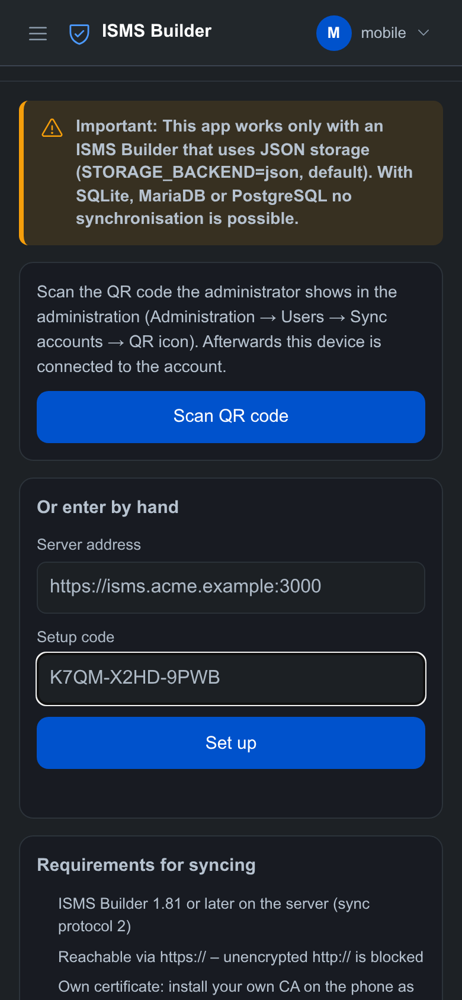
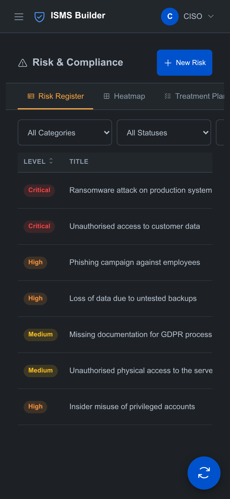
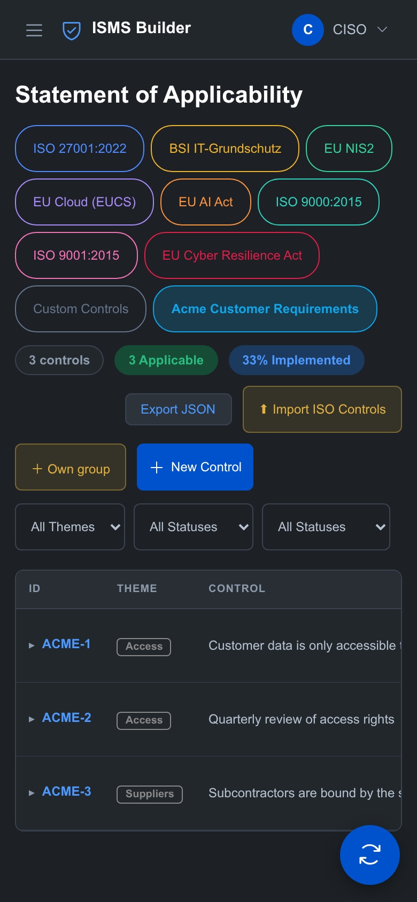
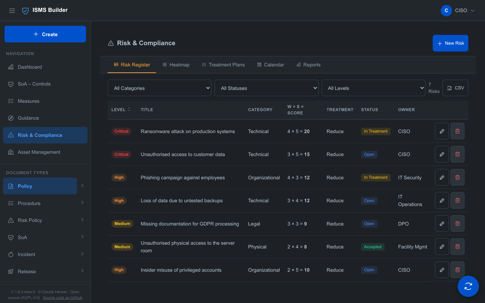
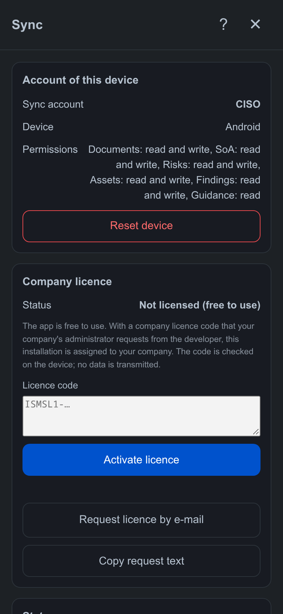
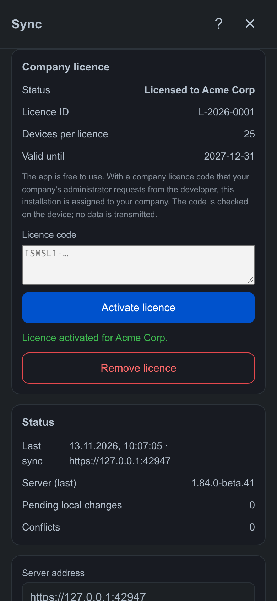
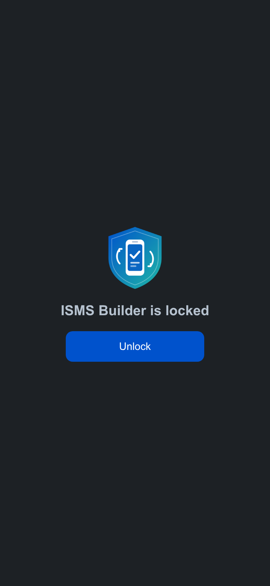

# Modul: Mobile App (Android) & Sync

> Die Android-App ist eine eigenständige, offline nutzbare Variante des ISMS Builders. Sie hält einen
> eigenen Datenbestand auf Handy oder Tablet und gleicht ihn bei Bedarf mit dem Hauptsystem ab — per WLAN oder per Datei.

> **⚠ Wichtig — nur mit JSON-Speicher:** Die mobile App und der Abgleich funktionieren **ausschließlich**, wenn ISMS Builder den **JSON-Speicher** nutzt (`STORAGE_BACKEND=json`, der Standard). Mit **SQLite, MariaDB/MySQL oder PostgreSQL ist der Abgleich nicht verfügbar** (der Server antwortet mit `501`). Welcher Speicher aktiv ist, steht in der `.env` des Servers (`STORAGE_BACKEND`). Bitte vor dem Einsatz der App prüfen.

---

<!-- mobile-screenshots:start -->
## Screenshots

> Die Bilder sind Aufnahmen in einem Desktop-Browser mit erfundenen Beispieldaten (Firma „Acme Corp“), denn die Android-App sperrt Bildschirmfotos aus Sicherheitsgründen. Die Oberfläche in der App entspricht ihnen.



*Einrichtung: QR-Code scannen oder Adresse und Code eingeben*



*Risiken auf dem Handy*



*Eigene SoA-Gruppe als eigener Reiter (hier ein erfundenes Beispiel)*



*Tablet im Querformat: Menü und Inhalt nebeneinander*



*Das Sync-Panel: Status, Server, Abgleich*



*Firmenlizenz aktiviert*



*Gesperrte App: Entsperren mit der Gerätesperre*

<!-- mobile-screenshots:end -->

## Was die App kann

- **Offline arbeiten:** Die App bringt die Oberfläche und die Server-Logik (Risiko-Bewertung, Asset-Typen, Versionierung, Statuswechsel) mit. Es wird kein Server benötigt.
- **Module:** Dokumente/Vorlagen, SoA (Statement of Applicability), Risiken, Assets, Audit-Feststellungen und Guidance. Alle anderen Module (z. B. GDPR, BCM, Lieferanten, Verwaltung) gibt es in der App nicht.
- **Ein Konto je App:** Nach der Einrichtung gehört die App zu genau einem Sync-Konto. Name, Menü und Bearbeitungsrechte in der App folgen den Rechten dieses Kontos.
- **Handy und Tablet:** Die Oberfläche passt sich an (Hoch- und Querformat; im Querformat bleibt die Seitenleiste sichtbar). Einstellungen für Passwort, 2FA und Rollen gibt es lokal nicht; die Sprache wählt man im Sync-Panel unter *Sprache der Oberfläche*.
- **Hilfe in der App:** Über den Knopf „?“ im Sync-Panel und auf dem Einrichtungsbildschirm öffnet sich eine eingebaute Anwenderhilfe (Einrichtung, Abgleich, Konflikte, Dateiaustausch, Sicherheit, Fehlermeldungen). Sie ist offline lesbar und in allen fünf Sprachen verfügbar.
- **Rechte je Bereich:** Anlegen, Bearbeiten, Löschen und Datei-Upload erscheinen nur in Bereichen, in denen das Sync-Konto schreiben darf; die Guidance ist in der App immer nur lesbar. Druck- und PDF-Funktionen gibt es nur am Server.
- **Firmenlizenz (optional):** Die App bleibt frei nutzbar. Mit einem Lizenzcode, den der Administrator einer Firma beim Entwickler beantragt, wird die Installation der Firma zugeordnet („lizenziert für …“). Der Code wird offline auf dem Gerät geprüft, es werden keine Daten übertragen; ohne Code erscheint nur ein Hinweisband.
- **Open-Source-Lizenzen:** Unter *Info* in der App stehen alle enthaltenen Fremdkomponenten mit Urheberrechtsvermerk und Lizenztext (offline lesbar).
- **Nicht verfügbar:** Datei-Uploads/Anhänge (auch PDF/Word-Dateien der Guidance liegen nur am Server; die App zeigt dafür einen Hinweis), WebDAV-Veröffentlichung, KI-Funktionen, PDF-Download vom Server.

## Voraussetzungen am Hauptsystem

- ISMS Builder **ab Version 1.76** (Sync-Protokoll 1, sichtbar unter `GET /api/version` als `syncProtocol`).
- `STORAGE_BACKEND=json` (Standard). Bei sqlite, mariadb oder postgres antworten die Sync-Endpunkte mit `501`.
- **HTTPS:** Der Server muss per `https://` erreichbar sein (Einrichtung: `scripts/setup-ssl.sh`, Abschnitt *SSL/TLS einrichten*). Die Adresse, die in der App steht, muss im Zertifikat enthalten sein.
- **Versionen:** Die App hat eine **eigene Versionsnummer** und ist unabhängig vom Hauptsystem. Verträglich sind beide, wenn das Sync-Protokoll übereinstimmt (aktuell 1) und der Server mindestens Version 1.76 hat. Version und Kompatibilität zeigt die App unter *Server prüfen* und *Info & Voraussetzungen* an.
- Ein **Sync-Konto** (siehe unten). Ein normales Benutzerkonto wird für den Abgleich nicht verwendet.

## Sync-Konto anlegen

Administratoren legen Sync-Konten unter *Verwaltung → Benutzer* im Bereich *Sync-Konten (mobile App)* an (*Neues Sync-Konto*). Ein Sync-Konto steht für eine **Rolle oder Person** (z. B. „CISO“, „DSB“, „Revision“) und ist **unabhängig von den Benutzern**: kein Login an der Oberfläche, keine Rolle, kein Passwort, keine 2FA. Es dient ausschließlich dem Datenabgleich der App.

- **Name**, z. B. „CISO“. Der Name erscheint in der App als Konto, bei neu angelegten Datensätzen und im Audit-Log (`sync:CISO`).
- **Rechte je Modul:** *kein Zugriff*, *lesen* oder *lesen und schreiben* (Dokumente/Vorlagen, SoA, Risiken, Assets, Feststellungen). Guidance ist nur lesbar. Beispiel: Das Konto der Auditorin darf Risiken und Feststellungen lesen und schreiben und sonst nichts.
- **Gültig bis** (optional).
- **Geräte:** Ein Konto kann mehrere Geräte haben (z. B. Handy und Tablet der CISO). Jedes Gerät hat einen **eigenen Schlüssel**. Die Liste zeigt Gerätename und „zuletzt benutzt“; ein verlorenes Gerät lässt sich einzeln sperren (✕), ohne die anderen zu betreffen.

### Eigene SoA-Gruppen

Eigene SoA-Gruppen (Frameworks, die ein Administrator auf dem Server angelegt hat) werden mit der SoA synchronisiert. **Anzeigen** dürfen Konten mit Leserecht auf SoA oder auf *Eigene SoA-Gruppen*; ohne Gruppen-Definition hätten die Controls einer eigenen Gruppe in der App keinen Namen und keine Farbe. **Anlegen, umbenennen, umfärben und leere Gruppen löschen** darf nur ein Konto mit dem Recht *Eigene SoA-Gruppen (Verwaltung)* = *Lesen und Schreiben* — Sync-Konten sind keine Administratoren, den Zugriff vergibt der Administrator des Servers an dieser Stelle. Das Schreibrecht auf SoA allein genügt dafür nicht. Die Server-Prüfungen gelten unverändert (Kennung, reservierte Kennungen eingebauter Frameworks, Farbe `#RRGGBB`, Bezeichnung höchstens 120 Zeichen); eine Gruppe mit Controls lässt sich nicht löschen. Der Import einer Gruppe per Datei legt zugleich Controls an und braucht deshalb zusätzlich Schreibrecht auf SoA (die Vorschau genügt mit dem Gruppenrecht). **Mindestversion des Servers für diese Funktion: 1.84.0.**

### Gerät einrichten (QR-Code)

Nach dem Anlegen und später jederzeit über das QR-Symbol zeigt die Verwaltung einen **QR-Code und einen Einrichtungscode** (Format `XXXX-XXXX-XXXX`). Beides ist **15 Minuten gültig und nur einmal verwendbar**; ein neuer Code macht den vorherigen ungültig. Die Adresse, unter der die App den Server erreicht, ist einstellbar (vorbelegt mit der aktuell benutzten). Der QR-Code enthält nur diese Adresse und den Einmal-Code — **nicht den Schlüssel**. Der Schlüssel entsteht erst beim Einlösen in der App, ist dem Administrator nie sichtbar und liegt am Server nur als Hash.

Für **Skripte** (z. B. `scripts/sync-import.js`) erzeugt das Schlüssel-Symbol einen Geräteschlüssel `ISMS-XXXX-XXXX-XXXX-XXXX-XXXX-XXXX-XXXX-XXXX`, der **einmal** angezeigt wird.

Sperren, Freigeben, Rechte ändern und Löschen wirken sofort. Die Verwaltung wird im Audit-Log protokolliert (nie Schlüssel oder Codes); Änderungen aus dem Abgleich stehen dort unter dem Namen des Sync-Kontos.

## Gerät in der App einrichten

1. App installieren und öffnen (bei aktiver Gerätesperre zuerst entsperren, siehe *Sicherheit*). Beim ersten Start zeigt die App nur den Einrichtungsbildschirm.
2. **QR-Code scannen** und den QR-Code der Verwaltung mit der Kamera erfassen. Alternativ Server-Adresse und Einrichtungscode von Hand eintragen. Die App liest den QR-Code selbst, ohne Google-Dienste.
3. Die App tauscht den Code gegen den Geräteschlüssel (Ablage im Android-Schlüsselspeicher), holt den Grunddatenbestand (erster Abgleich) und startet neu.

Danach gehört die App zu **diesem einen Konto**: Oben steht der Kontoname, Menü und Bearbeitungsrechte folgen den Rechten des Kontos. Module ohne Zugriff fehlen im Menü; nur lesbare Module sind schreibgeschützt (Änderungen werden mit „Zugriff verweigert“ abgelehnt). Konto, Gerät und Rechte zeigt das Sync-Panel unter *Konto dieses Geräts*.

- **Rechte ändern sich:** Bei jedem Abgleich werden die aktuellen Rechte geholt. Wird ein Leserecht entzogen, löscht die App die lokalen Daten dieses Moduls (auch nicht gesendete Änderungen); wird ein Modul neu freigegeben, lädt sie es komplett nach. Anzeige und Menü passen sich nach dem Neuladen der Oberfläche an.
- **Konto wechseln oder Gerät abgeben:** *Gerät zurücksetzen* im Sync-Panel löscht nach Rückfrage alle lokalen Daten, das Konto und den Schlüssel; danach ist eine neue Einrichtung nötig. Nicht gesendete Änderungen gehen dabei verloren.

## Zertifikat auf dem Handy

Mit einem öffentlich vertrauten Zertifikat (z. B. Let's Encrypt) ist nichts zu tun. Mit einem **eigenen oder selbstsignierten Zertifikat** muss das Handy ihm vertrauen:

1. Beim Erzeugen mit `scripts/setup-ssl.sh` unter *Weitere Namen/IP-Adressen* den Namen oder die IP eintragen, die in der App verwendet wird (z. B. `192.168.1.20`). Steht die Adresse nicht im Zertifikat, lehnt die App die Verbindung ab.
2. `ssl/cert.pem` aufs Handy kopieren (USB, Nextcloud, E-Mail).
3. Am Handy: *Einstellungen → Sicherheit → Verschlüsselung & Anmeldedaten → Zertifikat installieren → CA-Zertifikat* (der Pfad unterscheidet sich je nach Hersteller). Android warnt dabei vor Zertifikaten Dritter; das ist hier das eigene Zertifikat.
4. In der App *Server prüfen* wählen: Erscheint die Serverversion, vertraut das Handy dem Zertifikat.

Fehlermeldungen: *Server nicht erreichbar* → Adresse, Port, WLAN/VPN und Firewall des Servers prüfen. *Zertifikat … nicht als vertrauenswürdig* → Schritte 1–3.

## Abgleich per WLAN

Nach der Einrichtung (siehe oben) sind Adresse und Schlüssel gespeichert: Es genügt *Jetzt abgleichen*. Die folgenden Schritte gelten, wenn der Schlüssel entfernt wurde oder mit einem anderen Geräteschlüssel (z. B. für ein zweites Konto-Gerät) gearbeitet wird.

1. In der App unten rechts auf die Sync-Schaltfläche tippen.
2. Server-Adresse (z. B. `https://isms.example.org:3000`) und **Zugangsschlüssel** eintragen. *Server prüfen* zeigt Serverversion und Kompatibilität; nach dem ersten Abgleich zeigt die App außerdem den Namen und die Rechte des Sync-Kontos. Der Schlüssel wird im geschützten Android-Schlüsselspeicher abgelegt; *Schlüssel entfernen* löscht ihn vom Gerät.
3. **Jetzt abgleichen.** Die App sendet zuerst lokale Änderungen (Push) und holt danach alles, was am Server neu ist (Pull). Der erste Abgleich lädt den kompletten Grunddatenbestand.

Regeln:

- **Nur Änderungen:** Es wird nur übertragen, was sich seit dem letzten Abgleich geändert hat.
- **Serverzeit:** Der Server vergibt `updatedAt` beim Annehmen. Eine falsch gehende Handy-Uhr stört den Abgleich nicht.
- **Konflikte:** Wurde ein Datensatz am Server geändert, seit das Handy ihn geholt hat, wird er **nicht überschrieben**. Er erscheint in der App unter *Konflikte lösen*, mit den abweichenden Feldern. Pro Datensatz wählt man *Meine Fassung behalten* (wird beim nächsten Abgleich gesendet) oder *Serverstand übernehmen*.
- **Löschen:** Löschen am Handy landet im Papierkorb des Hauptsystems. *Endgültig löschen* am Handy wird dort ebenfalls als gelöschter Datensatz übertragen und nicht aus dem Hauptsystem entfernt.
- **Rechte:** Module ohne Leserecht werden nicht geholt. Fehlt das Schreibrecht für ein Modul, meldet die App es als *abgelehnt*; lokale Änderungen gehen nicht verloren. *Zugangsschlüssel ungültig, gesperrt oder abgelaufen* heißt: Konto in der Verwaltung prüfen.

## Abgleich per Datei

Für Geräte ohne Netzverbindung zum Hauptsystem:

- **Gesamtbestand exportieren** — komplette Sicherung der App-Daten (App → App oder Archiv).
- **Nur Änderungen exportieren** — Datei mit den lokal geänderten Datensätzen. Einspielen am Hauptsystem mit einem Sync-Konto:

  ```bash
  ISMS_SYNC_KEY=ISMS-XXXX-… node scripts/sync-import.js https://isms.example.org:3000 isms-mobile-changes-2026-10-18.json
  ```

  Ohne `ISMS_SYNC_KEY` fragt das Skript den Schlüssel ohne Echo ab. Es gelten dieselben Rechte und dieselbe Konfliktregel wie beim WLAN-Abgleich; Exitcode `3` bedeutet Konflikte oder abgelehnte Datensätze.
- **Datei importieren** — nimmt ein App-Bundle oder einen Export des Hauptsystems (*Admin → Export*) entgegen. Vorher zeigt die App eine **Vorschau** (neu / aktualisiert / unverändert / Konflikte). Lokal geänderte Datensätze werden nie stillschweigend überschrieben. Der Export des Hauptsystems enthält nur die Module, die er selbst liefert (z. B. Vorlagen, SoA, Risiken, Guidance); Assets und Feststellungen kommen über den WLAN-Abgleich.

## Maßnahmen

Maßnahmen haben **kein eigenes Recht** im Sync-Konto. Der Zugriff ergibt sich aus den Modulen, mit denen eine Maßnahme verknüpft ist:

| Verknüpfung | Modul |
|---|---|
| Risiko | Risiken |
| Feststellung | Feststellungen |
| SoA-Control | SoA |
| Richtlinie | Dokumente/Vorlagen |

- **Lesen:** mindestens ein verknüpftes Modul ist lesbar.
- **Ändern, anlegen, löschen:** Schreibrecht auf **alle** Module der Maßnahme (bisheriger und neuer Stand). Eine neue Maßnahme braucht mindestens eine Verknüpfung; Maßnahmen ohne Verknüpfung werden nicht synchronisiert.
- **Nie über die App änderbar:** TOMs, Governance-Maßnahmen und Maßnahmen, die mit Verarbeitungstätigkeiten verknüpft sind. Anhänge bleiben am Server.
- Entzieht man ein Leserecht, verschwinden die betroffenen Maßnahmen beim nächsten Abgleich vom Gerät. Ist eine Maßnahme mit Risiko **und** Feststellung verknüpft, sind Schreibrechte auf beide nötig.
- Behandlungen von Risiken und Maßnahmen von Feststellungen sind Maßnahmen des Registers und folgen denselben Regeln.
- Die Referenz (M-001 …) vergibt der Server; kollidiert die Referenz einer am Gerät angelegten Maßnahme, bekommt sie die nächste freie.

Hinweis: Rollen der Weboberfläche (z. B. Auditor, Content Owner) gelten für Sync-Konten nicht; maßgeblich sind allein die Rechte je Modul.

## API

Alle Aufrufe außer `/sync/enroll` tragen den Header `Authorization: Bearer <Geräteschlüssel>`.

| Methode | Pfad | Zweck |
|---|---|---|
| POST | `/sync/enroll` | Gerät einrichten: tauscht den Einrichtungscode (aus dem QR-Code) gegen einen Geräteschlüssel. Ohne Anmeldung; Code einmalig und 15 Minuten gültig; Fehlversuche werden ausgebremst. |
| GET | `/sync/me` | Name, Rechte und Gültigkeit des Sync-Kontos. |
| GET | `/sync/pull?since=<ISO>&modules=a,b` | Änderungen seit `since`, einschließlich gelöschter Datensätze, nur für lesbare Module (ausdrücklich angefragte, nicht erlaubte unter `denied`). Antwort enthält `serverTime` für den nächsten Pull. |
| POST | `/sync/push` | `{ protocolVersion, changes: { <modul>: [Datensätze mit baseUpdatedAt] } }` — Antwort: `accepted`, `conflicts`, `rejected`. |

Die Verwaltung der Sync-Konten (`/admin/sync-accounts`) ist nur für Administratoren. Module: `templates`, `soa`, `risks`, `assets`, `findings`, `guidance`, `soaFrameworks`. Beschreibung in `docs/architecture/openapi.yaml`.

## Sicherheit

- Die Übertragung erfolgt **ausschließlich verschlüsselt (HTTPS)**. Unverschlüsseltes `http://` lehnt die App ab. Außerhalb des eigenen WLANs sollte der Server zusätzlich per VPN oder Reverse-Proxy erreichbar sein.
- Der Zugangsschlüssel berechtigt **nur zum Abgleich** der freigegebenen Module, nicht zur Oberfläche oder Verwaltung. Am Server liegt nur sein Hash; am Gerät liegt er im Android-Schlüsselspeicher. Geht ein Gerät verloren, das Sync-Konto sperren oder löschen — es wirkt sofort.
- Falsche Schlüssel werden ausgebremst (wie falsche Passwörter bei der Anmeldung).
- **App-Sperre:** Die App verlangt beim Start und nach etwa zwei Minuten im Hintergrund Fingerabdruck, Gesicht oder PIN/Muster/Passwort des Geräts. Hat das Gerät keine Bildschirmsperre, startet die App nicht und erklärt warum.
- Die Android-Datensicherung der App ist abgeschaltet; Screenshots, Bildschirmaufnahme und die Vorschau in der App-Übersicht sind gesperrt. Ausgeliefert wird eine signierte Release-Version (nicht „debuggable“, WebView-Debugging aus).
- Einrichtungscodes sind einmalig und 15 Minuten gültig; falsche Codes werden ausgebremst.
- Die Daten liegen im geschützten App-Speicher des Geräts, aber **nicht zusätzlich verschlüsselt**. Gerätesperre und Android-Geräteverschlüsselung sind Pflicht.

## Grenzen

- Nur mit dem JSON-Backend; Anhänge werden nicht synchronisiert.
- Konflikte werden pro Datensatz, nicht pro Feld aufgelöst.
- Am Hauptsystem endgültig gelöschte Datensätze erreichen das Handy nicht.
- Die Oberfläche kennt keine Rechte je Modul: Sie unterscheidet nur „darf irgendwo schreiben“ und „nur lesen“. Die genaue Prüfung je Modul erfolgt beim Speichern.
- Audit-Feststellungen werden synchronisiert, haben in der App aber noch keine eigene Ansicht.
- Die App enthält die Server-Logik des Stands, mit dem sie gebaut wurde. Nach einem Server-Update sollte auch die App neu gebaut werden (`npm run build:android` im Projekt `isms-builder-mobile`).

## Häufige Fragen (FAQ)

**Der Abgleich meldet „Sync complete“, aber es fehlen Daten auf dem Gerät (z. B. Dokumentvorlagen, Maßnahmen, Risiken, Assets).**
Der Abgleich holt nur Datensätze, die sich *seit dem letzten Abgleich geändert* haben (Zeitstempel `updatedAt`). Werden Daten **mit altem Zeitstempel** erst *nach* dem letzten Abgleich auf den Server gebracht — Demo-Import, geladenes Demo-Bündel, Wiederherstellung aus einem Backup, von Hand ersetzte Dateien —, gelten sie für das Gerät als „nicht geändert“ und kommen nie an. Ab Hauptsystem 1.84 und App 1.6 erkennt die App das selbst: Der Server nennt eine *Daten-Epoche*, die sich bei jedem Serverstart und nach jedem Datenaustausch ändert, und die App lädt dann einmal **alle** Daten neu. Von Hand: im Sync-Panel **Alle Daten neu laden** (App 1.6). Mit älteren Ständen hilft *Gerät zurücksetzen* und eine neue Einrichtung per QR-Code — dabei gehen nicht gesendete Änderungen verloren, deshalb vorher abgleichen oder *Nur Änderungen exportieren*.

**Ich muss jeden Konflikt einzeln bestätigen und jedes Mal die PIN eingeben.**
Ab App 1.6 erscheinen Konflikte als Liste zum Anhaken: Einträge auswählen (anfangs ist nichts gewählt), *Alle auswählen* und den Modulfilter nutzen und mit **einer** Sammelaktion lösen — die PIN wird nur einmal abgefragt.

**Das Handy lehnt das Zertifikat meines Servers ab.**
Ein einzelnes selbstsigniertes Serverzertifikat wird auf manchen Geräten nicht akzeptiert (beobachtet auf einem Android-16-Tablet). Zuverlässig: eine **eigene CA** erzeugen, damit ein Serverzertifikat mit der Adresse (IP oder Name) im `subjectAltName` signieren und die **CA** am Handy als **„CA-Zertifikat“** installieren (nicht als „VPN- und App-Nutzerzertifikat“). Zu prüfen: Steht sie unter *Vertrauenswürdige Anmeldedaten → Benutzer*? Ein Browserhinweis „nicht sicher“ sagt nichts darüber, ob die App dem Zertifikat vertraut. Eine nur zum Testen angelegte CA nach dem Test vom Handy entfernen.

**Welchen Port nutzt der Abgleich?**
Keinen eigenen: dieselbe Adresse und denselben Port wie die Weboberfläche (`https://host[:port]`). Eine Firewall-Regel und ein Zertifikat genügen.

**In den Guidance-Artikeln fehlen Bilder.**
Die mitgelieferten Artikel enthalten ihre Bilder in der App (ab App 1.6). Bilder, die Anwender selbst in eigenen Artikeln verlinken, bringt die App nicht mit — sie liegen nur auf dem Server. Wer sie in der App braucht, passt den Bau der App an (`scripts/sync-ui.sh`).

**Ein Dokument aus dem Demo-Paket fehlt (z. B. „Rollen & Verantwortlichkeiten“), nachdem ich Guidance-Artikel gelöscht habe.**
Das Demo-Paket bringt Dokumente und Daten als ganz normale Datensätze mit — im Unterschied zu den *Seed-Artikeln* (z. B. die Bedienungsanleitungen in *Rollen*, das Systemhandbuch, die Leitfäden), die der Server bei jedem Start neu anlegt, falls sie fehlen. Ein gelöschtes Paket-Dokument kommt deshalb **nicht von selbst zurück**. Vorbeugen: nicht ganze Kategorien löschen; gelöschte Artikel zuerst im *Papierkorb* **wiederherstellen**, solange er nicht geleert ist. Nach dem endgültigen Löschen: das Dokument neu anlegen (der Text steht im Demo-Paket, `data/demo-bundles/<Sprache>.json`) oder das Demo-Paket neu laden — das ersetzt die Demodaten und ist im Produktivbetrieb gesperrt. Auf den Geräten erscheint ein neu angelegtes Dokument beim nächsten Abgleich.
