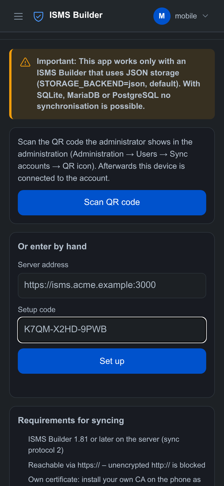
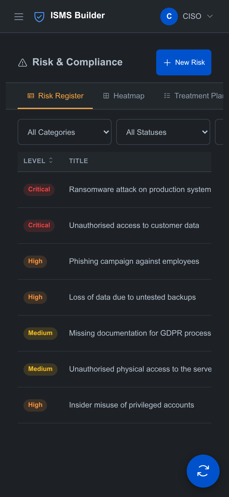
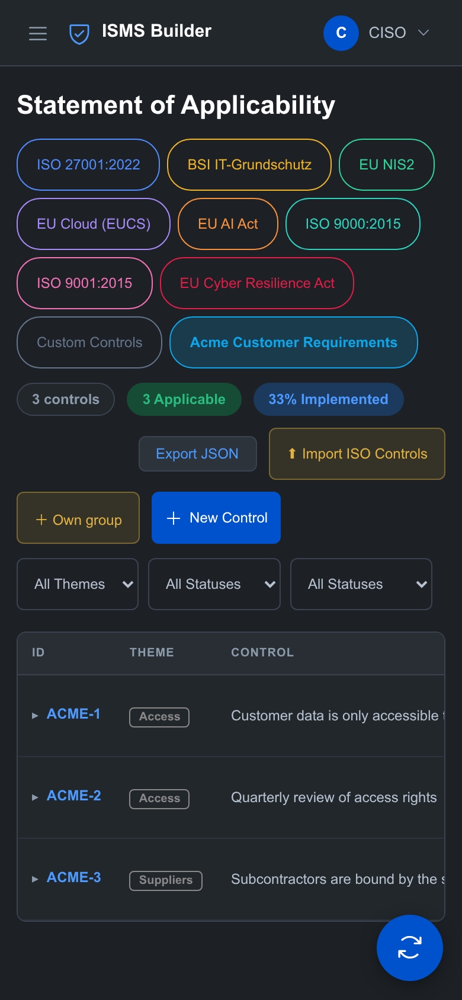
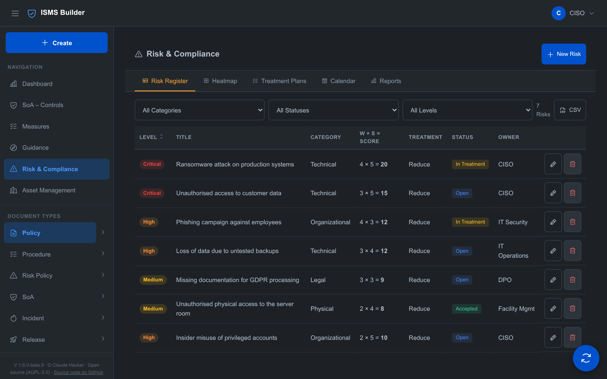
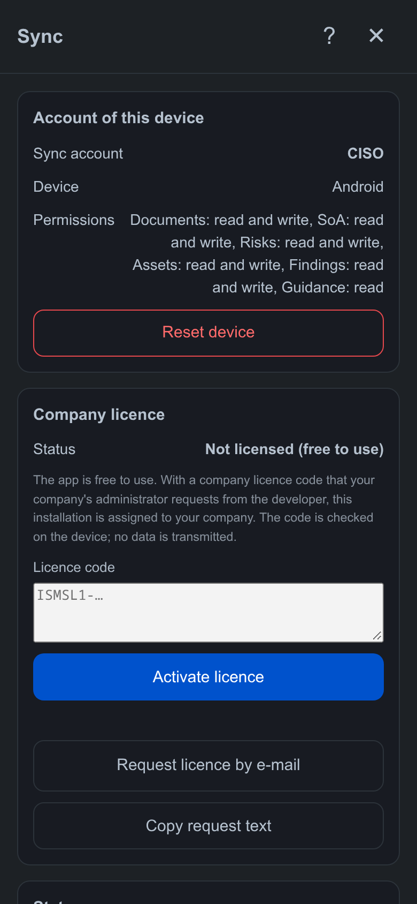
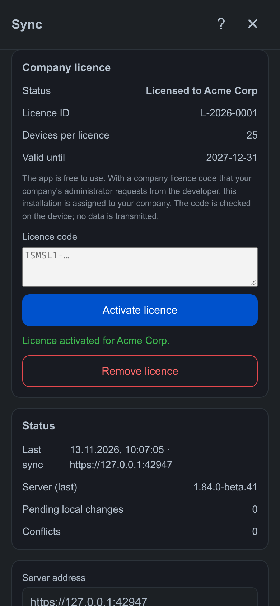
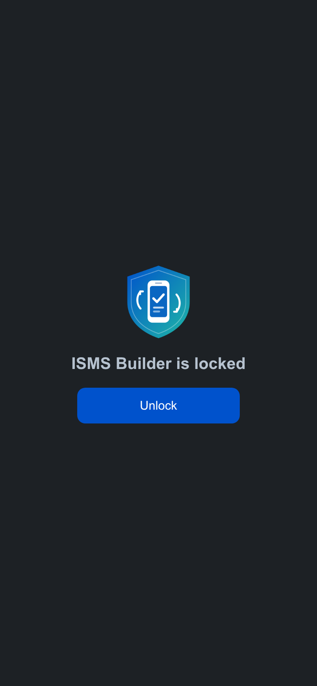

# Module: Mobiele app (Android) en synchronisatie

> De Android-app is een zelfstandige, offline bruikbare variant van ISMS Builder. Ze bewaart een eigen gegevensbestand
> op telefoon of tablet en synchroniseert dat op verzoek met het hoofdsysteem — via wifi of via een bestand.

> **⚠ Belangrijk — alleen met JSON-opslag:** De mobiele app en de synchronisatie werken **uitsluitend** als ISMS Builder de **JSON-opslag** gebruikt (`STORAGE_BACKEND=json`, de standaard). Met **SQLite, MariaDB/MySQL of PostgreSQL is synchronisatie niet beschikbaar** (de server antwoordt met `501`). De actieve opslag staat in de `.env` van de server (`STORAGE_BACKEND`). Controleer dit voordat u de app gebruikt.

---

<!-- mobile-screenshots:start -->
## Schermafbeeldingen

> De afbeeldingen zijn gemaakt in een desktopbrowser met fictieve voorbeeldgegevens (bedrijf “Acme Corp”), omdat de Android-app schermafbeeldingen om veiligheidsredenen blokkeert. De interface van de app komt ermee overeen.



*Instellen: QR-code scannen of adres en code invoeren*



*Risico's op de telefoon*



*Een eigen SoA-groep als eigen tabblad (verzonnen voorbeeld)*



*Tablet in liggende stand: menu en inhoud naast elkaar*



*Het synchronisatiepaneel: status, server, synchronisatie*



*Bedrijfslicentie geactiveerd*



*Vergrendelde app: ontgrendelen met de apparaatvergrendeling*

<!-- mobile-screenshots:end -->

## Wat de app doet

- **Offline werken:** de app bevat de gebruikersinterface en de serverlogica (risicoscore, activatypen, versiebeheer, statusovergangen). Een server is niet nodig.
- **Modules:** documenten/sjablonen, SoA (Statement of Applicability), risico's, activa, auditbevindingen en guidance. Alle andere modules (bijv. AVG, BCM, leveranciers, beheer) zitten niet in de app.
- **Eén account per app:** na de installatie hoort de app bij precies één synchronisatieaccount. Naam, menu en bewerkingsrechten in de app volgen de rechten van dit account.
- **Telefoon en tablet:** de interface past zich aan (staand en liggend; liggend blijft de zijbalk zichtbaar). Instellingen voor wachtwoord, 2FA en rollen bestaan lokaal niet; de taal kies je in het synchronisatiepaneel onder *Taal van de interface*.
- **Help in de app:** De knop “?” in het synchronisatiepaneel en op het installatiescherm opent een ingebouwde gebruikershulp (installatie, synchronisatie, conflicten, bestandsuitwisseling, beveiliging, foutmeldingen). Ze is offline leesbaar en in alle vijf talen beschikbaar.
- **Rechten per gebied:** Nieuw, bewerken, verwijderen en bestandsupload verschijnen alleen in gebieden waar het synchronisatieaccount mag schrijven; de guidance is in de app altijd alleen-lezen. Afdruk- en pdf-functies zijn alleen op de server beschikbaar.
- **Bedrijfslicentie (optioneel):** De app blijft vrij te gebruiken. Met een licentiecode die de beheerder van een bedrijf bij de ontwikkelaar aanvraagt, wordt de installatie aan het bedrijf toegewezen (“gelicentieerd voor …”). De code wordt offline op het apparaat gecontroleerd, er worden geen gegevens verzonden; zonder code verschijnt alleen een meldingsbalk.
- **Open-sourcelicenties:** Onder *Info* in de app staan alle meegeleverde componenten van derden met copyrightvermelding en licentietekst (offline leesbaar).
- **Niet beschikbaar:** bestandsuploads/bijlagen (PDF/Word-bestanden van de guidance staan alleen op de server; de app toont een melding), WebDAV-publicatie, AI-functies, pdf-download vanaf de server.

## Vereisten op het hoofdsysteem

- ISMS Builder **versie 1.76 of hoger** (synchronisatieprotocol 1, zichtbaar als `syncProtocol` in `GET /api/version`).
- `STORAGE_BACKEND=json` (standaard). Bij sqlite, mariadb of postgres antwoorden de synchronisatie-eindpunten met `501`.
- **HTTPS:** de server moet bereikbaar zijn via `https://` (inrichting: `scripts/setup-ssl.sh`, sectie *SSL/TLS instellen*). Het adres dat in de app staat, moet in het certificaat voorkomen.
- **Versies:** de app heeft een **eigen versienummer** en is onafhankelijk van het hoofdsysteem. Beide zijn compatibel wanneer het synchronisatieprotocol overeenkomt (nu 1) en de server minstens versie 1.76 is. De app toont versie en compatibiliteit onder *Server controleren* en *Info en vereisten*.
- Een **synchronisatieaccount** (zie hieronder). Een gewoon gebruikersaccount wordt voor de synchronisatie niet gebruikt.

## Een synchronisatieaccount aanmaken

Beheerders maken synchronisatieaccounts aan onder *Beheer → Gebruikers* in het onderdeel *Synchronisatieaccounts (mobiele app)* (*Nieuw synchronisatieaccount*). Een synchronisatieaccount staat voor een **rol of persoon** (bijv. “CISO”, “FG”, “Audit”) en is **onafhankelijk van de gebruikers**: geen aanmelding bij de interface, geen rol, geen wachtwoord, geen 2FA. Het dient uitsluitend voor de gegevenssynchronisatie van de app.

- **Naam**, bijv. “CISO”. De naam verschijnt in de app als account, bij nieuw aangemaakte records en in het auditlogboek (`sync:CISO`).
- **Rechten per module:** *geen toegang*, *lezen* of *lezen en schrijven* (documenten/sjablonen, SoA, risico's, activa, bevindingen). Guidance is alleen-lezen. Voorbeeld: het account van de auditor mag risico's en bevindingen lezen en schrijven en verder niets.
- **Geldig tot** (optioneel).
- **Apparaten:** een account kan meerdere apparaten hebben (bijv. telefoon en tablet van de CISO). Elk apparaat heeft een **eigen sleutel**. De lijst toont apparaatnaam en “laatst gebruikt”; een verloren apparaat kan afzonderlijk worden geblokkeerd (✕) zonder de andere te raken.

### Eigen SoA-groepen

Eigen SoA-groepen (frameworks die een beheerder op de server heeft aangemaakt) worden met de SoA gesynchroniseerd. **Bekijken** mogen accounts die de SoA of *Eigen SoA-groepen* kunnen lezen; zonder de groepsdefinitie hebben de controls van een eigen groep in de app geen naam en kleur. **Aanmaken, hernoemen, kleur wijzigen en lege groepen verwijderen** vereist het recht *Eigen SoA-groepen (beheer)* = *lezen en schrijven* — synchronisatieaccounts zijn geen beheerders; de serverbeheerder verleent deze toegang hier. Schrijfrecht op de SoA alleen is niet genoeg. De servercontroles blijven ongewijzigd (ID, gereserveerde ID's van ingebouwde frameworks, kleur `#RRGGBB`, naam maximaal 120 tekens); een groep met controls kan niet worden verwijderd. Een groep importeren uit een bestand maakt ook controls aan en vereist daarom bovendien schrijfrecht op de SoA (het voorbeeld werkt met alleen het groepsrecht). **Minimale serverversie voor deze functie: 1.84.0.**

### Een apparaat instellen (QR-code)

Na het aanmaken, en later op elk moment via het QR-pictogram, toont het beheer een **QR-code en een installatiecode** (formaat `XXXX-XXXX-XXXX`). Beide zijn **15 minuten geldig en slechts eenmaal te gebruiken**; een nieuwe code maakt de vorige ongeldig. Het adres waarmee de app de server bereikt, is aanpasbaar (vooraf ingevuld met het gebruikte adres). De QR-code bevat alleen dit adres en de eenmalige code — **niet de sleutel**. De sleutel ontstaat pas wanneer de app de code inwisselt, is voor de beheerder nooit zichtbaar en staat op de server alleen als hash.

Voor **scripts** (bijv. `scripts/sync-import.js`) maakt het sleutelpictogram een apparaatsleutel `ISMS-XXXX-XXXX-XXXX-XXXX-XXXX-XXXX-XXXX-XXXX` aan, die **eenmaal** wordt getoond.

Blokkeren, vrijgeven, rechten wijzigen en verwijderen werken direct. Het beheer wordt vastgelegd in het auditlogboek (nooit sleutels of codes); wijzigingen uit de synchronisatie staan daar onder de naam van het synchronisatieaccount.

## Het apparaat in de app instellen

1. Installeer en open de app (bij een actieve apparaatvergrendeling eerst ontgrendelen, zie *Beveiliging*). Bij de eerste start toont de app alleen het installatiescherm.
2. **QR-code scannen** en de QR-code van het beheer met de camera vastleggen. Of voer serveradres en installatiecode met de hand in. De app leest de QR-code zelf, zonder Google-diensten.
3. De app wisselt de code in voor de apparaatsleutel (opslag in de Android-sleutelopslag), haalt de basisgegevens op (eerste synchronisatie) en start opnieuw.

Daarna hoort de app bij **dit ene account**: bovenaan staat de accountnaam, en menu en bewerkingsrechten volgen de rechten van het account. Modules zonder toegang ontbreken in het menu; alleen-lezen modules zijn tegen schrijven beschermd (wijzigingen worden geweigerd met “Toegang geweigerd”). Het synchronisatiepaneel toont account, apparaat en rechten onder *Account van dit apparaat*.

- **Rechten wijzigen:** elke synchronisatie haalt de actuele rechten op. Wordt een leesrecht ingetrokken, dan wist de app de lokale gegevens van die module (ook niet verzonden wijzigingen); wordt een module opnieuw vrijgegeven, dan laadt ze die volledig. Weergave en menu passen zich aan nadat de interface opnieuw is geladen.
- **Van account wisselen of het apparaat overdragen:** *Apparaat resetten* in het synchronisatiepaneel wist na bevestiging alle lokale gegevens, het account en de sleutel; daarna is een nieuwe installatie nodig. Niet verzonden wijzigingen gaan verloren.

## Certificaat op de telefoon

Met een openbaar vertrouwd certificaat (bijv. Let's Encrypt) hoeft er niets te gebeuren. Met een **eigen of zelfondertekend certificaat** moet de telefoon het vertrouwen:

1. Voer bij het aanmaken met `scripts/setup-ssl.sh` onder *Extra namen/IP-adressen* de naam of het IP in dat in de app wordt gebruikt (bijv. `192.168.1.20`). Staat het adres niet in het certificaat, dan weigert de app de verbinding.
2. Kopieer `ssl/cert.pem` naar de telefoon (USB, Nextcloud, e-mail).
3. Op de telefoon: *Instellingen → Beveiliging → Versleuteling en inloggegevens → Certificaat installeren → CA-certificaat* (het pad verschilt per fabrikant). Android waarschuwt voor certificaten van derden; hier is het uw eigen certificaat.
4. Kies in de app *Server controleren*: verschijnt de serverversie, dan vertrouwt de telefoon het certificaat.

Foutmeldingen: *Server niet bereikbaar* → controleer adres, poort, wifi/VPN en de firewall van de server. *Certificaat … niet vertrouwd* → stappen 1–3.

## Synchroniseren via wifi

Na de installatie (zie boven) zijn adres en sleutel opgeslagen: *Nu synchroniseren* volstaat. De volgende stappen gelden als de sleutel is verwijderd of een andere apparaatsleutel wordt gebruikt.

1. Tik rechtsonder in de app op de synchronisatieknop.
2. Voer het serveradres (bijv. `https://isms.example.org:3000`) en de **toegangssleutel** in. *Server controleren* toont serverversie en compatibiliteit; na de eerste synchronisatie toont de app ook de naam en rechten van het synchronisatieaccount. De sleutel wordt opgeslagen in de beschermde Android-sleutelopslag; *Sleutel verwijderen* wist hem van het apparaat.
3. **Nu synchroniseren.** De app verstuurt eerst lokale wijzigingen (push) en haalt daarna alles op wat op de server nieuw is (pull). De eerste synchronisatie laadt het volledige basisbestand.

Regels:

- **Alleen wijzigingen:** alleen wat sinds de laatste synchronisatie is gewijzigd, wordt overgedragen.
- **Servertijd:** de server kent `updatedAt` toe bij acceptatie. Een verkeerd lopende telefoonklok verstoort de synchronisatie niet.
- **Conflicten:** is een record op de server gewijzigd nadat de telefoon het had opgehaald, dan wordt het **niet overschreven**. Het verschijnt in de app onder *Conflicten oplossen*, met de afwijkende velden. Per record kies je *Mijn versie behouden* (verstuurd bij de volgende synchronisatie) of *Serverversie overnemen*.
- **Verwijderen:** verwijderen op de telefoon plaatst het record in de prullenbak van het hoofdsysteem. *Definitief verwijderen* op de telefoon wordt daar eveneens als verwijderd record overgedragen; het wordt niet uit het hoofdsysteem gewist.
- **Rechten:** modules zonder leesrecht worden niet opgehaald. Ontbreekt het schrijfrecht voor een module, dan meldt de app dit als *geweigerd*; lokale wijzigingen gaan niet verloren. *Toegangssleutel ongeldig, geblokkeerd of verlopen* betekent: controleer het account in het beheer.

## Synchroniseren via bestand

Voor apparaten zonder netwerkverbinding met het hoofdsysteem:

- **Alles exporteren** — volledige back-up van de appgegevens (app naar app, of archief).
- **Alleen wijzigingen exporteren** — bestand met de lokaal gewijzigde records. Importeren op het hoofdsysteem met een synchronisatieaccount:

  ```bash
  ISMS_SYNC_KEY=ISMS-XXXX-… node scripts/sync-import.js https://isms.example.org:3000 isms-mobile-changes-2026-10-18.json
  ```

  Zonder `ISMS_SYNC_KEY` vraagt het script de sleutel zonder echo. Dezelfde rechten en conflictregel als bij wifi-synchronisatie gelden; exitcode `3` betekent conflicten of geweigerde records.
- **Bestand importeren** — accepteert een app-bundel of een export van het hoofdsysteem (*Admin → Export*). De app toont eerst een **voorbeeld** (nieuw / bijgewerkt / ongewijzigd / conflicten). Lokaal gewijzigde records worden nooit stilzwijgend overschreven. De export van het hoofdsysteem bevat alleen de modules die het zelf levert (bijv. sjablonen, SoA, risico's, guidance); activa en bevindingen komen via de wifi-synchronisatie.

## Maatregelen

Maatregelen hebben **geen eigen recht** in het synchronisatieaccount. De toegang volgt uit de modules waaraan een maatregel is gekoppeld:

| Koppeling | Module |
|---|---|
| Risico | Risico’s |
| Bevinding | Bevindingen |
| SoA-control | SoA |
| Beleid | Documenten/sjablonen |

- **Lezen:** minstens één gekoppelde module is leesbaar.
- **Wijzigen, aanmaken, verwijderen:** schrijfrechten op **alle** modules van de maatregel (vorige en nieuwe toestand). Een nieuwe maatregel heeft minstens één koppeling nodig; maatregelen zonder koppeling worden niet gesynchroniseerd.
- **Nooit wijzigbaar via de app:** TOM’s, governancemaatregelen en maatregelen gekoppeld aan verwerkingsactiviteiten. Bijlagen blijven op de server.
- Wordt een leesrecht ingetrokken, dan verdwijnen de betreffende maatregelen bij de volgende synchronisatie van het apparaat. Een maatregel gekoppeld aan een risico **en** een bevinding vraagt schrijfrechten op beide.
- Behandelingen van risico’s en acties van bevindingen zijn maatregelen van het register en volgen dezelfde regels.
- De referentie (M-001 …) wordt door de server toegekend; bij een botsing krijgt een op het apparaat aangemaakte maatregel de eerstvolgende vrije referentie.

Opmerking: rollen van de webinterface (bijv. auditor, content owner) gelden niet voor synchronisatieaccounts; alleen de rechten per module tellen.

## API

Alle aanroepen behalve `/sync/enroll` dragen de header `Authorization: Bearer <apparaatsleutel>`.

| Methode | Pad | Doel |
|---|---|---|
| POST | `/sync/enroll` | Een apparaat instellen: wisselt de installatiecode (uit de QR-code) in voor een apparaatsleutel. Zonder aanmelding; code eenmalig en 15 minuten geldig; mislukte pogingen worden afgeremd. |
| GET | `/sync/me` | Naam, rechten en geldigheid van het synchronisatieaccount. |
| GET | `/sync/pull?since=<ISO>&modules=a,b` | Wijzigingen sinds `since`, inclusief verwijderde records, alleen voor leesbare modules (expliciet gevraagde maar niet toegestane staan onder `denied`). Het antwoord bevat `serverTime` voor de volgende pull. |
| POST | `/sync/push` | `{ protocolVersion, changes: { <module>: [records met baseUpdatedAt] } }` — antwoord: `accepted`, `conflicts`, `rejected`. |

Het beheer van synchronisatieaccounts (`/admin/sync-accounts`) is alleen voor beheerders. Modules: `templates`, `soa`, `risks`, `assets`, `findings`, `guidance`, `soaFrameworks`. Beschreven in `docs/architecture/openapi.yaml`.

## Beveiliging

- De overdracht verloopt **uitsluitend versleuteld (HTTPS)**. De app weigert onversleutelde `http://`. Buiten het eigen wifi hoort de server bovendien bereikbaar te zijn via VPN of reverse proxy.
- De toegangssleutel geeft **alleen recht op synchronisatie** van de toegestane modules, niet op de interface of het beheer. De server slaat alleen de hash op; op het apparaat staat hij in de Android-sleutelopslag. Raakt een apparaat kwijt, blokkeer of verwijder dan het synchronisatieaccount — dat werkt direct.
- Verkeerde sleutels worden afgeremd (zoals verkeerde wachtwoorden bij het aanmelden).
- **App-vergrendeling:** de app vraagt bij het starten en na ongeveer twee minuten op de achtergrond om vingerafdruk, gezicht of pincode/patroon/wachtwoord van het apparaat. Heeft het apparaat geen schermvergrendeling, dan start de app niet en legt ze uit waarom.
- De Android-back-up van de app is uitgeschakeld; schermafbeeldingen, schermopname en het voorbeeld in het appoverzicht zijn geblokkeerd. Geleverd wordt een ondertekende releaseversie (niet “debuggable”, WebView-debugging uit).
- Installatiecodes zijn eenmalig en 15 minuten geldig; verkeerde codes worden afgeremd.
- De gegevens staan in de beschermde opslag van de app op het apparaat, maar zijn **niet extra versleuteld**. Een apparaatvergrendeling en Android-apparaatversleuteling zijn verplicht.

## Beperkingen

- Alleen met de JSON-backend; bijlagen worden niet gesynchroniseerd.
- Conflicten worden per record opgelost, niet per veld.
- Op het hoofdsysteem definitief verwijderde records bereiken de telefoon niet.
- De interface kent geen rechten per module: ze onderscheidt alleen “mag ergens schrijven” en “alleen lezen”. De exacte controle per module vindt plaats bij het opslaan.
- Auditbevindingen worden gesynchroniseerd, maar hebben in de app nog geen eigen weergave.
- De app bevat de serverlogica van de versie waarmee ze is gebouwd. Bouw de app na een serverupdate ook opnieuw (`npm run build:android` in het project `isms-builder-mobile`).

## Veelgestelde vragen (FAQ)

**De synchronisatie meldt „Sync complete”, maar er ontbreken gegevens op het toestel (bijv. documentsjablonen, maatregelen, risico's, assets).**
De synchronisatie haalt alleen records op die *sinds de laatste synchronisatie zijn gewijzigd* (tijdstempel `updatedAt`). Komen gegevens **met een oud tijdstempel** pas *na* de laatste synchronisatie op de server — demo-import, geladen demopakket, herstel uit een back-up, handmatig vervangen bestanden —, dan beschouwt het toestel ze als „ongewijzigd” en ontvangt ze nooit. Met hoofdsysteem 1.84 en app 1.6 herkent de app dit zelf: de server meldt een *data-epoch* die bij elke serverstart en na elke vervanging van gegevens verandert, waarna de app **alle** gegevens eenmalig opnieuw laadt. Handmatig: **Alle gegevens opnieuw laden** in het synchronisatiepaneel (app 1.6). Met oudere versies helpt *Toestel resetten* en opnieuw instellen via QR-code — niet verzonden wijzigingen gaan daarbij verloren; synchroniseer dus eerst of gebruik *Alleen wijzigingen exporteren*.

**Ik moet elk conflict afzonderlijk bevestigen en telkens de pincode invoeren.**
Vanaf app 1.6 verschijnen conflicten als aanvinklijst: vink de items aan (aanvankelijk is niets geselecteerd), gebruik *Alles selecteren* en het modulefilter en los ze op met **één** groepsactie — de pincode wordt maar één keer gevraagd.

**De telefoon weigert het certificaat van mijn server.**
Een enkel zelfondertekend servercertificaat wordt op sommige toestellen niet geaccepteerd (waargenomen op een Android 16-tablet). Betrouwbaar: maak **een eigen CA**, onderteken daarmee een servercertificaat waarin het adres (IP of naam) in `subjectAltName` staat, en installeer de **CA** op de telefoon als **„CA-certificaat”** (niet als „VPN- en app-gebruikerscertificaat”). Controleer: staat ze onder *Vertrouwde inloggegevens → Gebruiker*? Een browsermelding „niet veilig” zegt niets over het vertrouwen van de app. Verwijder een CA die alleen voor tests is gemaakt daarna van de telefoon.

**Welke poort gebruikt de synchronisatie?**
Geen eigen poort: hetzelfde adres en dezelfde poort als de webinterface (`https://host[:poort]`). Eén firewallregel en één certificaat volstaan.

**In de guidance-artikelen ontbreken afbeeldingen.**
De meegeleverde artikelen bevatten hun afbeeldingen in de app (vanaf app 1.6). Afbeeldingen die gebruikers in eigen artikelen koppelen, levert de app niet mee — ze staan alleen op de server. Wie ze in de app nodig heeft, past de app-build aan (`scripts/sync-ui.sh`).

**Een document uit het demopakket ontbreekt (bijv. „Rollen & verantwoordelijkheden”) nadat ik guidance-artikelen heb verwijderd.**
Het demopakket levert documenten en gegevens als gewone records — anders dan de *seed-artikelen* (bijv. de gebruikershandleidingen onder *Rollen*, de systeemhandleiding, de leidraden), die de server bij elke start opnieuw aanmaakt als ze ontbreken. Een verwijderd pakketdocument komt daarom **niet vanzelf terug**. Voorkomen: verwijder geen hele categorieën; **herstel** verwijderde artikelen eerst uit de *prullenbak*, zolang die niet is geleegd. Na definitief verwijderen: maak het document opnieuw aan (de tekst staat in het demopakket, `data/demo-bundles/<taal>.json`) of laad het demopakket opnieuw — dat vervangt de demogegevens en is in productie geblokkeerd. Op de toestellen verschijnt een nieuw aangemaakt document bij de volgende synchronisatie.
